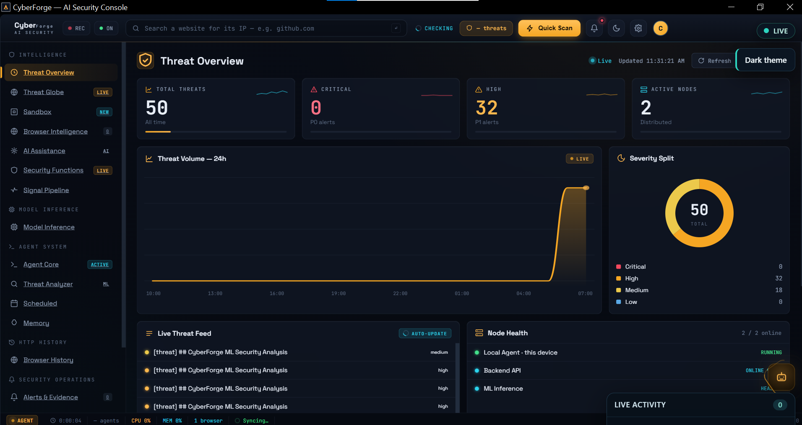
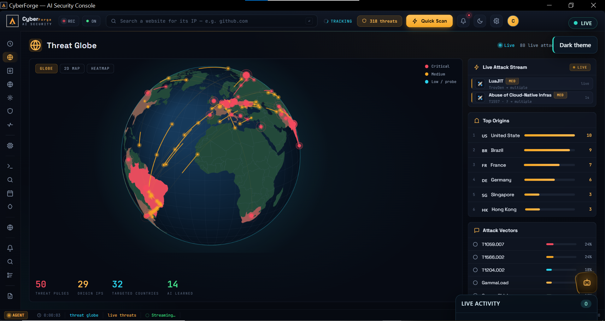
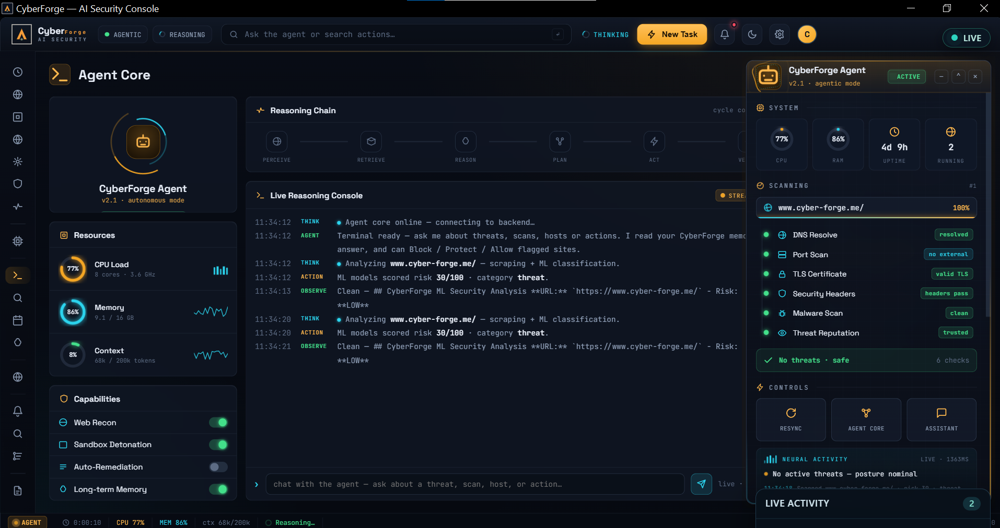
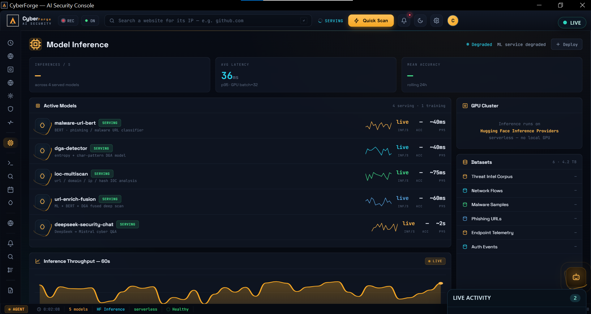
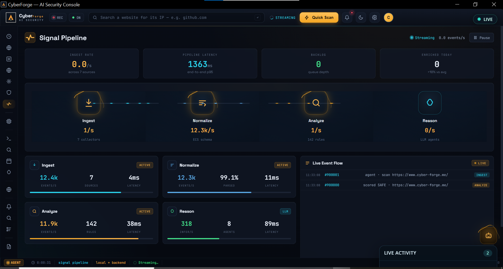
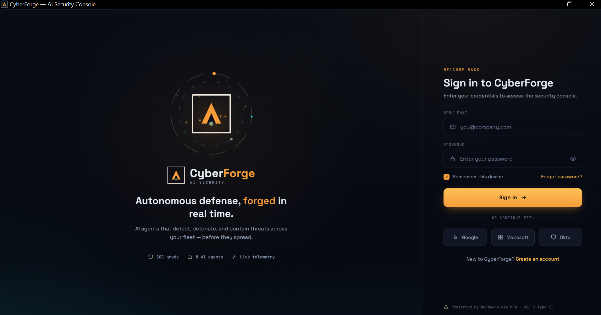

<div align="center">

# 🛡️ CyberForge — Real‑Time Agentic AI Security

**Your own AI security operations centre — running locally on your device.**

CyberForge watches the websites your browsers visit in real time, detects phishing and
malicious pages with machine learning **and** an autonomous AI agent, and lets you block,
protect or investigate them in one click — all while your data stays on your machine.



🎥 **[Watch the demo walkthrough »](https://youtu.be/d5GLapNKSKk)**

</div>

---

## ✨ What it does

| | |
|---|---|
| 🔎 **Real‑time scanning** | Continuously scans the page you're actually viewing (active‑tab aware), even across multiple browsers, reading history straight from the on‑disk databases — no extension required. |
| 🧠 **Agentic AI** | An autonomous Agent Core reasons through each threat step‑by‑step and streams its thinking live; a DeepSeek‑powered assistant answers questions grounded in your local security memory. |
| 🎯 **Deep phishing detection** | Blends backend ML, URL + page‑content heuristics, host reputation, and a DeepSeek confirmation pass — and even **solves free‑host anti‑bot (`aes.js`) challenges** to see the page a normal scanner can't. |
| 🚨 **Always‑on alerts** | When a credential‑harvesting site is confirmed, an always‑on‑top popup appears **over your browser even when CyberForge is minimized**, with one‑click Block / Protect / Allow. |
| 🌍 **Threat globe** | An interactive 3‑D globe of public threat‑intelligence pulses from AlienVault OTX, with each pulse's age and approximate geography, kept apart from what happens on your own devices. The agent learns the pulses into memory as context. |
| 📊 **AI reports** | Generate a detailed, LaTeX‑styled PDF security report for the last 8h / 24h / 7d / 30d, written by DeepSeek from your real scans, history, intel and actions. |
| 🔒 **Real enforcement** | Block, protect or allow sites for real via the OS hosts file; manage your blocked / protected / allowed lists from Security Functions. |
| 🗃️ **Local‑first memory** | A local vector memory stores every scan, intel pulse, report and action so the assistant and reports recall your whole history — nothing is uploaded unless you choose to sync. |

> CyberForge is **local‑first**: scans, browser intelligence, memory and reports live on your
> device. There is no silent cloud harvesting.

---

## 🖼️ Screenshots

### Threat Globe — public threat intelligence (OTX)


### Agent Core — autonomous reasoning + terminal


### Model Inference — live ML detection engines


### Signal Pipeline — real‑time scan signal flow


### Sign‑in — secure, local‑first authentication


---

## 🏗️ Architecture

```
┌─────────────────────────────────────────────────────────────┐
│  Desktop app  (desktop/)         Tauri 2 · Rust + HTML/JS    │
│  • real-time active-tab scanner   • Agent Core / floating     │
│  • local vector memory            agent · threat globe        │
│  • hosts-file block/protect       • AI assistant · reports    │
│  • always-on-top threat alerts    • settings · sandbox        │
└───────────────┬───────────────────────────┬─────────────────┘
                │ Rust (reqwest, keychain)   │ DeepSeek via HF
                ▼                            ▼
┌───────────────────────────┐   ┌──────────────────────────────┐
│  Backend (backend/)        │   │  ML services (ml-services/)   │
│  Node/Express on Heroku    │   │  Python · phishing URL, DGA,  │
│  auth · threats · agents   │   │  IOC scan, enrichment         │
└───────────────────────────┘   └──────────────────────────────┘
        Mobile companion (mobile-app/) · Expo React Native + VPN capture
```

- **`desktop/`** — the flagship: a Tauri 2 app (Rust backend in `src-tauri/`, static UI in `ui/`).
- **`backend/`** — Node/Express API (auth, threat intelligence, the agent orchestrator).
- **`ml-services/`** — Python ML microservices (phishing/URL classification, DGA, IOC).
- **`mobile-app/`** — Expo React‑Native client with on‑device VPN capture + backend sync.
- **`phishing-test-sites/`** — an authorized phishing‑**simulation** lab for demonstrating detection.

---

## 🧪 How detection works

1. **Active‑tab awareness** — the scanner reads the OS foreground window to know the page you're
   actually looking at, then scans it (priority queue, never interrupts a running scan).
2. **Host reputation** — a well‑known domain (Google, GitHub, Microsoft, …) needs stronger evidence
   before it raises an alert, but its reputation never erases what a check found. Hosts where anyone
   can publish (Google Docs and Drive, GitHub gists, cloud storage buckets, blogs) never count as
   well‑known.
3. **Backend + ML** — the orchestrator runs URL classification, IOC extraction and threat‑intel
   enrichment.
4. **Local reinforcement** — URL heuristics (free/abused hosting, risky TLDs, brand tokens) +
   page‑content heuristics (credential forms, brand sign‑ins, lure phrases) + a **DeepSeek**
   confirmation pass. Free‑host **anti‑bot interstitials are solved** (a from‑scratch AES‑128) so
   the scanner sees the real page.
5. **Verdict + action** — scores are blended; a confirmed phishing/malware verdict raises an
   always‑on‑top alert and offers Block / Save / Allow, and the result is written to memory.

---

## 🚀 Getting started

### Desktop app (primary)

```bash
cd desktop
npm install
npm run dev      # live dev build
# or
npm run build    # installers — see desktop/BUILD.md
```

Prerequisites for each system, what the build produces, signing, where credentials are kept, first run and uninstall are in **[`desktop/BUILD.md`](desktop/BUILD.md)**. It also says which of those steps have been run and which have not.

### Backend + ML (optional, for cloud features)

```bash
cd backend
cp .env.example .env     # then set JWT_SECRET and the keys you use
npm install
npm run dev              # http://localhost:8000/health
```

The backend needs a MongoDB database (`DATABASE_URL`) and works with or without Redis.
To get both in containers, with the backend, run `docker compose up --build` from the
repository root; see the notes at the top of [`docker-compose.yml`](docker-compose.yml),
including that it has not yet been run.

The ML service is not run locally. The backend calls the hosted one (a Hugging Face
Space); its code is in `ml-services/` and is deployed with `python deploy_space.py`. The Space
answers only callers holding its service key (`ML_SERVICE_KEY`, set on both the backend and the
Space), except for `/health`.

The desktop app works on its own (local detection, memory, hosts‑file enforcement); the backend
adds cloud threat‑intel and cross‑device sync. Connect the AI assistant by pasting a Hugging Face
token in **Settings → AI & Models** (kept in the system credential store, not in a file).

Reading browser history, watching the active tab, cloud scanning, the assistant and sync are each
**off until you choose** in **Settings → Privacy** (on the phone: capture, capture sync and the
assistant). Each control says what it sends and where. Export your data, delete it by kind, or
delete the account from the same screen.

### Known limitations

- **Android capture is not available.** Its packet engine (`libtun2socks.so`) is not in this
  repository, so no build from it offers capture; the screen says why.
- **The sandbox is static analysis.** Links and files are analysed without being opened or run;
  its MITRE ATT&CK tiles are hints from words in the findings, not confirmed techniques.
- **Incidents are grouped findings, not managed cases.** Findings on the same host are grouped
  into incidents that can be resolved and whose evidence can be exported with a signed manifest,
  but there are no response phases or assignees, and time to respond is not measured.
- **Some backend data is kept only in the web process** and is lost at each restart (recent network
  captures, orchestrator session memory, distributed-node registrations, and the records of
  `routes/features.js` and `routes/child-pages.js`). Everything else is in the database; see
  [`docs/RECOVERY.md`](docs/RECOVERY.md).
- **The detection models have measured limits**, stated in each model's training report in the
  `Che237/cyberforge-models` repository (for example, the web-attack model was not trained on path
  traversal).
- **Not yet run:** packaged desktop builds on each system, an Expo (phone) build,
  `docker compose up`, a screen-reader walkthrough, and a contrast check.

What survives a restart, how devices and agents recover, and how to roll a release back:
[`docs/RECOVERY.md`](docs/RECOVERY.md).

The next release is planned in [Update Plan V2](plan-update-v2.md): a desktop MCP server,
an AI-enabled CyberForge CLI, and the ML changes they require. These are planned features.

The first part is in place. The installers include a `cyberforge` terminal command, and on
Windows they put it on PATH. It can:

- **Check the setup:** `status` reports the backend, the stored credentials and the session.
- **Sign in and out:** `auth login | status | logout`, keeping the session in the system credential store.
- **Manage profiles:** `profile` and `config`.
- **Show or hold the owner of this computer's state:** `broker status | hold`.
- **Ask the Analysis Agents:** `models status`, and `scan url` for one address.
- **Serve AI clients over MCP:** `mcp serve` for clients you approve in Settings > Integrations or with `mcp grant create`. Each client gets read-only tools; sending addresses for analysis must be allowed separately. Revoking an approval stops the client's next call.

Only one CyberForge program at a time changes this computer's device state, hosts file,
local memory and privacy settings. See [`desktop/BUILD.md`](desktop/BUILD.md).
Read [How ML services work](docs/ML-SERVICES.md) for the active models, training phases,
learning methods, evaluation limits, and proposed improvements.

Backend startup requires a generated `JWT_SECRET`; see `backend/.env.example`. The staged
implementation and current limitations are tracked in [plan-update.md](plan-update.md#12-milestones-dependencies-and-implementation-order).
Run `npm --prefix backend ci` followed by `npm run validate:updates` from the repository root
with Node 24 to check backend syntax and run the offline security and contract suites.

---

## 🛠️ Tech stack

- **Desktop:** Tauri 2, Rust (reqwest, rusqlite, keyring, sysinfo), vanilla HTML/CSS/JS, d3‑geo.
- **AI:** DeepSeek‑V3 via Hugging Face Inference Providers; backend ML microservices.
- **Backend:** Node.js / Express (Heroku).
- **ML:** Python (URL/phishing classification, DGA detection, IOC scanning).
- **Mobile:** Expo / React Native (TypeScript).
- **Intel:** AlienVault OTX.

---

## 📂 Project structure

```
desktop/            Tauri desktop app (src-tauri = Rust, ui = frontend)
backend/            Node/Express API
ml-services/        Python ML microservices
mobile-app/         Expo React Native client
phishing-test-sites/ Authorized phishing-simulation lab (detection demos)
docs/               Documentation
```

---

## 📸 Screenshots & assets

Captures live in [`images/after/`](images/after/). The **before → after** comparison gallery —
showing how each screen went from a mock‑data shell to live, on‑device functionality during the
Finish‑Up‑A‑Thon — is in the dev.to writeup [`submission.md`](submission.md), pairing
[`images/before/`](images/before/) with [`images/after/`](images/after/).

---

## 🔐 Responsible use

The `phishing-test-sites/` directory contains **educational simulation** pages used to demonstrate
CyberForge's detection. They carry a visible "simulation" banner, capture only to the operator's
own store, and end on an educational debrief. Use them only on infrastructure you control, for
authorized demonstrations.

---

<div align="center">

**CyberForge — security that thinks, so you don't have to worry.**

</div>
