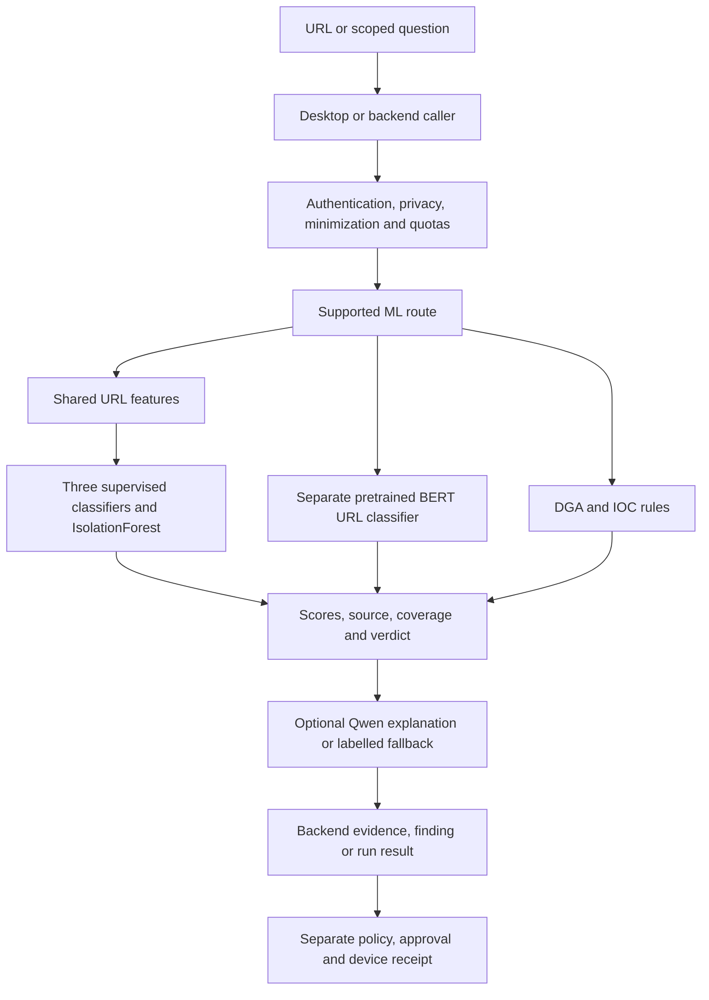

# How CyberForge ML Services Work

**Reviewed:** October 16, 2026.  
**Source baseline:** working tree at `b2a404e`, including local V1 changes.  
**Related roadmap:** [Update Plan V2](../plan-update-v2.md).  
**Historical experiments and live checks:** [V1 implementation log](../plan-update.md#16-implementation-log), especially 16.23, 16.29–16.34, 16.55–16.58.

This guide distinguishes what the source implements, what V1 previously verified live, and what V2 proposes. It does not certify today's deployment or claim that the legacy Python service is running.

## 1. Which ML service is authoritative?

The connected product uses the Hugging Face Space configured by the backend's `ML_SERVICE_URL`. Its default is `https://che237-cyberforge.hf.space`. The deploy script identifies the Space as `Che237/cyberforge` and uploads files from `ml-services/hf_space_deploy/`.

| Source | Role and status |
| --- | --- |
| [hf_space_deploy/app.py](../ml-services/hf_space_deploy/app.py) | Canonical FastAPI inference app (service-key gate, body limit), model loading, chat and owner-triggered training. No Gradio interface since V2-ML01 |
| [hf_space_deploy/url_features.py](../ml-services/hf_space_deploy/url_features.py) | Shared feature extraction used by serving and current training |
| [hf_space_deploy/trainer.py](../ml-services/hf_space_deploy/trainer.py) | Current four-detector training and acceptance pipeline, executed remotely in the Space |
| [hf_space_deploy/Dockerfile](../ml-services/hf_space_deploy/Dockerfile) | Python 3.11 image; Uvicorn `app:app` on port 7860 |
| [deploy_space.py](../ml-services/deploy_space.py) | Uploads app, features, trainer, requirements and Dockerfile; backs up deployed source |
| [train_on_space.py](../ml-services/train_on_space.py) | Operator client: starts remote training, polls status, saves a report. It does not fit models locally |
| [backend ML configuration](../backend/src/config/ml.config.js) | Single inference destination; obsolete URL aliases do not choose another service |
| [backend capability inventory](../backend/src/services/mlCapabilities.js) | 22 supported inference/metadata routes and 29 retired calls; owner-training routes are deliberately outside this client list |
| `ml-services/main.py`, `app/` | Separate legacy FastAPI/agent implementation. Its existence does not make its training/agent routes deployed |
| `hf_app.py`, `simple_app.py`, `huggingface_space/` | Alternate/historical app paths; not the source selected by `deploy_space.py` |
| `hf_space_clone/` | Source backups from deploys, not the active source tree |
| `train_and_upload_models.py` | Superseded synthetic/column-mapping training script; do not use to rebuild production detectors |
| `notebooks/00_...` through `07_...` | Historical exploratory pipeline; useful context, not the current production training recipe |

Root `dev:ml`, `start:ml` and `test:ml` still reference the legacy local service/test tree. They are not proof that the canonical Space passes its tests or that training should run on a developer machine. V2 must reconcile these entry points.

## 2. The runtime process



The diagram shows available paths; a request does not necessarily run every component. The URL-only ML service computes features from the address text. Rendered-page scanning is a separate backend/scanner path; a URL verdict does not prove that a page or downloaded file was inspected.

Route presence does not prove the named capability: `/api/analysis/network` and `/api/ai/execute-task` pass text into the reasoning service, while `/api/datasets/process` returns `processed`, a dataset name and timestamp without processing a dataset. These paths must not become advertised trained-network, execution or training tools without implementing and verifying those behaviors.

### Startup

`MLModelLoader.initialize()` loads a popularity list, four model artifacts, their metadata and any required scaler. It first tries the Hub model repository (`Che237/cyberforge-models` by default), then local fallback directories. Current retrained models declare `uses_scaler: false`. The loader also has a legacy `.pkl` sweep, which V2 should replace with an explicit trusted manifest.

The GGUF chat model loads on a background thread. Its default repository/file are `unsloth/Qwen3.5-2B-GGUF` and `Qwen3.5-2B-Q4_K_M.gguf`. The service probes loading in a child process before opening the main inference context. BERT loads lazily on first use. An answering `/health` request therefore does not mean that every model is warm or usable; inspect per-component status.

### URL request

1. The caller selects a supported endpoint. `/api/models/predict` can select a detector and supply a URL; `/analyze-url` runs the classic URL analysis; `/api/v2/url-classify` uses the separate BERT path.
2. The service validates request shape and extracts numerical URL features. Training and serving share extraction code and metadata-defined feature order.
3. Each selected detector computes its own output. A model requiring popularity data is withheld if that dependency is absent.
4. Responses identify `inference_source`, such as a fitted model, heuristic, or unavailable result. Passing only the original twelve features to a retrained model can invoke a labelled rule-based estimate with missing-feature information; sending `url` is the supported full-feature path.
5. The caller aggregates available results. The backend's `cyberforgeMLService.js` uses 60% average plus 40% maximum and additional action thresholds; the Space has its own aggregation path. These are not presently a single calibrated decision policy.
6. Evidence and explanation are kept separate from execution. A malicious verdict can create a proposal; it is not evidence that a device was blocked.

Backend model failures now produce unavailable/unknown or partial coverage rather than fabricated local model predictions. This does not eliminate the service's explicitly labelled heuristic fallback; consumers must preserve that distinction.

### Chat and explanation

The Space's `LocalLLM` performs inference with a pretrained GGUF model through llama.cpp. It does not train or fine-tune that model. Defaults in current source:

| Setting | Default | Practical meaning |
| --- | --- | --- |
| Context | 4,096 tokens | Bounded model context, not unlimited incident history |
| CPU threads | 2 | Serving configuration; not a current hardware benchmark |
| Input characters | 2,400 | Longer input keeps the beginning/end and omits the middle |
| Output | 320 tokens | Requested token counts are capped |
| Generation budget | 17 seconds | Checked while consuming generated chunks; not a hard preemption guarantee for native computation |
| Queue lock wait | 5 seconds | Only one generation uses the context at a time; callers can receive busy |
| Temperature | 0.3 | Generation parameter, not a confidence score |

`TransformerModelLoader.security_chat()` asks for a short advisory answer. Failure may produce a labelled rule-based/template response elsewhere in the stack. The backend can also use configured hosted engines, and the desktop has a separate user-key DeepSeek route. [answerEngine.js](../backend/src/services/answerEngine.js) describes the actual answer source; provider identity must survive into CLI/MCP results.

The current text interface does not establish reliable structured tool calling, token streaming to clients, grounded citations, or autonomous planning. V2 adds and evaluates those contracts explicitly.

## 3. Models, rules, and types of learning

| Component | Technique actually used | What it learns / does | Limits |
| --- | --- | --- | --- |
| `phishing_detection` | Supervised binary classification; `HistGradientBoostingClassifier` | Fits labelled benign versus phishing URLs using host/path/reputation features | URL text and reputation cannot reliably settle all login or hosted-page cases |
| `malware_detection` | Supervised binary classification; same estimator family, different positive data | Fits benign URLs versus URLs reported as serving malware | Does not inspect executable bytes or prove a file is malware |
| `web_attack_detection` | Supervised binary classification; same estimator family, payload features | Fits ordinary URLs versus SQL-injection/XSS payloads placed into URLs | Current training does not establish path-traversal detection or universal web-attack coverage |
| `anomaly_detection` | Unsupervised anomaly scoring with `IsolationForest`, trained on benign examples only | Learns unusual feature combinations relative to its benign training population | Unusual does not mean malicious; this is not a network-behavior model |
| `url_phishing_bert` | Inference using an externally pretrained text classifier, `elftsdmr/malware-url-detect` | Classifies URL text after protocol removal/truncation | CyberForge's active trainer does not fine-tune it; significant historical false positives |
| `dga_detector` | Handwritten entropy/character-pattern heuristic | Scores DNS labels for generated-looking structure | No fitted DGA model in this deployed path; heuristic “confidence” is not calibrated probability |
| IOC processing | Parsing, validation and rules | Extracts/describes domains, IP addresses and hashes | An IP/hash description is not a threat-intelligence reputation lookup |
| Qwen chat | Inference with an externally pretrained language model | Generates explanations from supplied context | No local weight updates; prompt text cannot enforce permissions |
| Popularity feature | Deterministic lookup in a saved Tranco list | Supplies a model input based on domain rank | A feature, not an unconditional trusted-domain allow-list |

### Learning terms that must not be confused

- **Supervised learning:** the three labelled detector fits above. The labels are data sources' judgments, not guaranteed ground truth.
- **Unsupervised/anomaly learning:** the benign-only IsolationForest fit. Labels are used afterward to measure usefulness, not to train malicious classes.
- **Pretraining/transfer learning:** BERT and Qwen arrive with externally trained weights. Running them is inference; CyberForge does not currently execute their pretraining or a production fine-tuning pipeline.
- **In-context learning:** instructions/examples in a prompt can change the answer for that request. They do not save changes to model weights.
- **Retrieval-augmented generation (planned):** retrieve authorized evidence, supply it to the model, verify citations. Adding a memory entry or embedding is not detector training.
- **Active learning (planned):** select uncertain/disputed cases for human review before a later offline training dataset is built. A false-positive click is not automatically a trustworthy global label.
- **Online/continual learning:** no verified automatic update of serving model weights from current product activity. V2 starts with reviewed batch retraining and controlled promotion.
- **Reinforcement learning:** no active production reward/policy-training loop was found in the canonical serving/training path. Agent scheduling, heuristic decisions and tool execution do not constitute RL. Live security actions must not become exploration experiments.
- **Semi-supervised/self-supervised custom training:** not part of the canonical four-detector trainer. Consider only after data/evaluation needs justify a separately specified experiment.

## 4. Training data and feature preparation

### Sources used by the current trainer

These names and license/provenance notes reflect source comments and V1's record. Re-verify cards, rights and attribution at the immutable dataset revisions before any new training/release; this document is not a fresh license audit.

| Source identifier | Current use | Known concern |
| --- | --- | --- |
| `Mitake/PhishingURLsANDBenignURLs` | Main phishing/benign data | V1 records missing provenance in the card; source comments record CC-BY-SA-4.0 |
| `bgspaditya/byt-malicious-url-treatment` | Malware positives and some benign URLs | Older collection; source/shape bias and mislabelled rows noted in V1 |
| `pirocheto/phishing-url` | Training supplement plus independent supplied test split | Comments record CC-BY-4.0; reference-test URLs are excluded from relevant training pools |
| `phl-ldm/tranco_top_million` | Popular-site landing URLs as benign examples | Comments record CC-BY-4.0; popular does not guarantee benign |
| `shengqin/web-attacks` | SQLi/XSS payloads and normal strings | Payloads are composed into benign URL bases; that construction must be reflected in evaluation |
| Tranco list `PYGVJ` | Top 300,000 domains for popularity input | Snapshot must travel with the models and retain its own source/version |

The trainer fetches selected Hub files and records repository revision metadata. It does **not** pin each download to a previously resolved immutable revision, so “revision recorded” is weaker than a reproducible data snapshot. V2 fixes this race and records file hashes.

### Cleaning and sampling

`clean_urls`, `labelled`, and conflict handling normalize/deduplicate URLs and remove URLs present in both positive and negative pools. Scheme and leading `www.` are removed for fitted features to reduce collection-format shortcuts. Reference test URLs are filtered by normalized URL; domain/time/source overlap still needs a stronger audit.

Sampling defaults are caps, not guaranteed final row counts: 120,000 benign main-collection URLs, 40,000 older benign URLs, 60,000 popular-site URLs, 120,000 phishing URLs, 30,000 malware URLs, and 40,000 attack-base URLs. The seed is 42. Actual training reports must state counts after filtering/splitting.

Web-attack positives use real attack strings placed twice on sampled benign bases, as query/path values with placement/encoding variation. Normal strings are placed similarly among negatives. This is data augmentation/composition, not observed end-to-end attack traffic. Splitting only by base site can still repeat the same attack payload in train and test; add payload-family separation before treating the very high AUC as broad generalization.

### Features

- **12 legacy fields** remain in responses for compatibility, such as URL length and HTTPS presence.
- **39 current lexical fields** describe host/path/query shape, entropy, digits, executable/script/archive extensions, credential words, shorteners, embedded URLs, popularity and user-content hosting. Feature-drop options can reduce the list for a particular run; artifact metadata is authoritative.
- **22 attack fields** combine 16 decoded-payload fields with six path/query fields. Presence of a traversal feature does not mean training contains representative traversal labels.
- Serving and training use the ordered feature list and float32 precision specified by the artifact. A prior float64/float32 discrepancy was fixed and checked in V1 16.34.
- Popular hosting/user-content domains do not automatically inherit a parent domain's popularity signal. This reduces one known blind spot but does not prove all hosted phishing is caught.

`registered_domain()` currently uses a small suffix heuristic, not a complete Public Suffix List. Its grouping behavior must be upgraded/versioned with an explicit snapshot for V2, then reassessed for private hosting and IP literals.

## 5. Current training phases, end to end

### Phase 0 — Request and authorization

The operator client posts options to `/api/admin/train`. The endpoint checks the supplied Hub token using `whoami()` against the configured Space/model-repository owner. Missing/wrong owner receives 403. One process-local lock prevents concurrent runs in that process; another request during a run receives 409.

The API returns 202 and a daemon thread performs the work. `/api/admin/train/status` returns the in-memory `TRAINING` record. It is not a durable job queue, and restarting the Space loses the current job/status. These two routes are the only way to start or read training; the Gradio callbacks that once trained on uploaded data were removed in V2-ML01.

### Phase 1 — Acquire, clean, and describe data

Download the selected sources; prepare clean lists, labels, source tags and reputation data. Record source revisions, row counts, seed, settings and the resulting report. Fail rather than fill absent data with invented numbers. No user browsing history is automatically added by this trainer.

### Phase 2 — Split before fitting

For each supervised model, build grouped site IDs and use `GroupShuffleSplit` with a default 20% holdout. Set aside another 10% of the remaining training-site partition to choose the decision threshold. Held-out test sites do not choose that threshold.

The estimator additionally uses `early_stopping=True` with `validation_fraction=0.1` inside its fit partition. The code does not pass site groups to that internal split. Keep the outer test independent, and improve the inner selection procedure in V2. Percentages of groups do not guarantee the same percentages of rows.

### Phase 3 — Fit candidates

The three classifiers fit `HistGradientBoostingClassifier` with balanced class weights. Defaults include up to 300 iterations, learning rate 0.1, 31 leaf nodes and 20 minimum samples per leaf. They share an algorithm family, not labels or identical learned models.

The anomaly model fits `IsolationForest` on benign training URLs only: 200 trees, contamination 0.02, two jobs, seed 42. Malicious examples are later used for evaluation, not training. No gradient updates happen during inference requests.

### Phase 4 — Choose thresholds and measure

The classifiers choose a raw-score threshold using benign scores from the threshold-selection partition at a target false-positive rate of 2%, constrained to 0.5–0.99 when sufficient benign samples exist. The served score is rescaled so that this selected threshold corresponds to 0.5:

```text
if raw_score < threshold:
    displayed_score = 0.5 * raw_score / threshold
else:
    displayed_score = 0.5 + 0.5 * (raw_score - threshold) / (1 - threshold)
```

This is monotonic threshold normalization, **not probability calibration**. A displayed 0.8 does not establish an 80% probability of compromise. V2 should measure calibration on separate data and only label probabilities when supported. See [scikit-learn probability calibration](https://scikit-learn.org/stable/modules/calibration.html).

Reports include held-out AUC, average precision, precision/recall/FPR, source breakdown, known-legitimate/hostile examples and optional independent phishing results. Permutation importances estimate feature sensitivity, not a causal explanation of a specific decision. Anomaly evaluation records benign/malicious flag rates and margin percentiles.

### Phase 5 — Apply gates and record exceptions

| Candidate | Current gate |
| --- | --- |
| Supervised classifier | Held-out ROC-AUC ≥ 0.90; held-out FPR ≤ 0.05; zero of 24 fixed legitimate regression URLs scoring ≥ 0.5 |
| IsolationForest | Held-out benign flagged ≤ 0.05; malicious flagged ≥ 0.10 and at least three times benign flagged |

The fixed 24-URL list is a regression suite, not a representative release test set. Repeated tuning against it can overfit. Independent phishing results are reported but do not decide the current gate.

There is a narrow explicit owner override: only a classifier whose sole failed rule is `max_known_legitimate_flagged` can be accepted, with a reason of at least 20 characters. The report retains the failed gate plus owner decision, timestamp and exact exceptions. A measured AUC/FPR failure cannot use this override. Do not silently convert an exception into a passed gate.

### Phase 6 — Dry run or publication

`dry_run: true` still downloads data, fits and evaluates on the Space, but uploads no model and changes no serving model. It consumes remote compute.

A non-dry run uploads accepted models individually as `best_model.pkl` plus `metadata.json`, deletes obsolete scaler/model files for those models, then uploads the popularity list if needed. Each model upload is a separate Hub commit. `previous_revision` records the model repository's starting revision.

This is not an atomic release: a failure midway can leave a partial set in the repository, even if the current process has not installed it. V2 must stage complete bundles and publish one manifest pointer only after verifying all artifacts. Downloading trusted manifests and checking hashes must happen before deserializing any artifact.

### Phase 7 — Install and verify

After a successful run, `_train_job` installs returned models/metadata and the popularity data in memory. At restart the loader obtains models from the Hub again, currently without an immutable bundle pin. V1 verified persistence and training/serving score parity after restart, but that is not a guarantee against a future mixed-revision download.

Verify accepted model identity, features, dtype, threshold, reputation snapshot and known fixture scores. Verify rejected models remain unchanged. Expose actual revision and loading/failed states in client-visible results.

### Phase 8 — Monitor and retrain

Current code does not provide a governed production drift/retraining loop. V2 adds reviewed feedback, source/score drift, coverage and error metrics, candidate experiments, shadow comparison and explicit promotion. A model is not automatically retrained because someone uses the assistant or resolves a finding.

## 6. Historical results and what they mean

These are **October 13 results recorded in V1 16.33**, not freshly reproduced benchmarks or guarantees about today's deployed model revision.

| Model | Recorded result | Release decision / limitation |
| --- | --- | --- |
| Phishing | ROC-AUC 0.956; FPR 2.1%; recall 0.677. Independent test AUC 0.958, FPR 1.4% | Accepted by owner despite one known legitimate false positive; recall cost at the chosen threshold |
| Malware URL | ROC-AUC 0.988; FPR 0.96%; recall 0.905 | Accepted by owner despite three known legitimate false positives |
| Web attack | ROC-AUC 0.9998; FPR 0.14%; recall 0.995 | Passed recorded gate; SQLi/XSS composed-payload setting, not broad web-attack accuracy |
| Anomaly | 1.8% benign flagged; 13.4% malicious flagged | Passed gate; detects only a minority of malicious examples as unusual |
| Separate BERT | Flagged 8 of 24 known legitimate samples in V1 16.31 | Not replaced by four-detector retraining; requires its own evaluation/removal decision |

Known difficult cases include Google/Microsoft sign-in, Google Drive file sharing, phishing hosted on `sites.google.com`, and path traversal. The 2026-10-13 model-repository rollback baseline recorded in V1 is `c46314b`; it is historical evidence, not a recommendation to restore it now.

V1 16.34 reports 95 non-mutating REST requests sent with zero problems, with two mutating requests skipped. API response checks demonstrate contract behavior, not held-out model quality or AI safety.

## 7. Training notebooks and older services

The notebook sequence expresses an earlier design:

| Notebook phase | Intended purpose | Relationship to current service |
| --- | --- | --- |
| 00 Environment | Dependencies, hardware, credentials/provider checks | Contains historical Gemini assumptions; current runtime has its own requirements |
| 01 Acquisition | Scraper/Hub/local data, validation, normalization | Current trainer loads specific reviewed URL/payload collections directly |
| 02 Features | URL/network/header/JavaScript features | Deployed detector recipe uses `url_features.py`; these notebook features do not prove live network/JS models |
| 03 Training | Model fitting, serialization, upload | Current reproducible starting point is `hf_space_deploy/trainer.py` |
| 04 Agent intelligence | Decisions, Gemini reasoning, queues, browser integration | Not the authoritative backend `AgentRun` worker; no permission to execute live changes |
| 05 Validation | Model thresholds and API contract checks | Supplementary history; new frozen evaluation must use current contracts |
| 06 Integration | Packages and backend adapter generation | Existing deployed contracts must be preserved rather than overwritten by generated legacy code |
| 07 Deployment | Artifacts, Docker and upload scripts | `deploy_space.py` selects the five actual deployment source files |

The separate `app/services/ml_trainer.py` contains additional algorithm families, including random forests, gradient boosting, MLP, TensorFlow/PyTorch networks and SVM. These implementations are not evidence that the production service uses all those models. Likewise, the Python planner/scheduler/memory tree is not the authority for current desktop agent runs.

V2 should archive or label historical paths, retain useful research with provenance, and prevent scripts/notebooks from publishing directly into the serving model namespace.

## 8. Changes needed for MCP and AI CLI demand

| Need | Keep | Update/add | Release evidence |
| --- | --- | --- | --- |
| More callers | One backend inference destination | Service auth, per-principal budgets, bounded queues, separate training hardware/process | Mixed desktop/CLI/MCP load, denial and overload tests |
| Reliable tools | Existing scoped run/action services | Capability schema, typed plans, external permission validation, timeout/cancel/idempotency | Malformed/hostile model output executes no unauthorized tools |
| Evidence-based AI | Findings, signed snapshots and audit | Scoped retrieval, citation validation, context accounting and truncation visibility | Grounding corpus plus cross-account/deleted-evidence tests |
| Better detection | Shared features and supervised/anomaly baselines | New benign hard negatives, BERT reassessment, independent time/source/payload holdouts, calibrated aggregation | Category metrics and uncertainty; no automatic response from unsupported confidence claims |
| Reproducible training | Source tags, reports, explicit gates | Immutable downloads and split manifests; durable remote jobs; candidate registry | Same frozen inputs reproduce results within declared tolerance |
| Safe publication | Model metadata and historical rollback revision | Signed/hash-checked complete bundles, atomic promotion, pinned reads, staged rollback | Partial upload/restart cannot mix model/features/reputation |
| Feedback | Existing false-positive workflow | Opt-in reviewed labels, retention/deletion, poisoned-feedback controls | Feedback cannot silently alter another workspace's detection |

### Inference and administration must be separated first

Before V2-ML01 the source mounted Gradio at `/` with notebook and cell execution, CSV training and uploaded `.pkl` loading, with no authentication on that mount. An uploaded `.pkl` passed to `joblib.load()` can execute code; that is a property of the serialization format, not something input validation can fix. See [scikit-learn model persistence](https://scikit-learn.org/stable/model_persistence.html).

V2-ML01 changed the source as follows. The deployed Space follows it only once it has been redeployed; see the V2 log for whether it has been.

- **No interactive UI.** Gradio, the notebook runner, uploaded-data training and uploaded-model inference are gone, and so are their packages and the Jupyter kernel in the image. `/` is a static page. Models are loaded only by the model loader, from the model repository and the image.
- **Service key.** Every route except `/` and `/health` needs the `X-CyberForge-Service-Key` header to match the Space secret `ML_SERVICE_KEY`; the backend sends its `ML_SERVICE_KEY` to the configured ML service only. With no secret set, those routes answer 503 rather than run open. `/docs` and `/openapi.json` are behind the key too. The two training routes keep their owner check instead.
- **Body limit.** Bodies over `ML_MAX_BODY_BYTES` (256 KiB by default) get 413, whether or not they state their length.

Still open: the key is one shared secret, not a per-caller identity or budget, and training still runs in the inference process (separating them is V2-ML03 and V2-04).

Also bound training options, downloaded bytes, runtime, memory and upload permissions; remove wildcard browser access where unnecessary. A private training worker may hold publication credentials. The inference worker should have only the artifact access it needs. Neither desktop MCP clients nor an AI tool plan gets those credentials.

## 9. Operator procedure and artifact checklist

The existing commands below document current behavior. They were **not executed for this review**. Run from `ml-services/` in an authorized environment; `hf_env.py` loads the Hub token from environment/local configuration. Never paste it into a command, log, MCP client configuration or report.

```text
python deploy_space.py --dry-run
python train_on_space.py --status
python train_on_space.py --dry-run --models phishing_detection,malware_detection
```

The first command lists deployment files only. The second reads remote owner-only status. The third actually trains on remote compute without publishing. Review the full report before selecting a publication operation.

```text
python train_on_space.py
python deploy_space.py
```

The first can train, publish and immediately install accepted models; the second changes deployed source. They are separate operations with different rollback needs. `deploy_space.py --rollback` restores backed-up source files; it does not restore the model repository. Current source rollback also skips files missing in older backups instead of deleting them, so verify the full resulting source manifest. V2 introduces explicit candidate promotion and bundle rollback before operator CLI exposure.

For every future training job, retain:

1. Job ID, requester/role, scope, time, options, random seeds and consent basis.
2. Dataset identifiers, immutable revisions/file hashes, license/provenance review and label definitions.
3. Cleaning/conflict/deduplication counts, site/time/source/payload split manifests and leakage checks.
4. Feature code hash/order/dtype, suffix/popularity snapshot, runtime image and dependency lock.
5. Fit configuration, raw evaluation, threshold/calibration procedure, slice metrics and confidence intervals.
6. Gate outcome, reviewed exceptions and reasons, rejected candidates and comparison with the serving baseline.
7. Artifact hashes, complete bundle ID, signature/key identity, promotion audit, previous bundle and restore result.

A report signed by a key embedded in that same report only proves internal consistency unless the verifier trusts the key through an independent trusted source. Pin/discover trusted release and evidence keys through the authenticated control plane or installation policy.

## 10. Validation and maintenance

Use separate gates for separate claims:

- Deterministic feature, malformed-input, auth, schema, score and train/serve parity tests.
- Frozen detector evaluations with site/time/source/payload separation, sample counts, class balance, abstention and missing-provider coverage.
- AI evaluations for task success, valid plans, citation support, refusal of unavailable tools, prompt injection and cross-workspace isolation.
- Artifact promotion/rollback and training restart/cancel tests in an isolated environment.
- Opt-in integration and load tests with named service/model revisions, hardware, concurrency, queue wait, p50/p95 latency, memory and error rates.

`eval/eval_harness.py` still classifies engines as DeepSeek/Mistral/fallback and includes loose keyword assertions. Update it for Qwen/current engine metadata; keyword presence alone does not establish grounded reasoning. `cyberforge-ml.rest` is useful manual coverage but does not replace an automated, credential-independent canonical Python suite.

**Checks run while preparing these documents:** four existing backend contract suites, 30 passing tests, covering route inventory/client calls, engine attribution and workspace/document references. No Python training, full model evaluation, live inference, packaged desktop execution or full-system release validation was run here.

Update this guide whenever the serving entry point, model family, data source, feature schema, threshold policy, training phases or promotion process changes. Update [V2 task status](../plan-update-v2.md#8-work-packages-and-implementation-order) with implementation and validation evidence separately.
