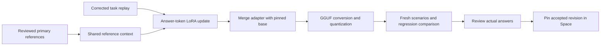

# Qwen V2 quality update

## Implemented

- Corrected "all detectors" targets to name supervised classifiers separately
  from the anomaly model. The fixed decision policy is provided in model context.
- Added 13 reviewed, cited references from OWASP, MITRE ATT&CK, NIST, OpenSSL
  and the US Postal Inspection Service. The bounded local retriever requires no
  external request and matches the current question rather than remembered scans.
- Training, evaluation and serving use the same reference context. The library
  supplements the model; it is not a live CVE feed or threat reputation service.
- Missing core facts or known dangerous claims trigger an explicitly labelled
  reviewed reference answer. This narrow guard does not prove every generated
  assertion true. Reference responses and raw model responses are measured
  separately; references are not passed off as model output.
- Backend response metadata and desktop source links identify reviewed references.
  Saved assistant conversations retain the source labels and reference links.
  The contextual chat route reports uncalibrated confidence as null, and general
  questions without an indicator verdict have unknown risk rather than a fixed score.
  Desktop chat defaults to the backend Qwen route. Direct DeepSeek requires the
  explicit `CYBERFORGE_CHAT_PROVIDER=deepseek` environment setting.

## Training

[Refinement job](https://huggingface.co/jobs/Che237/6adaa7a3c191903149a77fb1)
updates the first adapter at immutable revision
`9fcfd481271b09218de9e1bd0c7e7b224c58dd41`.
The base model remains `Qwen/Qwen3.5-2B` at
`15852e8c16360a2fea060d615a32b45270f8a8fc`.

The V2 dataset has 2,462 train, 273 validation and 487 regression test examples.
It combines corrected, task-balanced replay with reviewed-reference instructions.
SSRF and session-reference instructions are held out of the new reference SFT
examples to exercise retrieval transfer. Original training data may already
mention those concepts; this is not a claim of wholly unseen model knowledge.

The update uses supervised answer-token LoRA training: rank 16, learning rate
0.00002, batch 2, accumulation 8, 100 steps. It starts from the prior adapter,
creates a new private V2 model repository and preserves the original candidate.
The L4 job has a two-hour limit. Source bundle:
`Che237/cyberforge-llm-sft-v2@fa706ac4553b40c347dfe88cc844092f558cb06b`.

The refinement and GGUF export completed. Training took 412.67 seconds for 100
steps. Validation loss moved from 0.136654 to 0.066537; this measures adaptation
to the supplied targets, not factual accuracy. Candidate artifact revision:
`494483e9a85362b5d0bd596f9040bbc0848c860a`.



At inference, the desktop calls the authenticated backend, which calls the Space.
The current question selects bounded reference context before generation. The
response carries the model ID, reference provenance and whether a reviewed
reference replaced an answer that failed the narrow factual guard. Retrieval
does not update weights. Training occurs only in the separate Jobs workflow.

## Evaluation and promotion

[Release evaluation](https://huggingface.co/jobs/Che237/6adaa9be925af0e27d4f8fad)
waits for export, then compares the previous model and V2 using the same grounded
prompt. It runs on CPU with the serving llama-cpp-python 0.3.36 runtime.
The first evaluation worker had a stage-dispatch error and was replaced; it did
not generate model-quality results.

The fixed suite contains 39 new scenarios in both modes (78 cases), eight negative
retrieval controls and 240 regression examples per model. Fresh scenario prompts
were frozen before this training run and excluded from SFT targets. These are
author-reviewed, open-book tests, not an independent expert security audit.
Thresholds were fixed in `release_cases.py` before results:

- At least 95% final factual checks and 80% raw factual checks.
- No more than 25% reference substitution; no matched dangerous-answer patterns.
- Correct retrieval for every scenario and negative control.
- At least 90% reference risk agreement, 98% analyst concision and at most 2%
  invented memory hosts on the legacy regression set.

After the gate, actual answers must also be reviewed. Candidate promotion pins
the model revision in the Space; it is followed by health, both chat modes and
backend integration checks. Automatic pattern checks are not a complete factual
or security audit.

## Integration verification so far

- 14 local Python contract/grounding checks pass, including every one/two-reference
  decoding combination and the analyst word budget.
- All 950 backend security/contract tests pass. A later targeted desktop-rendering
  run also passes after reviewing the two changed static settings labels.
- Desktop Rust library check passes with two existing unrelated warnings.
- Focused real-browser assistant source/link/layout check passes.
- The focused browser check also verifies persisted references round-trip through
  the conversation store and are restored when messages are rendered again.
- Real backend ML-client calls for CSRF, MFA fatigue and Heartbleed pass against
  the live reference-enabled service; final candidate calls follow promotion.
- The broad navigation harness has an older ten-destination assertion against
  today's fourteen-link sidebar; that unrelated assertion was not changed.
- Backend engine-label integration deployed as Heroku release v51.
- Space reference code initially deployed at
  `997b6a6f69e698b42fbb9dc61308ae4ab0f8014d`, with the previous Space source backed
  up under `ml-services/hf_space_clone/f73c2564d614/`.

Final model revision, results and live verification are recorded below.

## Manual review and source-constrained follow-up

The initial automated gate passed: 78/78 final pattern checks, 84.62% raw core-fact
matching, 19.23% reference substitution and 96.55% reference risk agreement.
Manual review nevertheless found unsupported clauses about CSRF, prepared
statements, password managers, cryptojacking and session rotation. Those
measurements are retained unchanged under `release/494483e9a85362b5d0bd596f9040bbc0848c860a/`;
passing keyword checks was insufficient for promotion.

Knowledge policy `2026-10-23.2` instructs reference-covered generation to select
complete reviewed sentences. The guard verifies whole-sentence membership,
preserving negation, and returns an explicitly labelled reference response for
unverified wording. This is a conservative source-support check; it can also
substitute a reference for a reasonable paraphrase. Covered factual generation
is bounded by the reviewed library. Other chat tasks continue normal generation.

[Follow-up job](https://huggingface.co/jobs/Che237/6adabaffc191903149a78bb9)
compares both models again with the unchanged gate thresholds. It includes the
original 78 factual cases and 26 additional scenarios in both modes (52 cases).
The additional scenarios were authored after manual review and excluded from
training; this is a reviewed extension, not an independent expert benchmark.

For the 240 legacy cases, outputs are reused only when the immutable model
revision, sampling seed and entire serialized prompt match the first run and no
reference substitution was involved. Changed prompts are generated again.
Reused items record their input SHA-256. Mixed cached/regenerated latency values
are not suitable for a new timing comparison. Results go under
`release-grounded/494483e9a85362b5d0bd596f9040bbc0848c860a/`.

The guard and backend label update are deployed as Space source
`7522973a73403f126259c7fc12e66533d4f111b7` and Heroku release v52 respectively.
Fine-tuned weights remain the completed 100-step V2 artifact; this follow-up
changes serving constraints rather than claiming another weight-training run.

The rebuilt desktop executable is `desktop/src-tauri/target/debug/cyberforge-console.exe`.
The existing root ML test shortcut still targets the legacy pytest tree and
requires a pytest installation; canonical checks for this workflow are the
Python unittest command documented above.

## Constrained reference generation

The source-sentence follow-up completed but **failed acceptance**. The candidate
passed core-fact checks on 115/130 raw outputs, but 56/130 (43.08%) needed an
explicit reference replacement. The additional set needed 17/52 (32.69%). The
fixed 25% substitution ceiling was retained. Its reports remain unchanged under
`release-grounded/494483e9a85362b5d0bd596f9040bbc0848c860a/`.

Policy `2026-10-23.3` adds GBNF-constrained decoding for the 13 covered topics.
The model chooses full or concise reviewed passages; it cannot add new wording
to those outputs. Every choice retains the definition and required core facts.
Analyst choices fit 80 words, including when two references match. The same
whole-sentence checker still catches partial generations after interruptions.
Uncovered questions continue ordinary generation. This constraint does not
prove retrieval relevance, source completeness, or general model accuracy.

Responses expose `grounding.generation_constraint: reviewed_passages`; the
backend label says that the model selects reviewed security passages. Explicit
reference substitution remains separately labelled when generation fails the
guard. This is extractive generation, not improved unaided factual recall.
The constraint follows the [llama.cpp GBNF format](https://github.com/ggml-org/llama.cpp/blob/master/grammars/README.md).

[Constrained comparison job](https://huggingface.co/jobs/Che237/6adac192925af0e27d4f9a58)
uses bundle `ca4729eabf8b1bd02e17e413b7db00b751bcbb85`, unchanged weights and
unchanged thresholds. It regenerates all 130 factual answers per model under
the exact serving grammar. Legacy outputs are reused only for identical inputs
with no reference decoding, as described above. Results are saved separately
under `release-constrained/494483e9a85362b5d0bd596f9040bbc0848c860a/`.

The constrained comparison completed and passed all eight fixed checks. Actual
candidate outputs were reviewed, and all 130 raw/served factual responses matched
the permitted reviewed passages, with no substituted answers.

| Measurement | Previous adapter with current serving policy | V2 with current serving policy |
| --- | --- | --- |
| Covered scenario core-fact/support checks | 130/130 | 130/130 |
| Additional scenario checks | 52/52 | 52/52 |
| Reference substitution | 0/130 | 0/130 |
| Correct retrieval | 130/130 | 130/130 |
| Matched harmful-answer patterns | 0 | 0 |
| Regression reference risk agreement | 83/87 (95.40%) | 84/87 (96.55%) |
| Analyst answers within 80 words | 100% | 100% |
| Invented remembered hosts | 0 | 0 |

There are 240 regression items per model; risk agreement uses only the 87 items
with an expected risk label. Other metrics also use their applicable subsets.
The V2 risk labels still disagree on three items. Neither model's constrained
factual score measures unaided recall: the library and grammar establish the
output boundaries. Mixed reused/regenerated timings are not a latency benchmark.
The saved provenance's `previous_model_revision` identifies the actual comparison
model; its separate `baseline_revision` field records the resolved public base
and was not the model loaded for this release comparison.

## Deployment and rollback

Accepted weights are pinned in `Che237/cyberforge`:

```text
LOCAL_LLM_REPO=Che237/cyberforge-qwen3.5-2b-v2-GGUF
LOCAL_LLM_FILE=cyberforge-qwen3.5-2b-Q4_K_M.gguf
LOCAL_LLM_REVISION=494483e9a85362b5d0bd596f9040bbc0848c860a
```

The existing operator token was supplied as the Space's `HF_TOKEN` secret to
read the private model. No token is written to source or receipts. Space source
is `f79b9e8cd3c2f0fb98851789ca1124c3ce4ee930`. Heroku release v53, deploy commit
`a89fc37f2d327c68346ad1603ebfe39e4e317b09`, supplies the explicit passage-selection
engine label. `/health` confirms V2's repository, file and exact revision are
loaded, with `loading: false` and `error: null`. Backend `/health` returns 200.

Rollback state is saved in ignored `runs/v2-promotion.json`, including the prior
variable values and SHA-256 of the accepted report. All three model variables
were previously unset; removing those overrides restores the public Unsloth
Qwen default. The previous source is backed up under
`ml-services/hf_space_clone/7522973a7340/`. Use `deploy_space.push` with that folder
to restore it without replacing the local working tree. Set/delete only the
three recorded model variables through the authenticated HF API, then check
runtime, loaded revision and actual answers again. Heroku v52 is the prior
backend release if its engine-label change also needs rollback.

The rebuilt desktop binary is a debug build. Open
`desktop/src-tauri/target/debug/cyberforge-console.exe` to use the native Qwen
default and persisted reference UI; the installed desktop application has not
been replaced. SHA-256:
`F85493D9D8C7F29E225337F592AD498688F7264A4362FBD27E5398B8BDC4340C`.

Final live checks passed:

- The desktop route's real backend ML client answered CSRF, MFA fatigue and
  Heartbleed against the pinned V2 repository, carrying the correct primary
  references. Measured generation times on this run were 14.906, 14.107 and
  20.298 seconds; these are three observations, not a service-level guarantee.
- `/api/v2/security-chat` in analyst mode returned supported MFA-fatigue text,
  references and `generation_constraint: reviewed_passages`, within 80 words.
- `/api/v2/chat` returned supported CSRF text and preserved provenance;
  `confidence: null`, `risk_score: null`, `risk_level: unknown` correctly avoid
  presenting a factual question as a scored incident.
- 14 Python contract/grounding tests and 29 targeted backend answer-source and
  desktop rendering tests pass. Earlier full backend verification passed all
  950 tests. The Rust check/build and focused Chromium assistant test passed;
  neither the legacy root pytest shortcut nor the stale full navigation
  assertion is represented as passing.

The remote backend deploy and actual HF calls were checked. The desktop source
and rebuilt binary were checked through compilation and the browser fixture;
a signed-in native desktop session was not driven as part of this release.
