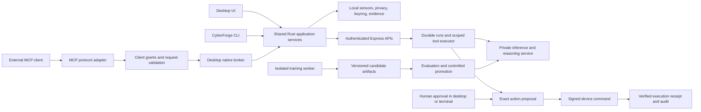

# CyberForge Update Plan V2: Desktop MCP, AI CLI, and ML Services

**Review date:** October 16, 2026 (America/Los_Angeles).  
**Baseline:** working tree at `b2a404e`, including the substantial uncommitted V1 implementation.  
**Status:** planning complete; implementation tasks below are not started by this document.  
**Predecessor:** [plan-update.md](plan-update.md), especially its implementation log through Section 16.97.  
**ML reference:** [How CyberForge ML services work](docs/ML-SERVICES.md).  
**Recovery reference:** [Recovery and rollback](docs/RECOVERY.md).

## 1. Outcome and scope

V2 makes CyberForge usable from three consistent interfaces: the desktop, external AI clients through a desktop MCP server, and a standalone `cyberforge` CLI with AI assistance. All three must use the same permissions, privacy choices, evidence, agent runs, and verified action outcomes. ML work supports those interfaces with dependable inference, evidence-based explanations, bounded tool proposals, and reproducible model releases.

“Fully functional” means installation, authentication, discovery, useful operations, cancellation, recovery, diagnostics, and upgrade/uninstall all work in a packaged release. A server that only lists tools, a CLI that only opens the GUI, or a chat interface without grounded tool use does not meet the target.

Windows is the first release platform. macOS and Linux remain explicit follow-on validation targets, with the same contracts. Keep the existing backend and hosting arrangement; this plan does not require a hosting migration. Android packet capture, dynamic malware detonation, arbitrary shell execution, and global autonomous remediation remain outside this release.

### Evidence boundary

This review inspected the predecessor's roadmap and implementation history, current Rust/Express/Python entry points, agent and evidence APIs, ML clients, serving/training code, notebook structure, and relevant tests. Historical live results below are attributed to V1; production was not re-tested for this plan. No model was trained, service deployed, credential changed, or OS control applied.

The predecessor's opening status and Section 12 stage table lag behind its later log. Use the later evidence and current source when they disagree. A V1 checkbox is not sufficient evidence for a packaged release.

## 2. Actual starting point

| Area | Current evidence | V2 implication |
| --- | --- | --- |
| Desktop | Tauri 2, static UI, Rust commands; OS keyring, privacy controls, native SSE, enrollment, signed telemetry/outbox, domain enforcement | Reuse native services; extract them from Tauri-specific state instead of duplicating them |
| CLI | `main.rs` only calls the GUI library's `run()`; no dedicated CLI parser/binary found. Installer PATH support exists | Build a real terminal executable; PATH installation alone is not a CLI |
| MCP | No MCP implementation, SDK dependency, or server lifecycle found in the inspected active desktop/backend sources | Add protocol adapter, local authorization, lifecycle, integration UI, and compatibility tests |
| Control plane | MongoDB workspace records/repositories, authenticated routes, audit; Appwrite still holds alerts/capture and other records | Preserve verified principals and store boundaries; do not let MCP arguments select ownership |
| Devices/actions | Enrollment, key rotation, signed commands, expiry, idempotency, receipts; V1 16.69–16.77 | Reuse commands for remote execution; a queued command is not an applied block |
| Agents | Two available templates: URL analyst and device health. Fixed steps, budgets, leases, schedules, pause/cancel/retry; V1 16.75–16.89 | Extend with constrained AI plans; do not install a second Python scheduler |
| Templates still unavailable | Browser Guardian, Intel Watcher, Incident Investigator, Report Assistant, Policy Response are disabled in `agentCatalog.js` | Reassess Investigator/Report prerequisites against new evidence APIs; explicitly implement adapters before enabling them |
| Findings/reports | Deduplication, workflow, exceptions, derived incidents, signed evidence exports/reports; V1 16.90–16.97 | Expose these as scoped tools and CLI commands; signed evidence reports are deterministic, separate from AI-written reports |
| ML serving | Canonical deployment source is `ml-services/hf_space_deploy/`; backend shares `ML_SERVICE_URL` | Build on this service, not the undeployed `main.py` service |
| ML contract | 22 supported inference/metadata routes, 29 retired ML calls in `mlCapabilities.js`; owner training routes are separate | Discover usable capabilities and return unsupported explicitly; do not revive retired training routes blindly |
| Detection | Three gradient-boosted classifiers plus IsolationForest retrained; separate BERT URL classifier and DGA heuristic | Model quality, aggregation, calibration, and provenance need further work |
| Language model | In-Space Qwen GGUF inference, optional backend hosted paths, separate desktop BYOK DeepSeek path | Preserve engine attribution; consolidate routing and consent for new CLI/agent requests |
| Learning | Offline detector fitting exists; current agent execution does not let an LLM choose tools | Memory, chat, and fixed task execution are not online training or reinforcement learning |

Source anchors: [desktop entry point](desktop/src-tauri/src/main.rs), [native API](desktop/src-tauri/src/lib.rs), [agent catalogue](backend/src/services/agentCatalog.js), [agent runtime](backend/src/services/agentRunService.js), [ML capabilities](backend/src/services/mlCapabilities.js), [report API](backend/src/routes/reports.js).

## 3. V1 handoff: close or carry forward explicitly

Do not reopen completed authentication, device, or evidence foundations as new greenfield work. Carry forward these specific gates:

| ID | Carryover | Required evidence / destination |
| --- | --- | --- |
| V2-B01 | Packaged desktop acceptance, including B00d.2 | Build/install; sign in; native stream; popup ACL; keyring migration; consent; real UAC denial/approval; hosts preservation and rollback; PATH and uninstall |
| V2-B02 | Late V1 deployment parity | Record which source/release contains Sections 16.96–16.97; verify incident export and signed report across two accounts. Section 16.97 still describes a live check to run after deployment |
| V2-B03 | F30: inference service access and resource exhaustion | Service authentication, bounded requests, and private administration before broad CLI/MCP access |
| V2-B04 | F31: previously disclosed OTX keys | Record evidence that both old keys are revoked and runtime uses replacements. Last explicit log check leaves this unresolved; do not assume it remains live today or print key values |
| V2-B05 | F27 / DET-01 detector limits | New held-out evaluation for login/file-sharing false positives, hosted phishing, BERT, aggregation, and web-attack coverage; retain the previous owner's exceptions as historical decisions |
| V2-B06 | Recovery and remaining transient stores | Backup/restore drill; classify legacy Maps as caches or unavailable. New CLI/MCP jobs and conversations must not depend on them |
| V2-B07 | Privacy, local storage, product checks | Local sensitive-store protection/retention, accessibility and contrast walkthrough, real Google OAuth, Compose and platform builds; record unsupported platforms honestly |
| V2-B08 | Remaining product scope | Redacted export preview; manual report distribution; Android native packet engine remains a separate release |

README text still contains an obsolete forced-clean allow-list description and an older incident limitation. Reconcile those descriptions during B01/B02 against current code; neither is a valid V2 design requirement.

## 4. Architecture and authority



### 4.1 Shared implementation

Proposed Rust workspace additions: `crates/cyberforge-core`, `crates/cyberforge-cli`, and `crates/cyberforge-mcp`. These paths do not exist yet. Keep `desktop/src-tauri` as the GUI adapter. Extract interfaces incrementally from `state.rs`, `auth.rs`, `privacy.rs`, `device.rs`, `blocking.rs`, and the existing API modules; preserve current command contracts while migrating callers.

Use a typed operation registry shared by CLI and MCP: operation ID, input/output schema version, local/remote requirement, data-sharing category, permission scope, side effects, timeout, idempotency behavior, and audit category. Implement authorization in application services and backend APIs, not just tool descriptions or frontend controls.

The native broker owns local mutable state and device sequence numbers while the desktop runs. Use a per-user named pipe on Windows and a restricted Unix socket on supported Unix systems. Bind a connection to its OS user and a separately approved client grant. PID/process name alone is not identity. Enforce single ownership of the device loop, outbox, SQLite writes, and hosts-file changes.

The CLI works without the GUI for backend operations and supported local commands. If a running broker owns local state, attach to it. Otherwise an explicit CLI-owned local runtime may acquire the same lock; do not silently launch another enrolled-device loop. Headless commands requiring UI approval fail with a structured pending/unavailable result.

### 4.2 Identity and permissions

- Separate CLI user sessions, device signing keys, MCP client grants, and ML service credentials. None substitutes for another.
- A named profile binds backend origin, account, workspace, and credential-store reference. Switching profiles closes streams and clears cached scope; it never reuses a token at a different origin.
- MCP grants bind client installation, account/workspace, permitted operations, data categories, expiry, and revision. Read-only is the default. Revocation blocks the next operation and cancels pending work where safe.
- Scope is derived from authenticated context. Workspace/device IDs supplied as arguments are selectors that still require ownership checks.
- An AI client may propose an action but cannot approve itself. Approval is an exact, expiring authorization bound to operation, canonical arguments, device, definition version, and current permissions.
- Privacy checks precede evidence retrieval and model/tool network calls. An external MCP client is a separate recipient of data; backend-sync consent does not automatically authorize sharing with it.

## 5. Desktop MCP server

### 5.1 Transport and lifecycle

Support a bundled `cyberforge mcp serve --stdio` adapter that external hosts launch. It attaches to the approved native broker. When the desktop/broker is unavailable, report that state and expose only explicitly supported standalone capabilities. stdout contains protocol messages only; diagnostics go to stderr with redaction.

Also deliver a desktop-managed **loopback Streamable HTTP** listener for clients that support HTTP. It is off until enabled, binds loopback only, validates Host/Origin, and uses per-client authentication with revocation. Network-wide/LAN exposure is deferred. Product SSE (`/api/stream`) is not an MCP transport implementation.

Pin a tested SDK and protocol compatibility matrix. The official Rust SDK is the first implementation candidate; verify its Rust toolchain requirements against the desktop before extraction. The current published protocol reviewed here is `2026-07-28`; it differs from earlier session/initialize semantics. Test current per-request metadata and any explicitly supported legacy negotiation separately. Do not copy a 2025 handshake and label it current. See the [protocol transport overview](https://modelcontextprotocol.io/specification/2026-07-28/basic/transports) and [official Rust SDK](https://github.com/modelcontextprotocol/rust-sdk).

Desktop Settings → Integrations → MCP must provide enable/disable, transport/status, executable/endpoint, copyable client configuration without secrets, connected/authorized clients, scopes, revoke, recent redacted calls, pending approvals, and a self-test. Handle app restart, port conflict, broken pipe, client crash, sleep/wake, logout, and update. Disabling stops new calls and records what happens to existing jobs.

### 5.2 Initial tool contract

Names below are proposed product contracts. Each receives bounded JSON inputs and returns typed results plus human-readable text, evidence IDs, freshness, coverage, and provenance where relevant.

| Tool | Purpose / backing implementation | Required boundary |
| --- | --- | --- |
| `cyberforge_status` | Local capabilities, connection, grant and provider readiness | Sanitized metadata; no secrets or other profiles |
| `cyberforge_analyze_url` | Bounded URL analysis through supported backend/native path | Cloud consent and quota; no implicit browsing credentials |
| `cyberforge_analyze_file` | Existing static file analysis where permitted | Explicit file selection/grant, size/type limits; no detonation or arbitrary filesystem reads |
| `cyberforge_list_devices` | Enrolled inventory and actual coverage | Workspace-scoped device read |
| `cyberforge_list_findings`, `cyberforge_get_incident` | Scoped findings, timeline, evidence references | Cursor/limit and cross-workspace rejection |
| `cyberforge_get_evidence` | Bounded, redacted evidence by ID | Evidence grant; missing/deleted/integrity state retained |
| `cyberforge_list_agents`, `cyberforge_get_run` | Definitions and durable execution state | Read permission, versioned result |
| `cyberforge_create_agent_draft` | Typed draft via existing definition validation | Separate write grant; no implicit activation |
| `cyberforge_run_agent`, `cyberforge_cancel_run` | Start/cancel within definition capabilities | Run grant, budgets, idempotency; cancellation is acknowledged, not invented |
| `cyberforge_propose_action` | Exact supported domain-block proposal | Assist mode and target capability; never raw command execution |
| `cyberforge_get_action` | Approval/command/receipt status | Returns queued/delivered/applied/failed accurately |
| `cyberforge_generate_report` | Signed evidence snapshot through report service | Export grant, bounded time/device scope, redacted preview |
| `cyberforge_model_status` | Available detectors, versions and limitations | Sanitized inference metadata; no training/promotion permission |

Resources: `cyberforge://capabilities`, scoped device/run/incident/evidence URIs, and model cards. Resource reads have the same authorization and pagination as tools. Prompts: explain a finding, triage an incident, summarize a report. Prompts are versioned templates, not authority or executable instructions.

Long operations return a durable CyberForge job/run ID and allow bounded polling; support protocol task extensions only when negotiated and tested. Distinguish protocol cancellation from an already delivered OS action. Errors distinguish invalid input, denied permission, consent required, unavailable capability, provider timeout, partial result, approval required, and stale version.

### 5.3 Security and interoperability acceptance

Test with at least two independently implemented MCP clients and a protocol test harness. Verify discovery, schemas, tools/resources/prompts, malformed messages, concurrent clients, cancellation, payload limits, supported protocol revisions, and restart.

Test hostile URL/page/log/model text, tool-name spoofing, evidence URI traversal, foreign IDs, revoked grants, logout, cross-profile requests, local HTTP DNS rebinding, and secret leakage. No generic shell, arbitrary SQL, arbitrary URL proxy, uploaded executable model, token retrieval, training, or self-approval tool is exposed.

For HTTP, implement the applicable MCP authorization flow and audience-bound tokens; do not pass a desktop backend JWT through to arbitrary MCP clients. stdio uses a local credential/grant mechanism rather than the HTTP OAuth flow. Validate these choices against the [HTTP authorization specification](https://modelcontextprotocol.io/specification/2026-07-28/basic/authorization) and [Streamable HTTP binding](https://modelcontextprotocol.io/specification/2026-07-28/basic/transports/streamable-http).

## 6. Complete CyberForge CLI

### 6.1 Command surface

All commands below are planned, not currently runnable. Shared flags include `--profile`, `--json`, `--timeout`, `--no-color`, and `--non-interactive`. Avoid passwords/tokens in argv. Profiles contain references to secure storage, not plaintext credentials.

| Family | Minimum useful commands | Behavior |
| --- | --- | --- |
| Basics | `version`, `help`, `completion`, `status`, `doctor` | Version/protocol/build info; actionable dependency/connectivity diagnostics |
| Config/auth | `config list/get/set`, `profile list/use`, `auth login/status/logout` | Validate origins; hidden password input or supported browser PKCE; bounded headless flow only once implemented |
| Analysis | `scan url`, `scan file`, `scan batch --input`, `scan status`, `scan cancel` | File/stdin input; bounded batches; partial results; separate static file vs URL capabilities |
| Devices | `devices list/show/enroll/approve/revoke`, `devices events` | Existing enrollment/key proof; distinguish inventory-only and enrolled endpoints |
| Agents | `agents templates/list/show/create/validate/activate/pause/resume/archive/clone/run` | Versioned configs from file or wizard; validate before activation |
| Runs | `runs list/show/watch/cancel/retry` | Stable IDs, real progress, retry only failed/skipped work, reconnect |
| Findings | `findings list/show/acknowledge/assign/resolve/reopen/false-positive`, `exceptions list/create/revoke` | Existing workflow/version checks; an exception never retrains a global model |
| Incidents | `incidents list/show/resolve` | Derived incidents and shared evidence; no invented case-management fields |
| Actions | `actions list/show/approve/reject`, `block`, `unblock` | Explicit target and intent; preview, approval, execution receipt. Rollback offered only when its adapter is implemented |
| Evidence/reports | `evidence show/export/verify`, `reports generate/export/verify` | Scoped signed snapshot, hashes, trusted signing-key checks, export preview |
| AI | `ai chat`, `ai ask`, `ai explain`, `ai investigate`, `ai plan`, `ai run` | Grounded answers and bounded execution described below |
| Models | `models list/show/status/evaluate` | Evaluation uses fixed fixtures or authorized input; distinguish paid/remote work from local metadata |
| MCP | `mcp serve/status/config/test/clients/revoke` | Shares desktop grants and implementation; no second tool catalogue |
| Account/privacy | `privacy show/set`, `account export/delete-data/delete` | Collection choices and destructive actions have explicit scope and confirmation |

`models train/status/promote/rollback` belongs to a separately authorized operator profile after durable training jobs exist. Ordinary CLI users and MCP clients never receive the Space owner's Hub token. No new command should point at the 29 retired ML paths.

### 6.2 Terminal and automation contract

- Human output is readable in PowerShell, cmd, Bash and Zsh; `--json` has one stable versioned envelope with `data`, `error`, `warnings`, and correlation ID. Optional JSONL is explicit. Progress/logs go to stderr.
- Proposed exit codes: `0` completed, `1` failure, `2` usage/input, `3` authentication/authorization, `4` unavailable/offline, `5` approval required, `6` partial/timeout, `7` stale version/conflict, `130` interrupted. Threat detection is data, not an execution error; offer an explicit `--fail-on` policy for CI.
- No hidden prompts without a TTY. Writes requiring approval fail or return a pending action ID. `--yes` cannot bypass identity, capability, OS elevation, privacy, or an exact-action approval.
- `Ctrl+C` cancels cancellable requests and shows the durable run/action ID if remote work continues. Retries reuse idempotency keys; reconnect resumes bounded event history without duplicating actions.
- Redact URLs, bearer material and secrets in logs, diagnostics, completions and history. Render untrusted terminal text without executable escape sequences. CSV exports neutralize formula injection.
- Backend-only commands work with the desktop closed. Local-only diagnostics/read operations explain when cloud inference, monitoring consent, a broker, or elevation is absent. No offline path claims a cloud model answered.

### 6.3 AI functionality

`ai ask` answers with cited evidence IDs and actual engine/source. `ai explain <finding-id>` describes observed evidence, missing checks and the recommended next step. `ai investigate <incident-id>` retrieves only permitted records and creates a bounded run. `ai plan` produces a typed plan for review; `ai run <plan-id>` revalidates it before execution.

The AI loop is: authenticate/scope → retrieve minimized evidence → propose structured steps → validate tools/arguments/budget → persist run → execute allowed read/analysis steps → propose changes → human approval → existing executor/receipt → summarize evidence and limits. The model cannot invent an applied outcome or approve a proposed change.

Add provider capabilities for structured output, tool proposals, context budget, streaming, cancellation and usage. A small model without reliable tool output may remain explanation-only. Fixed-text fallbacks are labelled and cannot produce executable plans. Retrieval-augmented generation starts with scoped queries over existing evidence; a vector service is added only after retrieval evaluation justifies it.

## 7. ML assessment and required changes

The detailed mechanics, learning taxonomy and training phases are in [ML-SERVICES.md](docs/ML-SERVICES.md). The following is the implementation assessment, not a claim that changes are already deployed.

| ID / priority | Observed gap and evidence | Required update / acceptance |
| --- | --- | --- |
| V2-ML01 / P0 | F30 plus `create_interface()` mounts notebook execution, CSV training and uploaded `.pkl` inference; `run_inference()` calls `joblib.load`; no app auth on Gradio mount. Owner checks guard only two REST training routes | Remove executable upload/notebook callbacks from inference runtime; isolate private operator service; authenticate inference; negative tests cover Gradio callbacks as well as REST. Loading untrusted pickle/joblib can execute code: [scikit-learn persistence guidance](https://scikit-learn.org/stable/model_persistence.html). This is source evidence, not a live exploit test |
| V2-ML02 / P1 | 22 routes share one configured destination but return heterogeneous result shapes; `/api/datasets/process` returns `processed` without processing data | Audit behavior behind every advertised capability, retire no-op success, add versioned capability/readiness and result schemas; adapter parity for native, CLI, MCP, backend; retain unknown/partial and exact source |
| V2-ML03 / P1 | Qwen generation is serialized, input truncates at 2,400 characters, output caps at 320 tokens, queue wait 5s and generation budget 17s by default | Separate inference workers from training; bounded queues and backpressure; measured chat/tool latency, truncation and resource use; durable jobs for long work |
| V2-ML04 / P1 | Current chat is text, not validated tool plans; legacy Python planner is not the deployed agent control plane | Typed intent/plan schema, constrained generation where supported, schema/permission validation outside model, exact evidence references, prompt-injection evaluations |
| V2-ML05 / P1 | Historical phishing recall 0.677 at chosen threshold; accepted login/file-sharing false positives; BERT flagged 8/24 legitimate samples; SQLi/XSS training does not establish traversal coverage | Expand legitimate hard negatives and threat categories with reviewed provenance; evaluate or quarantine BERT contribution; report recall/FPR/calibration by category/source/time |
| V2-ML06 / P1 | Score rescaling is not probability calibration; Space and backend combine scores differently (backend 60% mean + 40% max with a single-model escalation path) | One versioned verdict/aggregation policy, separate raw score/probability/severity, evaluate correlated detectors and single-model errors, abstain when evidence is insufficient |
| V2-ML07 / P1 | Grouped site holdout exists, but grouping is a rough suffix heuristic; repeated payloads can cross sites/splits; dataset revisions are recorded after downloads, not pinned for downloads | Frozen source hashes/revisions, proper suffix snapshot, domain/time/source and payload-family separation, duplicate/conflict reports, independent release holdout; audit early-stopping split too |
| V2-ML08 / P1 | `TRAINING` and its daemon thread are process-local; uploads happen model-by-model, reputation afterward; runtime reloads Hub files without a pinned bundle revision | Durable TrainingJob, cancellation/quotas/leases; isolated training; immutable manifest; atomic promotion of model+features+reputation+thresholds; restart and rollback tests |
| V2-ML09 / P1 | Existing eval harness labels DeepSeek/Mistral, not current Qwen; small keyword tests do not prove grounded AI/tool quality; legacy scripts/tests target another service | Separate deterministic unit/schema tests, held-out model evaluation, AI/tool safety evaluation and opt-in integration; update CI paths to include desktop/CLI/MCP/ML |
| V2-ML10 / P1 | Analyst false-positive workflow exists, but no governed feedback-to-training pipeline | Consented feedback with adjudication, provenance, abuse controls and deletion handling; review queue → dataset candidate → offline training → evaluation → promotion. No immediate global learning |
| V2-ML11 / P2 | Multiple stale entry points and notebook paths; broad dependency ranges | Canonical service/trainer packaging and lockfiles; archive/deprecate legacy invocation paths with migration notes; published model cards and operator runbook |

### Added service contracts

Design these behind versioned backend APIs before adding them to client command/tool lists:

| Contract | Required fields/behavior |
| --- | --- |
| Capabilities/readiness | Service/schema version; detector/model revision; warm/loading/failed; supported tasks; input/context/batch limits; training separate |
| Analysis result | Analysis ID; verdict including unknown; raw score and calibrated probability only if available; coverage; evidence references; detector/feature/threshold versions; duration; warnings |
| AI answer/plan | Answer and valid evidence IDs; engine/model revision; truncation; usage; typed proposed steps; no executable free text; rejected/partial state |
| Long job | Job ID, authenticated scope, idempotency key, progress, deadline, cancellation state, result/error; persist before acknowledging acceptance |
| Feedback | Finding/evidence/model version, correction reason, label source, consent, review status; not automatically a training label |
| Training candidate/release | Dataset/split hashes, code/environment revision, feature/reputation versions, metrics, gates/exceptions, signer, artifact hashes, previous bundle, promotion/rollback audit |

Do not advertise `/api/analysis/network` as a trained network intrusion detector just because the route exists: the current Space delegates such wrappers to text reasoning. `/api/ai/execute-task` also returns reasoning text rather than an execution receipt. `/api/datasets/process` currently echoes a name and timestamp without a data pipeline; remove its success claim before exposing dataset operations. DGA is a heuristic; IP/hash descriptions are not reputation verdicts.

## 8. Work packages and implementation order

All rows start **planned**. Update this table and append evidence as work completes. “Implemented locally,” “packaged,” and “verified live” are separate states.

| Package | Deliverable | Depends on | Exit gate |
| --- | --- | --- | --- |
| V2-00 | Reconcile V1 carryovers B01–B08; freeze source/release evidence; close ML admin exposure and service auth (ML01) | Review | Known release boundary, packaged baseline evidence, inference surface cannot run uploaded code/admin work |
| V2-01 | Shared native core, operation registry, profile/credential model, local broker/locks | V2-00 architecture decisions | Existing desktop behavior preserved; CLI harness and broker return equivalent scoped results; no competing device writers |
| V2-02 | CLI read/analysis/device/agent commands and install flow | V2-01; ML02 | Clean terminal install; GUI-closed usage; JSON, exit, failure, retry, privacy and isolation matrix passes |
| V2-03 | MCP stdio and loopback HTTP, client grants, desktop integration UI | V2-01; V2-02 shared operations | Two clients pass real operations, grants/revocation, account switching, protocol and restart tests |
| V2-04 | ML contracts, worker separation, model registry/evaluation (ML02/03/05–09) | ML01 | Versioned results, frozen evaluation, no silent fallback, bounded overload, tested candidate promotion and rollback |
| V2-05 | AI CLI chat/explain/plan/investigate/run and evidence retrieval; ML04/10 | V2-02; V2-04 | Grounded answers and typed plans; hostile content cannot expand scope; cancellation and budgets persist |
| V2-06 | Approved actions and complete report/agent workflows across desktop/CLI/MCP | V2-03; V2-05; verified response adapters | Same proposal and receipt visible everywhere; no self-approval; retry never duplicates enforcement; restore tested |
| V2-07 | Distribution, documentation, CI and release acceptance | V2-00–06 | Signed/verified Windows artifacts; fresh-machine install/update/uninstall; measured load; operator recovery exercise |

ML quality and infrastructure work can proceed alongside core/CLI implementation once contracts are fixed. This is sequencing, not an instruction to run autonomous sub-agents. Avoid calendar promises before the native extraction and inference benchmark establish effort. Plan one reviewable vertical slice at a time:

1. CLI `status` → shared core → existing backend health, including offline/keyring failure.
2. MCP `cyberforge_analyze_url` → approved grant → same analysis → identical provenance in CLI and desktop.
3. CLI `ai explain` → scoped finding/evidence → grounded answer with engine label and missing-evidence handling.
4. AI plan → existing durable run → domain-block proposal → desktop human approval → signed command → device receipt visible in CLI/MCP.
5. Operator training candidate → frozen evaluation → staged promotion → deliberate rollback with the old bundle restored.

## 9. File-level implementation map

| Area | Existing touchpoints | Proposed additions |
| --- | --- | --- |
| Native core | `desktop/src-tauri/src/{lib,state,auth,privacy,device,outbox,blocking,input}.rs`, native API modules | `crates/cyberforge-core/`; broker/lock and scoped-operation modules |
| CLI | `desktop/src-tauri/src/main.rs`, `system.rs` installer functions, `desktop/BUILD.md` | `crates/cyberforge-cli/`; completions; command schema/help; terminal tests |
| MCP | `desktop/src-tauri/Cargo.toml`, `build.rs`, capability files; Settings UI | `crates/cyberforge-mcp/`; grants store; MCP integration UI; protocol/client fixtures |
| Agents/AI | `agentCatalog.js`, `agentRunService.js`, `agentActionService.js`, `answerEngine.js`, `llmFallbackChain.js` | Typed plan validator, scoped evidence retrieval, provider capability registry, AI run fixtures |
| Backend contracts | `routes/agentsV1.js`, `devices.js`, `reports.js`, `mlRoutes.js`; `mlCapabilities.js`, `ml.config.js` | Versioned AI/job/operator APIs and schemas; do not overload legacy training routes |
| Inference | `ml-services/hf_space_deploy/{app,url_features}.py` | Separated inference/reasoning modules, auth, readiness, typed outputs and bounded queues |
| Training | `hf_space_deploy/trainer.py`, `train_on_space.py`, `deploy_space.py` | Durable worker, dataset manifests, candidate registry, atomic bundle promotion/rollback |
| Evaluation | `ml-services/eval/`, `cyberforge-ml.rest`, backend contract/security tests | Domain/time/payload held-out datasets, AI/tool fixtures, model parity and load benchmarks |
| Release | `.github/workflows/update-pipeline.yml`, root scripts, `.gitignore` | Cross-platform CLI/MCP checks, changed-path coverage, artifact provenance and signing checks |

## 10. Release acceptance and measurements

### Mandatory user journeys

- [ ] Fresh Windows install supplies both desktop and terminal CLI; PATH is reversible; `cyberforge --help` works without opening the GUI.
- [ ] Login/profile selection, logout and account switch isolate keys, streams, local caches and MCP grants.
- [ ] Connect two MCP clients; authorize different scopes; discovery and actual operations respect each grant; revoke one without affecting the other.
- [ ] Scan the same fixture through desktop, CLI and MCP; detector version, coverage and verdict agree under the same policy.
- [ ] Provider absent/busy, backend offline, revoked device and malformed tool output produce explicit partial/unavailable states.
- [ ] AI explanation cites accessible evidence; deleted/foreign evidence cannot be hallucinated into a valid citation.
- [ ] An AI-requested block requires human approval and a verified receipt; timeout after delivery remains uncertain until reconciled.
- [ ] Retry/cancel/restart preserves job identity and does not duplicate enforcement; disabling MCP prevents new calls.
- [ ] Signed reports verify against a trusted key source, detect changed content, and show deleted evidence and coverage gaps.
- [ ] Training cannot be started by an ordinary user/MCP grant; crash/restart preserves job state; promotion/rollback changes a complete immutable bundle.
- [ ] Packaged accessibility, privacy/no-network tests, UAC, update/uninstall and recovery complete on declared supported platforms.

### Proposed benchmark gates, not current performance claims

| Measure | Initial gate and workload |
| --- | --- |
| Local metadata CLI/MCP | p95 under 500 ms warm; record cold start separately on a named Windows reference machine |
| Warm URL-only ML | p95 under 2 s for single-URL requests at 5 concurrent requests; record CPU/RAM, failures and cold model loading separately |
| Interactive AI | First progress/queued state within 1 s; final answer or explicit partial/timeout within configured 30 s interactive budget; benchmark one then five simultaneous users |
| Overload | Bounded queues; documented 429/busy response with retry guidance; no unbounded memory growth; 30-minute mixed-load soak |
| Isolation/authorization | Zero unauthorized reads, side effects, approvals or private-event deliveries in the adversarial fixture matrix |
| Model/tool output | Every accepted plan validates against schema and current scope; invalid output executes zero tools; measure initial generation validity separately |
| Grounding | Every cited evidence ID exists and is accessible; publish human-rated claim support and task success on a frozen corpus |
| Detection | Publish per-category precision/recall/FPR/PR-AUC, calibration and coverage with sample counts/uncertainty; set stronger response thresholds before automatic mode is considered |

If hardware cannot meet a gate, record measurements and change capacity, batching or exposed capability before release. Never silently shorten an answer or remove a check to claim a latency target.

## 11. Decisions to settle in the first implementation slice

Default choices here allow engineering preparation without blocking on cosmetic choices. Record any replacement and its consequences.

| Decision | Starting position | Must resolve before |
| --- | --- | --- |
| CLI language | Rust, shared core with Tauri; parser selected and pinned after toolchain check | V2-01 |
| MCP library/protocol | Official Rust SDK candidate; current protocol plus named legacy client compatibility | V2-03 |
| Desktop closed | Backend CLI independent; explicit local runtime with exclusive lock; no silent background monitoring | V2-01 |
| HTTP authorization | Standards-compatible HTTP auth; per-client grants; loopback only | V2-03 |
| Model role | Qwen explanation-only until it passes structured tool tests; stronger configured engine optional with consent and budget | V2-05 |
| Evidence retrieval | Start with database queries; add embeddings only when measured retrieval quality warrants them | V2-05 |
| Training execution | Remote isolated worker, separate from inference; no training on the user's desktop by default | V2-04 |
| Model promotion | Explicit operator promotion of immutable candidate; preserve narrow historical override audit, no automatic broad exception | V2-04 |
| Enforcement | Observe/Assist; exact approved reversible domain operations; no autonomous broad remediation | V2-06 |

## 12. Review and implementation log

### October 16, 2026 — V2 planning baseline

Created this successor plan and the ML service/training guide. Established the active Space source, separated it from legacy Python/notebook paths, identified Gradio administration/artifact-loading exposure and training reproducibility gaps, and mapped new interfaces onto existing agent/device/evidence services.

**Checks run in this review:** four existing backend contract suites passed, **30 tests**: `ml-capabilities`, `ml-client-routes`, `answer-engine`, and `workspace-scripts`. On this PowerShell host use `npm.cmd` because its execution policy blocks `npm.ps1`:

```powershell
npm.cmd --prefix backend run test:contracts -- --runTestsByPath tests/contracts/ml-capabilities.test.js tests/contracts/ml-client-routes.test.js tests/contracts/answer-engine.test.js tests/contracts/workspace-scripts.test.js
```

The predecessor records 860 gate tests and 86 Rust tests at 16.97; those counts are historical, not a fresh full-suite result here. This planning change adds no application behavior. Append implementation entries with task IDs, source/release revision, checks, actual results, rollback evidence and remaining limits.

### October 16, 2026 — V2-B02 closed: late V1 deployment parity

**Release:** Heroku v40 (`Deploy e7a26a51`) holds Sections 16.96 and 16.97. Before it, v39 answered 404 at `/api/v1/reports/evidence`; v40 answers 401 without a token.

**Live checks:**
- **Incident evidence export (16.96):** checked on v39 in the predecessor session.
- **Signed evidence report (16.97):** 8 of 8 passed on v40 across two throwaway accounts. The results are recorded in plan-update.md 16.97. The accounts and their records were removed by exact ID; 8 real accounts remain.

**README reconciled against the code:**
- **Host reputation:** the forced-clean allow-list text now says what `agent.rs` does. A well-known host needs a higher alert floor (70 instead of 50), its reputation never erases a check's finding, and user-content hosts never count as well-known.
- **Incidents:** the limitation now says they are grouped findings that can be resolved and exported with a signed manifest, but have no phases or assignees and no measured time to respond.

### October 16, 2026 — V2-ML01 (P0) and V2-B03: the Space runs no uploaded code, and answers only the backend

**Source revision:** working tree on `b2a404e` (uncommitted). **Live Space before this change:** commit `c823c6a`, deployed 2026-10-13. There, `/config` (Gradio) and `/openapi.json` answered 200 to an anonymous caller. No callback was invoked: this is surface evidence, not an exploit test.

**What changed in `ml-services/hf_space_deploy/`:**
- **Gradio removed.** The code that ran notebooks and cells (`nbconvert --execute`, `exec`) is gone, and so are training on an uploaded CSV and inference with an uploaded `.pkl` (`joblib.load` on a caller's file). Gradio, nbconvert, nbformat, nest_asyncio, httpx and the Jupyter kernel are out of `requirements.txt` and the `Dockerfile`, and `app = api`. `/` is a static page saying the service has no interactive interface. Models load only in `MLModelLoader`, from the model repository and the image.
- **Service key.** `ServiceGate` is ASGI middleware added after CORS, so it runs before every route. It requires `X-CyberForge-Service-Key` to equal the Space secret `ML_SERVICE_KEY` (`hmac.compare_digest`) on every route except `/` and `/health`. That includes `/docs` and `/openapi.json`. Without the secret set, those routes answer 503 `SERVICE_KEY_NOT_CONFIGURED` instead of running open. The two training routes keep their owner-token check and are not opened by the service key.
- **Body limit.** A body over `ML_MAX_BODY_BYTES` (default 256 KiB) gets 413 `BODY_TOO_LARGE`. That applies to a stated `Content-Length` and to a streamed body counted as it arrives. `json_object` lets that through instead of turning it into a 400. A non-numeric `Content-Length` gets 400.
- **Health.** `/health` reports `service_key` (`required` or `not_configured`) and `max_body_bytes` instead of `gradio_ui`.

**Backend:**
- `config/ml.config.js` adds `getMLServiceKey()`, which takes 32–256 URL-safe characters and never echoes a bad value; a malformed key stops startup in `server.js`.
- `attachMLServiceKey()` sends the key only to requests whose full URL is the configured `ML_SERVICE_URL` or under it. A look-alike prefix such as `…/ml-lookalike` does not get it. It is installed on the shared axios instance and on the two instances ML clients create (`mlService`, `mlServiceClient`), so every existing ML caller sends it without per-call changes.
- `.env.example` documents `ML_SERVICE_KEY`.
- **Heroku:** `ML_SERVICE_KEY` was set (release v41) to a fresh 43-character random value, never printed. Release v40's code ignores it.

**Operator tools:**
- `deploy_space.py --set-secret NAME` sets a Space secret from standard input.
- `cyberforge-ml.rest` sends `{{$dotenv ML_SERVICE_KEY}}` on its 84 gated requests and gains section Q (refusals).
- `eval/eval_harness.py` sends `ML_SERVICE_KEY` from the environment.
- `docs/ML-SERVICES.md` describes the new boundary.

**Checks:**
- **`backend/tests/contracts/ml-service-auth.test.js`, 11 tests.**
  - Static checks of `app.py`: no Gradio, notebook, `exec`/`eval`, upload or uploaded-model code; `joblib`/`pickle`/`torch` loads only inside `MLModelLoader`, which reads no request; exact public and owner path sets; each admin route calls `owner_token`; the gate is added after CORS; requirements and Dockerfile carry none of the removed tools.
  - The real `ServiceGate`, run through `tests/helpers/ml_gate_harness.py`, which compiles only the gate's definitions from `app.py` and imports no model. With a key set:
    - no key, a wrong key, `/docs`, `/openapi.json` and `/gradio_api/upload` get 401 without reaching a route;
    - the key, `/health`, `/`, the owner routes and preflight pass;
    - a stated or streamed body over the limit gets 413, a body at the limit passes, and a bad length gets 400.
  - With no key configured, gated routes get 503.
  - Backend: a malformed key is refused unechoed and stops startup; `MLService`, `MLServiceClient`, `CyberForgeMLService`, `LLMFallbackChain` and plain axios send the key to a local stand-in ML service, and requests elsewhere carry none.
- **Gate:** 871 tests (617 security, 254 contract).
- **Python:** `app.py` and `deploy_space.py` parse; pyflakes reports no undefined name in `app.py`.

**Rollout, in this order:**
1. Deploy the backend, so it sends the key. The live Space ignores the header.
2. Set the Space secret from Heroku without displaying it: `heroku config:get ML_SERVICE_KEY -a cyberforge | python deploy_space.py --set-secret ML_SERVICE_KEY` (from `ml-services/`). The Space restarts on its current code.
3. Deploy the Space: `python deploy_space.py`.
4. Run the live check: Space refusals, removed Gradio routes, body limit, owner check intact, and the backend reaching the Space with its key through two signed-in routes. Done; see below.

**Rolled out (October 17, 2026):**
- **Backend:** Heroku v42 (`Deploy 02409029`).
- **Space secret:** `ML_SERVICE_KEY` set from Heroku through `--set-secret` (43 characters, never displayed).
- **Space:** commit `fc40afd`. Built and running after 203 s; the previous files are backed up under `hf_space_clone/c823c6af137b/`.

**Live: 15 of 15 passed.**
- `/health` is public and reports `service_key: required`; `/` is the static page.
- Inference without the key or with a wrong key gets 401, and with the key gets 200. `/openapi.json`, `/docs` and `/models` without the key get 401.
- `POST /gradio_api/upload`, `GET /config` and `GET /gradio_api/info` get 404 even with the key.
- A 300 KiB body gets 413.
- The service key does not start training (403: the owner check still applies).
- Through the backend, a signed-in throwaway account got a DGA verdict and the transformer status from the Space, so the backend sends its key. The account and its records were removed by exact ID; 8 real accounts remain.

The rebuilt image without Gradio loads all four detection models, the transformers, the chat model and the 300,000-domain popularity list (`/health`).

**Rollback:** `python deploy_space.py --rollback` restores the backed-up commit `c823c6a`. That also restores the Gradio exposure, so treat it as a last resort. The backend change is inert against either Space version.

**Remaining limits:**
- The key is one shared secret, with no per-caller identity, budget or rotation history.
- Training still runs in the inference process; separating them is V2-ML03/V2-04.
- CORS stays `*`.
- `/api/datasets/process` still returns success without processing (V2-ML02).
- The base image reports high-severity CVEs in the IDE's scan; that is not addressed here.

### October 17, 2026 — V2-01, slice 1: shared native core and `cyberforge status`

**State:** implemented locally. Not packaged: the installers do not include the CLI yet. **Source revision:** working tree on `b2a404e` (uncommitted). Nothing was deployed. No backend or ML change.

**Decisions (section 11):**
- **CLI language and parser:** Rust, with `clap` pinned to `=4.5.61`, the last 4.5 release (Rust 1.74+, within the desktop's 1.77.2 floor). The toolchain here is rustc 1.98.1.
- **Workspace:** rooted at `desktop/src-tauri`, so Tauri keeps its layout, lockfile and target directory. Members: the app, `crates/cyberforge-core` and `crates/cyberforge-cli`, the paths in section 4.1. Each crate names the root through `package.workspace`.

**`crates/cyberforge-core`:**
- **`origin`:** a backend origin is `https://host[:port]`, or `http://` to localhost only. Credentials, paths, queries and fragments are refused without echoing the input. The single native default backend address is here; the desktop's `state.rs` re-exports it.
- **`credentials`:** the `SecretStore` trait, the OS credential store (`KeyringStore`, built with all four platform features), an in-memory store, and per-app config directories.
- **`profile`:** named profiles in `profiles.json` (version 1, no secrets), each bound to one origin. A session's credential-store entry is `session:<profile>:<origin>`, so a token kept for one origin is never found for another (section 4.2). Bad names, unknown profiles, unreadable or newer files, and invalid origins are reported, not defaulted.
- **`http`:** the client builder, `read_json` and `error_chain`, moved from the desktop.
- **`text::printable`:** removes control characters, including terminal escapes and bidi overrides, and caps length (section 6.2).
- **`status`:** a read-only check of four parts, each reported on its own:
  - the backend's `/health`: reachable, unhealthy or unreachable;
  - the credential store: available or unavailable, with the error;
  - the session: signed out, valid (the backend accepted it at `/api/auth/profile`), rejected (401/403), unverified, or unknown when the store cannot be read;
  - the desktop broker: reported as not available, because it is not built yet.

**Desktop:**
- `http.rs` delegates to the core and keeps its User-Agent.
- `auth.rs` uses the shared `SecretStore`, `KeyringStore::new("com.cyberforge.console")` and `app_config_dir`; its vault rules are unchanged.
- `state.rs` re-exports the default address. No command, permission or UI changed.

**`crates/cyberforge-cli` (binary `cyberforge`):**
- **Commands:** `version` and `status`. Global flags: `--profile`, `--json`, `--timeout` (1–300 s), `--no-color`, `--non-interactive`.
- **Separate from the desktop:** its config folder and credential-store service are `com.cyberforge.cli`. It never reads the desktop's session.
- **`--json`:** prints one line, `{schema: "cyberforge.cli.v1", command, ok, data, error, warnings, correlation_id}`. That includes usage errors when `--json` was given.
- **Text mode:** the report goes to stdout; warnings and errors go to stderr.
- **Exit codes:** 0, 1 (bad profiles file or no config folder), 2 (usage, bad or unknown profile), and 4 (backend unhealthy or not answering).
- **Overrides:** `CYBERFORGE_CONFIG_DIR` (absolute path) and `CYBERFORGE_PROFILE`.

**Checks:**
- **Rust core, 19 tests:** origin rules; per-app directories; profiles, including the binding of a session entry to its origin; text sanitising. Against a local HTTP server:
  - healthy backend with an accepted session;
  - signed out, then rejected;
  - offline: unreachable, session unverified;
  - broken credential store: reported, with the escape sequence removed from its error, and the session unknown;
  - non-JSON health answer: unhealthy;
  - another profile's session is not used.
- **Rust CLI, 6 tests:** one renderer test, and 5 that run the real binary with its own config folder against local addresses:
  - healthy backend: exit 0 and every part reported;
  - offline: exit 4, with the report still on stdout and the warning on stderr;
  - usage errors: exit 2, with a JSON envelope when `--json` was given;
  - a profiles file pointing off this computer over HTTP: exit 1;
  - `version` and `--help` need no network, and no command is a usage error.
- **Desktop:** `cargo test` still passes 86 (4 ignored); `cargo build` succeeds. The two warnings in `agent.rs` were there before.
- **Gate:** 877 tests (617 security, 260 contract).
  - New `native-core.test.js`: workspace membership; keyring features; the desktop on the shared store, config directory and client; separate CLI and desktop services; `status` with no writes; pinned parser; exit codes; envelope keys; only working commands listed.
  - `client-endpoints.test.js` now finds the one native default in the core and scans `crates/` too.
- **Live, read-only:** `cyberforge status` against the deployed backend gave "reachable (HTTP 200, healthy)", the credential store available, the session signed out, and the broker not available. Exit 0.

**Remaining in V2-01:**
- the operation registry;
- CLI sign-in and profile commands;
- the local broker (named pipe, OS-user binding, client grants) and the single-owner locks for the device loop, outbox, SQLite and hosts file;
- extracting `privacy`, `device`, `outbox` and `blocking` behind the core;
- packaging the CLI with PATH install and uninstall.

The exit gate ("CLI harness and broker return equivalent scoped results; no competing device writers") is not met yet.

### October 17, 2026 — V2-01, slice 2: CLI sign-in, profiles and settings

**State:** implemented locally and checked live against the deployed backend (Heroku v42). Not packaged. **Source revision:** working tree on `b2a404e` (uncommitted). No backend change.

**Core: new `session` module, and additions to `profile` and `status`:**
- **`login`** posts to `/api/auth/login` and tells refusal (401/403), bad input (400), rate limiting (429) and no answer or a 5xx apart. A missing or malformed token in the answer is an error. `Debug` on a session prints `<hidden>` instead of the token.
- **`keep`** writes the token to the profile's credential-store entry and reads it back. A store that accepts it and then does not return it is an error, and the entry is removed. Nothing is written anywhere else.
- **`logout`** posts to `/api/auth/logout` (which ends the account's live streams), then deletes the entry, whether or not the backend answered, and confirms it is gone. **The backend still cannot revoke session tokens**, so the CLI says the removed token stays valid until it expires.
- **`forget`** removes one profile's session without a network call.
- **`ProfileStore`:** `list` (always includes `default`) and `use_profile` (a failed switch changes nothing).
- **`status`** reuses the account parser.

**CLI:**
- **`auth login [--email] [--password-stdin]`:**
  - The password is never an argument: it is read hidden from a terminal (`rpassword` pinned `=7.3.1`, which needs Rust 1.60; later releases need 1.85), or from the first line of stdin.
  - Without a terminal, or with `--non-interactive`, it never prompts; a missing email or password exits 2.
  - Exit codes: 3 on refusal, 4 when rate-limited or offline, 1 when the session could not be kept.
- **`auth status`:** exit 0 when signed in and accepted, 3 when signed out or refused, 4 when the session cannot be checked, 1 when the store cannot be read.
- **`auth logout`:** exit 0 when nothing is left on this computer, with a warning that the token is not revoked.
- **`profile list`:** marks the current profile and shows whether a session is kept for each (kept, none or unknown). **`profile use NAME`.**
- **`config list | get origin | set origin URL`:** `set` creates a named profile if needed and validates the origin. When the origin changes, it first removes the session kept for the old origin; if that fails, nothing is changed.
- **Code layout:** split into `out.rs` (envelope and exit codes), `auth.rs`, `profiles.rs`, `render.rs` and `main.rs`.

**Checks:**
- **Rust core, 25 tests:** 6 new.
  - Session: sign in, keep, sign out with acknowledgement; refusal, rate limit and an answer with no token told apart; offline sign-in is unavailable while offline sign-out still removes the session; a forgetful store is an error; forgetting touches only one profile.
  - Profiles: list and switch.
- **Rust CLI, 11 tests, 1 of them ignored:**
  - unit tests: renderer, email shape;
  - status: 5 binary tests, unchanged;
  - auth suite, against a local stand-in backend:
    - a wrong password exits 3 with nothing kept, and the password never appears in the output;
    - without a terminal sign-in never prompts, and `--password` is not an argument;
    - signing out when not signed in exits 0;
    - profiles are created, listed, switched and validated.
- **Real credential store (the `#[ignore]` test, run once here):** sign in; `auth status` and `profile list` show the session; moving the profile to another origin removes it, and moving back does not bring it back; sign in again, then sign out with the backend acknowledging. Passed, and no `com.cyberforge.cli` entry was left in Windows Credential Manager.
- **Desktop:** `cargo test` 86 passed (4 ignored).
- **Gate:** 878 tests (617 security, 261 contract). `native-core.test.js` now also checks:
  - the command tree;
  - that `Login` takes only `email` and `password_stdin`;
  - the pinned `rpassword`;
  - write then read-back, and no file writes, in `session.rs`;
  - the hidden token in `Debug`;
  - the sign-out wording;
  - that changing an origin forgets the old session.

**Live: 9 of 9 passed.** A throwaway account on the deployed backend, through the CLI binary, on a `selftest` profile in a temporary config folder:
- the profile pointed at the backend;
- a wrong password exits 3;
- the right one, sent on stdin, signs in with the session kept, and neither the password nor a token appears in the output;
- `auth status` and `status` show the session valid for the account's ID;
- `profile list` shows a session kept for `selftest` only;
- `logout` removed it, with the backend acknowledging;
- afterwards `auth status` exits 3.

The account and its records were removed by exact ID; 8 real accounts remain, and no CLI credential-store entry is left.

**Remaining in V2-01:**
- the operation registry;
- the local broker (named pipe, OS-user binding, client grants) and single-owner locks;
- extracting privacy, device, outbox and blocking behind the core;
- PATH packaging.

Google sign-in from the CLI (browser PKCE) is not implemented.

### October 17, 2026 — V2-01, slice 3: operation registry, local broker and one owner of device state

**State:** implemented locally and exercised with two real copies of the desktop debug build and the CLI on Windows. Not packaged. **Source revision:** working tree on `b2a404e` (uncommitted). No backend change.

**Operation registry (`crates/cyberforge-core/src/operations.rs`, section 4.1):** one table of the operations offered outside the window. It lists the 10 CLI operations and `broker.status`, and nothing that does not work yet. Each entry states:
- the ID and a summary;
- the schema version;
- whether it runs locally or calls the backend, and what data it shares;
- what it requires: nothing, the same OS user, or a session;
- its side effects (credential store, local config, backend session);
- its timeout, whether it is idempotent, and the backend audit action it records.

The registry's own tests require local work to share nothing, a backend-session change to be audited, and broker operations to be read-only and limited to the same user. A CLI test walks clap's command tree and requires it to equal the registry's CLI operations, so a command cannot be added unregistered.

**Broker (`crates/cyberforge-core/src/broker.rs`, Windows):**
- **The lock:** the pipe `\\.\pipe\cyberforge-broker-<user SID>`. Holding its first instance (`first_pipe_instance`) is the ownership lock. A second claim gets `HeldByAnother`. The lock disappears with its owner, so a crash leaves nothing stale. A new instance is created before each connected one is served.
- **Identity is the OS user, never a process name:**
  - the pipe's access list is `D:P(A;;GA;;;<SID>)`, and remote clients are refused;
  - the owner checks the client process's user SID (`GetNamedPipeClientProcessId`);
  - a client checks the server process's user SID (`GetNamedPipeServerProcessId`), and reports a pipe created by another account as `untrusted`.
- **Protocol 1:** one JSON line per request, with requests capped at 64 KiB and a 30 s idle timeout. Only `broker.status` is answered: the owner, version, PID, start time and what it owns. Other registered operations get `NOT_GRANTED` (client grants arrive with V2-03), and unknown ones get `UNKNOWN_OPERATION`.
- **Other platforms:** `Unsupported`.

**Desktop (`ownership.rs`):**
- **Claim at start:** the app claims ownership before starting the heartbeat loop.
- **Owner:** serves the broker and runs the loop.
- **A second copy:** opens but does not start the loop, and takes over within 10 s of the owner exiting.
- **Guards:** `ensure_owner()` guards device.json writes (`save`), the four commands that sign or send this device's messages (enroll, claim, heartbeat, rotate key), every outbox change (`outbox::update`) and the six hosts-file commands. A refusal says another copy owns the state and that this copy will take over.
- **No broker** (other systems, or the pipe could not be made): not enforced, which is the previous behaviour.
- **`device_status`** returns `localOwner`, and the Devices page shows it.

**CLI:** `status` now reports the broker as `attached` (owner, version, PID, what it owns), `not_running`, `untrusted` (with a warning) or `not_available`.

**Checks:**
- **Rust core, 31 tests.** New:
  - registry: unique and consistent;
  - broker protocol: status answered; other operations not granted; unknown operations, bad versions and bad requests refused; only a string ID echoed;
  - pipe: this process's SID matches the current user; one owner at a time, with clients getting its status three times; after the owner stops, `NotRunning`, and the lock can be claimed again; nothing running is `NotRunning`.
- **Rust CLI, 14 tests (1 ignored):** adds the registry parity test and `debug_assert` on the command definition.
- **Desktop:** 86 passed (4 ignored).
- **Test fix:** "offline" origins in core and CLI tests now stay bound and hang up on each connection. Before, the released port could be taken by a parallel test's server, which made one session test fail once in a full workspace run. Three consecutive runs pass.
- **Gate:** 881 tests (617 security, 264 contract). `native-core.test.js` adds:
  - the registry list;
  - the broker serving only status;
  - the pipe access list, remote refusal, SID checks at both ends and no process-name identity;
  - the claim coming before the heartbeat loop, with the second-copy takeover;
  - each of the 12 guarded functions;
  - `localOwner` on the Devices page.

**Cross-process check (Windows, debug builds; both copies closed afterwards):**
- copy A started: `cyberforge status` showed it `attached` (owner desktop, PID 23956, owning `device_loop`, `device_messages`, `device_outbox`, `hosts_file`);
- copy B started and logged `Secondary`, while the CLI still showed A;
- killing A gave `not_running` on the build without takeover;
- with takeover: after A was killed, B logged `Owner`, and within 3 s the CLI showed B (PID 4912) attached.

**Remaining in V2-01:**
- The browser-history store and local memory (SQLite) are not yet behind the owner.
- `privacy` and `device` are not yet extracted into the core. The device loop stays in the desktop crate, guarded there.
- No CLI-owned local runtime: the CLI only asks the broker, and has no local command that would need to claim it.
- No Unix socket broker.
- PATH packaging.

**V2-01 exit gate:**
- "no competing device writers" holds on Windows for the device loop, device messages, outbox and hosts file;
- "CLI harness and broker return equivalent scoped results" holds for `broker.status` only, as the broker offers nothing else without grants.

### October 17, 2026 — V2-01, slice 4: every local write behind the owner, privacy and device in the core, CLI-held lock, Unix broker, CLI in the installers

**State:**
- **Windows:** implemented and exercised locally, and the installers were built.
- **macOS and Linux broker:** compiled, not run.
- Nothing installed or deployed; no backend change. **Source revision:** working tree on `b2a404e` (uncommitted).

**1. Local memory, the saved history copy and privacy settings are written only by the owner.**
- **Memory:** it is a file each copy writes whole, so a second copy could erase the owner's entries.
  - `memory::persist` writes only when this copy owns the state or ownership is not enforced; otherwise memories last for this session only.
  - `memory_save` and `memory_sync` refuse.
- **History copy:** `persist_history_snapshot` saves only in the owner, and still checks the privacy control first.
- **Privacy:** `privacy_set`, `privacy_clear_history` and `privacy_clear_memory` refuse with the ownership reason.
- **Takeover:** a copy that takes over reloads memory from disk (`memory::reload_from_disk`) before it starts the device loop.
- **What the owner reports owning:** device loop, device messages, device outbox, hosts file, local memory, history copy and privacy settings.

**2. Privacy and device code in the core.**
- **`cyberforge_core::privacy`:** the model, consent rules, file format, `describe` and the `PRIVACY_OFF:<id>` refusal. The desktop keeps the file's path, `require` and the four commands. The privacy tests moved with the model.
- **`cyberforge_core::device`:** everything the backend checks is defined there once:
  - the claim, request, rotation and command messages;
  - the body digest, the key fingerprint and the sequence rule;
  - server signature checks and signing;
  - `DeviceFile` and its load and save.

  The desktop re-exports these and keeps `device.json`'s location, the credential-store key, the backend calls, the loop and the commands. Core tests hold signatures to the same backend-made vectors as the desktop's tests.

**3. The CLI can hold the lock:**
- **`cyberforge broker status`:** exit 0 when an owner answers, 4 when none does, 1 when the answerer is not trusted.
- **`cyberforge broker hold [--for SECONDS]`:** the explicit CLI-owned runtime of section 4.1.
  - It takes the same lock as owner `cli`, with `owns: []`, and runs nothing on the state, so no window changes device state meanwhile.
  - It releases on Ctrl+C (exit 130) or when `--for` ends (exit 0).
  - It never takes the lock from a running owner (exit 7 `HELD_BY_ANOTHER`, naming the owner and its process).
- **Registry:** `broker.status` is now offered on the CLI as well as the broker, and `broker.hold` is added, with the new side effect `local_ownership`.
- **Exit codes:** 7 and 130 are now used.
- **Desktop and Devices page:** the refusal text names `cyberforge broker hold` as a possible owner.

**4. Broker on macOS and Linux (`broker.rs`, `mod socket`):**
- **The lock:** `flock(LOCK_EX | LOCK_NB)` on `broker.lock`. The kernel releases it when the owner exits, and the next owner replaces the socket file left behind.
- **The socket:** `broker.sock`, mode 0600.
- **The folder:** `$XDG_RUNTIME_DIR/cyberforge-<uid>` (else `$TMPDIR`, else `/tmp`). It is made 0700, and refused unless it is a real folder of this user that no one else can enter.
- **Identity:** both ends check the peer's uid through the socket's peer credentials.
- **Shared code:** the request loop and the client exchange are now shared by Windows and Unix (`converse`, `ask_status`).
- **Checks:**
  - `broker.rs` and `operations.rs`, unchanged and with their tests, pass `cargo check --tests` for `x86_64-unknown-linux-gnu` and `aarch64-apple-darwin` (in a scratch crate with only their pure-Rust dependencies).
  - The whole core could not be cross-checked here, because ring and the Secret Service crate need a C toolchain for the target.
  - No Unix test has run: this machine has no WSL.

**5. The CLI in the installers:**
- **Building:** `npm run build` runs `scripts/build-cli.mjs` (a release CLI, placed at `src-tauri/binaries/cyberforge-<triple>`, which is git-ignored), then `tauri build --config src-tauri/tauri.cli.conf.json`. The overlay adds the sidecar, the two PATH scripts as resources (keeping `hf_config.example.json`), the NSIS hooks and the WiX fragment. The base `tauri.conf.json` does not name the sidecar, because Tauri checks it exists whenever the app compiles.
- **NSIS (per user):**
  - `installer/hooks.nsh` runs `installer/path-add.ps1` after installing and `path-remove.ps1` before uninstalling.
  - The folder is passed in `CF_INSTDIR`.
  - The scripts read `HKCU\Environment\Path` unexpanded and write it back with its original type, adding or removing only the install folder.
- **MSI (per machine):** `installer/cli-path.wxs` adds `[INSTALLDIR]` to the system PATH with `Permanent="no"`, so Windows Installer removes it on uninstall.
- **Linux and macOS:** the `.deb`/`.rpm` place the sidecar in `/usr/bin`. On macOS it is inside the app bundle; BUILD.md says how to link it.

**Checks:**
- **Rust:**
  - core: 39 tests, adding 3 device ones; the 5 privacy tests moved here;
  - CLI: 14 tests, 1 ignored, adding the `broker hold` binary test, run against this user's real lock and skipped if an owner is running;
  - desktop: 81 tests, 4 ignored; its 5 privacy tests now run in the core;
  - three consecutive core and CLI runs were stable.
- **Gate:** 886 tests (617 security, 269 contract). `native-core.test.js` has 15 tests, now also covering:
  - privacy and device in the core, re-exported by the desktop;
  - the memory, history and privacy guards and the reload on takeover;
  - the Unix lock, folder and uid checks;
  - CLI `hold` refusing an existing owner, and exit codes 7 and 130;
  - the packaging wiring: overlay, resources superset, hooks with `CF_INSTDIR`, scripts unexpanded, WiX `Permanent="no"` and its component reference, the build script and the ignored binaries.
- **PATH scripts:** run against a throwaway `HKCU\Environment\CF_TEST_PATH` seeded with `%USERPROFILE%\tools;C:\Existing` (ExpandString):
  - adding appended the folder and kept the entry unexpanded and the type ExpandString;
  - adding again changed nothing;
  - removing restored the exact original value and type;
  - with no folder given, the script exited 2;
  - the throwaway value was deleted.
- **Cross-process (debug builds):**
  - `broker hold --for 15` held the lock;
  - a desktop started meanwhile logged `Secondary`, and `broker status` showed `cli … (process 19400) holds … and runs nothing on it`;
  - after the CLI released, the desktop took over within 4 s and `broker status` showed it owning all seven kinds of state;
  - everything was closed afterwards.
- **Installers:** `npm run build` finished in about 27 minutes (CLI 7 min, app 19 min, then bundling) and produced:
  - `CyberForge_1.0.0_x64_en-US.msi` (6.6 MB);
  - `CyberForge_1.0.0_x64-setup.exe` (4.6 MB).

  In the generated scripts:
  - NSIS `!include`s `installer/hooks.nsh`, installs `cyberforge.exe` and `installer\path-*.ps1`, and the uninstaller deletes them;
  - WiX includes `cyberforge.exe`, both scripts and `<ComponentRef Id="CyberForgeCliPath"/>`.

  The bundled release `cyberforge.exe` answers `version` and `broker status`. The only build warnings are the two known ones in `agent.rs` and `device.rs`.
- **Not done:** neither installer was installed or uninstalled here, so the PATH change on a real install and its removal on uninstall are unverified. That belongs to V2-B01's packaged acceptance, with the user's approval to install. Both installers are unsigned (`certificateThumbprint` is `null`).

**Remaining limits:**
- The in-app installation wizard still offers to put `<install folder>\bin` on PATH, a folder that holds no program. The installers' PATH entry is the real one.
- `scripts/uninstall.ps1` assumes `%LOCALAPPDATA%\Programs\CyberForge`, while the NSIS per-user default is `%LOCALAPPDATA%\CyberForge`.
- Both should be reconciled in V2-B01.

**V2-01 exit gate:**
- **No competing device writers:** holds on Windows for every local write the desktop makes on its own: device loop and messages, outbox, hosts file, memory, history copy and privacy settings.
- **The CLI and the broker give the same scoped results:** holds for the broker operations that exist, `status` and `hold`.

V2-01 is complete locally on Windows, with the Unix broker compiled but not run. Next is V2-02, the CLI command families, which need V2-ML02's result contracts.

### October 17, 2026 — Desktop registration fixed ("Validation failed")

**Reported:** creating an account in the desktop app always failed with "Validation failed".

**Cause:**
- The register page collects first and last names separately, but `cf-auth.js` joined them into one `name`, and `auth_register` sent `{ name, email, password }`.
- The backend requires `firstName` and `lastName`, so every desktop registration was refused. Confirmed on the live backend with that payload (no account was created).
- The page showed only the backend's headline and not its field reasons.
- The form was also pre-filled with a demo identity ("Jordan Okafor", `jordan@acme-corp.io`), plus an "Organization" field that was never sent.

**Fix:**
- **What is sent:** `auth_register` takes `firstName`, `lastName`, `email` and `password`, and sends them trimmed.
- **Refusals:** a refused sign-in or registration goes to the page through `explain_refusal`. The message becomes the backend's field reasons ("Last name is required … Password must contain …"), and each field error keeps only its field and reason. The backend's copy echoes the submitted value, which for a password is the password.
- **Password rule on the page:** the page applies the backend's rule before sending: 8+ characters, lower and upper case, a digit, and one of `@ $ ! % * ? &`. Other symbols such as `#` or `.` do not count, and the first character must be a letter, digit or one of those. It names whatever is still missing.
- **Form:** the demo values are gone and the Organization field is removed.

**Checked:** the user created an account in the app after the fix. Two Rust tests cover `explain_refusal`: field reasons replace the headline, and a submitted password is not passed on; a refusal without field errors keeps its message. The mobile app already sent `firstName` and `lastName`.

### October 17, 2026 — V2-ML02, slice 1: the ML service says what it can do, and stops claiming work it does not do

**State:** deployed and verified live. Backend: Heroku v43 (`Deploy 692f38fa`). Space: commit `8966ebc`.

**ML service (`hf_space_deploy/app.py`):**
- **Retired:** `/api/datasets/process`, which answered `"status": "processed"` without processing anything, is removed. It had no caller in the backend; the unused `mlService.processDataset` is removed as well.
- **Labelled:** the seven routes that return language-model text now say so: `/analyze`, `/scan-threats`, `/api/insights/generate`, `/api/analysis/network`, `/api/ai/execute-task`, `/api/browser/analyze` and `/api/threat-feeds/analyze`.
  - Each answer carries `result_kind: "reasoning_text"` and an `engine`: `language_model`, or `rule_based_summary` when the model did not answer.
  - `/api/ai/execute-task` also says `executed: false`: nothing is carried out there.
  - Existing fields are unchanged, so current callers keep working.
- **`GET /api/v2/capabilities`** (behind the service key), schema `cyberforge.ml.capabilities.v1`, lists each capability with its kind, readiness, reason and limits:
  - the four trained models, with readiness (`ready`, or `unavailable` when the file did not load, with heuristic answers), when they were trained, feature count, decision threshold and routes;
  - the BERT URL classifier: ready, not loaded (loads on first use), failed with the error, or unavailable;
  - the DGA detector, as a heuristic ("an entropy rule, not a trained model");
  - the popular-domain list;
  - the language model, with readiness from its loader and its limits (2,400 input characters, 320 output tokens, a 5 s queue wait, a 17 s budget, one generation at a time).

  It also gives the service limits (256 KiB body, 20 URLs per batch); what is not offered (network intrusion detection, task execution, dataset processing); and how training is done: by the Space owner only, still in the same process, `separate_from_inference: false`, until V2-ML03.

**Backend:**
- **`GET /api/v1/ml/capabilities`** (signed-in users) fetches that report with the service key and passes it on, checked:
  - unknown kinds or readiness become `unknown`, text is capped, routes must be strings, and limits must be numbers;
  - when the report is unavailable it answers 503 `ML_UNAVAILABLE` with the reason (no answer, the older Space, a refused key, no key configured, or another schema). Readiness is never assumed.
- **`mlCapabilities.js`:** gains `GET /api/v2/capabilities` and drops `/api/datasets/process`.

**CLI:** `cyberforge models status` (registry operation `models.status`, needing a session):
- it reads the backend route with the profile's session and lists each capability, what is not offered and how training is done;
- it warns when any capability is not ready;
- exit 3 when signed out or refused, 4 when the ML service or this route is unavailable;
- the CLI never holds the ML service key.

**Checks:** 
- **New backend contract test, `ml-capability-report.test.js`, 10 tests:**
  - the Space has no dataset route or `"processed"` claim;
  - every reasoning route returns `as_reasoning_text`, and execute-task says `executed=False`;
  - the capability report is versioned, behind the key, and matches the health version;
  - the backend route needs a user; it checks and trims the report (unknown kind and readiness marked, routes filtered, a 300-character cap);
  - it answers 503 with the reason for an older Space, a refused key, no key, another schema, or no answer.
- **`ml-capabilities.test.js`:** the backend route list still equals the Space's.
- **Rust:** CLI 16 tests (1 ignored), adding `models status` needing a session (exit 3 `SIGNED_OUT`) and the renderer, with network escapes removed; the registry parity test covers `models.status`. Core 39; desktop 83 (+2 for registration).
- **Python:** pyflakes reports no undefined names in `app.py`.
- **Gate:** 896 tests (617 security, 279 contract).

**Live: 14 of 14 passed** (October 17, 2026).
- **Space, with the service key:** the report is `cyberforge.ml.capabilities.v1`.
  - It lists all eight capabilities: the four models, BERT, DGA, the reputation list and the language model.
  - The four trained models are `ready`, and training is stated as not separate from inference.
  - Without the key the report gets 401, and `/api/datasets/process` gets 404.
  - Network analysis answers `result_kind: reasoning_text` (engine `language_model`), and execute-task says `executed: false`.
- **Backend:** `/api/v1/ml/capabilities` passes the full report on for a signed-in throwaway account, and gets 401 without one.
- **CLI:** on a `selftest` profile, `models status` exits 3 while signed out. After `auth login` it lists all eight capabilities; `auth logout` removes the session.
- **Cleanup:** the account and its records were removed by exact ID, and no CLI credential-store entry was left. The database now has 9 real accounts, the 9th being the one the user registered after the desktop registration fix.

**Remaining in V2-ML02:**
- versioned result schemas for analysis answers (analysis ID, verdict including unknown, raw score, detector versions, duration, warnings);
- an audit of the remaining routes' result shapes;
- the same report in the desktop and through MCP.

### October 17, 2026 — V2-ML02, slice 2: a versioned URL analysis, from the Space to the CLI

**State:** deployed and verified live (Space commit `5185c0d`, backend redeployed), with one fix after the live check; see below.

**ML service:**
- `/analyze-url` now adds an `analysis` record (schema `cyberforge.ml.analysis.v1`) beside its older fields, which are unchanged. The record holds:
  - `analysis_id`, task, target and `service_version`;
  - `verdict` (threat, benign or unknown), its reason, and the policy `trained_models_v1`;
  - `coverage`: detectors, trained models answered, rule-based estimates, and whether the reputation list is loaded;
  - per detector: engine (`trained_model` or `heuristic`), verdict, `raw_score`, `calibrated_probability: null`, `trained_at`, decision threshold, feature set, missing features;
  - `duration_ms` and `warnings`.
- **Verdict policy `trained_models_v1`:**
  - "threat" when any trained model answered and flagged the target;
  - "benign" when trained models answered and none flagged it;
  - "unknown" when no trained model answered (rule-based estimates only).
  - A rule-based estimate never decides the verdict: it is listed as a warning that names the reason (missing features, the model not loaded, or the reputation list missing).
- **Scores:** each score is a model's output rescaled at its decision threshold, so no score is given as a probability, and a warning says so. Calibration is V2-ML06.

**Shared redaction:**
- The desktop's `redact_url` moved to `cyberforge_core::redact`. The desktop keeps `crate::system::redact_url` as a re-export, so no caller changed.
- The core's test reads the shared `redact-url-vectors.json`, the examples the backend and the phone are held to. Before, the Rust code had only copies of those cases.

**Backend:** `POST /api/v1/ml/analyze-url` (signed-in users, 30 per minute per account):
- the address must be http(s) and at most 2,048 characters, and is redacted before it is sent;
- it returns the record checked: an unknown verdict or engine becomes `unknown`, scores must be numbers, and invalid detectors are dropped;
- `targetRedacted` says whether anything was removed;
- 400 `URL_INVALID`; 503 `ML_UNAVAILABLE` (no answer or a refused key), or `ML_RESULT_UNVERSIONED` (the older Space).

**CLI:** `cyberforge scan url <URL> [--fail-on threat|unknown|threat-or-unknown]`, registry operation `scan.url`.
- **Data sharing:** a new kind, `target_address`: the address the user gives, with credentials removed, to the profile's backend and its ML service. A new registry rule requires every such operation to go to the backend and need a session.
- **Order of checks:** the address is checked and redacted locally first, then the session.
- **Output:** text shows the verdict and reason, the address, coverage, each detector's engine, verdict and raw score, and the analysis ID, policy and duration.
- **Exit codes:** 0 whatever the verdict unless `--fail-on` matches (then 1, `FAIL_ON`, with the record kept); 2 for a bad address, 3 when signed out or refused, 4 when unavailable or rate-limited.

**Checks:**
- **`ml-capability-report.test.js`, 23 tests (13 new):**
  - the record exists beside the older fields;
  - `analysis_record`, run through `tests/helpers/ml_analysis_harness.py` (which takes only that function and its constants from `app.py`) on stand-in predictions:
    - all trained benign → benign;
    - one flags → threat, with the reason naming it;
    - only estimates → unknown, with warnings giving the reasons;
    - an estimate flagging while a trained model says benign → benign, with the estimate warned about;
    - an error → unknown;
    - every record has a 32-hex ID, every probability is null, and trained detectors name their training and threshold.
  - the backend route needs a user, redacts before sending (the stand-in ML service received `token=[redacted]`), checks the record, turns an unrecognised verdict into unknown, refuses six bad addresses without calling the ML service, and reports the older Space and an unreachable or refusing one.
- **Rust:**
  - core 40, including the shared redaction vectors and a registry rule for operations that send an address;
  - CLI 20, 1 ignored: redaction and checking of addresses, `--fail-on`, rendering, and a binary test (a bad address exits 2 before anything else, signed out exits 3, a bad `--fail-on` exits 2);
  - desktop 83.
- **Gate:** 910 tests (617 security, 293 contract).
- **Python:** pyflakes reports no undefined names.

**Live: 13 of 13 passed** (October 18, 2026):
- **Space:** `www.google.com` gets a record with all four trained models answering, no probability given, and verdict benign ("4 trained model(s) answered and none flagged it"). The older fields are kept.
- **Backend:** returns the record for a throwaway account. `token=…` reached the ML service as `token=[redacted]`, and `javascript:` was refused.
- **CLI:** `scan url` returned the record with `session=[redacted]`, never printing the value. `--fail-on threat-or-unknown` on a benign verdict exited 0.
- **Cleanup:** the account and its records were removed by exact ID (9 real accounts remain), with no CLI credential left.

**Found by the live check, and fixed locally:** the Space reported `reputation_list_loaded: 300000`, because `popular_domains_loaded()` returns how many domains are loaded. The backend accepted only `true`, so it would have told clients the list was not loaded. The harness's stand-in had returned `True`, which hid this.
- **Space:** now gives `reputation_list_loaded` as true or false, and `reputation_list_size` as the count.
- **Backend:** also reads a positive count as loaded, for the Space version that is live, and passes the size on.
- **Tests:** the stand-in returns a count like the real function, and a new backend test covers both forms (24 tests in the suite). Gate: 911.
- **Needs deploying:** the backend first (that fixes clients at once), then the Space.

The checks listed in the next part were the plan for the live run:
- **Space:** the record exists, the older fields are kept, all four trained models answered, and no probability is given.
- **Backend:** returns the record for a throwaway account and redacts a token in the address; a non-http address is refused.
- **CLI:** `scan url` returns the record with the session parameter redacted and never printed, and `--fail-on` alone decides the exit code.

### October 18, 2026 — Desktop footer: honest connection states; "Server" and "Analysis Engine" in the app

**Reported:** the desktop footer showed "Backend: unavailable · Events: offline · ML: unavailable" while the server and the ML service were both up.

**Cause (live probe with a throwaway account):** the server answered everything the footer reads except one route. `/api/v1/ml/capabilities` gave 200 with the report available, `/api/stream` connected and authenticated, and `/api/auth/profile` gave 200. Only the new `/api/v1/console/summary` gave 404: it is in the source and not yet deployed. In the footer (`cf-console.js`):
- **Sign-in check:** `auth_is_authenticated` answers `{ authenticated, user }`, and the footer treated any answer as signed in. A signed-out or expired session therefore showed three outages instead of "signed out".
- **Restored sessions:** at launch the desktop restores a cached session without asking the server first. Session tokens last 24 hours, so an expired token produced 401s that the footer showed as "unavailable" and "offline".
- **The summary route:** a 404 on a reachable server was shown as "Backend: unavailable".

**Fix (`cf-console.js`):**
- **Sign-in:** `authenticated` must be `true`; otherwise the footer shows "signed out".
- **Server state:**
  - unreachable when there is no answer;
  - connected on 200, and also on 404 (this server version lacks the summary; the tooltip says so);
  - "sign in again" on 401 or 403, "busy" on 429, `error <status>` otherwise.
- **Engine state:** reported, sign in again, not offered by this server, unreachable, or unavailable, with the server's reason as the tooltip.
- **Events:** shows "sign in again" when the stream's session is refused, with the full reason as the tooltip.
- **Snapshot refused:** a native snapshot refused because the user signed out clears the footer to signed out.

**Naming:** "backend" is now "server" in everything the desktop shows, and the ML service is the **Analysis Engine** ("Engine" where space is short, e.g. `Engine: 8/8 ready`), because it serves both the detection models and the assistant's model.
- **Desktop UI:** 71 text changes, made with Babel's tokenizer so only string literals and template text changed, plus HTML text and title, aria-label, placeholder and alt values. Code identifiers such as `backendOk`, `get_backend_url` and `state.backend`, and comments, are unchanged; every changed script passes `node --check`.
- **Desktop Rust:** 20 user-facing messages, string literals only ("The server could not be reached", "The server refused the request", …). The crate compiles and its 83 tests pass.
- **Not changed:** the CLI's wording, and the server and Space themselves.

**Checks:**
- **Gate:** 920 tests (625 security, 295 contract).
  - Four reviewed expressions in `desktop-html-reviewed.json` were updated to the new text (static text, escaping unchanged).
  - The Signal Pipeline label check now expects "Server round trip".
  - Three new footer tests: sign-in read from `authenticated`; a state named for each failure (no blanket "unavailable"); the "Server:" and "Engine:" labels.

**Still to do:**
- Deploy the server for `/api/v1/console/summary`, which also carries the reputation-list fix from V2-ML02 slice 2.
- Deploy the Space.
- The desktop does not renew its 24-hour session token, so a long-open app is signed out daily. Renewing it through `/api/auth/refresh` is a follow-up.

### October 18, 2026 — AI assistant: the model gets time to answer; no stock text in its place; token field removed

**Reported:** questions on the desktop's AI Assistant page got the ML service's rule-based summary ("Malware indicators detected in your query … AI chat model offline"), labelled "no language model answered".

**Cause (measured on the live Space with the service key):** the model was loaded and working, but slow on the Space's 2 vCPUs.
- A short question was answered in 8.7 s (49 tokens). A 2,000-character prompt used the whole 17 s budget for 28 tokens: reading the prompt takes most of the budget.
- The assistant sent up to 20 full memories plus a long instruction, well over the model's 2,400-character input, so the budget ran out before any text came, and the chat route returned its rule-based summary.
- That summary keyword-matches the whole prompt, memories included, so it claimed "Malware indicators detected in your query" whenever a memory mentioned malware.

**Fix:**
- **Desktop page:** the prompt now carries at most 6 memories (the most relevant first), each cut to 220 characters, with a shorter instruction: about 1,600 characters, down from the 2,400-character maximum. The instruction says not to invent scans, threats or detections. The "grounded in N memories" note counts the memories actually sent.
- **Space:**
  - `/api/v2/security-chat` accepts `time_budget_s` (5–50 s; the default stays 17 s, and the cap is `LOCAL_LLM_MAX_TIME_BUDGET_S`). The capability report states the cap.
  - When the model does not finish, the route returns `answered: false` with the reason, and no keyword summary.
- **Server:**
  - `securityChat` asks for 40 s, inside its own 60 s request timeout. `llmFallbackChain` asks for its timeout minus 8 s (17 s for the usual 25 s, as before).
  - The chat route turns `answered: false` into an honest reply: the model did not answer, the reason, and to try again or ask something shorter. It is labelled with a new engine, `ml-service-no-answer` ("No answer: the Analysis Engine's language model did not finish").
  - Engine labels now say "Analysis Engine" and "CyberForge server".
- **Token field removed from the AI Assistant page:** the DeepSeek / Hugging Face token banner, its "Your HF token" row, and its `set_hf_token` and `hf_token_status` calls are gone. The side panel's "Inference: HF Providers" row now reads "Answers from: Analysis Engine". Settings still offers the token, and a token already stored is still used.

**Checks:**
- **`answer-engine.test.js`, 11 tests:** labels renamed; a stand-in Space answering `answered: false` gives the `ml-service-no-answer` engine; the route's honest reply; the Space chat route no longer calls `reasoning_service._fallback`; callers pass a time budget matching their timeouts.
- **`desktop-truthfulness.test.js`, 43 tests:** no token field on the page; a compact context; the note counts the memories sent.
- **Python:** pyflakes reports no undefined names. `node --check` passes on the page script.
- **Gate:** 928 tests.

**Needs deploying:** the Space (`python deploy_space.py`) and the server (`npm --prefix backend run heroku:deploy`). The desktop change takes effect when the app reloads. Until both deploys, the compact prompt alone gives short answers within the old 17 s budget.

### October 18, 2026 — AI assistant: a waiting question goes before background explanations

**Reported, after the previous fix:** "hi" got the new honest reply: "did not answer this time (local LLM is busy with another request)".

**Cause (Space run log, read-only):**
- Around the chat request the Space served `/analyze-url` 4 times and `/scan-threats` 4 times.
- Each desktop scan asks the server for a written explanation (`mlServiceClient.getExplanation`, delivered later on the live feed). That calls `/scan-threats`, which runs the same language model for up to 17 s.
- The model generates one answer at a time and a waiting request gave up after 5 s, so with the background scanner active the assistant lost to scan explanations.

**Fix (Space `LocalLLM`):**
- **Interactive requests first.** A request with `priority: "interactive"` waits for the model for up to `LOCAL_LLM_INTERACTIVE_WAIT_S` (25 s), always leaving at least 10 s of its budget to answer; the time it waits comes out of its budget.
- **Background gives way.**
  - While a question waits, no background request starts: it is refused at once as busy.
  - A running background generation stops at its next chunk and hands the model over. That scan's explanation is cut short; its detection scores are unaffected.
- **Who is interactive:** only the server's `securityChat`, the desktop assistant's path, sends `priority: 'interactive'`. `llmFallbackChain` and every other caller stay background.
- **Reporting:** the capability report states the interactive wait.

**Checks:**
- **`tests/helpers/ml_llm_priority_harness.py`:** runs the real `LocalLLM` class from `app.py`, nothing else, with a fake model that streams a word every 50 ms. No model is loaded.
  - A question arriving during a background generation got the model within 0.01 s; the background run stopped after 10 chunks.
  - Background work asked while a question waited was refused as busy, and the waiting question was then answered.
  - A question that could not get the model was told so after its wait (5 s for a 15 s budget).
  - Background work alone still ran.
- **`answer-engine.test.js`:** 13 tests (these and the routing).
- **Gate:** 930 tests.

**Needs deploying:** the Space and the server.

### October 18, 2026 — AI assistant: a conversation first

**Requested:** on the AI Assistant screen, "hi" should get a greeting like any chat model (the reason a lightweight model runs on Hugging Face), not go straight into scanning.

**What made it an analyst:**
- the page wrapped every message, "hi" included, in a "security assistant, ground your answer in this memory" prompt with the user's scans attached;
- the Space answered it with its analyst prompt ("a cybersecurity analyst … as short bullet points … Risk Level").

**Fix:**
- **Desktop page:** memory goes in only when the message is about the user's security data: security terms (scans, threats, alerts, phishing, malware, reports, block, …) or a URL or domain name.
  - "hi", "thanks", "how are you?", "what can you do?" and "tell me a joke" go as themselves, with no memory chip.
  - "which of my scans were risky?", "is example.com safe?" and "what is phishing?" bring the most relevant memories.
  - The last two exchanges, each cut to 200 characters, go along so a follow-up reads as part of the conversation.
- **Space:** interactive chat (the assistant's `priority: "interactive"` requests) uses a new conversational prompt, `ASSISTANT_PROMPT`. It greets back and handles small talk, answers security questions plainly, uses provided memory only if it helps, and never claims to have scanned or detected anything not in the message. Background explanations keep the analyst prompt.

**Checks:**
- `desktop-truthfulness.test.js`: the page's own `wantsMemory`, evaluated from the source, returns false for six small-talk messages and true for five data questions; history is carried; the Space chooses the prompt by `interactive`.
- **Gate:** 933 tests. pyflakes and `node --check` pass.

**Deployed and verified live (October 18, 2026): 7 of 7 passed.** Space commit `f73c256`; the server deployed, so `/api/v1/console/summary` is now served.
- The capability report states the 25 s interactive wait and the 50 s cap.
- Through the server, for a throwaway account:
  - **"hi":** the Space model answered in 7.6 s with a greeting ("Hello! 👋 How's your day going? I'm here to help with anything you need, whether it's answering questions or just chatting…"), with no risk level and no report.
  - **"What is phishing, briefly?":** a plain-language answer in 20.5 s.
  - **During background work:** "hello again", asked 1.5 s after a background `/scan-threats` request started, was answered by the model in 10.4 s. The background request gave way and still completed (HTTP 200 in 4.1 s).
  - **Footer:** the console summary answered 200.
- **Cleanup:** the account was removed, and so was the probe account left from the footer investigation, together with the one audit checkpoint of its own workspace. 9 real accounts remain.

### October 18, 2026 — Desktop: the session is renewed before it expires

**Why:** server session tokens last 24 hours, and the desktop never renewed them. An app left open was signed out daily, and a token restored at start after a day away failed every call. That was part of the "Backend unavailable · Events offline" footer earlier today.

**Change (`desktop/src-tauri/src/session_renewal.rs`, started from `lib.rs`):**
- **When it checks:** 5 s after start, then every 10 minutes. It reads the token's `iat`/`exp` (only to decide when to ask; the server verifies) and renews when under 6 hours remain, or the token has expired.
- **How it renews:** `POST /api/auth/refresh` with the current token. The server renews any token issued within the last 7 days, expired or not.
- **On success:** the new token replaces the old one in memory and in the system credential store, unless the user signed out or in again meanwhile.
- **On refusal of an already-expired token:** that session is ended locally, and the stored token is removed.
- **No answer:** nothing changes, and it tries again at the next check.
- **Live stream:** a token change for the same sign-in now reports "reconnecting: session renewed" instead of "signed out", so the footer does not clear itself at each renewal; the stream reconnects with the new token.

**Checks:**
- **Rust, 3 new tests (desktop 86 in all):**
  - claims are read, and renewal is due near or after expiry, not when fresh, never for unreadable tokens;
  - against a one-request local server: the old token is sent as the bearer and the new one returned;
  - a 401 refusal, a reply without a usable token, and a 503 are told apart.
- **Gate:** 933 tests.
- **Not yet checked live:** the throwaway registration for a live `/api/auth/refresh` check was rate-limited (429) after today's checks, and no account was created. Retry once the limit window has passed.

### October 18, 2026 — Desktop: the floating agent panel restored

**Reported:** the floating agent panel had disappeared.

**Cause:** the other agent's console rework changed `desktop/ui/scripts/cf-agent.js`.
- The floating icon became an "Open AI Assistant" link: clicking it went to `ai-assistance.html` instead of opening the panel.
- The panel opened only from Settings → Diagnostics.

The panel itself (`components/agent-panel.html` and `scripts/components/agent-panel.js`) and its loader (`cyberforge-shared.js`, on every screen) were unchanged. Its hidden iframe, which runs the real-time active-tab scanner, kept loading.

**Restored:**
- The icon (titled "CyberForge Agent", labelled "Open the CyberForge Agent panel") opens the panel again on every screen. Minimizing and Escape put it back to the icon.
- The Settings → Diagnostics event still opens the same panel.
- `cf-navigation.css` had placed the icon 18 px from the bottom, on top of the new 36–40 px footer's buttons. It now sits 52 px from the bottom, above the footer.

**Checks:** a new `desktop-truthfulness.test.js` test: the icon's click opens the panel, it is not a link to the assistant, the panel iframe is loaded, and every screen loads `cf-agent.js`. Gate: 934 tests.

### October 18, 2026 — Desktop Settings → Integrations: the real CLI, and MCP stated as not built

**Reported:** "I don't see the MCP and CLI anywhere on the desktop app."

**State:**
- **The CLI:** built (V2-01), and installed beside the app by `npm run build`, with PATH set up by the installers. The desktop showed only a static Integrations section, added by the other agent. It said scan commands were unavailable, though `scan url` and `models status` exist, and it could not tell whether the CLI was installed.
- **The MCP server:** not built. It is V2-03, which has not started; V2-01 laid its groundwork (shared core, operation registry, broker).

**Change:**
- **New native command `cli_status` (`src-tauri/src/integrations.rs`).** It looks for `cyberforge(.exe)` beside the running app only and runs it with the fixed arguments `--json version`: no window, a 5 s limit, and the answer must be the `cyberforge.cli.v1` envelope. It also checks whether the CLI's folder is on PATH, ignoring case and a trailing separator.
- **Registration:** in `lib.rs`, `build.rs` and `capabilities/main.json`.
- **Settings → Integrations** now shows:
  - **CLI status:** installed (or why not), version and schema, on PATH (or which folder to add), and location;
  - **Commands that exist,** grouped: status; auth login, status and logout; models status and scan url; profiles; broker status; and a CI example with `--json` and `--fail-on`;
  - **MCP server:** "not built yet", with a note that it is the next part of the plan (V2-03) and will need a grant approved there for each AI client.

**Checks:**
- **Rust:** a new PATH-matching test; desktop 87 tests.
- **Reviewed HTML list:** `cf-header.js`'s entry was regenerated from the audit's extractor (11 static rows in, the 4 replaced ones out).
- **`desktop-truthfulness.test.js`:** the section reads `cli_status`; the command runs only the program beside the app with fixed arguments and checks the envelope; only existing commands are listed; and MCP is "not built yet".
- **Gate:** 936 tests.

### October 18, 2026 — V2-03, slice 1: the MCP server over stdio, client grants, and the Integrations page

**Asked:** "start the MCP and CLI work properly", with both visible in the desktop app.

**Shared operations (towards V2-02):**
- **`cyberforge-core/src/ops.rs`** is now the one implementation of `models.status`, `scan.url` (address check and credential removal included) and approving an MCP client. The CLI and the MCP server both call it.
- **Failures** come back as `OpError` with a kind (usage, auth, unavailable, failure); the CLI maps the kind to its exit code (`out::from_op`).
- **Sync stores:** the core's store parameters became `&(dyn SecretStore + Sync)`, and the in-memory store a `Mutex`, so these futures can run inside the MCP SDK.

**Registry (`operations.rs`):**
- A new `Surface::Mcp`. `status`, `models.status` and `scan.url` are offered on both the CLI and MCP, as the tools `cyberforge_status`, `cyberforge_model_status` and `cyberforge_analyze_url`.
- New CLI-only operations: `mcp.serve`, `mcp.grant.create | list | revoke` and `mcp.config`.
- Registry tests require every MCP operation to be side-effect free and to have a tool name.

**Grants (`cyberforge-core/src/grants.rs`, `mcp-grants.json` in the CLI's folder, no secrets):**
- **What a grant holds:** the client's name, the CLI profile, the server origin, the account confirmed by the server, the operations, and its expiry (1–365 days, default 90). It also records revocation and a revision.
- **The default grant** includes only operations that send nothing the user gives (`status`, `models.status`). `scan.url` must be allowed explicitly.
- **Every check** refuses a grant that is unknown, revoked or expired, an operation it lacks, a profile now signed in to another account, or a profile now pointing at another server.

**The MCP server (new crate `crates/cyberforge-mcp`):**
- **SDK:** the official Rust SDK, `rmcp`, pinned to `=3.5.1`, with features `server` and `transport-io` only. It needs Rust 1.88, so the CLI's floor rose from 1.77.2 to 1.88; the desktop's stays where it is.
- **Tools:** generated from the registry's MCP entries. All are annotated read-only and not destructive; their schemas allow no undeclared fields, and undeclared arguments are refused.
- **Grant checks:** every `tools/list` and every `tools/call` checks the grant again. The account is confirmed with the server once per session token (keyed by a SHA-256 fingerprint of the token, never the token itself).
- **Results:** a short text summary plus the structured data. A refusal is a tool error with `{error:{code,message}}`.
- **Call log:** each call is noted in `mcp-calls.jsonl` with the time, grant, tool and outcome. It keeps the last 500 lines and never records arguments.
- **Protocol versions:** it answers initialize-based clients (2024-11-05 to 2025-11-25) and 2026-07-28 clients, which send no `initialize`.

**CLI (`cyberforge mcp …`):**
- **`serve --stdio --grant <id>`** runs before any envelope is printed, so standard output carries only JSON-RPC. An unusable grant is refused on standard error with exit 3.
- **`grant create --name … [--allow scan.url] [--days N]`** needs a signed-in profile whose session the server accepts.
- **`grant list`** and **`grant revoke <id>`**.
- **`config --grant <id>`** prints `{"mcpServers":{"cyberforge":{"command":<this program>,"args":["mcp","serve","--stdio","--grant",id]}}}`, which holds no secret.

**Desktop:**
- **New commands** `mcp_grants`, `mcp_grant_create` and `mcp_grant_revoke` in `integrations.rs`, registered in `lib.rs`, `build.rs` and `capabilities/main.json`.
- **They run the installed CLI** with fixed arguments and checked values: a name of 1–60 characters with no control characters, passed as `--name=…`; days 1–365; a grant id of `g_` plus 24 lower-case hex digits. The CLI's session is therefore read only by the CLI (§4.2). Only the call log is read directly, and only its four known fields.
- **Settings → Integrations** replaces "not built yet" with:
  - how many clients are approved, and the CLI profile they act as (its origin and whether it is signed in);
  - an approval form: name, address analysis off unless ticked, expiry 30, 90 or 365 days;
  - the configuration to copy;
  - each grant's state, operations and expiry, with Configuration and Revoke buttons;
  - the last 20 calls.
  - The commands list adds `mcp grant create | list` and `mcp config`.

**Checks:**
- **`crates/cyberforge-mcp/tests/protocol.rs` (7 tests):** JSON-RPC over an in-process pipe, against a local stand-in server, with sessions in memory:
  - a 2025-06-18 `initialize`, and 2026-07-28 without one;
  - the default grant lists only the two read-only tools, and `cyberforge_analyze_url` is refused `NOT_GRANTED`;
  - unknown tools and undeclared arguments are protocol errors;
  - an allowed address reaches the server redacted (`token=[redacted]`), and a `javascript:` address is refused;
  - revoking stops the next call and `tools/list`;
  - signing in to another account gives `GRANT_ACCOUNT_CHANGED`, and signing back in works again;
  - another server origin gives `GRANT_ORIGIN_CHANGED`;
  - expired and unknown grants are refused before serving;
  - signed out, the status tool still answers and server tools give `SIGNED_OUT`;
  - the session token never appears in an answer, and the call log holds no arguments.
- **`crates/cyberforge-cli/tests/mcp.rs` (4 tests):** spawns the real binary as a client would. Every standard-output line is JSON-RPC, closing standard input ends the server with exit 0, an unknown grant exits 3 on standard error, and `--stdio` is required. Grant list, config and revoke envelopes are checked, and approval refuses a signed-out profile.
- **Desktop Rust:** page values are checked before the CLI runs, and recent calls come back newest first with known fields only.
- **Contracts:**
  - `native-core.test.js`: the workspace includes `cyberforge-mcp`; the registry ids and CLI command variants; a new "MCP server (V2-03)" group covering registry-derived read-only tools, the pinned SDK, shared operations, grant checks before any operation, the read-only default, no `print!` in the server paths, an argument-free call log, a secret-free configuration, and the desktop going through the CLI;
  - `desktop-truthfulness.test.js`: the Integrations page manages real grants, and address analysis is off unless ticked.
- **Reviewed HTML list:** `cf-header.js` was regenerated after review. The new entries are static rows, or values built only from `esc(…)` and fixed class names.
- **Rust:** `cargo test --workspace`: 167 passed, 5 ignored (desktop 89, core 46, CLI 24, MCP 8).
- **Gate:** 940 tests.

**Not done yet (rest of V2-03):**
- **The live check** (`live_v47_mcp.js`: a throwaway account, both grants spawned against the deployed server, revoke and sign-out, plus the pending `/api/auth/refresh` check). Registration answered 429 twice, 16 minutes apart, so no account was created and there is nothing to clean up.
- the loopback HTTP transport and its authorization;
- a check with two real AI clients (for example Claude Desktop and an IDE assistant);
- restart tests;
- installers rebuilt so the shipped CLI has `mcp`.

The server needs no deploy: it runs on the user's computer and calls the existing `/api/v1/ml/*` and `/api/auth/profile` routes.

### October 18, 2026 — Desktop Overview: redesigned, with purposeful motion

**Reported:** the Overview page still had poor design, micro-interactions and animations.

**Found (screenshot of the page before the change):**
- **"This computer and decisions"** was a block of plain text with default underlined links.
- **The stat cards** were flat and inert, and showed `0` before any data arrived.
- **The chart** was drawn with `preserveAspectRatio="none"`, so its empty-state text and end point were stretched.
- **A "Next in 3s" ring** counted continuously, a cadence the page cannot guarantee.
- **The feed and service-health rows** were inline-styled lists that rebuilt with no feedback.

**Change (`pages/threat-overview.html`, `scripts/pages/threat-overview.js`):**
- **This computer:** three tiles, for privacy and monitoring (opens Settings → Privacy), agent approvals, and device coverage. Each shows a state colour, a one-line state and its detail, and lifts on hover.
- **Stat cards:**
  - links to Investigations, Alerts and Devices;
  - skeletons until real data arrives, then the numbers count to their value (a newer value cancels a count still running);
  - a brief bump when a value changes, and a soft light that follows the pointer;
  - share bars (critical and high as a share of all threats; devices online).
- **Chart:** drawn at its real pixel size and redrawn on resize. It has whole-number axis labels, draws itself in once, shows a crosshair tooltip with the value and time, and its end point pings when the total changes. Axis times come from the observations themselves. The empty state is page text, not text inside the drawing.
- **Severity donut:** segments sweep to their share. Hovering a segment or its legend row focuses it and shows its percentage in the centre. The legend has share bars.
- **Latest threats:** time since detection and severity chips. Only rows not seen before animate in. Rows link to Investigations.
- **Service health:** icon, detail and state per service, plus a latency bar for the server. A state that changes bumps once.
- **Header:** an "Updated" stamp whose dot pings once per real update, in place of the countdown.
- **Entrance:** sections reveal once, staggered. Nothing loops except the loading skeletons.
- **Reduced motion:** honoured both ways, through the system setting and the app's own motion setting (`data-motion="reduce"`).
- **Unchanged:** the data sources (`get_threats`, `agent_status`, `devices_list`, `agents_call`, `privacy_get` and the `cf-telemetry` event), and `refreshCoverage`, which the console's Refresh data button calls. It now also re-pulls threats and status.

**Checks:**
- **Screenshots:** headless Edge, before and after, and with stand-in data. Both populated and empty states were checked, top and bottom.
- **Reviewed HTML list:** the `threat-overview.js` entry was regenerated after review. The new expressions are numbers, URL-encoded ids, fixed SVG paths, `esc(...)`-built strings, and a severity limited to four values.
- **`desktop-truthfulness.test.js`:** 3 new tests:
  - skeletons rather than zeros, no countdown, and the real data commands;
  - the chart drawn at real size, with the empty state outside the drawing;
  - one-shot motion that honours both reduced-motion settings, cancelled counts, and only new rows animating.
- **Gate:** 943 tests.

### October 18, 2026 — Desktop sidebar: a Diagnostics group

**Asked:** everything under Settings → Diagnostics should also be in the sidebar.

**Change (`scripts/cf-sidebar.js`, `styles/cf-navigation.css`):**
- **A new sidebar group, Diagnostics:** Local runtime (`agent-core.html`), Event stream (`signal-pipeline.html`), Model capabilities (`model-inference.html`) and Floating monitor. The last opens the same panel as the Settings button (`cf:open-runtime-monitor`, handled in `cf-agent.js`). Device coverage was already in the sidebar as Devices.
- **The three pages are now sidebar entries in their own right.** They were children of Settings, reached through a tab strip with a Settings button; that strip is removed. On those pages the Settings button still opens Diagnostics.
- **Settings → Diagnostics** is unchanged, and now says the same pages are in the sidebar.
- **Alignment:** `.sidebar{text-align:left}`, so a page's own centred layout (`signal-pipeline.html`'s `.stage`) no longer centres the sidebar labels.

**Checks:**
- **Screenshot:** headless Edge, on the Event stream page.
- **`desktop-truthfulness.test.js`:** 1 new test. Every page Settings → Diagnostics links to is in the sidebar, the floating monitor raises the same event the panel listens for, and the diagnostics pages are no longer Settings children.
- **Gate:** 944 tests.

### October 18, 2026 — Desktop: Memory in the sidebar, no blink between pages, "Engine" renamed "Agents", live browsing and agent work on the Overview

**Asked:**
- replace the sidebar's Floating monitor with Memory;
- stop the screen blinking at every sidebar navigation;
- rename every "Engine" to "Agents";
- make the Overview show real-time browsing and agent work, since it looked non-functional.

**Sidebar (`cf-sidebar.js`):**
- **Diagnostics** now holds Local runtime, Event stream, Model capabilities and **Memory** (`memory.html`, its own entry now, no longer a tab under AI Assistant). The assistant's two-tab strip is gone.
- **The floating monitor** stays in Settings → Diagnostics and on its floating icon.

**Blink (cause and fix):**
- **Cause:** every workspace page first painted the old 1440×824 design canvas. The shell class (`cf-desktop-shell`), the navigation stylesheet, and the header, sidebar and footer all came from scripts at the end of the page, so each navigation painted one layout and then jumped to another. The Overview's staggered entrance also replayed at every visit.
- **Shell up front:** all 18 workspace pages carry the shell class on `<html>` and link `cf-navigation.css` in `<head>`.
- **First paint waits:** `<link rel="expect" href="#cf-ready" blocking="render">` holds the first paint until the marker after the last script, so the chrome is already built when anything is shown.
- **Crossfade:** `cf-navigation.css` opts into cross-document view transitions, a 0.16 s crossfade with the top bar, sidebar and footer held still. It is off with reduced motion, either the system setting or the app's.
- **Overview entrance:** plays once per session.

**"Engine" → "Agents" (the user's choice: every Engine name; no antivirus engine counts exist in the app):**
- **Renamed:** the Analysis Engine (now "Analysis Agents"), the footer's "Engine:", the policy and report engine labels, the Analyzer's detector list ("Detection Agents", "Agents flagged"), and answer attribution ("Agent not reported").
- **Where:** the desktop UI, the server's answer labels (`answerEngine.js`, `mlRoutes.js`, `mlService.js`), CLI and MCP messages, README and BUILD.md.
- **Unchanged:** identifiers, data fields named `engine`, and code comments.

**Overview, live:**
- **"Browsing on this computer":**
  - shows the active tab (`get_active_urls`), the latest scan with its verdict and risk (`get_last_scan` and the telemetry's `lastScan`), the running browsers (telemetry), and the 8 most recent pages (`get_browser_history`);
  - a page marks the scan's verdict when it is the scanned host;
  - it refreshes every 10 s, and at once on `cf:scan`;
  - if History access is off in Privacy, it says so with a button to Privacy settings. Until the user makes the first-run privacy choices, history reading stays off, which is a likely cause of the empty screen reported.
- **"Agent work":**
  - how many agents are active, the runs in progress, the last finished run, and the 8 latest runs with state, outcome and age (`agents_call` `run_search` and `list`);
  - it refreshes every 15 s, and at once on `cf:agent`.
- **Both sections:** new rows animate in, both badges go LIVE on real data, and the console's Refresh data refreshes them.

**Checks:**
- **Screenshots:** headless Edge with stand-in answers (the preview copy is deleted after each run).
- **Reviewed HTML list:** `threat-overview.js` and `cf-header.js` were regenerated after review. A server-supplied run state now picks a CSS class only from the fixed map's own keys.
- **`desktop-truthfulness.test.js`:**
  - the Diagnostics group lists Memory and no Floating monitor;
  - every workspace page paints its final layout first, crossfades with the chrome held still, and honours reduced motion;
  - the live sections use the real commands, telemetry and events, contain no sample data, and handle Privacy-off.
- **Gate:** 948 tests.
