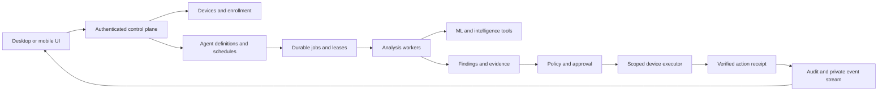

# CyberForge: Detailed Product and Engineering Update Plan

**Review date:** October 2, 2026  
**Code baseline:** local working tree based on commit `6e6704b`  
**Status:** Stage 1 is implemented locally; Stage 2 is in progress. Each completed subtask and its validation are recorded immediately in Section 16. Remaining work is tracked in Section 12.  
**Latest update:** October 12, 2026 — the plan was re-verified against the backend and desktop code, and corrected. Findings F21–F30, milestone M0a, and batch items B00a–B00e are new; F03, F12, and F20 are amended. Work already carried out and the verification record are in [Section 16](#16-implementation-log).

## 1. Purpose and review boundaries

CyberForge already has a substantial foundation: a Tauri desktop application, Rust browser monitoring and local enforcement, an Express backend, Python ML and agent services, and an Expo mobile companion. The next update should turn these pieces into a consistent security product with trustworthy protection status, secure device enrollment, configurable agents, and durable investigations.

This plan comes from reviewing application entry points, authentication, device and agent services, streaming, storage, native desktop commands, mobile capture code, UI components, project scripts, existing tests, and the checked-in Agent Core and Threat Globe screenshots. It is a source review, not a penetration test or proof that a deployed environment behaves exactly like this checkout. No production APIs were tested, no application services were started, and no full build or test suite was run. Dependency vulnerabilities, deployed permissions, provider availability, and performance remain verification work.

The original review preserved local modifications in `backend/.env.example`, `desktop/package-lock.json`, and `desktop/src-tauri/Cargo.toml`, adding only the planning document and its `.gitignore` exception. Subsequent application changes are recorded in Section 16.

**October 12 verification.** Each finding in Section 3 was rechecked against the backend and desktop source, and three contracts were cross-checked mechanically: UI to native commands, desktop to backend routes, and backend to ML service routes. The ML service was also exercised live (Section 16.1). The backend and desktop were still not run: the backend has no reachable deployment (F21), so backend and desktop behavior remains a source-level assessment. Mobile was checked only where it shares a finding with the backend or desktop.

### Planning assumptions

- The desktop application remains the primary security client; mobile supports monitoring, notifications, and platform-supported capture.
- “Device creation” means adding, enrolling, pairing, organizing, and managing devices. A manually added asset must be distinguishable from an enrolled device that actually reports telemetry.
- “Agent creation” means a persistent, user-configurable security worker with an assigned scope, tools, execution mode, schedule, and auditable results.
- Personal use is the first delivery target. Introduce a personal workspace as the ownership boundary so team support can follow without rewriting authorization.
- Preserve the current dark interface, amber action color, cyan telemetry accents, and recognizable CyberForge branding.
- Complete the security foundations before exposing broader remote control or automatic remediation.

### Priority definitions

| Priority | Meaning | Release rule |
| --- | --- | --- |
| P0 | A trust-boundary failure, sensitive-data exposure, or misleading security behavior requiring immediate correction | Blocks a broader connected beta |
| P1 | Core device, agent, reliability, or usability work needed for a dependable release | Required for the relevant feature milestone |
| P2 | Valuable improvements after the core workflows are reliable | Deliver in subsequent iterations |
| P3 | Larger expansion with significant platform or operational requirements | Separate discovery and release decision |

## 2. Current progress: what exists and what remains

“Implemented” below means there is substantive code for the capability. It does not mean the capability passed runtime acceptance testing during this review. A percentage-complete estimate would be misleading without a defined release scope and passing checks.

| Area | Current implementation and evidence | Assessment | Next required step |
| --- | --- | --- | --- |
| Desktop shell | Tauri 2 with static HTML/CSS/JS, shared navigation, installer flow, threat popup, and many feature pages under `desktop/ui/` | Substantial implementation | Validate packaged behavior; replace fixed-canvas layout and inconsistent states |
| Browser monitoring | Rust browser discovery, history collection, foreground/active-URL logic, and scan commands in `system.rs`, `agent.rs`, and `lib.rs` | Substantial implementation | Add explicit collection controls, bounded work, freshness, and platform-specific coverage tests |
| Detection | Backend ML calls, URL/content heuristics, LLM confirmation, IOC extraction, and OTX enrichment | Implemented with several result paths; measured defects in the deployed models (F27) | Standardize verdicts, unknown states, provenance, and evaluation; fix the scoring defects first |
| Local enforcement | Hosts-file blocking and persistent blocked/protected/allowed lists in `blocking.rs` | Blocking has real OS integration; “protect” records intent, and nothing in the UI can add a protected or allowed site (F29) | Verify actual applied state and rollback; avoid implying an active encrypted tunnel from a saved preference |
| Accounts | MongoDB user model, JWT middleware, Appwrite user mapping, Firebase middleware, Google desktop flow | Multiple integrated identity mechanisms | Close role escalation and reconcile identity/permission handling |
| Device records | Appwrite device registration plus a separate distributed-node registry | Foundations exist; lifecycle is fragmented | Build one enrollment and ownership contract; persist identity across restarts |
| Mobile device UI | `DevicesSection.tsx` shows this phone, backend connectivity, and session state | Connection status, not a fleet manager | Add enrollment, inventory, details, revocation, and real device health |
| Persistent agents | `CyberforgeAgent.js` registers an agent/device, polls tasks, and sends heartbeats; `AgentManager.js` manages instances | Working structure, unsafe public control surface | Add scoped IDs, durable definitions, authorization, and recoverable execution |
| Specialist analysis | `agentOrchestrator.js` coordinates URL, DGA, scraping, memory, IOC, behavioral, MITRE, and threat-intelligence specialists | Useful analysis pipeline | Reuse as versioned tools/templates inside the agent lifecycle |
| Python agents | Planner, scheduler, observer, tool registry, memory, and action executor under `ml-services/app/agent/` | Broad implementation with partial action adapters | Define ownership between Node/Python/Rust and eliminate simulated success |
| Policies and audit | Policy CRUD/evaluation and audit service exist; some routes use role authorization | Partial; important stores are process-local | Durable storage, workspace isolation, actual action receipts, protected audit records |
| Realtime | SSE event bus, WebSocket manager, desktop bridge, and mobile live-feed context | Connected infrastructure with isolation defects; the desktop live feed is expected to be blocked by the app's own CSP (F26) | Authenticate streams and route private events by verified ownership; move the desktop stream behind the native layer |
| Memory | Rust local memory, backend feature-hashed memory routes, other ML/vector stores | Multiple implementations | Establish authoritative stores, sync consent, retention, deletion, and ownership |
| Sandbox | URL/file static analysis, hashes/IOCs, MITRE mapping, in-memory evidence locker | Static analysis, explicitly not detonation | Label accurately and persist evidence; treat detonation as a separate project |
| Reports | Desktop report generation and memory integration | Implemented path | Evidence-linked results, reproducibility, privacy-safe exports, accurate engine labels |
| Mobile capture | Kotlin VPN service, SOCKS/proxy code, CA handling, Expo bridge, capture UI, and backend ingest | Significant but incomplete native integration | Supply and verify JNI engine; validate capture safety and supported platforms |
| Quality infrastructure | Backend integration scripts, Python tests, evaluation harness/test cases, some Rust unit tests, and a 74-request manual suite for the ML service (`ml-services/cyberforge-ml.rest`) | Useful starting points | Establish deterministic automated checks and clean-checkout build instructions |
| Deployment and connectivity | Desktop, mobile, and backend CORS all hard-code one Heroku URL that no longer resolves to an app; no client has a configurable backend address | **Not functional:** every connected feature fails today (F21, F22) | Deploy the backend with valid configuration and give every client one configurable base URL |
| Client wiring | All 55 native commands the desktop UI invokes are registered in `lib.rs`; all 25 backend paths the desktop's Rust code calls exist as backend routes | Internally consistent | Keep these two checks as automated contract tests |
| ML service contract | Hugging Face Space with four scikit-learn URL models, a BERT URL classifier, a DGA heuristic, and an in-Space open-source chat model (Section 16.1) | Deployed and tested, but the backend's ML configuration is split and 29 of the 44 ML paths it references do not exist on the Space (F23, F24) | Point every backend ML client at one service and remove or re-home the calls that have no target |

### Product direction for the next release

The core journey should be: **install → choose privacy settings → enroll a device → create an agent → run a scan → review evidence → approve or apply an allowed response → verify the result**.

Every part of that journey should have a durable identity and clear ownership. A connected backend should not imply that a device is protected. An available specialist should not count as a running user-created agent. A generated action should not count as an applied security control.

## 3. Findings that determine implementation order

These are source-level observations from the reviewed baseline, with implications stated separately from unverified deployment exposure. Consult the Section 12 task status and Section 16 implementation log for fixes applied since that review.

| ID | Priority | Observed code behavior | Implication and required correction |
| --- | --- | --- | --- |
| F01 | P0 | `backend/src/routes/auth.js` accepts `admin` and `analyst` in public registration; `authController.register()` persists the supplied role | Public registration must always create an ordinary member. Elevated roles require a separate authorized operation |
| F02 | P0 | `createDocumentWithPermissionFallback()` in `appwriteService.js` supplies public read/write permissions when none are passed and retries certain errors with `Role.any()` | A schema/permission mismatch must fail safely. Audit existing collection/document permissions; actual exposure depends on deployed Appwrite configuration |
| F03 | P0 | Seven route files apply no authentication middleware at all: `agentRoutes.js` (12 routes), `mlRoutes.js` (15), `orchestrator.js` (10), `sandbox.js` (8), `otx.js` (7), `browser-intelligence.js` (4), and `memory.js` (3), 59 routes in total; `server.js` does not add it for these mounts. The desktop itself calls several of them with a caller-supplied user ID (`/api/agent/alerts?userId=`, `/api/agent/scan-url`, `/api/memory/save`) | Centralize authentication and per-object authorization. Caller-supplied user IDs cannot establish ownership. The desktop calls must move to the authenticated principal at the same time, or they will break |
| F04 | P0 | SSE filtering uses `if (target && userId && target !== userId) return` in `routes/stream.js` | Anonymous connections pass this condition for user-targeted events. Reject private events unless the subscriber has the matching verified identity |
| F05 | P0 | WebSocket authentication assigns `message.userId`; desktop/mobile broadcast helpers iterate every client of that type. Capture ingest uses those helpers | Verify credentials and filter at delivery. A user identifier inside the payload does not restrict recipients |
| F06 | P0 | Distributed registration reads signature/timestamp headers without checking them. Telemetry destructures `signature` without verifying it; its replay set is process-local | Bind devices to enrolled keys; verify message integrity and freshness; persist deduplication and reject impersonation |
| F07 | P0 | JWT signing/verification falls back to a fixed source-code secret | Require configured signing material outside explicitly isolated tests; fail startup when production auth is misconfigured |
| F08 | P1 | Distributed listing reads `req.user.id`/`_id`, while middleware supplies `req.user.userId`. “Admin” routes such as `/nodes/all` and weight changes lack role checks | Use one verified principal shape and enforce both role and workspace membership |
| F09 | P0 | Desktop `store_token()` always also writes `session.json`; HF tokens are saved in JSON and recent-token history as well as keyring | Keyring success does not prevent plaintext copies. Migrate credentials, remove copies safely, and return storage failures honestly |
| F10 | P0 | `is_trusted_domain()` and `scan_url()` force a broad domain/subdomain list to risk zero, including user-content hosting domains | Reputation must be one signal. Never override contrary evidence solely because of a hosting domain |
| F11 | P1 | `AgentManager` keys instances by global display name. `CyberforgeAgent` obtains hostname/platform from the backend process and creates device records on registration | Different users can collide on names; backend workers can be mistaken for endpoints. Separate identities and make enrollment idempotent |
| F12 | P1 | Distributed nodes, policy state, audit entries, sandbox evidence, and backend memory include in-memory stores. So do the two largest route files: `routes/features.js` (58 routes) and `routes/child-pages.js` (66 routes) keep requests, workflows, findings, scans, and browser sessions in process-local `Map`s | Restart and multi-instance behavior can lose or disagree on security state. Add explicit durability contracts. On a platform that restarts processes daily, such as Heroku, this data does not survive a day |
| F13 | P0 | Policy response objects are marked `executed` without a corresponding enforcement receipt. Several Python action handlers return success after logging or updating a set | Represent proposed, queued, applied, failed, and unsupported actions separately; require executor acknowledgement |
| F14 | P1 | `agent-core.html` generates random sparklines, cycles its reasoning display on a timer, toggles capabilities through CSS, and pauses console output locally | Some visible controls/metrics do not describe agent execution. Connect controls to authoritative state or label their limited function |
| F15 | P1 | Desktop CSS starts from an absolutely positioned `1440px × 824px` window. Screenshots show a large floating agent panel covering content | Use responsive layout, reserved panel space, and readable typography |
| F16 | P1 | `Tun2Socks.kt` requires `libtun2socks.so`; no `jniLibs` directory was present in the reviewed module | Do not count capture as complete until a compatible JNI implementation is built, packaged, and exercised on devices |
| F17 | P1 | Mobile capture sync runs for signed-in users; its queue removes a batch before upload and drops failed batches. Backend capture reads use the in-memory ring | Add a separate sync preference, durable retry/outbox behavior, and reads from persisted records after restart |
| F18 | P1 | Tauri CSP permits inline/evaluated scripts; Express disables CSP. Desktop pages use many `innerHTML` paths | Audit untrusted text rendering, move executable inline code, and tighten boundaries without breaking native IPC |
| F19 | P1 | The scraper client defaults to an HTTP external endpoint, and multiple paths fetch user-provided URLs | Require secure provider transport and a shared destination-validation policy; verify redirects and resolved addresses |
| F20 | P1 | Root scripts reference a missing landing `package.json`, an absent iOS build script, and missing `desktop/BUILD.md`; Compose expects PostgreSQL while the backend uses Mongoose | Repair the supported setup/build path before claiming reproducible installation. Compose also references absent backend/landing/proxy inputs, including `backend/Dockerfile`. The root `heroku-postbuild` script runs `npm install && npm run build` inside `cyberforge-landing/`, which has no `package.json`, so a whole-repository Heroku deploy fails at build; only a backend-only (subtree) push works |
| F21 | P0 | **No reachable backend.** `https://cyberforge-ddd97655464f.herokuapp.com` returns Heroku's “No such app” page, and it is hard-coded in the desktop (`state.rs`, `system.rs`, `ui/scripts/cyberforge-shared.js`, `ui/scripts/cf-realtime.js`, `tauri.conf.json`), the mobile app (`src/api/config.ts`, `app.json`), the backend CORS allow-list (`server.js`), and `app.json`. No client reads the address from configuration | Login, registration, policy, threat lists, alerts, memory sync, and every ML call from the desktop fail today. Deploy the backend, then replace the literal with one configurable base URL per client and update the CORS origin. Nothing else in this plan can be validated end to end until this is done |
| F22 | P0 | `server.js` calls `connectDatabase()` and `connectRedis()` during startup; both throw on failure and the process exits. Mock fallbacks exist in `database.js` and `redis.js` but are never used. The local `backend/.env` points Redis at localhost and still has the placeholder `JWT_SECRET` | The backend cannot boot on a host without reachable MongoDB and Redis. Provision both, set a real signing secret (F07), and decide whether Redis is required or optional; if optional, degrade explicitly instead of exiting |
| F23 | P1 | Backend ML clients disagree about where the ML service is. Six default to `http://localhost:8001` (`mlService.js`, `cyberforgeMLService.js` `localAPIUrl`, `ai/AIAnalysisService.js`, `analysisService.js`, `threatService.js`, `analysisController.js`); four default to the Hugging Face Space (`mlServiceClient.js`, `llmFallbackChain.js`, `routes/ai.js`, `routes/orchestrator.js`). They read three different variables: `AI_SERVICE_URL`, `ML_SERVICE_URL`, and `HF_SPACE_URL`. The first two are set to localhost in the local `.env` | In production more than half the ML clients would target the backend's own host. Use one setting, default it to the deployed service, and fail visibly when it is unreachable |
| F24 | P1 | 29 of the 44 ML paths the backend references do not exist on the deployed Space: the training, dataset, agent, batch, recommendation, and threat-map calls in `mlService.js` (used by `routes/ml-training.js`, `routes/ai.js`, `routes/child-pages.js`) and `/analyze/url`, `/analyze/file`, `/analyze/network` in `ai/AIAnalysisService.js`. They belong to the FastAPI service under `ml-services/app/`, which is not deployed | The 16 `ml-training` routes and the AI routes built on these calls cannot work against the Space. Decide per feature: retire the backend route, port the endpoint to the Space, or deploy the second service. Do not present these features as available until one is chosen |
| F25 | P0 | `routes/analysis.js` and `routes/threats.js` treat any request whose `User-Agent` contains `cyber-forge-desktop` or `Electron` as the desktop app and serve `GET /api/threats`, `/api/threats/stats`, `/api/analysis/stats`, and `/api/analysis/history` without a token. The desktop sends that header from `state.rs` | A request header is not a credential; anyone can send it. Require the same authentication as every other client and scope the results to the caller |
| F26 | P1 | The desktop live feed (`ui/scripts/cf-realtime.js`, loaded by 14 pages and `cf-live.js`) opens an `EventSource` from the WebView straight to the backend with the JWT in the query string. The app's CSP in `tauri.conf.json` sets `connect-src 'self' ipc: http://ipc.localhost`, which does not include the backend origin | The live feed is expected to be blocked in a packaged build, independently of F21, and the token would appear in server logs if it were not. Consume the stream in Rust and forward events over Tauri events, as SEC-02 already recommends; verify in a packaged build |
| F27 | P1 | Live tests of the deployed models (Section 16.1) show the anomaly model's output is read backwards, so clean URLs score 50, “medium”; the phishing, malware, and web-attack models have identical feature importances and use two features; the DGA check scores only the first DNS label; `ioc-scan` ignores `ip` and `hash`; malformed input returns HTTP 500 | Every URL verdict the desktop shows is built on these scores. Fix the inversion and input handling, then retrain or replace the three duplicate models before DET-01 evaluation; do not tune thresholds on the current outputs |
| F28 | P1 | Three clients choose the language model independently. The backend's `llmFallbackChain.js` calls Gemini directly when `GEMINI_API_KEY` is set, then the Space. The desktop's `ml.rs` calls DeepSeek directly with a user-supplied Hugging Face token, then the backend. The Space answers with its own small in-Space model. UI text and `ml-services/eval/eval_harness.py` still name DeepSeek as the engine | The same question can be answered by three different models with different quality and data-sharing implications, and the engine label shown to the user can be wrong. Choose one policy (Section 15), report the engine that actually answered, and keep the small model's output advisory (Section 16.1 limitations) |
| F29 | P2 | `protect_site`, `allow_site`, and `mark_installed` are registered native commands that no UI code invokes; the UI can list and remove protected and allowed sites but cannot add them | Either wire the add actions into the UI or remove the commands. Related to the “Protect” wording in SEC-06 |
| F30 | P1 | The ML Space is public and unauthenticated, and its chat model handles one request at a time on two CPU cores | Anyone who finds the URL can occupy the model and push real users onto the template fallback. Put the Space behind the backend with a shared secret or make it private, and rate-limit the chat routes |

Additional verification targets: the desktop OAuth request shown in `auth_google()` does not include state or PKCE parameters; Android CA storage uses a fixed-password PKCS#12 file; the upstream TLS socket sets SNI without explicit endpoint-identification configuration. Review these end to end and add negative tests before declaring them secure. Do not treat this static review as a demonstrated exploit against a running installation.

## 4. Target architecture and ownership

### 4.1 One product model across the existing runtimes

Retain the existing languages and clients. Assign responsibilities explicitly:

| Component | Intended responsibility | Boundary |
| --- | --- | --- |
| Desktop Rust | Local sensors, local storage, key storage, capability discovery, local execution and verification | Privileged operations remain behind validated native commands |
| Desktop/mobile UI | Configuration, inventory, approval, status, evidence, and reports | UI state is not proof of execution or authorization |
| Express control plane | Verified identity, workspace membership, enrollment, agent definitions, scheduling contracts, event authorization | Every private operation derives scope from authenticated context |
| Worker runtime | Claims jobs, runs specialist workflows, emits results, renews leases | Receives only the job's scoped capabilities and data |
| Python ML service | Versioned inference and analysis tools | Authenticated service access; no parallel public administration surface |
| Persistence | Authoritative records, audit, evidence metadata, sync cursors | Ownership fields and migrations are mandatory |



The diagram describes the target connected workflow. Local-only scanning should remain available without a cloud account where the selected tools support it. Cloud features must declare what data leaves the device.

### 4.2 Persistence decision and migration

**Recommended initial approach:** keep MongoDB as the existing account/JWT authority and Appwrite as the existing control-plane record store, with an explicit internal identity mapping. This avoids a simultaneous identity-platform rewrite. Revisit consolidation after the lifecycle is stable.

1. Define an immutable internal user ID; map MongoDB IDs, Appwrite IDs, and verified provider subjects in one place.
2. Create personal workspace records and memberships. Never use a display name, email, request header, or device fingerprint as authority.
3. Define repositories for devices, agents, runs, policies, evidence, and audit so routes do not access raw global maps.
4. Decide whether clients may access Appwrite directly. Prefer server-mediated control-plane writes initially; configure document/collection permissions accordingly. Do not mix internal IDs with Appwrite role IDs.
5. Use Redis for bounded caches, coordination, and short-lived replay state where appropriate; durable records remain authoritative after Redis loss.
6. Version migrations; back up existing records; backfill ownership from verified mappings. Quarantine ambiguous records for review instead of assigning them to an arbitrary user.
7. Keep a migration ledger and stable legacy-to-new ID map. Validate record counts, owner mapping, and duplicate devices before changing reads.
8. Remove compatibility adapters only after desktop and mobile clients have migrated. Rollback must preserve newly created IDs and audit records.

### 4.3 Shared records and contracts

These are proposed models, not a claim that collections already exist.

| Record | Essential fields and constraints |
| --- | --- |
| Workspace / Membership | `workspaceId`, `userId`, role, status, created time; unique membership per workspace/user |
| Device | `deviceId`, `workspaceId`, display name, kind, platform, installation ID, key reference, enrollment state, last seen, capabilities, client version, desired/applied policy versions |
| Enrollment | ID, workspace, token hash, intended device kind, expiry, issuer, claim state, attempts, claimed key thumbprint; atomic one-time consumption |
| DeviceCredential | Device ID, public key or credential reference, key version, validity, revoked time; never return private key material |
| AgentDefinition | ID, workspace, name, template/version, instructions, device scope, tools, execution mode, budgets, schedule, status, config version |
| AgentAssignment | Definition ID, device ID or worker pool, desired version, applied version, runtime health; unique active assignment |
| AgentRun / RunStep | Run ID, trigger, definition snapshot, workspace, target, lease, step states, engine versions, evidence references, outcome, timing, usage |
| Finding / Incident | Workspace/device/run IDs, severity, confidence, category, status, deduplication key, first/last seen, owner, evidence links |
| Policy / Action | Policy version, scope, trigger, allowed action, approval rule; action ID, target, expiry, requester, executor receipt, rollback reference |
| AuditEvent | Server-assigned identity, workspace, actor, action, resource, outcome, timestamp, correlation ID; distinguish client-reported observations |
| SyncBatch / Cursor | Workspace/device IDs, batch ID, sequence/epoch, schema version, accepted time, acknowledgement, retry status |

Use one timestamp representation in API contracts, explicit units, bounded pagination, shared error codes, and versioned schemas. Runtime validation is necessary even where TypeScript types exist. Proposed common errors include `AUTH_REQUIRED`, `FORBIDDEN`, `DEVICE_REVOKED`, `CAPABILITY_UNAVAILABLE`, `APPROVAL_REQUIRED`, `PROVIDER_UNAVAILABLE`, and `STALE_VERSION`.

## 5. Security implementation workstream

### SEC-01 — Authentication, roles, and ownership [P0]

**Touchpoints:** `backend/src/server.js`, `routes/auth.js`, `controllers/authController.js`, `middleware/auth.js`, `middleware/firebaseAuth.js`, all sensitive route groups, and `services/appwriteService.js`.

- Force ordinary-member registration on the server and ignore/reject submitted elevated roles. Add authorized role changes with audit records.
- Define a single principal object containing verified user, workspace, role, and authentication method. Device credentials use a distinct principal type.
- Inventory every HTTP route and classify it as public metadata, user-scoped, privileged, or internal service-only. Apply default-deny middleware and object ownership checks.
- Protect agent lifecycle, jobs, memory, analysis history, evidence deletion, policy evaluation, training, and administrative operations. A role check alone is insufficient when an object belongs to another workspace.
- Remove permissive Appwrite fallbacks; correct schema permissions and test them through both backend and any supported direct client access.
- Validate signing configuration at startup. Add session revocation, bounded session lifetime, refresh-token rotation if used, and consistent account-disable/lock behavior.
- Review login failure tracking against the existing account-lock fields. Add a complete reset/recovery flow and optional MFA before administrative team use.
- Complete native OAuth with state validation, PKCE, bounded loopback callback handling, and single-use authorization codes. Native OAuth design should follow [RFC 8252](https://www.rfc-editor.org/rfc/rfc8252).

**Acceptance:** public signup cannot create privileged users; user A cannot read or mutate user B's objects through any supported transport; missing signing material prevents connected production startup; disabled/revoked sessions lose access; permission misconfiguration never produces public documents.

Object-level checks, function-level authorization, and resource limits should be included in the route inventory, consistent with the [OWASP API Security Top 10](https://api-security.owasp.org/editions/2023/en/0x11-t10/). These are design references, not a certification claim.

### SEC-02 — Private realtime transport [P0]

**Touchpoints:** `routes/stream.js`, `services/realtimeBus.js`, `services/websocket.js`, `routes/network-capture.js`, `desktop/ui/scripts/cf-realtime.js`, and mobile live-feed/SSE modules.

- Fix anonymous SSE delivery immediately. Private events require an authenticated subscriber matching the target workspace and authorized resource scope.
- Authenticate WebSockets before accepting identification, scans, or subscriptions. Derive identity from verified credentials; never trust `message.userId`.
- Make event visibility explicit: `public_intelligence`, `workspace`, or `device`. Missing visibility/ownership must not default a private event to public.
- Replace client-type broadcasts with authenticated subscription routing. Public OTX intelligence and private device observations use distinct topics and payload schemas.
- Prefer authenticated headers through native clients/Rust. If a browser transport requires a URL token, use a narrowly scoped, short-lived stream ticket; redact it from access logs.
- Add expiry/revocation handling for open connections, bounded outgoing buffers, reconnect backoff, event IDs, and a documented replay window.

**Acceptance:** test guest, expired session, user A, user B, and revoked device subscribers simultaneously. Each sees only permitted events; reconnects do not duplicate alerts or leak previous-account data.

### SEC-03 — Credentials and local data protection [P0/P1]

**Touchpoints:** desktop `auth.rs`, `ml.rs`, `memory.rs`, `system.rs`, mobile `src/api/storage.ts`, and native CA storage.

- Stop writing auth/provider tokens to plaintext session/config history. Store secrets in platform secure storage; show only masked status and source in settings.
- Migrate existing tokens only after verifying the secure write and read. Then remove the obsolete secret fields/files while preserving unrelated settings.
- If secure storage is unavailable, offer a clearly temporary session or actionable error. Do not silently claim persistent secure storage succeeded.
- Separate non-secret profile/preferences from credentials. Define logout, account-switch, provider-disconnect, and device-revoke cleanup independently.
- Encrypt sensitive local history, memory, and capture stores using a protected key where supported; set restrictive file access and retention limits.
- Review web-client token persistence separately from native SecureStore. Avoid persistent web secrets where a secure session mechanism is practical.
- Protect capture CA private keys with platform-backed protection where compatible; do not rely on a fixed file password. Exclude sensitive material from backups and diagnostic exports.

**Acceptance:** a filesystem search of application-owned storage after migration finds no plaintext session/provider tokens; settings and logs never reveal full secrets; logout/account switching isolates local data; key-store failures are visible and recoverable.

### SEC-04 — Fetching, uploads, and input safety [P1; before broad scanning access]

**Touchpoints:** scraper services, domain-intelligence routes, sandbox uploads, Rust page fetching, ML URL tools, and report rendering.

- Route URL fetching through a common policy: allowed schemes, normalized hostnames, DNS resolution checks, destination restrictions, redirect limits, timeouts, and response-size limits.
- Reject public-cloud scans targeting loopback, private, link-local, or metadata-service addresses, including alternate address encodings and redirects. Recheck destinations at connection time to address rebinding.
- Support private-network analysis only through an explicitly scoped local capability for networks the user is authorized to assess.
- Require HTTPS for external provider traffic. If the configured scraper cannot support it, report unavailable instead of falling back silently to HTTP.
- Fetch suspicious content in isolated analysis workers without ambient cookies, credentials, privileged mounts, or unrestricted network access. Keep captured scripts out of the application WebView.
- Validate uploads by size, type, parser limits, storage path, and archive expansion budget. Treat filenames and report/CSV cells as untrusted output.
- Limit batch size, concurrency, provider use, training requests, and per-workspace queued work. Apply separate quotas for cheap metadata and expensive analysis.

**Acceptance:** tests cover private/loopback destinations, redirect-to-private, DNS changes, oversized responses, slow responses, malformed uploads, and dangerous report content. Legitimate scans still work. Detailed fetch controls should be checked against the [OWASP SSRF prevention guidance](https://cheatsheetseries.owasp.org/cheatsheets/Server_Side_Request_Forgery_Prevention_Cheat_Sheet.html).

### SEC-05 — Desktop trust boundary and safe rendering [P1]

- Audit every Tauri command, particularly token retrieval, file access, reports, OS changes, and provider calls. Validate inputs inside Rust even when the UI already validates them.
- Separate the threat-alert window's required operations from the main application's capabilities. Review custom-command authorization as well as plugin permissions.
- Replace unsafe rendering of URLs, page titles, provider responses, and model text with text nodes or a maintained restricted renderer. Audit existing escaping helpers instead of assuming every `innerHTML` call is exploitable.
- Move inline executable code/event handlers into modules and remove unnecessary script evaluation allowances. Test the packaged CSP and native IPC together.
- Harden hosts-file updates: narrow privileged helper, unique protected temporary files, safe path handling, concurrency control, backup, atomic replacement, verification, and rollback.

**Acceptance:** hostile page titles and AI responses render as text; the popup cannot invoke unrelated sensitive operations; cancelling elevation leaves enforcement accurately marked unapplied; unrelated hosts entries survive changes. Use Tauri's [security model](https://v2.tauri.app/security/) and [CSP guidance](https://v2.tauri.app/security/csp/) to validate the boundary.

### SEC-06 — Trustworthy detection and enforcement [P0/P1]

- Remove the forced-clean domain shortcut. Use scoped, expiring user exceptions with reasons; continue recording conflicting evidence.
- Standardize `benign`, `suspicious`, `malicious`, and `unknown` verdicts. Keep severity, confidence, and risk score separate.
- Return analysis coverage: checks attempted/completed, unavailable engines, evidence age, local/remote source, model/version, and duration.
- Missing evidence, provider errors, or unsupported checks must produce `unknown`/partial coverage, not a green clean result.
- Change the policy action lifecycle to `proposed → awaiting_approval → queued → executing → applied/failed/expired`, with `rolled_back` when verified. Record the outcome of each actual adapter.
- Treat hosts blocking as a documented domain-resolution control with limits. Do not label it complete network isolation.
- Rename “Protect” to a truthful saved-policy action until a supported protection mechanism is applied and checked.

**Acceptance:** an unavailable engine is visible; known-host reputation cannot erase malicious evidence; a simulated/no-op action cannot be marked applied; every applied response has an executor, target, time, and verification result.

### SEC-07 — Privacy and explicit data-sharing controls [P1]

- Add separate controls for browser-history access, active-tab monitoring, full-history import, capture, cloud enrichment, LLM processing, and cross-device sync.
- Explain the data sent by each feature before enabling it: URL, domain, page excerpt, findings, or capture metadata. “Local-first” copy must match actual network behavior.
- Default to metadata/minimized evidence where possible. Redact credentials, authorization headers, cookies, sensitive query parameters, and form values before persistence or provider calls.
- Provide per-device retention, pause collection, clear local history, delete synced data, export, and account deletion with an auditable completion state.
- Store consent version/time and clear queued sensitive uploads when consent is withdrawn. Account switching must not upload the previous user's backlog.

**Acceptance:** with cloud processing disabled, local scans make no cloud analysis requests; revoking sync stops queued uploads; deletion propagates through authoritative stores and derived memory according to documented retention.

### SEC-08 — Durable audit and evidence [P1]

- Persist security events with workspace, actor, resource, outcome, and correlation IDs. Append server-generated events at the operation that actually changes state.
- Distinguish client-reported observations from authoritative records of role changes, approvals, enrollment, and enforcement.
- Restrict audit modification permissions. Add integrity verification/checkpoints and backup retention; do not describe `Object.freeze()` or a hash chain alone as tamper-proof storage.
- Hash evidence artifacts, preserve collection time and source, and document transformations/redactions. Link report assertions to evidence IDs.
- Make evidence deletion respect retention policy and preserve a minimal deletion audit event.

**Acceptance:** restart and multi-instance tests preserve events; normal users cannot rewrite security history; exported evidence has a verifiable manifest; derived reports show missing or deleted evidence honestly.

## 6. Device creation and management workstream

### DEV-01 — Canonical device identity [P1]

**Build on:** Appwrite device methods, `distributedIntelligenceService.js`, desktop system profile code, and `DevicesSection.tsx`.

- Create a stable installation identity and device key pair at first enrollment; persist across restarts and application upgrades.
- Separate `endpoint`, `backend_worker`, and `inventory_only` device kinds. A server agent's hostname must not masquerade as the user's laptop.
- Make registration idempotent by workspace and installation identity. Display names may change without changing IDs.
- Replace the distributed map as the sole source of truth. Map legacy node/device IDs to the canonical record.
- Store advertised capabilities separately from capabilities enabled by policy and confirmed by runtime checks.

**Acceptance:** restarting/reinstall-recovery does not create duplicate device records; a backend worker is visibly identified; a renamed device retains its agents/history; duplicate names do not merge devices.

### DEV-02 — Add-device wizard and pairing [P1]

**Proposed flow:**

1. Open **Devices → Add device** and choose Windows, macOS, Linux, Android, or inventory-only asset. Show unsupported capabilities before enrollment.
2. Choose **Enroll this device**, **Pair another device**, or **Add an inventory record**.
3. For pairing, generate a short-lived, one-time token represented as QR/deep link and manual code. Store only its hash server-side; bind it to the issuing workspace and intended flow.
4. The target installation generates its own key, claims the enrollment, and proves possession through a challenge. A device fingerprint is descriptive metadata, not authentication.
5. Show the proposed name, platform, workspace, and key confirmation on the enrolling surface; require the appropriate authenticated approval before activation.
6. Let the user choose collection and sync options. Complete necessary local OS permission prompts on the target device.
7. Verify a signed heartbeat and baseline capability check. Finish with the real state: connected, awaiting permission, partial coverage, or offline.
8. Offer a compatible agent template. Do not silently create broad autonomous access during enrollment.

**Failures to design:** expired code, already-claimed token, invalid workspace, account mismatch, interrupted setup, denied OS permission, duplicate installation, unsupported version, and unavailable secure storage.

**Acceptance:** concurrent claims cannot enroll two devices with the same token; wrong-workspace claims fail; no user JWT is embedded in a QR code; cancelled enrollment creates no active credential; retry resumes safely.

### DEV-03 — Device inventory and detail screens [P1]

Inventory columns: name, platform/kind, enrollment state, last seen, protection coverage, active agents, open alerts, version, and policy status. Support search, filters, grouping, stable sorting, and accessible list/card layouts.

Device details should contain:

- **Overview:** connection, last heartbeat, assigned agents, current risk, and a concise reason for degraded coverage.
- **Permissions and sensors:** supported/enabled/denied/unavailable states for each sensor; a repair action where possible.
- **Activity and evidence:** recent runs, findings, actions, and incident links scoped to this device.
- **Policies:** desired versus applied version, changes awaiting approval, and last enforcement receipt.
- **Privacy:** collection scope, storage usage, retention, last sync, and data deletion controls.
- **Management:** rename, tags/groups, diagnostics, credential rotation, revoke, and remove inventory record.

Connection and protection are separate indicators. “Online” means a recent authenticated heartbeat; “Protected” requires the configured protection capabilities to be running successfully.

**Acceptance:** an offline but previously protected device shows stale state and last-known time; an online device with denied permissions is degraded; inventory-only assets never show invented telemetry.

### DEV-04 — Heartbeats, telemetry, and reliable sync [P1]

- Sign telemetry envelopes containing device/workspace identity, schema version, key version, timestamp, batch ID, sequence/epoch, and payload digest.
- Verify credentials, signature, freshness, size, ownership, and replay protection before ingestion. Canonicalize signed bytes consistently across Rust/JS/Kotlin.
- Use idempotent ingestion with acknowledgements and a bounded persistent client outbox. Separate fast live display from durable acceptance.
- Track disconnected, stale, and revoked states using server time; tolerate documented client clock skew.
- Persist last accepted sequence/epoch across server restarts and define safe recovery after device key rotation or installation reset.
- Replace mobile's constant `mobile` device identifier with the enrolled device ID; make cloud capture sync independently configurable.
- Add retry/backoff, queue limits, dropped-event counts, and manual retry. Read persisted capture records when the ring buffer is empty after restart.

**Acceptance:** duplicate batches produce one durable result; forged/replayed messages fail; a disconnected device reconnects without losing acknowledged data; queue saturation is visible; one device cannot submit telemetry under another identity.

### DEV-05 — Revocation, lifecycle, and policy delivery [P1]

- Support revoke, rotate credentials, pause collection, and remove from inventory as different operations with clear consequences.
- Deliver signed, versioned, expiring commands only to enrolled devices with the required capability. Include idempotency keys and receipts.
- Reject new jobs and server requests immediately after revocation. Close connected sessions and subscriptions.
- Define offline behavior explicitly: remote revocation cannot instantly reach a disconnected device. Short-lived execution leases and command expiry bound queued remote actions; local user controls remain available.
- Support device groups and desired/applied policy reconciliation without assuming a broadcast means success.
- Offer explicit decisions for retaining evidence and detaching agents when a device is removed.

**Acceptance:** revoked credentials cannot reconnect or fetch work; stale commands cannot execute after reconnect; remote policy success appears only after a matching device receipt; an unreachable device is never shown as remotely wiped.

### DEV-06 — Platform capability matrix [P1]

| Platform | First supported scope | Required verification before claiming support |
| --- | --- | --- |
| Windows desktop | Enrollment, browser monitoring, local history controls, scans, hosts blocking | Browser/profile coverage, UAC cancellation, hosts rollback, keyring migration, packaging |
| macOS desktop | Same shared features where native code supports them | Browser data permissions, secure storage, enforcement helper, signing/notarization workflow |
| Linux desktop | Shared monitoring and local analysis where supported | Keyring availability, browser paths, privilege boundary, packaging on supported distributions |
| Android native build | Companion plus optional supported VPN capture | Compatible JNI library, VPN permission/foreground lifecycle, network restoration, TLS behavior, battery use |
| iOS | Companion inventory, alerts, evidence, approvals | Clearly disable unsupported Android capture; separate discovery for any native network extension |
| Expo Go / web | Companion functionality supported by the runtime | Honest unsupported capture state and platform-appropriate authentication |
| Inventory-only assets | Owner-entered descriptive asset record | No scanning/protection claims until a supported connector is enrolled |

Android VPN behavior must account for the system permission flow and the fact that only one VPN service can be active per user/profile. Capture should remain optional and have a clear stop/recovery path. See [Android VPN documentation](https://developer.android.com/develop/connectivity/vpn).

### Proposed device API contract

New endpoints below are design proposals. Existing `/api/distributed/*` routes should be secured immediately and later adapted or deprecated deliberately.

| Endpoint | Principal / permission | Behavior |
| --- | --- | --- |
| `POST /api/v1/device-enrollments` | User with device-enrollment permission | Create one-time enrollment; return expiry and pairing material |
| `POST /api/v1/device-enrollments/claim` | Enrollment token + key proof | Atomically claim only the permitted enrollment |
| `GET /api/v1/devices` | Workspace member | Paginated authorized inventory |
| `GET/PATCH /api/v1/devices/:id` | Authorized reader / manager | Read details or edit allowed metadata |
| `POST /api/v1/devices/:id/heartbeat` | Bound device credential | Update presence and applied state |
| `POST /api/v1/devices/:id/telemetry` | Bound device credential | Validate and acknowledge idempotent batches |
| `POST /api/v1/devices/:id/rotate-key` | Bound key proof or recovery permission | Rotate with bounded overlap and audit |
| `POST /api/v1/devices/:id/revoke` | Device manager, stronger authentication as configured | Revoke sessions/credentials and invalidate remote work |
| `GET /api/v1/devices/:id/actions` | Device credential or authorized viewer | Device receives only applicable unexpired work; viewer gets status |

## 7. Agent creation and execution workstream

### AGT-01 — Separate definitions, assignments, runtimes, and tools [P1]

The existing code uses “agent” for a desktop assistant, persistent Node process, Python autonomous loop, and specialist analyzer. Give each a precise product meaning:

- **Agent definition:** the user's saved configuration and objective.
- **Assignment:** where that definition may run and which devices/resources it can access.
- **Runtime instance:** a worker executing an assignment with a lease and health state.
- **Tool/specialist:** a bounded operation such as URL classification or IOC extraction.
- **Run:** one traceable execution with inputs, steps, evidence, usage, and outcome.
- **Assistant:** the interface that explains evidence and proposes actions through the same authorized APIs.

Use stable IDs rather than global names in `AgentManager`. Reuse the existing orchestrator as a workflow/tool implementation and Python components where they have a clear responsibility. Choose one scheduling authority; do not let multiple independent loops claim the same job without coordination.

**Acceptance:** two users can each create an agent called “Default” without sharing state; the specialist catalog and active-agent count are distinct; every task belongs to a workspace, definition, and run.

### AGT-02 — Create-agent wizard [P1]

1. **Choose a template:** explain what it detects and which data/tools it needs.
2. **Name and objective:** unique ID generated by the server; human-readable name and optional bounded custom instructions.
3. **Choose scope:** selected devices/groups, authorized URLs/domains, exclusions, and local versus remote execution. Show incompatible devices with a reason.
4. **Choose permissions:** tool allowlist, data access, approved external providers, and maximum action scope. Present a readable permission summary.
5. **Choose behavior:** Observe, Assist, or Guarded automatic mode. Observe is the default.
6. **Choose schedule and budget:** event-driven/on-demand/recurring, timezone, quiet hours, concurrency, timeout, provider/token limits, and network/battery preferences.
7. **Test configuration:** perform a dry run on a safe fixture or user-selected authorized target; show planned steps, coverage gaps, and potential actions.
8. **Review and activate:** display devices, collection scope, provider sharing, permitted responses, and resource budget. Save a versioned configuration and start only after successful validation.

Allow save-as-draft at any step. Validation errors must preserve input. Changes to an active agent produce a new configuration version and a permission diff; increased privileges require appropriate authorization.

**Acceptance:** a user can create, test, activate, edit, pause, resume, clone, and archive an agent; unsupported tools cannot be enabled through a modified API request; duplicate submission creates one definition.

### AGT-03 — Initial template catalog [P1/P2]

| Template | Reuse | Initial actions and limits |
| --- | --- | --- |
| Browser Guardian | Rust active URL collection, URL/content checks, classifier | Observe visited URLs within consent scope; alert first; optional approved domain block |
| URL and Phishing Analyst | URL classifier, scraper, IOC extraction, OTX | Analyze selected links; bounded content fetch; evidence-based verdict; no credential submission |
| Threat Intelligence Watcher | OTX and domain/IOC matching | Match enrolled-device observations against fresh intelligence; distinguish an intel hit from a confirmed compromise |
| Device Health Monitor | Heartbeats, system stats, capability status | Detect stale monitoring, missing permissions, version drift, failed enforcement, and resource pressure |
| Incident Investigator | Existing orchestrator, memory, evidence, MITRE mapping | Correlate selected findings; build a timeline and recommend next actions; no unapproved expansion of scope |
| Report Assistant | Report generation and scoped retrieval | Summarize a selected time range with evidence links and limitations; no automatic external sharing |
| Policy Response Agent | Policy evaluation plus verified executor | Guarded mode only after action receipts, approval, expiry, and rollback are implemented |

Custom agents should initially compose approved templates/tools and instructions. Arbitrary uploaded executable tools, unrestricted shell access, or self-granted permissions are outside the first release.

### AGT-04 — Runtime state, scheduling, and recovery [P1]

- Definition lifecycle: `draft → validating → ready → active → paused → archived`; configuration errors remain explicit.
- Run lifecycle: `queued → leased → running → waiting_approval → completed/partial/failed/cancelled/expired`.
- Persist run state, step status, tool inputs after redaction, results, evidence IDs, policy version, and timing. Store concise execution explanations, not invented reasoning traces.
- Claim work atomically with leases, heartbeats, and bounded retries. Use fencing/version checks so an expired worker cannot later apply a stale action.
- Deduplicate retries and schedule triggers. Record scheduler timezone and daylight-saving behavior; distinguish missed-run catch-up from duplicate execution.
- Add cancellation propagation to provider calls and queued actions; define what can be cancelled once an OS operation has begun.
- Provide global/workspace/device emergency pause controls. Stop new work and prevent pending privileged actions from starting; show in-flight work separately.
- Enforce maximum concurrency, steps, duration, provider spend, and memory. Exceeding a budget produces a visible partial result.

**Acceptance:** restart during a run either resumes safely or reports a recoverable failure; two workers cannot apply the same action; pause changes the runtime rather than only console rendering; revoked devices cannot receive resumed work.

### AGT-05 — Permission modes and approval [P1]

| Mode | Allowed behavior | Approval rule |
| --- | --- | --- |
| Observe | Collect permitted telemetry, analyze, and produce findings | No system-changing actions |
| Assist | Observe plus propose scoped remediation | User approves the concrete action and target |
| Guarded automatic | Execute a restricted set of preauthorized, reversible responses | Allowed only within a versioned policy, current scope, and verified capability |

Approval records bind the approver, exact target, action parameters, policy/config version, expiry, and relevant evidence. Editing the target or action after approval invalidates it. The executor rechecks permissions, current device state, and policy before acting.

Initial automatic responses should be narrow, such as applying a time-limited block to a confirmed domain on an explicitly opted-in device. File deletion, broad network isolation, certificate changes, or unconstrained commands should not be default capabilities.

**Acceptance:** stale/reused approvals fail; an agent cannot approve its own requested privilege increase; revoking a permission prevents subsequent execution even if an earlier plan included it; every automatic action has a reason, receipt, and supported recovery path.

### AGT-06 — Untrusted content, memory, and model safety [P1]

- Treat website text, PDFs, logs, threat feeds, memory entries, and retrieved instructions as untrusted evidence.
- Keep tool authorization and response policy outside the model. Model output may suggest an action but cannot expand scope or disable verification.
- Validate structured tool arguments against schemas; allow only tools enabled for the current definition and run.
- Minimize provider payloads and redact secrets before model calls. Separate memory by workspace/device and distinguish observations from verified facts.
- Record memory provenance and expiry. A past user exception should not silently become a global security rule.
- Test malicious content that asks the model to disclose secrets, call another device's tools, mark a threat clean, or overwrite policy.
- Return user-facing evidence summaries, tool results, and decision explanations. Animated “thinking” is not an execution trace.

**Acceptance:** hostile retrieved content cannot obtain unauthorized tool access, change policy, or expose another workspace's memory. Apply defense in depth consistent with [OWASP prompt-injection guidance](https://genai.owasp.org/llmrisk/llm01-prompt-injection/); no single prompt is a security boundary.

### AGT-07 — Agent detail, run history, and debugging [P1]

Create an agent list with status, template, assigned devices, last run, recent outcome, pending approvals, and resource use. Agent details should have Overview, Runs, Permissions, Devices, Schedule, and Configuration History.

The run view shows a real step timeline: collected evidence, completed checks, skipped checks, provider failures, pending approvals, and action receipts. Make logs searchable by run/device ID and redact sensitive values. Include “Retry failed checks” and “Clone as draft” where valid.

**Acceptance:** users can explain why an alert was raised, which engine produced it, what failed, and what action actually happened without reading server logs. Status remains consistent between desktop and mobile.

### Proposed agent API contract

| Endpoint | Behavior |
| --- | --- |
| `GET /api/v1/agent-templates` | Return permitted templates and required capabilities |
| `POST /api/v1/agents` | Create scoped draft with validated configuration |
| `GET/PATCH /api/v1/agents/:id` | Read/update authorized definition with version check |
| `POST /api/v1/agents/:id/validate` | Validate capabilities, scope, tools, and budgets |
| `POST /api/v1/agents/:id/dry-run` | Produce a bounded preview without remediation |
| `POST /api/v1/agents/:id/activate` | Activate a validated version |
| `POST /api/v1/agents/:id/pause` | Persist desired paused state and signal runtimes |
| `POST /api/v1/agents/:id/runs` | Enqueue authorized idempotent execution |
| `GET /api/v1/runs/:id` | Return scoped run, steps, evidence, and outcomes |
| `POST /api/v1/runs/:id/cancel` | Request cancellation and report actual state |
| `POST /api/v1/actions/:id/approve` | Approve an immutable action proposal within authority |
| `POST /api/v1/actions/:id/rollback` | Request a supported scoped rollback and track receipt |

All endpoints require verified workspace ownership and operation-specific permission. Worker claims and device execution APIs use separate restricted credentials.

## 8. Detection, investigation, and reporting improvements

### DET-01 — Evaluation before stronger automatic responses [P1]

- Extend `ml-services/eval/eval_harness.py` beyond loose response-keyword checks. Preserve useful existing smoke cases but add deterministic security assertions and labeled detection datasets.
- Separate training, validation, and held-out test data; avoid domain/time leakage. Record dataset provenance, collection date, label source, and known blind spots.
- Evaluate benign services, malicious content hosted on otherwise reputable domains, lookalikes, redirects, multilingual pages, inaccessible pages, and provider failures.
- Measure precision, recall, false-positive rate, calibration, coverage, latency, and abstention. Report results by threat category and by local heuristic versus remote model path.
- Version model artifacts and threshold policies. Stage replacements, compare against the baseline, and keep a rollback path.
- Do not present hard-coded model accuracy or heuristic score transformations as measured confidence. Define what each UI number actually means.

**Acceptance:** each released detector has a reproducible evaluation report and explicit limitations; provider failures are counted; automatic blocking thresholds require stronger evidence than advisory alerts.

### DET-02 — Useful alerts and incident workflow [P1]

- Give findings a stable ID and deduplicate by device, normalized target, category, and time window while preserving recurrence count.
- Add acknowledge, assign, investigate, resolve, reopen, and false-positive feedback states. Keep severity independent of workflow state.
- Group related findings into incidents with a shared timeline and evidence, including the device's last-known coverage.
- Display “Why this matters,” observed evidence, confidence/coverage, recommended next step, and action outcome.
- Support scoped exceptions with an owner, reason, expiry, and audit trail. Reevaluate exceptions when new contradictory evidence appears.

**Acceptance:** repeated scans do not flood identical alerts; resolving an incident preserves its history; false-positive feedback does not silently weaken detection for other users.

### DET-03 — Static analysis and evidence locker [P1/P2]

- Label the current sandbox as static URL/file analysis and describe supported checks.
- Persist metadata/evidence with ownership, hash, retention, and scan version. Add search, comparison, and export manifests.
- Show MITRE mappings as evidence-linked hypotheses when derived from keywords; do not imply a confirmed attack technique from a string match alone.
- If detonation is later added, create a separate isolated service with restricted egress, disposable execution environments, artifact handling, and dedicated validation. Ordinary containers alone are not a complete hostile-code isolation design.

### DET-04 — Reports and intelligence context [P2]

- Generate reports from a fixed evidence snapshot, selected devices, and explicit time range/timezone.
- Include incomplete scans, stale devices, provider outages, rule/model versions, and data sources alongside findings.
- Distinguish public threat-intelligence pulses from attacks observed against this user's devices. Label approximate geography and source age on the globe.
- Support a concise executive summary and an evidence appendix. Provide redacted export previews and consistent HTML/PDF output.
- Keep report distribution manual initially; add integrations only with explicit workspace configuration and delivery audit.

## 9. Design and usability workstream

### UX-01 — Clear navigation and product hierarchy [P1]

Recommended top-level navigation:

| Destination | Purpose and existing pages to consolidate |
| --- | --- |
| Overview | Personal protection status, urgent findings, devices needing attention, recent agent outcomes |
| Devices | Inventory, enrollment, device details, permissions, and health |
| Agents | Definitions, templates, assignments, schedules, and run history |
| Alerts & Incidents | Alerts, evidence, investigations, and incident timelines |
| Analyze | URL/file analysis and deeper static investigation |
| Intelligence | OTX feeds and globe, clearly separate from personal incidents |
| Reports | Saved reports and exports |
| Settings | Account, privacy, providers, notification preferences, storage, and appearance |

Keep Memory, Model Inference, and Signal Pipeline as advanced views accessible from relevant details. Add navigation labels/tooltips for the collapsed rail and a clear workspace/device scope indicator. Eliminate hard-coded sidebar counts and always-active badges.

**Acceptance:** a new user can find Add Device, Create Agent, current threats, and privacy controls without knowing internal subsystem names; counts reflect the selected scope.

### UX-02 — Responsive layout and non-obstructing panels [P1]

**Touchpoints:** `desktop/ui/styles/cyberforge.css`, shared shell scripts, `cf-agent.css`, floating agent component, and page-specific styles.

- Replace the scaled fixed design canvas with CSS grid/flex layouts, fluid content widths, and deliberate breakpoints.
- Support the current desktop minimum window, common laptop dimensions, maximized views, and OS/text scaling. Define which dense tables scroll horizontally instead of shrinking all text.
- Dock the assistant/activity panel in reserved space on wide screens; use a dismissible drawer on smaller screens. Preserve its open/closed preference.
- Avoid stacking the assistant, live-activity rail, tooltip, and alert popup over primary actions. Use one overlay hierarchy with predictable focus behavior.
- Preserve data-table headers and page actions while content scrolls. Keep panels readable when an error message or long URL wraps.

**Acceptance:** no primary action or evidence field is covered at supported sizes; keyboard focus remains visible; 200% text scaling works for core workflows without shrinking the entire interface.

### UX-03 — Truthful status and functional controls [P0/P1]

- Replace random sparklines with recent measured samples or a clear “No samples yet” state.
- Drive the run timeline from actual step events; show an idle state when there is no run.
- Separate **Pause display** from **Pause agent**. The latter requires a runtime acknowledgement and a visible pending state.
- Persist capability changes through authorized APIs; show desired/applied state and errors. Unsupported options should be disabled with a reason.
- Show separate indicators for connection, monitoring coverage, scan verdict, and enforcement state.
- Use common loading, empty, offline, stale, partial, error, permission-denied, and unsupported components across desktop and mobile.
- Never replace a failed read with fabricated success, zero risk, or an “ACTIVE” label.

**Acceptance:** the interface can be checked against actual API/runtime state for each displayed metric and control; losing connectivity visibly changes freshness without erasing the last-known result.

### UX-04 — Typography, accessibility, and visual consistency [P1]

- Preserve Space Grotesk for normal text and JetBrains Mono for technical values; reserve tiny uppercase tracking for nonessential decoration.
- Establish shared tokens for background, surface, text, borders, severity, spacing, radius, focus, and motion. Generate CSS and TypeScript tokens from one source when practical.
- Increase essential labels and table values to a readable scale; target roughly 14–16 px body text and 12–13 px secondary text on desktop, validated at real display scaling.
- Use color plus text/icon for severity. A green dot alone must not convey protection.
- Add accessible names, proper buttons and switches, keyboard operation, visible focus, dialog focus trapping/return, and reduced-motion support.
- Test normal text contrast at least 4.5:1 and large text at least 3:1; test relevant controls/non-text indicators at 3:1. Use comfortable mobile touch targets and platform font scaling.

**Acceptance:** core enrollment, agent creation, alert review, and approval flows work with keyboard and screen reader; contrast and focus checks meet the chosen WCAG 2.2 AA scope. See [WCAG 2.2](https://www.w3.org/TR/WCAG22/) for the exact criteria and exceptions; the proposed typography sizes are product choices, not WCAG mandates.

### UX-05 — Screen-specific changes [P1/P2]

| Screen | Planned improvement | Success condition |
| --- | --- | --- |
| Overview | Prioritize coverage, unresolved incidents, stale devices, and next action; reduce decorative metrics | User can identify what needs attention immediately |
| Agent Core | Turn into selected agent/run detail; concise step explanations, evidence links, real pause/resume | No synthetic execution stages or ambiguous controls |
| Devices | New inventory and enrollment entry point; separate endpoint from backend connectivity | User can add and verify a real device |
| Security Functions | Rename to Policies & Responses within the relevant area; plain-language trigger/action editor and dry run | Policy effect is understandable before activation |
| Alerts & Evidence | Master/detail layout, stable filtering, deduplication, incident links, response receipt | Review and response happen in one coherent workflow |
| Threat Globe | Explicit public-intelligence label, source time, filters, accessible list alternative | Globe activity is not confused with personal compromise |
| Browser History | Consent state, browser/profile scope, retention, exclusions, and deletion | Collection is discoverable and controllable |
| AI Assistance | Scope banner, cited evidence, suggested actions requiring proper approval, provider status | Assistant statements can be traced to observed data |
| Reports | Time/device selector, snapshot status, redaction preview, saved output | A report can be reproduced and safely shared |
| Mobile home | Compact device coverage and urgent tasks; distinguish backend connection from local capture | Phone status is clear even when offline |
| Mobile capture | Permission/setup checklist, supported protocols, capture state, stop control, sync preference | User knows what is observed and can stop it immediately |

### UX-06 — Onboarding and recovery [P1]

First run should explain local versus connected features, establish privacy choices, discover capabilities, enroll the device if requested, and offer a compatible agent. Do not force provider credentials before showing useful local functionality.

Recovery screens should explain a concrete cause and next step: sign in again, grant a browser permission, reconnect a provider, retry enrollment, free storage, update the app, or use a supported build. Keep advanced diagnostics available without exposing secrets or stack traces in ordinary product flows.

## 10. Mobile capture completion plan

This is a distinct milestone because a companion app and a traffic-capture engine have different release requirements.

1. Select and pin the native forwarding implementation, confirm its license, implement the JNI signatures expected by `Tun2Socks.kt`, and package supported ABIs. A library with a matching filename alone is insufficient.
2. Test missing-library startup, VPN permission denial/revocation, foreground service lifecycle, process death, network changes, and safe restoration of connectivity.
3. Verify TCP, DNS, IPv4/IPv6, UDP/QUIC, HTTP framing, and unsupported traffic behavior. Declare coverage limits instead of treating unparsed traffic as clean.
4. Keep metadata capture usable without installing a capture CA. Make TLS inspection an explicit advanced opt-in for traffic the user is authorized to inspect.
5. Verify upstream certificate-chain and hostname validation with negative cases. Respect certificate pinning failures; do not add a trust-all fallback or automatic pinning bypass.
6. Bound request/response previews, parser memory, socket counts, and retention. Redact sensitive payloads before UI display, local storage, and optional sync.
7. Implement stable enrolled-device IDs, durable outbox/acknowledgements, explicit sync consent, and logout/account-switch isolation.
8. Measure battery, memory, latency, throughput, and crash behavior on physical Android devices. Keep iOS capture separate until a supported native implementation exists.

**Release gate:** unsupported builds clearly say capture is unavailable; stopping or failing capture does not leave unexplained broken connectivity; invalid upstream certificates are rejected; no sensitive capture data reaches another user.

## 11. Engineering quality and delivery foundations

### ENG-01 — Reproducible setup [P1]

- Repair root scripts to match the actual static landing assets and available desktop/mobile commands. Remove references to absent packages or implement the intended build inputs.
- Align Compose with the backend's actual MongoDB dependency and required services, or replace it with a documented supported development setup. Remove misleading production placeholders.
- Restore or replace missing build/setup documentation referenced by README/tests. Document platform prerequisites and optional versus required services.
- Choose supported Node/Python/Rust/Expo versions based on compatibility checks; pin reproducible dependencies. Do not interpret old package metadata as the current application architecture.
- Identify canonical UI sources; mark `updates/`, `ml-services/desktop/`, design references, and generated public assets as reference/generated/active so fixes land in the right place.
- Keep simulation fixtures separate from ordinary application packaging and production data.

**Acceptance:** a clean checkout follows one documented path to start the supported local components; package scripts reference existing targets; required configuration is validated before partial startup.

### ENG-02 — Automated checks that match the risks [P1]

| Layer | Required coverage |
| --- | --- |
| API | Public registration role restriction, missing/expired auth, workspace isolation, object ownership, quotas, validation |
| Realtime | Guest/private filtering, verified WS identity, account switch, revocation, reconnect replay, backpressure |
| Devices | One-time enrollment, concurrency, key proof, replay, duplicate registration, credential rotation/revoke |
| Agents | Scoped names/IDs, configuration validation, lease recovery, budget limits, cancellation, approval binding, duplicate execution |
| Desktop | Safe rendering, key migration, capability boundaries, hosts preservation/rollback, truthful applied state |
| ML | Held-out detection evaluation, unavailable providers, structured output validation, untrusted-content/tool-boundary tests |
| Mobile | Typecheck, unsupported runtime behavior, native lifecycle, TLS failures, sync recovery, account isolation |
| Product | Enrollment → agent creation → scan → evidence → approved action → verified receipt, including offline/error variants |

Keep unit/contract tests deterministic and independent of live credentials. Put provider integration tests behind explicit configuration and report skipped tests accurately. Existing integration scripts should not be counted as proof of a passing Jest or Python regression suite until discovery and assertions are verified.

### ENG-03 — Observability and operational readiness [P1/P2]

- Carry correlation IDs across request, device batch, run, tool step, and action receipt.
- Measure queue age, missed heartbeats, failed enrollments, failed authorization, inference latency, provider errors, partial scans, dropped events, and enforcement failures.
- Redact access logs, URLs, stream tickets, credentials, and capture payloads. Keep diagnostic collection opt-in where it contains user data.
- Make health/readiness distinguish process availability from database/queue/provider readiness. Public health should expose only minimal necessary detail.
- Test backups/restores and migration rollback for device keys/metadata, agent definitions, findings, and audit. Document what can and cannot be recovered.
- Add dependency/secret scanning, artifact manifests, signed release/update verification, and release provenance. Choose actual signing/update configuration during implementation rather than assuming an empty config proves unsigned deployed binaries.

### Proposed measurable release targets

These are targets to benchmark and refine, not current performance claims.

| Measure | Initial target |
| --- | --- |
| Tenant isolation | Zero unauthorized reads, writes, or private event deliveries in the cross-user test matrix |
| Enrollment | New device reaches verified heartbeat within 2 minutes after required permissions, under normal network conditions |
| Device presence | Desktop becomes stale after approximately 3 missed expected heartbeats; mobile uses platform-appropriate cadence |
| Local protection UI | State updates within 2 seconds of a received runtime event |
| Realtime connected delivery | 95th-percentile private event delivery within 2 seconds under the declared beta load |
| Scan responsiveness | Immediate queued/progress feedback; explicit timeout/partial outcome within the configured run budget |
| Duplicate handling | Repeated acknowledged telemetry/job requests create no duplicate durable action |
| Data integrity | No loss of acknowledged device, agent, or audit records in restart/recovery tests |
| Idle resource use | Establish a measured baseline on named reference devices; track regressions before setting a firm budget |
| Accessibility | Core workflows pass the documented keyboard, focus, scaling, and contrast checks |
| Detection quality | Publish measured category-specific results; do not choose automatic blocking thresholds without evaluation |

## 12. Milestones, dependencies, and implementation order

Use exit criteria to schedule releases. Effort estimates below are rough planning ranges for one experienced developer with access to representative devices and a working test environment. They exclude external review/signing delays and may grow after the security baseline. They are not promised calendar dates.

| Milestone | Scope | Depends on | Rough effort | Exit gate |
| --- | --- | --- | --- | --- |
| M0a: Reachable system | F21–F24: deploy the backend with valid configuration, one configurable base URL in every client, one ML service setting, and a decision on each ML call that has no target | Source review | 1–2 weeks | Desktop signs in against the deployed backend, a URL scan returns a verdict from the ML service, and the backend-to-ML contract check reports no missing paths |
| M0: Secure baseline | SEC-01/02, including F25; immediate token, forced-clean, and false-action-success fixes from SEC-03/06; route inventory | Source review; runs alongside M0a | 2–4 weeks | P0 regression matrix passes; no public privilege escalation or private event leak |
| M1: Durable foundation | Ownership mapping, repositories/migrations, SEC-04/05/07/08, shared schemas, ENG-01/02 foundations | M0 | 3–5 weeks | Restart-safe records, verified permissions, safe fetch/render boundaries, truthful UI contracts |
| M2: Device lifecycle | DEV-01 through DEV-06; device UI; enrollment/revocation/reliable sync | M1 | 3–5 weeks | Desktop enrolls, reconnects, rotates, revokes, and reports real coverage |
| M3: Agent builder | AGT-01 through AGT-04, AGT-06/07; Observe/Assist modes; template catalog | M1 and M2 scope/capabilities | 4–6 weeks | Create/test/run/pause/recover an agent with isolated evidence and bounded tools |
| M4: Verified response | AGT-05, full SEC-06 response lifecycle, DET-01/02, policy dry runs and rollback | M3 and measured detector baseline | 3–5 weeks | Approved action reaches the right device once and produces verified outcome/rollback |
| M5: Product polish and beta | Remaining UX work, reports, physical-device tests, packaging, recovery/operational checks | M2–M4 | 2–4 weeks | End-to-end acceptance on declared platforms; documented limitations and support path |
| M6: Android capture release | Native forwarding, protocol/TLS/lifecycle tests, privacy, performance | M0–M2; separate from companion release | 3–6 weeks | Capture-specific release gate passes on supported ABIs/devices |

M0a and M0 are deliberately parallel. M0a makes the system usable for integration testing; it does not make it safe to share. Until F01, F03, F04, F07, and F25 are fixed, a deployed backend allows public role escalation and unauthenticated access to agent, memory, and threat data, so keep the deployment URL private and do not invite outside users. The F27 scoring fixes belong with M0a or M1, before any detector evaluation in M4.

UX-03 truthfulness fixes belong with M0/M1; device and agent screens belong with M2/M3. Do not postpone all design work to M5. M6 may follow the companion beta; iOS capture, team administration, and dynamic detonation are separate expansions.

### First implementation batch

The execution pipeline below uses the existing task IDs. A passing local gate does not satisfy a deployment or platform acceptance gate.

| Stage | Tasks | Exit gate | Current state |
| --- | --- | --- | --- |
| 1. Authentication prerequisites | B01; signing configuration from B05; immediately related provider-identity and SSE fixes | Credential-independent HTTP/token/stream regression suite and backend syntax check | Implemented locally; see Section 16.3 |
| 2. Connectivity and access boundaries | B00a–B00c, B09; B02, B03 and remaining B05 identity mapping | Configurable client/service endpoints, reproducible startup, ML contract inventory, route/permission matrix and cross-user REST tests | In progress; individual completed subtasks and checks are recorded in Section 16.4 onward |
| 3. Complete the secure baseline | B00d, B00e, remaining B04, B06–B08 | Verified realtime routing, credential migration, truthful detection/actions and packaged desktop checks | Pending; depends on the relevant Stage 2 contracts |
| 4. Durable foundation | B10 and remaining M1 work | Workspace repositories, schema migrations and restart/recovery tests | Pending; requires M0 security gate |
| 5. Product slices | M2 device lifecycle → M3 agent builder → M4 verified response | Enrollment, durable runs, approval and enforcement receipts pass end to end | Pending; requires Stage 4 |
| 6. Release gates | M5; M6 as a separate Android capture release | Supported-platform, packaging, privacy, accessibility and recovery acceptance | Pending |

Run the implemented gate from the repository root with Node 24:

```sh
npm --prefix backend ci --no-audit --no-fund
npm run validate:updates
```

`validate:updates` checks backend JavaScript syntax, checks that every root `package.json` script points at an existing directory, package script or file, then runs deterministic Jest security and contract tests. Tests use a generated signing key, loopback HTTP/SSE, and mocked database/provider adapters; they do not load live credentials. `.github/workflows/update-pipeline.yml` runs the same gate for backend changes. Extend this gate with each implemented stage; the historical live-provider scripts are not part of this offline suite.

- [ ] **B00a / F21, F22:** deploy the backend (backend-only push) with reachable MongoDB and Redis, a generated `JWT_SECRET`, and the Appwrite settings; confirm `/health`. **Deployed but not running:** release v5 built and deployed on October 12, and the process exits at startup because MongoDB Atlas refuses the connection from Heroku; every path returns HTTP 503 (Section 16.14).
- [x] **B00b / F21:** replace the hard-coded backend URL with one configurable value in the desktop (Rust state and the two UI scripts), the mobile app, and the backend CORS allow-list. Completed locally October 12 with the new address as the default; 5 contract tests pass and the desktop crate type-checks; Section 16.10.
- [ ] **B00c / F23, F24:** use a single ML service setting that defaults to the deployed Space; retire, port, or separately deploy each of the 29 calls that have no target, starting with the `ml-training` routes.
  - [x] **B00c.1 / F23:** centralize every backend ML destination on validated `ML_SERVICE_URL`; 12 offline contract tests pass. Completed locally October 12; Section 16.4.
  - [x] **B00c.2 / F24:** retire or port unsupported ML calls and add endpoint-contract coverage; URL consolidation alone does not make these endpoints available. All 29 calls retired behind a tested capability guard; 8 contract tests pass. Completed locally October 12; Section 16.8. Live backend-to-ML acceptance still needs the deployment in B00a.
- [ ] **B00d / F26:** move the desktop live feed into the native layer and confirm it connects in a packaged build.
- [ ] **B00e / F27:** fix the anomaly-score inversion and the unguarded input handling in the ML service; record before-and-after results with the `.rest` suite.
- [x] **B01 / SEC-01:** prevent public role elevation and add regression coverage. Remove the `User-Agent` access path (F25) in the same change. Implemented and locally tested October 12; Section 16.3.
- [ ] **B02 / SEC-01:** remove Appwrite public permission fallback; inventory/migrate affected permissions in a controlled environment.
  - [x] **B02.1:** remove public retries, keep empty grants backend-only, reject broad document grants, and correct new-collection defaults; 21 regression tests pass, including capture ingestion. Completed locally October 12; Section 16.5.
  - [x] **B02.2:** prepare and verify a read-only permissions inventory tool; 14 tests pass, including real SDK HTTP method checks. Completed locally October 12; Section 16.6.
  - [ ] **B02.3:** run the inventory in the intended controlled environment, review owner mappings and migrate existing collection/document permissions with rollback evidence.
- [ ] **B03 / SEC-01:** protect agent, memory, orchestrator, sandbox, browser-intelligence, OTX, ML proxy, policy evaluation, and internal ML control routes (F03); derive ownership from verified principals, and update the desktop calls that pass `userId` in the same change.
  - [x] **B03.1:** isolate `/api/threats` listing, counts, details and status updates by verified owner; 19 new tests plus 22 existing route tests pass. Completed locally October 12; Section 16.7.
  - [x] **B03.2a / F03:** require a signed-in user on the seven open route groups (59 routes), take identity from the session instead of the request, and pin a route inventory in the gate; 74 tests pass. Completed locally October 12; Section 16.15.
  - [ ] **B03.2b:** close the nine routes the inventory lists as still open (`/api/ai/chat`, `/api/ai/chat-context`, `/api/ai/scrape-website`, `/api/policy/evaluate`, and five `/api/distributed` routes), add per-object ownership checks (agent tasks and agents by name, sandbox scans, orchestrator sessions), restrict OTX polling control to administrators, and confirm the mobile client against the guarded routes.
- [ ] **B04 / SEC-02:** fix SSE private-event filtering, verify WebSocket credentials, and replace unscoped capture broadcasts. **Partial:** addressed SSE events now require a matching, unexpired session; WebSocket, visibility, ticket and revocation work remains.
- [ ] **B05 / SEC-01:** require production signing configuration and validate identity mappings. **Partial:** shared signing configuration and token validation implemented; Google/Firebase body-identity bypasses removed. Full provider/account linking and workspace mapping remain.
- [ ] **B06 / SEC-03:** stop plaintext credential copies and provide a tested migration.
- [ ] **B07 / SEC-06:** remove forced-clean trusted-domain overrides; add unknown/partial verdicts.
- [ ] **B08 / SEC-06 + UX-03:** stop reporting no-op responses as executed; fix misleading protection/agent states.
- [ ] **B09 / ENG-01:** repair the supported clean-checkout setup and document current platform limits.
  - [x] **B09.1 / F20:** root scripts reference only existing targets, the deploy hook installs the backend alone, the Node version matches the tested one, and the gate fails on a broken script reference; 4 tests pass. Completed locally October 12; Section 16.9.
  - [ ] **B09.2 / F20:** repair or replace Compose (it expects PostgreSQL and a `backend/Dockerfile` that does not exist), restore or stop referencing `desktop/BUILD.md`, document platform prerequisites, and remove unused root dependencies.
- [ ] **B10 / M1:** introduce workspace-scoped repositories and schema migrations before new device/agent endpoints.

Do not enable distributed-node registration or telemetry as a trusted device channel until DEV-02/04 verification is complete. Until then, secure or restrict the legacy endpoints as part of B03.

### Suggested implementation slices after the security baseline

1. **Device vertical slice:** personal workspace → enrollment → stable device record → heartbeat → inventory/detail → revoke.
2. **Agent vertical slice:** Browser Guardian draft → one enrolled desktop → Observe dry run → durable run → evidence detail → pause/resume.
3. **Response vertical slice:** one confirmed finding → approved time-limited domain block → local verification → receipt → rollback.
4. **Companion vertical slice:** signed-in phone → own devices/alerts → approved remote proposal → reconnect/account-switch isolation.
5. **Capture vertical slice:** supported native build → explicit VPN permission → metadata capture → optional consented sync → stop/recovery.

Each slice should ship behind a capability/release gate until its acceptance tests pass. These gates are application behavior, not a recommendation to change hosting providers.

## 13. File-level implementation map

| Work | Existing files/directories to update | Likely additions |
| --- | --- | --- |
| Connectivity and configuration | `desktop/src-tauri/src/state.rs`, `system.rs`, `desktop/ui/scripts/cyberforge-shared.js`, `cf-realtime.js`, `tauri.conf.json`, `mobile-app/src/api/config.ts`, `backend/src/server.js` (CORS, startup), `services/database.js`, `services/redis.js`, root `package.json` and `Procfile` | One configurable base URL per client, startup configuration validation, a documented deploy procedure |
| ML service contract | `backend/src/services/mlService.js`, `mlServiceClient.js`, `cyberforgeMLService.js`, `ai/AIAnalysisService.js`, `analysisService.js`, `threatService.js`, `llmFallbackChain.js`, `controllers/analysisController.js`, `routes/ml-training.js`, `ml-services/hf_space_deploy/app.py`, `ml-services/eval/eval_harness.py` | A single ML client and setting, a contract test that fails when the backend references a path the service lacks, corrected model scoring |
| Auth and ownership | `backend/src/middleware/`, `routes/auth.js`, `routes/analysis.js`, `routes/threats.js`, `controllers/authController.js`, `models/User.js`, `services/appwriteService.js` | Principal/workspace middleware, permission matrix, identity mapping repository, auth tests |
| Realtime privacy | `routes/stream.js`, `services/realtimeBus.js`, `services/websocket.js`, `routes/network-capture.js` | Authorized topic routing, event schemas, reconnect/revocation tests |
| Device lifecycle | `routes/distributed.js`, `services/distributedIntelligenceService.js`, Appwrite schema setup | Versioned devices/enrollment routes, device repository, key verification, migrations |
| Desktop enrollment | `desktop/src-tauri/src/state.rs`, `system.rs`, `auth.rs`, `commands.rs`, `lib.rs` | Device identity/enrollment/sync modules; devices list/detail/wizard pages |
| Agent lifecycle | `backend/src/agent/`, `routes/agentRoutes.js`, `services/agentOrchestrator.js`, Python agent modules | Definition/run repositories, template registry, scoped job executor, approval service |
| Agent UI | `desktop/ui/pages/agent-core.html`, shared scripts, mobile agent screen | Agent list, builder, run detail, configuration history, API bindings |
| Enforcement | Desktop `blocking.rs`/`policy.rs`, backend policy service, Python action executor | Verified action adapter contract, privileged helper boundary, receipt/rollback store |
| Memory/evidence | Rust `memory.rs`, backend memory/sandbox/audit services, ML memory | Ownership/retention adapters, durable evidence and audit repositories, migration tools |
| Mobile fleet/sync | `mobile-app/src/sections/DevicesSection.tsx`, API types/endpoints, contexts | Enrollment screens, device details, outbox, permission/coverage components |
| Mobile capture | `mobile-app/modules/cyberforge-vpn/`, `src/native/vpn.ts`, `VpnContext.tsx` | Compatible native engine build/JNI packaging, lifecycle/TLS fixtures, durable capture queue |
| Layout and accessibility | `desktop/ui/styles/`, shared shell scripts, desktop pages, `mobile-app/src/theme.ts` | Shared token source, status components, responsive primitives, UI acceptance fixtures |
| Evaluation and build | `ml-services/eval/`, existing tests, package scripts, Compose, README | Deterministic regression suites, CI configuration, supported setup/build documents |

Use these as change locations, not instructions to create parallel duplicate subsystems. Prefer extracting and adapting the existing implementation when its contract is sound.

## 14. Release acceptance checklist

### Reachable system

- [ ] The backend is deployed, starts with validated configuration, and reports healthy.
- [ ] Desktop and mobile reach it through a configurable address; no client contains a hard-coded host.
- [ ] The desktop can register, sign in, scan a URL, and receive live events in a packaged build.
- [ ] Every ML path the backend calls exists on the configured ML service, or the feature is removed from the product.
- [ ] URL verdicts no longer rate ordinary sites as medium risk because of the anomaly-score inversion.
- [ ] The engine that produced an AI answer is reported accurately to the user.

### Connected security baseline

- [x] Registration cannot select a privileged role. Local HTTP/controller regression coverage passes; Section 16.3.
- [ ] No request header other than a verified credential grants access.
- [ ] Every private API and stream derives ownership from verified credentials.
- [ ] Cross-user REST, SSE, WebSocket, memory, evidence, and capture tests pass.
- [ ] Appwrite permissions are intentional and never broaden automatically on errors.
- [ ] No production fallback signing secret or plaintext desktop credential mirror remains.
- [ ] Scanning/fetching and rendering respect their trust boundaries.
- [ ] Model/provider failure cannot produce a false clean/protected state.

### Devices and agents

- [ ] One-time enrollment produces a stable, owned device identity with key proof.
- [ ] Online, stale, offline, revoked, and degraded states are distinguishable.
- [ ] Device/agent state survives restart and supports documented recovery.
- [ ] Agent creation validates actual capabilities, permissions, scope, and budgets.
- [ ] Pause/cancel affects the runtime; repeated work cannot duplicate enforcement.
- [ ] Approvals bind exact actions; executor receipts determine success.
- [ ] Revocation and expiry prevent stale remote work from starting.

### Product experience

- [ ] Core flows work at supported window sizes and with keyboard navigation/text scaling.
- [ ] The assistant and live-activity surfaces do not obscure primary tasks.
- [ ] All metrics and badges have an actual source or an explicit unavailable state.
- [ ] Privacy choices accurately control collection, provider processing, and sync.
- [ ] Android capture is advertised only in builds that pass the native gate.
- [ ] Static analysis, public threat intelligence, and actual device incidents are labeled distinctly.
- [ ] Build instructions, test evidence, known limitations, and rollback guidance match the released code.

## 15. Decisions to resolve during implementation

The following do not prevent this roadmap from being useful, but should be settled before the affected milestone:

| Decision | Recommended starting position | Resolve before |
| --- | --- | --- |
| First fully supported desktop OS | Windows, then validate macOS/Linux individually | M2 platform acceptance |
| Personal versus team product | Personal workspace first; preserve workspace isolation in schemas | M1 schema freeze |
| Account/control-plane consolidation | Keep current stores with explicit identity mapping initially | M1 migrations |
| Local-only versus connected onboarding | Offer local-only where supported; explicit opt-in to connected features | M1 privacy/UI contracts |
| Cloud providers and user-supplied keys | Support explicit provider configuration with secure key storage and clear data sharing | M3 template activation |
| Backend hosting and data services | Keep the backend-only Heroku deploy with managed MongoDB and Redis; confirm the Redis TLS settings work with the client before relying on it | M0a |
| Language-model policy (F28) | One engine order defined in the backend and reported to clients: the in-Space open-source model by default, a stronger hosted model only as an explicit, configured option. Remove direct model calls from the desktop or label them as a separate user-supplied feature | M0a for labels; M3 for agent use |
| Second ML service under `ml-services/app/` (F24) | Retire it and the backend routes that depend on it unless training from the product is a real requirement; port only the endpoints that are needed to the Space | M0a |
| ML service exposure (F30) | Reach the Space only through the backend, with a shared secret, before inviting users | M0 |
| Automatic response scope | Observe by default; Assist next; limited reversible automatic actions after evaluation | M4 |
| Capture availability | Android native build only after validation; companion elsewhere | M6 |
| Retention defaults | Minimize raw capture/history; configurable durations and deletion semantics | M1 storage design |
| Dynamic detonation | Defer to a separate isolated-service project | P3 discovery |
| Broader integrations | Add only after permissions, delivery audit, and reliable core workflows | Post-beta |

Update this document after each milestone with implemented task IDs, validation evidence, remaining limitations, and any changed architectural decisions. A feature should move from planned to complete only when its user flow, security boundary, persistence behavior, and acceptance checks all work together.

## 16. Implementation log

Entries here record work that was actually carried out, with the evidence for it. They do not change the plan in Sections 1–15.

### 16.1 October 11–12, 2026 — ML service: credentials, Gemini replacement, deployment

**Scope:** the Python ML service that runs as the Hugging Face Space `Che237/cyberforge` (`https://che237-cyberforge.hf.space`), its helper scripts under `ml-services/`, and a manual test suite for it. No backend, desktop, or mobile code was changed. None of the batch tasks B01–B10 in Section 12 were completed by this work.

**State at the time of writing:** everything below is deployed and verified on the Space at commit `27886c3`, except the removal of the hosted model (item 4), which is done in the local files and still has to be deployed. Nothing from this session has been committed to git.

#### What changed

1. **Hugging Face tokens removed from source.**
   - Two access tokens were hard-coded across nine scripts in `ml-services/` (`deploy_models.py`, `train_and_upload_models.py`, `push_notebooks.py`, `upload_notebooks.py`, `upload_fix.py`, `fix_gemini_deploy.py`, `fix_all_notebooks.py`, `fix_pipeline.py`, `fix_syntax.py`). All nine now read the token through a new loader, `ml-services/hf_env.py`.
   - The loader reads `HF_TOKEN` from `ml-services/.env` on a developer machine (git-ignored) and from the `HF_TOKEN` secret when running on the Space. `upload_models_to_hf.py` loads the same file.
   - `ml-services/.env.example` now documents `HF_TOKEN` and no longer lists Gemini settings.
   - Both old tokens were already revoked on Hugging Face. They remain in the public repository's git history.

2. **Manual test suite added: `ml-services/cyberforge-ml.rest`.**
   - 74 requests for the VS Code REST Client extension, covering all 22 routes of the Space plus Hugging Face account and Space status checks.
   - Each request carries the result observed on the live Space. Text from the chat model is generated and differs per run, so those entries describe fields and behavior.
   - The token is read from `.env` and is not in the file.

3. **Gemini replaced by an open-source model that runs inside the Space.**
   - Model: Qwen3.5-2B (Apache-2.0, ungated), 4-bit GGUF build `unsloth/Qwen3.5-2B-GGUF`, run on the Space's CPU with `llama-cpp-python`. It was chosen because the Space is on the free `cpu-basic` tier (2 vCPUs, no GPU) and the account has no Inference Providers credit, so every hosted model call was refused.
   - `ml-services/hf_space_deploy/app.py`: the Gemini SDK code and the dead call to the retired `api-inference.huggingface.co` host are removed. A `LocalLLM` class downloads and runs the model; `ReasoningService` (formerly `GeminiService`) wraps its answers for the REST routes.
   - Safeguards added with it:
     - generation is limited to 17 seconds and cut-off answers end on a complete sentence;
     - the model handles one request at a time, and a caller waiting more than 5 seconds gets the existing rule-based fallback;
     - the model is first loaded in a child process so a native crash cannot take the API down;
     - LLM calls run off the event loop so the health endpoint stays responsive.
   - `risk_level` and `risk_score` are now read only from an explicit `Risk Level: X` line in the answer. The system prompt asks for that line only when a specific URL, file, alert, or incident is being assessed.
   - `/api/v2/ioc-scan` returns `ai_analysis: null` instead of occasionally returning rule-based template text.
   - `requirements.txt`: adds `llama-cpp-python==0.3.36` from its prebuilt CPU wheel index and removes the Gemini SDK. `Dockerfile`: adds `libgomp1`.

4. **Hosted DeepSeek path removed from the Space (local files only; not yet deployed).**
   - `app.py` no longer calls the Hugging Face Inference Providers router. `security_chat` asks the in-Space model directly, and the retry/cooldown logic, the `REASONING_LLM_MODEL` setting, and the hosted-only branch in `ioc-scan` are gone.
   - `/health` reports `reasoning_llm: "local"` once the model has loaded and `reasoning_model` as the in-Space model. `/api/v2/status` reports only the in-Space model.
   - The direct DeepSeek request was removed from the `.rest` file, which is why it has 74 requests rather than 75.

5. **Deploy tooling added: `ml-services/deploy_space.py`.**
   - Backs up the three live Space files to `ml-services/hf_space_clone/<commit>/`, pushes `hf_space_deploy/`, waits for the rebuild, and prints the build log tail on failure. `--rollback` restores the newest backup; `--status` and `--dry-run` change nothing.
   - It uses only the Python standard library and is run by a person: the free account cannot create a second Docker Space for staging, so every deploy in this session went straight to production.

#### Deployment history

| Space commit | What it deployed | What was found |
| --- | --- | --- |
| `91af9cd` | Version live before this session (last changed May 25, 2026) | Chat routes returned only template text: Gemini did not initialise and the fallback LLM host no longer resolved |
| `02419cd` | In-Space model in place of Gemini | Model loaded and answered. Three of four scikit-learn models failed to load because the unpinned rebuild installed scikit-learn 1.9.1 and the model files were saved with 1.8.0 |
| `5e50189` | `scikit-learn==1.8.0` pin; shorter prompt; load failures logged | All four models restored. Answers were often labelled Critical regardless of content |
| `43ad7b0` | Risk-line parsing, new prompt, 17-second limit | Every new prompt stalled for 23–37 seconds and returned one token |
| `27886c3` | Prompt-processing threads capped at 2 | Stall fixed. The cause was `n_threads_batch` defaulting to the host's core count instead of the container's 2 vCPUs |

Rolling back to an earlier backup does not restore the pre-session behavior: any rebuild of the old `requirements.txt` installs scikit-learn 1.9.1 and breaks the same three models.

#### Validation evidence (commit `27886c3`)

- The suite had 75 requests at that point. All 74 that were sent (every one except the disruptive Space-restart request) returned their expected status codes.
- 52 non-LLM responses were identical to the run made before any deploy, so the detection endpoints did not regress.
- The 17 LLM-backed requests took 6.7–18 seconds (median 15) and none fell back to template text.
- The LLM code paths are covered by 42 logic checks that run against a stand-in for the model runtime (prompt format, time limit, busy and loading handling, crash containment, risk-line parsing). These checks live outside the repository and were not added to it.
- The hosted-model removal (item 4) passes the same logic checks and a syntax check. It has not run on the Space.

#### Known limitations

- **Answer quality is well below a hosted model.** The 2B model still states things it has not looked up (for example calling a test URL a "known phishing domain"), made one acronym error in the final run, and rated a suspected-ransomware report as Low because nothing was confirmed. Its output should be treated as a draft explanation, not as a finding. This bears directly on DET-01 and SEC-06: no automatic response should be driven by it.
- **Short answers only.** About 95–120 tokens fit in the 17-second limit; longer answers are trimmed.
- **No concurrency.** One generation at a time on 2 vCPUs.
- **Pre-existing defects found by the test suite and not fixed** (each is annotated on the relevant request in the `.rest` file):
  - the anomaly model's output is read backwards (IsolationForest returns 1 for normal, and the code treats 1 as a threat), so clean URLs such as `google.com` score 50, "medium";
  - the phishing, malware, and web-attack models have identical feature importances and use only URL length and special-character count, so they act as one signal rather than three;
  - the DGA check scores only the first DNS label, so `www.<generated-name>.com` passes as legitimate;
  - `/api/v2/ioc-scan` ignores the `ip` and `hash` fields;
  - malformed JSON or a `null` string field returns HTTP 500 instead of a validation error.

#### Open items

- **Deploy item 4** (`python deploy_space.py` from `ml-services/`), then re-run the test suite and confirm `/health` and `/api/v2/status` report only the in-Space model.
- **DeepSeek is still referenced outside the Space code:** the unused FastAPI service under `ml-services/app/` (`core/config.py`, `services/gemini_service.py`), `ml-services/eval/eval_harness.py` (which still expects the Space to report DeepSeek), and the desktop application's own DeepSeek integration with a user-supplied token (`desktop/src-tauri/src/ml.rs` and related UI). These were left unchanged.
- **Other hard-coded secrets remain:** a Gemini API key and a web-scraper API key in `ml-services/notebook_config.json`, `ml-services/notebooks/notebook_config.json`, `ml-services/fix_cells.py`, and two notebooks. They should be rotated and moved to `.env`. This is the ML-service counterpart of SEC-03.
- **Unused Space secrets:** `GEMINI_API_KEY` and `GEMINI_MODEL` are no longer read and can be deleted from the Space settings.
- **Backend is not deployed.** The Heroku URL hard-coded in the desktop app returns "No such app". The backend-only push and the desktop URL update are still pending, and the backend needs a reachable Redis and a real `JWT_SECRET` before it will start (see F07).
- **Commit the session's changes** once reviewed. `ml-services/hf_space_clone/` holds deploy backups and should be git-ignored or left uncommitted.

### 16.2 October 12, 2026 — Plan verification against the backend and desktop

**What was checked.** Every finding F01–F20 was rechecked against the current source. Three contracts were compared mechanically from the code: the native commands the desktop UI invokes against those registered in `desktop/src-tauri/src/lib.rs`; the backend paths the desktop's Rust code calls against the routes mounted in `backend/src/server.js`; and the ML paths the backend references against the routes in `ml-services/hf_space_deploy/app.py`. Neither the backend nor the desktop was run.

**Results.**

- **F01–F20 all hold.** No finding was withdrawn. F03, F12, and F20 understated their scope and were amended: seven route files (59 routes) have no authentication rather than four; the two largest route files are also in-memory; a whole-repository Heroku deploy fails at build.
- **Wiring that is sound.** All 55 commands invoked by the UI are registered, and all 25 backend paths called from the desktop's Rust code exist. The backend accepts the ML service's current chat response shape, so replacing Gemini did not break that contract.
- **What the plan had missed.** It described what to build next but not what stops the existing system from working. F21–F30 record those gaps: no reachable backend and no configurable address (F21), hard startup dependencies (F22), split ML configuration (F23), 29 backend ML calls with no target (F24), access granted by `User-Agent` (F25), a live feed the desktop's own CSP is expected to block (F26), measured scoring defects (F27), three independent language-model choices (F28), unreachable native commands (F29), and an unauthenticated ML service (F30).

**Changes made to this document.** Section 1 states the verification boundary. Section 2 gains rows for deployment and connectivity, client wiring, and the ML service contract. Section 3 gains F21–F30. Section 12 gains milestone M0a and batch items B00a–B00e, with a note that M0a makes the system testable but not safe to share. Sections 13, 14, and 15 gain the matching file locations, acceptance checks, and decisions.

**Limits of this pass.** The route-authentication count comes from which files import and apply the middleware, confirmed by reading the largest files; it is not a per-route audit of all 320 routes, which SEC-01 still requires. The CSP conclusion in F26 follows from the configured policy and has not been observed in a packaged build. Mobile was not re-reviewed beyond the shared URL and capture findings.

### 16.3 October 12, 2026 — Implementation pipeline, Stage 1: backend authentication prerequisites

**Scope:** local backend changes, a deterministic validation command, and a CI workflow. This starts M0; it does not complete M0 or M0a. The previously modified desktop and ML files were preserved. The existing `backend/.env.example` changes were preserved and its JWT instructions updated. No deployment, live permission migration, or database mutation was performed.

**Implemented.**

- **B01 complete locally:** public registration rejects elevated roles, and the controller independently forces `user` in both MongoDB and Appwrite writes. The four analysis/threat read routes previously gated by a desktop/Electron User-Agent now require JWT authentication.
- **B05 signing requirement / F07:** `config/auth.config.js` rejects absent, short and known placeholder signing secrets before service imports or startup side effects. `services/sessionTokens.js` is the single signing/verification implementation for registration, password/Google login, refresh, middleware and SSE. Sessions use HS256 with an explicit user identifier and expiration; malformed lifetime claims and refresh tokens older than seven days fail. Refresh still uses the existing session-token contract; rotating refresh sessions and revocation remain future work.
- **Related identity defects found and corrected:** `/api/auth/google` previously issued a JWT from an email/UID in the body without provider verification. It now requires a verified Firebase Google token in `Authorization: Bearer ...` and selects the mapped subject. Unconfigured Firebase authentication returns 503, and configured Firebase verification checks revocation. `/api/auth/firebase-sync` uses only verified claims, ignores body identity fields, and cannot reactivate a disabled account. Password login, refresh and Google code exchange also reject disabled/locked accounts; code exchange requires a verified provider email. Firebase refuses implicit linking to an existing email account or changing an existing subject's email; an explicit linking flow is still needed.
- **B04 partial / F04:** targeted SSE events are withheld from anonymous, invalid-token, expired-token and other-user subscribers. Existing streams stop receiving targeted events at token expiry. ObjectId-like targets are normalized before comparing them to the verified subject. Untargeted events retain the existing public behavior; explicit visibility and active revocation are still open work.
- **Analysis ownership correction:** history now filters the actual stored `Analysis.user` field from the authenticated subject, including its count query. The regression test casts the generated filter against the real Mongoose schema, so an unknown owner field cannot silently disappear under `strictQuery`.
- **ENG-02 foundation:** `npm run validate:updates` runs syntax checks and the four security suites. CI uses the same command on Node 24. No live-provider integration script is counted as part of this gate.

**Configuration and compatibility.** Set a generated `JWT_SECRET` of at least 32 bytes before starting the backend; `backend/.env.example` gives a cross-platform generation command and deliberately leaves the value blank. The local `.env` and deployed secrets were not changed. Rotating the signing secret invalidates old sessions. Clients using `/api/auth/google` must supply a verified Firebase Google ID token, and Firebase sign-in requires a verified email. The desktop's separate `/api/auth/google/token` code-exchange endpoint remains available. Production MongoDB, Redis, Appwrite and provider reachability have not been validated by these tests.

**Validation:** on Windows with Node `v24.20.0` and npm `11.19.0`, `npm --prefix backend ci --no-audit --no-fund` succeeded without lockfile changes. `npm run validate:updates` passed syntax checks for 77 JavaScript files and **83 tests across four suites**. `git diff --check` passed. Tests use mocked database/provider adapters and real loopback Express requests/SSE streams; provider SDK credentials, live persistence, desktop/mobile builds and Linux CI execution were not exercised locally.

**Next pipeline stage.** Continue B00a–B00c/B09 connectivity preparation alongside B02/B03 access boundaries. In particular, authenticated threat listing/statistics still use an unscoped legacy Threat store, other analysis handlers still have schema mismatches, seven route groups still need protection, and WebSocket/capture fan-out remains unscoped. SSE ticket exchange, payload visibility and account-revocation checks remain part of B04. Those open items prevent describing this checkout as a completed secure baseline or ready for a connected beta.

### 16.4 October 12, 2026 — B00c.1 complete: one backend ML destination

**Implemented and verified before starting the next task.** All ten backend ML call sites now obtain their base URL from `config/ml.config.js`. `ML_SERVICE_URL` is authoritative; when absent it defaults to the existing deployed Space. `AI_SERVICE_URL` and `HF_SPACE_URL` no longer select a backend destination. Classic models, transformer calls, analysis, threat detection, chat fallback and health probes use the same setting. Startup rejects blank or malformed URLs, embedded credentials, query parameters and fragments before service initialization. An explicit HTTP(S) address and optional path prefix are supported for local/staging services.

**Validation:** `npm --prefix backend run test:contracts` passed **12 tests**. These cover default/override behavior, retired aliases, URL validation, early startup rejection, real HTTP requests to a loopback ML fixture, and a source guard against reintroducing independent ML destinations. The test command is included in `validate:updates` and therefore CI.

**Configuration:** the example environment now contains only `ML_SERVICE_URL` for ML routing. Existing local/deployed environment files were not modified; their existing `ML_SERVICE_URL`, if set, still wins and must be configured to the intended service. Remove retired aliases during deployment configuration cleanup. **B00c remains open** because unsupported endpoint retirement/porting and live backend-to-ML acceptance belong to B00c.2/M0a.

### 16.5 October 12, 2026 — B02.1 complete: fail-closed Appwrite writes

**Implemented and verified before starting the next task.** `createPrivateDocument()` replaces the permissive fallback across all Appwrite document creation paths. Empty permissions stay empty; permission/schema errors propagate after one attempt. Broad `any`, `guests`, `users` and label grants, plus malformed permission arrays, are rejected before a write. Explicit user/team/member document permissions remain supported.

New collections created by `appwrite:schema` now have no collection-wide grants and retain document security. This also removes the previous all-signed-in-users access, which would otherwise bypass document ownership. User role/status metadata is only owner-readable; create/upsert no longer grants client modification/deletion or access to every agent label. Updating existing metadata intentionally replaces that document's grants with owner-read access.

**Validation:** the Appwrite permissions suite passed **18 tests**, covering absent grants, explicit owner grants, both known permission-mode errors, ordinary write failures, broad/malformed grant rejection, device registration, backend-only system tasks/snapshots, and role metadata creation/update. Tests use a mocked Appwrite database adapter; no remote permissions were changed.

**Final-review follow-up:** migrated the network-capture route's external call to the new private helper and removed unused fallback-context arguments. Added successful/failed ingest coverage and a guard against remaining references to the removed helper. The expanded permissions suite passes **21 tests**. Capture's existing WebSocket fan-out and in-memory read path remain separate open B04/F17 work.

**Remaining B02 work:** existing collections/documents are not bulk-migrated by this change. An existing broad collection can still grant access despite narrow new document permissions. Inventory and a reviewed migration remain necessary; the schema setup deliberately does not overwrite existing collections on a 409 response.

### 16.6 October 12, 2026 — B02.2 complete: read-only permission inventory tooling

**Implemented and verified before starting the next task.** `backend/scripts/audit-appwrite-permissions.js` inventories configured collections and cursor-paginates all documents. It flags collection-wide access, disabled document security, broad/malformed document grants, writable identity metadata, unknown owner mappings and mismatched user grants. The JSON report contains document IDs, permissions and issue codes, not document payloads. Missing collections, failed reads, repeated cursors, incomplete pages or changing totals make the report explicitly incomplete.

Run against the intended controlled environment using process environment variables, or an explicitly selected file:

```sh
npm --prefix backend run appwrite:audit -- --env-file /path/to/controlled-environment.env
```

The tool does not load a default `.env`, modify permissions, or migrate records. Exit code 0 means complete with no detected issues; 2 means complete with issues; 1 means incomplete or invalid configuration. Inventory is not a transactionally consistent snapshot; review ownership mappings and concurrent changes before preparing any migration.

**Validation:** the audit suite passed **13 tests**, including multi-page results, omitted sensitive payloads, missing collections, pagination failures and the installed Appwrite SDK making only GET requests against a loopback fixture. **B02.3 remains open:** no live inventory or migration was run, and no existing deployment's permissions are claimed to be safe.

**Final-review follow-up:** team/member grants are explicitly flagged for ownership-mapping review rather than assumed to match a document's user. The expanded audit suite passes **14 tests**.

### 16.7 October 12, 2026 — B03.1 complete: private threat API ownership

**Implemented and verified before starting the next task.** `/api/threats` list/count queries, statistics, detail lookups and dismiss/resolve updates now require the verified account's owner filter. Query/body user IDs cannot choose another owner. Foreign, nonexistent and legacy unowned threat IDs return the same 404 response. Filters and update inputs are validated before database access.

`Threat.user` is a required, immutable owner field for new records, with an owner/time index. Analysis-derived threats inherit the persisted analysis owner. Existing unowned records are deliberately excluded from private APIs until ownership can be established in a reviewed migration; no ownership is guessed or assigned globally.

The detail/dismiss/resolve routes now read or atomically update actual owned records instead of returning mock results. Manual dismissal/resolution stores the case status and actor timeline in the same update; these actions do not claim that an OS security control was applied. The schema adds `dismissed` and `resolved` statuses, and statistics include them. Database failures return an error instead of fabricated zero-threat results; no prior detection produces `last_scan: null`.

**Validation:** **19 new threat-ownership tests and 22 existing route tests pass**. Coverage includes both users, forged ownership inputs, foreign/legacy IDs, owner-bound counts, real Mongoose filter casting and required-owner validation, acknowledged updates, failed writes, malformed filters and analysis-derived ownership. Persistence adapters are mocked; a live MongoDB migration/restart test remains pending.

**Remaining B03/B04 scope:** this completes the `/api/threats` slice only. AI threat summaries, background threat monitoring/broadcasts, other analysis handlers, seven unauthenticated route groups and workspace/repository migration still require their own ownership checks and transport tests. The connected-beta gate remains open.

**Stage 2 batch verification (through 16.7):** after all four completed subtasks and final-review corrections, `npm run validate:updates` passed syntax checks for **85 JavaScript files** and **149 tests across eight suites** (137 security tests and 12 contract tests). `git diff --check` passed and the audit CLI help command ran successfully. Each task's completion was recorded when its targeted tests passed; this aggregate result verifies the combined changes. No deployment, live permission migration, desktop/mobile build or live ML integration was performed.

### 16.8 October 12, 2026 — B00c.2 complete: unsupported ML calls retired

**Implemented and verified before starting the next task.** The decision in Section 15 was applied: none of the 29 calls was ported, because their request and response shapes do not match anything the deployed service returns, and nothing in the desktop or mobile clients uses the routes built on them.

- `backend/src/services/mlCapabilities.js` holds the list of 22 routes the deployed ML service provides and the list of 29 retired calls. A request interceptor on the ML client refuses any call outside the supported list before a network request is made, with the shared `CAPABILITY_UNAVAILABLE` code.
- The 16 `/api/ml` training routes now answer **501** with that code instead of a generic 500. Authentication still runs first.
- `AIAnalysisService` refuses its three retired calls before creating an `Analysis` record, so no record is opened for work that cannot run.
- Six routes in `routes/child-pages.js` (`/api/threats/map`, `/api/ai/agent/threats`, `/api/ai/agent/learning`, `/api/ai/models`, `/api/ai/agent/tasks`, `/api/ai/models/training`) previously answered with hard-coded sample data, or reported a task or training job as started, whenever the ML call failed. Since that call could never succeed, they always did. They now answer 501. This is the UX-03 rule applied to these six routes only; other placeholder data in that file is still B08 work.

**Validation:** `tests/contracts/ml-capabilities.test.js` passes **8 tests**. They check that the supported list matches the routes defined in `ml-services/hf_space_deploy/app.py`, that the retired list equals the unsupported calls actually present in the two ML clients, that retired calls produce no request against a loopback ML fixture while supported calls do, and the 501 responses over real HTTP. Adding a new call to an endpoint the service lacks now fails the gate. `npm run validate:updates` passed syntax checks for **87 JavaScript files** and **157 tests across nine suites** (137 security, 20 contract).

**Not covered:** no request was made to the deployed ML service or a deployed backend. The supported list is checked against the local `app.py`, which includes the hosted-model removal that is not yet deployed; the route set is the same either way. **B00c stays open** until the deployed backend is shown reaching the ML service (B00a).

### 16.9 October 12, 2026 — B09.1 complete: root scripts and deploy hook repaired

**Implemented and verified before starting the next task.** Seven root scripts pointed at things that do not exist: five ran npm inside `cyberforge-landing/`, which is a folder of static files with no `package.json`; `heroku-postbuild` did the same, so a whole-repository deploy failed at build; and `build:mobile` called a `build:ios` script the mobile app does not have.

- The landing page is static and `backend/public` is a copy of it, so `build:landing` is now `scripts/sync-landing.js`, which copies the files and renames `cyberforge.html` to `index.html`. Running it leaves `backend/public` byte-identical to what is committed. The four other landing scripts were removed.
- `heroku-postbuild` is now `cd backend && npm ci --omit=dev`. `install:all`, `build`, and `lint` no longer chain into the removed scripts; `build:mobile` runs the Android build only.
- `dev` now starts the backend only. It previously also started the landing page (broken) and the local Python ML service; the backend defaults to the deployed ML service since 16.4, and `dev:ml` remains for anyone who wants the local one.
- `engines` is `node: 24.x` in both the root and `backend/package.json`, replacing a root pin of Node 18 and npm 9. Node 24 is the version this gate and CI run on; the backend previously declared no version, so a backend-only deploy took whatever the platform defaulted to.
- `backend/scripts/check-workspace-scripts.js` runs in the gate as `check:scripts` and fails when a root script names a missing directory, package script, or file.

**Validation:** `tests/contracts/workspace-scripts.test.js` passes **4 tests**: the real repository has no broken script, the deploy hook and engines are as stated, each kind of broken reference is detected in a fixture workspace (including commands nested inside `concurrently`), and a backend-only checkout is skipped rather than failed. `npm run validate:updates` passed syntax checks for **89 JavaScript files**, the script check for **34 workspace scripts**, and **161 tests across ten suites** (137 security, 24 contract). `git diff --check` passed.

**Not covered:** no deploy was attempted, so the repaired hook has not run on Heroku, and Node 24 availability there was not confirmed. `lint` and the desktop and mobile build scripts were checked for existence only, not run. **B09.2 remains open** for Compose, the missing `desktop/BUILD.md`, and setup documentation.

*(The paragraph below was written before 16.10; B00b is now done and the deployed address is known.)*

**Next in Stage 2.** B03.2 is the largest remaining local item: authenticate the seven open route groups (F03) and replace caller-supplied `userId` values in `agentRoutes.js`, `memory.js`, and `orchestrator.js` with the verified principal. It should start by settling which identifier alerts and memory are stored under (the Appwrite ID or the MongoDB ID carried in the session), because that mapping is the unfinished part of B05; changing the lookups before it is settled would return empty results to the desktop. B00b (one configurable backend address in each client) is independent and can proceed in parallel, but needs the deployed address from B00a for its default and a Rust build to verify the desktop change. B00a and B02.3 need access to the hosting and Appwrite environments and cannot be completed from this checkout.

### 16.10 October 12, 2026 — B00b complete: one configurable backend address per client

**Implemented and verified before starting the next task.** The new backend address, `https://cyberforge-f3249b5a0919.herokuapp.com`, replaces the retired one, and each client now has exactly one place that holds it.

- **Desktop (native):** `state.rs` defines `DEFAULT_BACKEND_URL` and a `backend_url()` function that prefers the `CYBERFORGE_BACKEND_URL` environment variable when it is an HTTP(S) address. `AppState` and the seeded `integrations.json` both use it. A new `get_backend_url` command exposes the value to the UI.
- **Desktop (UI):** `cyberforge-shared.js` and `cf-realtime.js` no longer contain an address. The live feed asks the native layer for it through `CF.backendUrl()` and does not connect when it is unavailable, for example in a plain browser preview.
- **Mobile:** `src/api/config.ts` no longer carries its own copy. It reads `EXPO_PUBLIC_API_BASE_URL`, then `extra.apiBaseUrl` in `app.json`, and fails with a clear message if neither is set.
- **Backend:** the address was removed from the CORS list in `server.js`. Web origins, including the deployment's own public URL, come from `ALLOWED_ORIGINS`; the desktop origins remain built in.
- **Manifests:** `app.json`, `mobile-app/app.json`, and the `homepage` in `tauri.conf.json` name the new address. A stale hint in `ml-services/deploy_hf_space.sh` now refers to `ML_SERVICE_URL` and the app name.

**Validation:** `tests/contracts/client-endpoints.test.js` passes **5 tests**: the retired address is absent from client, backend, and manifest sources; the desktop has one default and the UI holds none; the mobile source holds none; the backend holds none; and all defaults and manifests name the same backend. `cargo check` on the desktop crate succeeded with one existing warning unrelated to this change. `npm run validate:updates` passed syntax checks for **90 JavaScript files** and **166 tests across eleven suites** (137 security, 29 contract).

**Not covered:** the desktop was type-checked, not built or run, so the environment override and the UI's call to the new command are untested at runtime. The mobile change was not type-checked because the mobile dependencies are not installed in this checkout. F26 still applies: the desktop's content-security policy does not allow the live feed's direct connection, whatever address it uses. One unreferenced file from an old landing-page build, `backend/public/assets/index-ScRx0Aub.js`, still contains the retired address and was left in place.

**B00a status.** The Heroku app behind the new address exists, but nothing is deployed to it: on October 12 every path, including `/health`, returned Heroku's "Welcome to your new app!" page with HTTP 502. Deploying still requires, in order:

1. Committing the work in this checkout. A backend-only push sends committed history, and nothing from Sections 16.3–16.10 is committed.
2. Setting the configuration on the app: a generated `JWT_SECRET` of at least 32 bytes (startup now refuses a missing or placeholder value), `DATABASE_URL`, `REDIS_URL`, the `APPWRITE_*` values, and `ALLOWED_ORIGINS` set to the new address. `ML_SERVICE_URL` may be left unset to use the deployed ML service.
3. Pushing the backend directory and confirming `/health`.

Until then B00a, live backend-to-ML acceptance (B00c), and every end-to-end check in M0a remain open.

### 16.11 October 12, 2026 — B00a tooling: command to copy backend configuration to Heroku

**Implemented and tested; the push itself has not run.** `npm --prefix backend run heroku:config` reads `backend/.env` with the same parser the backend uses and sets the values as Heroku config vars in one API request, so quoted, multi-line, and special-character values arrive unchanged. It prints variable names only, never values. `--dry-run` sends nothing; `--app NAME` targets another app; `--all` disables the filtering below.

By default it leaves out values that cannot be right on Heroku and says why: `PORT` (Heroku assigns it), a non-production `NODE_ENV`, values still equal to the template placeholder, and values pointing at localhost. Against the current `backend/.env` a dry run selects **31 variables to set and skips 19**. The skipped ones that the deployment needs are `JWT_SECRET` (still the placeholder; startup refuses it) and `ALLOWED_ORIGINS` (local origins only); both must be set separately. The skipped `ML_SERVICE_URL` is correct to omit, because the backend then uses the deployed ML service.

**Validation:** `tests/contracts/heroku-config.test.js` passes **4 tests** for the selection rules and for skip reasons never containing a value. `npm run validate:updates` passed syntax checks for **92 JavaScript files** and **170 tests across twelve suites** (137 security, 33 contract). Run from the agent's shell, the command stopped at "Not logged in to Heroku" before sending anything, so the API request has not been exercised.

### 16.12 October 12, 2026 — B00a progress: configuration set on the Heroku app

**Done on the live app `cyberforge`.** The app had no config vars. It now has 33:

- 31 copied from `backend/.env` by `npm --prefix backend run heroku:config`, which exercised the Heroku API request for the first time and succeeded.
- `JWT_SECRET`, a newly generated 48-byte value (64 characters in base64). It is not the local placeholder and exists only on Heroku.
- `ALLOWED_ORIGINS`, set to `https://cyberforge-f3249b5a0919.herokuapp.com`.

`NODE_ENV` and `PORT` are deliberately not set; Heroku supplies both. `ML_SERVICE_URL` is not set, so the backend will use the deployed ML service. The 12 keys that are still template placeholders locally (Google, Firebase, Gemini, Pinecone, OTX, web-scraper, Datadog) were not copied, so the features that depend on them will report themselves unconfigured.

The command now also finds a Heroku login held by the workspace's own CLI (`npx heroku`), which keeps a separate login from a globally installed one. An earlier attempt to set the secret from Command Prompt set nothing; this was confirmed before the values above were written.

**Still open for B00a:** no code is deployed. The remaining steps are committing the work and pushing the backend directory, then confirming `/health`. Whether the configured MongoDB and Redis are reachable from Heroku is unknown until the backend starts there.

### 16.13 October 12, 2026 — B00a tooling: backend deploy command

**Implemented; the push has not run.** `npm --prefix backend run heroku:deploy` builds a commit containing the backend directory as it is on disk (tracked and new files, `.gitignore` respected) and pushes it to the Heroku app's `main` branch. It does not touch the working branch, index, or stash, so uncommitted work can be deployed; the deployed code is then not in the repository's history until it is committed. It refuses to deploy if the tree contains an environment file or lacks `package.json`, and it replaces whatever the app was running. `--dry-run` builds the commit and pushes nothing.

**Validation:** the dry run produced a 108-file tree with no `.env`, no `node_modules`, and no secret-pattern matches, and left the branch and index unchanged. A clean install of that tree's lockfile resolves. The gate still passes (93 JavaScript files, 170 tests). The push step was attempted by the agent and blocked by its tool's safety check for production deploys, so it must be run by a person; it is untested.

**B00a remains open** until that command has been run and `/health` answers on the deployed address.

### 16.14 October 12, 2026 — B00a progress: backend deployed; startup blocked by database network access

**Deployed.** `npm --prefix backend run heroku:deploy`, run by the project owner, pushed the backend directory (108 files, based on `6e6704b` with the uncommitted pipeline work). Heroku built it on the Heroku-24 stack with Node 24.21.0, installed 700 packages, pruned development dependencies, and released **v5** with one `web` dyno running `npm start`. This was the first real run of the deploy command and of the repaired setup from 16.9; both worked.

**Not running.** The process starts, loads configuration, and exits about six seconds later. From the startup log, in order:

- Signing configuration accepted; the ML client reports the deployed ML service as its destination; Appwrite initialises; Firebase reports itself unconfigured, as expected.
- `Database connection failed: Could not connect to any servers in your MongoDB Atlas cluster`, with Atlas's own hint that the connecting IP address is not on the access list. The server then exits with status 1, which is the hard startup dependency recorded as F22.

Heroku restarts the dyno, it fails the same way, and the router answers every path, including `/health`, with HTTP 503 (`H10 App crashed`). Redis is contacted after MongoDB, so its reachability is still unknown.

**To unblock:** allow Heroku's addresses in the Atlas project's network access list. Heroku dynos on this plan have no fixed outbound address, so the practical setting is to allow access from anywhere (`0.0.0.0/0`) and rely on the database user's credentials, or to add a static-IP add-on and list its addresses. Then restart the dyno and re-check `/health`.

**B00a remains open** until `/health` answers. The deployed code is not in the repository's history; it should be committed.

### 16.15 October 12, 2026 — B03.2a complete: the seven open route groups require a session

**Identity question settled first.** Sign-in returns the MongoDB user ID; the desktop stores it and sends it as `userId`; alerts are stored in Appwrite under that same value; and it is the subject of the session token. So the verified session can replace the caller-supplied `userId` without changing any stored lookups. No mapping to an Appwrite ID is involved in these routes.

**Implemented and verified before starting the next task.**

- `backend/src/middleware/verifiedUser.js` requires a valid session and then overwrites any `userId` in the query string or JSON body with the verified one, so a handler cannot be asked to act for another account.
- It is applied to every route in `agentRoutes.js`, `memory.js`, `orchestrator.js`, `sandbox.js`, `mlRoutes.js`, `otx.js`, and `browser-intelligence.js`: 59 routes, none left public, including their health routes. The root `/health` stays public.
- Every desktop call to these routes already sends the session headers (checked at each call site in `agent.rs`, `memory.rs`, and `metrics.rs`), so a signed-in desktop is unaffected and no desktop code changed. **Behaviour change:** URL scanning, alerts, and the ML proxy now return 401 to a desktop or script that is not signed in.

**Validation:** `tests/security/route-guards.test.js` passes **74 tests** over real HTTP with the real session middleware: all 59 routes reject a request with no session; a forged token is rejected even with the desktop `User-Agent`; alerts are fetched for the signed-in account whatever `userId` is sent; memory saved by one account is not visible to another; and a route inventory fails the gate if any mounted route lacks authentication without being on a reviewed list. `npm run validate:updates` passed syntax checks for **96 JavaScript files** and **244 tests across thirteen suites** (211 security, 33 contract).

**Route inventory after this change** (316 mounted routes; the 14 under `/api/auth` are excluded because signing in is public by nature and has its own suite): five are public by design (`/api/ai/ml-health`, `/api/audit/catalog`, `/api/distributed/health`, `/api/policy/meta`, and `/api/stream`, which authenticates per event) and nine are still open and listed in B03.2b. The inventory is a source scan of each route's middleware chain, not a request to every route; only the seven groups above were exercised over HTTP.

**Not covered:** object-level ownership inside these groups. A signed-in user can still read an agent task, sandbox scan, or orchestrator session by guessing its ID, agents are still keyed by a global name (F11), and any signed-in user can start or stop OTX polling. The mobile client was not checked against the guarded routes. These changes are not deployed.

### 16.16 October 12, 2026 — B00a: database rejection confirmed as an access-list issue

The connection string configured on Heroku was tested from the development machine with a connect-and-ping only: it connected in about three seconds. The cluster is therefore running and the credentials are valid; Atlas accepts that machine's address and rejects Heroku's. The fix is the Atlas project's network access list, which requires the Atlas account and cannot be changed from this checkout or with the database user's credentials. The deployed backend remains crashed at startup until then.

### 16.17 October 12, 2026 — B00a progress and F22: database reachable; Redis made optional

**Database.** The Atlas access list now allows all IPv4 addresses. After a dyno restart the deployed backend logged `MongoDB connected successfully`, so that part of F22 is resolved for this deployment.

**Redis.** The same start then failed with `Redis connection failed: Invalid protocol` and the process exited. The configured `REDIS_URL` is a bare `host:port` for a Redis Cloud instance, with no `redis://` scheme and no credentials, so it cannot work as it stands. The correct form is `redis://default:<password>@<host>:<port>`; the password has to come from the Redis Cloud console.

**Decision applied (F22).** Redis backs exactly one thing in the backend, the memory service's per-domain cache (`memoryService.js`, two call sites). It is therefore optional, and the backend must not refuse to start without it.

- `services/redis.js`: `connectRedis()` no longer throws. A missing, malformed, unreachable, or unauthorized Redis switches to the in-process cache that the file already contained but never used, and logs one warning. The connection attempt is bounded (5-second connect timeout, no retry loop at startup) and is verified with a `PING`, so refused credentials are caught at startup rather than on first use.
- `status()` reports `redis`, `memory`, or `not-started`, plus the kind of failure. The public `/health` response gains `cache: "redis" | "memory"`.
- Only the kind of error is logged or reported, never the configured address or password.
- The fallback's expiry timers no longer keep the process alive at shutdown.

**Consequence to accept:** in `memory` mode the cache is lost on every restart and is not shared between instances. That is acceptable for a single dyno and this one cache; it is not a substitute for the durable stores in F12.

**Validation:** `tests/contracts/redis-optional.test.js` passes **6 tests**: a working Redis is used and reported; an invalid URL, an unreachable host, and refused credentials each fall back to a working in-memory cache without stopping startup and without leaving a client retrying; no address or password appears in logs or status; and `/health` exposes the mode. `npm run validate:updates` passed syntax checks for **97 JavaScript files** and **250 tests across fourteen suites** (211 security, 39 contract).

**Not deployed.** The running release is still the earlier push, which exits on the Redis error. The next deploy carries this change together with 16.15. **B00a remains open** until `/health` answers.
