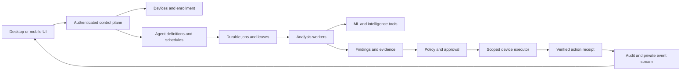

# CyberForge: Detailed Product and Engineering Update Plan

**V2 handoff (October 16, 2026):** [Update Plan V2](plan-update-v2.md) covers the desktop MCP server, AI-enabled CyberForge CLI, and ML service changes. [ML services and training](docs/ML-SERVICES.md) explains the active pipeline and its limits. This document remains the V1 implementation record; its opening status predates the later Section 16 entries. V2 does not mark the remaining V1 release checks complete.

**Review date:** October 2, 2026  
**Code baseline:** local working tree based on commit `6e6704b`  
**Status:** Stage 1 is implemented locally; Stage 2 is in progress. Each completed subtask and its validation are recorded immediately in Section 16. Remaining work is tracked in Section 12.  
**Latest update:** October 12, 2026 — the plan was re-verified against the backend and desktop code, and corrected. Findings F21–F30, milestone M0a, and batch items B00a–B00e are new; F03, F12, and F20 are amended. Work already carried out and the verification record are in [Section 16](#16-implementation-log).

## 1. Purpose and review boundaries

CyberForge already has a substantial foundation: a Tauri desktop application, Rust browser monitoring and local enforcement, an Express backend, Python ML and agent services, and an Expo mobile companion. The next update should turn these pieces into a consistent security product with trustworthy protection status, secure device enrollment, configurable agents, and durable investigations.

This plan comes from reviewing application entry points, authentication, device and agent services, streaming, storage, native desktop commands, mobile capture code, UI components, project scripts, existing tests, and the checked-in Agent Core and Threat Globe screenshots. It is a source review, not a penetration test or proof that a deployed environment behaves exactly like this checkout. No production APIs were tested, no application services were started, and no full build or test suite was run. Dependency vulnerabilities, deployed permissions, provider availability, and performance remain verification work.

The original review preserved local modifications in `backend/.env.example`, `desktop/package-lock.json`, and `desktop/src-tauri/Cargo.toml`, adding only the planning document and its `.gitignore` exception. Subsequent application changes are recorded in Section 16.

**October 12 verification.** Each finding in Section 3 was rechecked against the backend and desktop source, and three contracts were cross-checked mechanically: UI to native commands, desktop to backend routes, and backend to ML service routes. The ML service was also exercised live (Section 16.1). The backend and desktop were still not run: the backend has no reachable deployment (F21), so backend and desktop behavior remains a source-level assessment. Mobile was checked only where it shares a finding with the backend or desktop.

### Planning assumptions

- The desktop application remains the primary security client; mobile supports monitoring, notifications, and platform-supported capture.
- “Device creation” means adding, enrolling, pairing, organizing, and managing devices. A manually added asset must be distinguishable from an enrolled device that actually reports telemetry.
- “Agent creation” means a persistent, user-configurable security worker with an assigned scope, tools, execution mode, schedule, and auditable results.
- Personal use is the first delivery target. Introduce a personal workspace as the ownership boundary so team support can follow without rewriting authorization.
- Preserve the current dark interface, amber action color, cyan telemetry accents, and recognizable CyberForge branding.
- Complete the security foundations before exposing broader remote control or automatic remediation.

### Priority definitions

| Priority | Meaning | Release rule |
| --- | --- | --- |
| P0 | A trust-boundary failure, sensitive-data exposure, or misleading security behavior requiring immediate correction | Blocks a broader connected beta |
| P1 | Core device, agent, reliability, or usability work needed for a dependable release | Required for the relevant feature milestone |
| P2 | Valuable improvements after the core workflows are reliable | Deliver in subsequent iterations |
| P3 | Larger expansion with significant platform or operational requirements | Separate discovery and release decision |

## 2. Current progress: what exists and what remains

“Implemented” below means there is substantive code for the capability. It does not mean the capability passed runtime acceptance testing during this review. A percentage-complete estimate would be misleading without a defined release scope and passing checks.

| Area | Current implementation and evidence | Assessment | Next required step |
| --- | --- | --- | --- |
| Desktop shell | Tauri 2 with static HTML/CSS/JS, shared navigation, installer flow, threat popup, and many feature pages under `desktop/ui/` | Substantial implementation | Validate packaged behavior; replace fixed-canvas layout and inconsistent states |
| Browser monitoring | Rust browser discovery, history collection, foreground/active-URL logic, and scan commands in `system.rs`, `agent.rs`, and `lib.rs` | Substantial implementation | Add explicit collection controls, bounded work, freshness, and platform-specific coverage tests |
| Detection | Backend ML calls, URL/content heuristics, LLM confirmation, IOC extraction, and OTX enrichment | Implemented with several result paths; measured defects in the deployed models (F27) | Standardize verdicts, unknown states, provenance, and evaluation; fix the scoring defects first |
| Local enforcement | Hosts-file blocking and persistent blocked/protected/allowed lists in `blocking.rs` | Blocking has real OS integration; “protect” records intent, and nothing in the UI can add a protected or allowed site (F29) | Verify actual applied state and rollback; avoid implying an active encrypted tunnel from a saved preference |
| Accounts | MongoDB user model, JWT middleware, Appwrite user mapping, Firebase middleware, Google desktop flow | Multiple integrated identity mechanisms | Close role escalation and reconcile identity/permission handling |
| Device records | Appwrite device registration plus a separate distributed-node registry | Foundations exist; lifecycle is fragmented | Build one enrollment and ownership contract; persist identity across restarts |
| Mobile device UI | `DevicesSection.tsx` shows this phone, backend connectivity, and session state | Connection status, not a fleet manager | Add enrollment, inventory, details, revocation, and real device health |
| Persistent agents | `CyberforgeAgent.js` registers an agent/device, polls tasks, and sends heartbeats; `AgentManager.js` manages instances | Working structure, unsafe public control surface | Add scoped IDs, durable definitions, authorization, and recoverable execution |
| Specialist analysis | `agentOrchestrator.js` coordinates URL, DGA, scraping, memory, IOC, behavioral, MITRE, and threat-intelligence specialists | Useful analysis pipeline | Reuse as versioned tools/templates inside the agent lifecycle |
| Python agents | Planner, scheduler, observer, tool registry, memory, and action executor under `ml-services/app/agent/` | Broad implementation with partial action adapters | Define ownership between Node/Python/Rust and eliminate simulated success |
| Policies and audit | Policy CRUD/evaluation and audit service exist; some routes use role authorization | Partial; important stores are process-local | Durable storage, workspace isolation, actual action receipts, protected audit records |
| Realtime | SSE event bus, WebSocket manager, desktop bridge, and mobile live-feed context | Connected infrastructure with isolation defects; the desktop live feed is expected to be blocked by the app's own CSP (F26) | Authenticate streams and route private events by verified ownership; move the desktop stream behind the native layer |
| Memory | Rust local memory, backend feature-hashed memory routes, other ML/vector stores | Multiple implementations | Establish authoritative stores, sync consent, retention, deletion, and ownership |
| Sandbox | URL/file static analysis, hashes/IOCs, MITRE mapping, in-memory evidence locker | Static analysis, explicitly not detonation | Label accurately and persist evidence; treat detonation as a separate project |
| Reports | Desktop report generation and memory integration | Implemented path | Evidence-linked results, reproducibility, privacy-safe exports, accurate engine labels |
| Mobile capture | Kotlin VPN service, SOCKS/proxy code, CA handling, Expo bridge, capture UI, and backend ingest | Significant but incomplete native integration | Supply and verify JNI engine; validate capture safety and supported platforms |
| Quality infrastructure | Backend integration scripts, Python tests, evaluation harness/test cases, some Rust unit tests, and a 74-request manual suite for the ML service (`ml-services/cyberforge-ml.rest`) | Useful starting points | Establish deterministic automated checks and clean-checkout build instructions |
| Deployment and connectivity | Desktop, mobile, and backend CORS all hard-code one Heroku URL that no longer resolves to an app; no client has a configurable backend address | **Not functional:** every connected feature fails today (F21, F22) | Deploy the backend with valid configuration and give every client one configurable base URL |
| Client wiring | All 55 native commands the desktop UI invokes are registered in `lib.rs`; all 25 backend paths the desktop's Rust code calls exist as backend routes | Internally consistent | Keep these two checks as automated contract tests |
| ML service contract | Hugging Face Space with four scikit-learn URL models, a BERT URL classifier, a DGA heuristic, and an in-Space open-source chat model (Section 16.1) | Deployed and tested, but the backend's ML configuration is split and 29 of the 44 ML paths it references do not exist on the Space (F23, F24) | Point every backend ML client at one service and remove or re-home the calls that have no target |

### Product direction for the next release

The core journey should be: **install → choose privacy settings → enroll a device → create an agent → run a scan → review evidence → approve or apply an allowed response → verify the result**.

Every part of that journey should have a durable identity and clear ownership. A connected backend should not imply that a device is protected. An available specialist should not count as a running user-created agent. A generated action should not count as an applied security control.

## 3. Findings that determine implementation order

These are source-level observations from the reviewed baseline, with implications stated separately from unverified deployment exposure. Consult the Section 12 task status and Section 16 implementation log for fixes applied since that review.

| ID | Priority | Observed code behavior | Implication and required correction |
| --- | --- | --- | --- |
| F01 | P0 | `backend/src/routes/auth.js` accepts `admin` and `analyst` in public registration; `authController.register()` persists the supplied role | Public registration must always create an ordinary member. Elevated roles require a separate authorized operation |
| F02 | P0 | `createDocumentWithPermissionFallback()` in `appwriteService.js` supplies public read/write permissions when none are passed and retries certain errors with `Role.any()` | A schema/permission mismatch must fail safely. Audit existing collection/document permissions; actual exposure depends on deployed Appwrite configuration |
| F03 | P0 | Seven route files apply no authentication middleware at all: `agentRoutes.js` (12 routes), `mlRoutes.js` (15), `orchestrator.js` (10), `sandbox.js` (8), `otx.js` (7), `browser-intelligence.js` (4), and `memory.js` (3), 59 routes in total; `server.js` does not add it for these mounts. The desktop itself calls several of them with a caller-supplied user ID (`/api/agent/alerts?userId=`, `/api/agent/scan-url`, `/api/memory/save`) | Centralize authentication and per-object authorization. Caller-supplied user IDs cannot establish ownership. The desktop calls must move to the authenticated principal at the same time, or they will break |
| F04 | P0 | SSE filtering uses `if (target && userId && target !== userId) return` in `routes/stream.js` | Anonymous connections pass this condition for user-targeted events. Reject private events unless the subscriber has the matching verified identity |
| F05 | P0 | WebSocket authentication assigns `message.userId`; desktop/mobile broadcast helpers iterate every client of that type. Capture ingest uses those helpers | Verify credentials and filter at delivery. A user identifier inside the payload does not restrict recipients |
| F06 | P0 | Distributed registration reads signature/timestamp headers without checking them. Telemetry destructures `signature` without verifying it; its replay set is process-local | Bind devices to enrolled keys; verify message integrity and freshness; persist deduplication and reject impersonation |
| F07 | P0 | JWT signing/verification falls back to a fixed source-code secret | Require configured signing material outside explicitly isolated tests; fail startup when production auth is misconfigured |
| F08 | P1 | Distributed listing reads `req.user.id`/`_id`, while middleware supplies `req.user.userId`. “Admin” routes such as `/nodes/all` and weight changes lack role checks | Use one verified principal shape and enforce both role and workspace membership |
| F09 | P0 | Desktop `store_token()` always also writes `session.json`; HF tokens are saved in JSON and recent-token history as well as keyring. **Amended October 13:** it was worse than “as well as”. The `keyring` crate was built with no platform feature, which makes it an in-memory stand-in that keeps nothing after exit, so nothing was ever written to the operating system's credential store and the plaintext files were the only copy of every token. The Settings screen was also sent the full Hugging Face token | Keyring success does not prevent plaintext copies. Migrate credentials, remove copies safely, and return storage failures honestly. **Fixed locally, Section 16.43** |
| F10 | P0 | `is_trusted_domain()` and `scan_url()` force a broad domain/subdomain list to risk zero, including user-content hosting domains | Reputation must be one signal. Never override contrary evidence solely because of a hosting domain |
| F11 | P1 | `AgentManager` keys instances by global display name. `CyberforgeAgent` obtains hostname/platform from the backend process and creates device records on registration | Different users can collide on names; backend workers can be mistaken for endpoints. Separate identities and make enrollment idempotent |
| F12 | P1 | Distributed nodes, policy state, audit entries, sandbox evidence, and backend memory include in-memory stores. So do the two largest route files: `routes/features.js` (58 routes) and `routes/child-pages.js` (66 routes) keep requests, workflows, findings, scans, and browser sessions in process-local `Map`s | Restart and multi-instance behavior can lose or disagree on security state. Add explicit durability contracts. On a platform that restarts processes daily, such as Heroku, this data does not survive a day |
| F13 | P0 | Policy response objects are marked `executed` without a corresponding enforcement receipt. Several Python action handlers return success after logging or updating a set | Represent proposed, queued, applied, failed, and unsupported actions separately; require executor acknowledgement |
| F14 | P1 | `agent-core.html` generates random sparklines, cycles its reasoning display on a timer, toggles capabilities through CSS, and pauses console output locally | Some visible controls/metrics do not describe agent execution. Connect controls to authoritative state or label their limited function |
| F15 | P1 | Desktop CSS starts from an absolutely positioned `1440px × 824px` window. Screenshots show a large floating agent panel covering content | Use responsive layout, reserved panel space, and readable typography |
| F16 | P1 | `Tun2Socks.kt` requires `libtun2socks.so`; no `jniLibs` directory was present in the reviewed module | Do not count capture as complete until a compatible JNI implementation is built, packaged, and exercised on devices |
| F17 | P1 | Mobile capture sync runs for signed-in users; its queue removes a batch before upload and drops failed batches. Backend capture reads use the in-memory ring | Add a separate sync preference, durable retry/outbox behavior, and reads from persisted records after restart |
| F18 | P1 | Tauri CSP permits inline/evaluated scripts; Express disables CSP. Desktop pages use many `innerHTML` paths | Audit untrusted text rendering, move executable inline code, and tighten boundaries without breaking native IPC |
| F19 | P1 | The scraper client defaults to an HTTP external endpoint, and multiple paths fetch user-provided URLs | Require secure provider transport and a shared destination-validation policy; verify redirects and resolved addresses |
| F20 | P1 | Root scripts reference a missing landing `package.json`, an absent iOS build script, and missing `desktop/BUILD.md`; Compose expects PostgreSQL while the backend uses Mongoose | Repair the supported setup/build path before claiming reproducible installation. Compose also references absent backend/landing/proxy inputs, including `backend/Dockerfile`. The root `heroku-postbuild` script runs `npm install && npm run build` inside `cyberforge-landing/`, which has no `package.json`, so a whole-repository Heroku deploy fails at build; only a backend-only (subtree) push works |
| F21 | P0 | **No reachable backend.** `https://cyberforge-ddd97655464f.herokuapp.com` returns Heroku's “No such app” page, and it is hard-coded in the desktop (`state.rs`, `system.rs`, `ui/scripts/cyberforge-shared.js`, `ui/scripts/cf-realtime.js`, `tauri.conf.json`), the mobile app (`src/api/config.ts`, `app.json`), the backend CORS allow-list (`server.js`), and `app.json`. No client reads the address from configuration | Login, registration, policy, threat lists, alerts, memory sync, and every ML call from the desktop fail today. Deploy the backend, then replace the literal with one configurable base URL per client and update the CORS origin. Nothing else in this plan can be validated end to end until this is done |
| F22 | P0 | `server.js` calls `connectDatabase()` and `connectRedis()` during startup; both throw on failure and the process exits. Mock fallbacks exist in `database.js` and `redis.js` but are never used. The local `backend/.env` points Redis at localhost and still has the placeholder `JWT_SECRET` | The backend cannot boot on a host without reachable MongoDB and Redis. Provision both, set a real signing secret (F07), and decide whether Redis is required or optional; if optional, degrade explicitly instead of exiting |
| F23 | P1 | Backend ML clients disagree about where the ML service is. Six default to `http://localhost:8001` (`mlService.js`, `cyberforgeMLService.js` `localAPIUrl`, `ai/AIAnalysisService.js`, `analysisService.js`, `threatService.js`, `analysisController.js`); four default to the Hugging Face Space (`mlServiceClient.js`, `llmFallbackChain.js`, `routes/ai.js`, `routes/orchestrator.js`). They read three different variables: `AI_SERVICE_URL`, `ML_SERVICE_URL`, and `HF_SPACE_URL`. The first two are set to localhost in the local `.env` | In production more than half the ML clients would target the backend's own host. Use one setting, default it to the deployed service, and fail visibly when it is unreachable |
| F24 | P1 | 29 of the 44 ML paths the backend references do not exist on the deployed Space: the training, dataset, agent, batch, recommendation, and threat-map calls in `mlService.js` (used by `routes/ml-training.js`, `routes/ai.js`, `routes/child-pages.js`) and `/analyze/url`, `/analyze/file`, `/analyze/network` in `ai/AIAnalysisService.js`. They belong to the FastAPI service under `ml-services/app/`, which is not deployed | The 16 `ml-training` routes and the AI routes built on these calls cannot work against the Space. Decide per feature: retire the backend route, port the endpoint to the Space, or deploy the second service. Do not present these features as available until one is chosen |
| F25 | P0 | `routes/analysis.js` and `routes/threats.js` treat any request whose `User-Agent` contains `cyber-forge-desktop` or `Electron` as the desktop app and serve `GET /api/threats`, `/api/threats/stats`, `/api/analysis/stats`, and `/api/analysis/history` without a token. The desktop sends that header from `state.rs` | A request header is not a credential; anyone can send it. Require the same authentication as every other client and scope the results to the caller |
| F26 | P1 | The desktop live feed (`ui/scripts/cf-realtime.js`, loaded by 14 pages and `cf-live.js`) opens an `EventSource` from the WebView straight to the backend with the JWT in the query string. The app's CSP in `tauri.conf.json` sets `connect-src 'self' ipc: http://ipc.localhost`, which does not include the backend origin | The live feed is expected to be blocked in a packaged build, independently of F21, and the token would appear in server logs if it were not. Consume the stream in Rust and forward events over Tauri events, as SEC-02 already recommends; verify in a packaged build. **Done except the packaged-build check, Section 16.44** |
| F27 | P1 | Live tests of the deployed models (Section 16.1) show the anomaly model's output is read backwards, so clean URLs score 50, “medium”; the phishing, malware, and web-attack models have identical feature importances and use two features; the DGA check scores only the first DNS label; `ioc-scan` ignores `ip` and `hash`; malformed input returns HTTP 500 | Every URL verdict the desktop shows is built on these scores. Fix the inversion and input handling, then retrain or replace the three duplicate models before DET-01 evaluation; do not tune thresholds on the current outputs |
| F28 | P1 | Three clients choose the language model independently. The backend's `llmFallbackChain.js` calls Gemini directly when `GEMINI_API_KEY` is set, then the Space. The desktop's `ml.rs` calls DeepSeek directly with a user-supplied Hugging Face token, then the backend. The Space answers with its own small in-Space model. UI text and `ml-services/eval/eval_harness.py` still name DeepSeek as the engine | The same question can be answered by three different models with different quality and data-sharing implications, and the engine label shown to the user can be wrong. Choose one policy (Section 15), report the engine that actually answered, and keep the small model's output advisory (Section 16.1 limitations) |
| F29 | P2 | **Withdrawn as stated, October 13.** It said three native commands were never invoked. All three are: `mark_installed` from the setup wizard (`installer.js`), and `protect_site` and `allow_site` from the shared threat-action buttons, the floating agent panel and the alert window; the earlier statement that they were not was wrong. What was wrong with them is the wording: “Protect” promised a secure tunnel that does not exist, and “Allow” said the site was trusted when the scanner never reads the allowed list | The wording is corrected in Section 16.37; nothing else to do |
| F30 | P1 | The ML Space is public and unauthenticated, and its chat model handles one request at a time on two CPU cores | Anyone who finds the URL can occupy the model and push real users onto the template fallback. Put the Space behind the backend with a shared secret or make it private, and rate-limit the chat routes |
| F31 | P0 | Two working AlienVault OTX API keys were written into tracked files of this public repository: one as the fallback in `backend/src/services/otx.js` (it is the key the deployed backend was using, because the app had no `OTX_API_KEY` set), and a different one in `desktop/ui/pages/loading.html` and `threat-globe.html`, passed to the native `otx_fetch` command | Both keys are disclosed and stay in the git history whatever is changed now. Removed from the source and guarded by a test (Section 16.39). **The owner must replace both keys in the OTX account**; removing them from the files does not undo the disclosure |
| F32 | P1 | The desktop app copies browser history into its own file (`history_collection.json`), lists it, and sends addresses from it to the backend to be scanned, with whatever was in the address bar: sign-in codes, session tokens, auto-login and reset links. On the development machine the file held 6,570 addresses, 29 of them with a session-token-shaped value | A second plaintext store of credentials, and a scanner that fetches such an address is using the person's credential. Credentials are now removed from every address when history is collected (Section 16.43). The wider SEC-07 controls (consent, retention, clearing history) remain |

Additional verification targets: the desktop OAuth request shown in `auth_google()` does not include state or PKCE parameters; Android CA storage uses a fixed-password PKCS#12 file; the upstream TLS socket sets SNI without explicit endpoint-identification configuration. Review these end to end and add negative tests before declaring them secure. Do not treat this static review as a demonstrated exploit against a running installation.

## 4. Target architecture and ownership

### 4.1 One product model across the existing runtimes

Retain the existing languages and clients. Assign responsibilities explicitly:

| Component | Intended responsibility | Boundary |
| --- | --- | --- |
| Desktop Rust | Local sensors, local storage, key storage, capability discovery, local execution and verification | Privileged operations remain behind validated native commands |
| Desktop/mobile UI | Configuration, inventory, approval, status, evidence, and reports | UI state is not proof of execution or authorization |
| Express control plane | Verified identity, workspace membership, enrollment, agent definitions, scheduling contracts, event authorization | Every private operation derives scope from authenticated context |
| Worker runtime | Claims jobs, runs specialist workflows, emits results, renews leases | Receives only the job's scoped capabilities and data |
| Python ML service | Versioned inference and analysis tools | Authenticated service access; no parallel public administration surface |
| Persistence | Authoritative records, audit, evidence metadata, sync cursors | Ownership fields and migrations are mandatory |



The diagram describes the target connected workflow. Local-only scanning should remain available without a cloud account where the selected tools support it. Cloud features must declare what data leaves the device.

### 4.2 Persistence decision and migration

**Recommended initial approach:** keep MongoDB as the existing account/JWT authority and Appwrite as the existing control-plane record store, with an explicit internal identity mapping. This avoids a simultaneous identity-platform rewrite. Revisit consolidation after the lifecycle is stable.

1. Define an immutable internal user ID; map MongoDB IDs, Appwrite IDs, and verified provider subjects in one place.
2. Create personal workspace records and memberships. Never use a display name, email, request header, or device fingerprint as authority.
3. Define repositories for devices, agents, runs, policies, evidence, and audit so routes do not access raw global maps.
4. Decide whether clients may access Appwrite directly. Prefer server-mediated control-plane writes initially; configure document/collection permissions accordingly. Do not mix internal IDs with Appwrite role IDs.
5. Use Redis for bounded caches, coordination, and short-lived replay state where appropriate; durable records remain authoritative after Redis loss.
6. Version migrations; back up existing records; backfill ownership from verified mappings. Quarantine ambiguous records for review instead of assigning them to an arbitrary user.
7. Keep a migration ledger and stable legacy-to-new ID map. Validate record counts, owner mapping, and duplicate devices before changing reads.
8. Remove compatibility adapters only after desktop and mobile clients have migrated. Rollback must preserve newly created IDs and audit records.

### 4.3 Shared records and contracts

These are proposed models, not a claim that collections already exist.

| Record | Essential fields and constraints |
| --- | --- |
| Workspace / Membership | `workspaceId`, `userId`, role, status, created time; unique membership per workspace/user |
| Device | `deviceId`, `workspaceId`, display name, kind, platform, installation ID, key reference, enrollment state, last seen, capabilities, client version, desired/applied policy versions |
| Enrollment | ID, workspace, token hash, intended device kind, expiry, issuer, claim state, attempts, claimed key thumbprint; atomic one-time consumption |
| DeviceCredential | Device ID, public key or credential reference, key version, validity, revoked time; never return private key material |
| AgentDefinition | ID, workspace, name, template/version, instructions, device scope, tools, execution mode, budgets, schedule, status, config version |
| AgentAssignment | Definition ID, device ID or worker pool, desired version, applied version, runtime health; unique active assignment |
| AgentRun / RunStep | Run ID, trigger, definition snapshot, workspace, target, lease, step states, engine versions, evidence references, outcome, timing, usage |
| Finding / Incident | Workspace/device/run IDs, severity, confidence, category, status, deduplication key, first/last seen, owner, evidence links |
| Policy / Action | Policy version, scope, trigger, allowed action, approval rule; action ID, target, expiry, requester, executor receipt, rollback reference |
| AuditEvent | Server-assigned identity, workspace, actor, action, resource, outcome, timestamp, correlation ID; distinguish client-reported observations |
| SyncBatch / Cursor | Workspace/device IDs, batch ID, sequence/epoch, schema version, accepted time, acknowledgement, retry status |

Use one timestamp representation in API contracts, explicit units, bounded pagination, shared error codes, and versioned schemas. Runtime validation is necessary even where TypeScript types exist. Proposed common errors include `AUTH_REQUIRED`, `FORBIDDEN`, `DEVICE_REVOKED`, `CAPABILITY_UNAVAILABLE`, `APPROVAL_REQUIRED`, `PROVIDER_UNAVAILABLE`, and `STALE_VERSION`.

## 5. Security implementation workstream

### SEC-01 — Authentication, roles, and ownership [P0]

**Touchpoints:** `backend/src/server.js`, `routes/auth.js`, `controllers/authController.js`, `middleware/auth.js`, `middleware/firebaseAuth.js`, all sensitive route groups, and `services/appwriteService.js`.

- Force ordinary-member registration on the server and ignore/reject submitted elevated roles. Add authorized role changes with audit records.
- Define a single principal object containing verified user, workspace, role, and authentication method. Device credentials use a distinct principal type.
- Inventory every HTTP route and classify it as public metadata, user-scoped, privileged, or internal service-only. Apply default-deny middleware and object ownership checks.
- Protect agent lifecycle, jobs, memory, analysis history, evidence deletion, policy evaluation, training, and administrative operations. A role check alone is insufficient when an object belongs to another workspace.
- Remove permissive Appwrite fallbacks; correct schema permissions and test them through both backend and any supported direct client access.
- Validate signing configuration at startup. Add session revocation, bounded session lifetime, refresh-token rotation if used, and consistent account-disable/lock behavior.
- Review login failure tracking against the existing account-lock fields. Add a complete reset/recovery flow and optional MFA before administrative team use.
- Complete native OAuth with state validation, PKCE, bounded loopback callback handling, and single-use authorization codes. Native OAuth design should follow [RFC 8252](https://www.rfc-editor.org/rfc/rfc8252).

**Acceptance:** public signup cannot create privileged users; user A cannot read or mutate user B's objects through any supported transport; missing signing material prevents connected production startup; disabled/revoked sessions lose access; permission misconfiguration never produces public documents.

Object-level checks, function-level authorization, and resource limits should be included in the route inventory, consistent with the [OWASP API Security Top 10](https://api-security.owasp.org/editions/2023/en/0x11-t10/). These are design references, not a certification claim.

### SEC-02 — Private realtime transport [P0]

**Touchpoints:** `routes/stream.js`, `services/realtimeBus.js`, `services/websocket.js`, `routes/network-capture.js`, `desktop/ui/scripts/cf-realtime.js`, and mobile live-feed/SSE modules.

- Fix anonymous SSE delivery immediately. Private events require an authenticated subscriber matching the target workspace and authorized resource scope.
- Authenticate WebSockets before accepting identification, scans, or subscriptions. Derive identity from verified credentials; never trust `message.userId`.
- Make event visibility explicit: `public_intelligence`, `workspace`, or `device`. Missing visibility/ownership must not default a private event to public.
- Replace client-type broadcasts with authenticated subscription routing. Public OTX intelligence and private device observations use distinct topics and payload schemas.
- Prefer authenticated headers through native clients/Rust. If a browser transport requires a URL token, use a narrowly scoped, short-lived stream ticket; redact it from access logs.
- Add expiry/revocation handling for open connections, bounded outgoing buffers, reconnect backoff, event IDs, and a documented replay window.

**Acceptance:** test guest, expired session, user A, user B, and revoked device subscribers simultaneously. Each sees only permitted events; reconnects do not duplicate alerts or leak previous-account data.

### SEC-03 — Credentials and local data protection [P0/P1]

**Touchpoints:** desktop `auth.rs`, `ml.rs`, `memory.rs`, `system.rs`, mobile `src/api/storage.ts`, and native CA storage.

- Stop writing auth/provider tokens to plaintext session/config history. Store secrets in platform secure storage; show only masked status and source in settings.
- Migrate existing tokens only after verifying the secure write and read. Then remove the obsolete secret fields/files while preserving unrelated settings.
- If secure storage is unavailable, offer a clearly temporary session or actionable error. Do not silently claim persistent secure storage succeeded.
- Separate non-secret profile/preferences from credentials. Define logout, account-switch, provider-disconnect, and device-revoke cleanup independently.
- Encrypt sensitive local history, memory, and capture stores using a protected key where supported; set restrictive file access and retention limits.
- Review web-client token persistence separately from native SecureStore. Avoid persistent web secrets where a secure session mechanism is practical.
- Protect capture CA private keys with platform-backed protection where compatible; do not rely on a fixed file password. Exclude sensitive material from backups and diagnostic exports.

**Acceptance:** a filesystem search of application-owned storage after migration finds no plaintext session/provider tokens; settings and logs never reveal full secrets; logout/account switching isolates local data; key-store failures are visible and recoverable.

### SEC-04 — Fetching, uploads, and input safety [P1; before broad scanning access]

**Touchpoints:** scraper services, domain-intelligence routes, sandbox uploads, Rust page fetching, ML URL tools, and report rendering.

- Route URL fetching through a common policy: allowed schemes, normalized hostnames, DNS resolution checks, destination restrictions, redirect limits, timeouts, and response-size limits.
- Reject public-cloud scans targeting loopback, private, link-local, or metadata-service addresses, including alternate address encodings and redirects. Recheck destinations at connection time to address rebinding.
- Support private-network analysis only through an explicitly scoped local capability for networks the user is authorized to assess.
- Require HTTPS for external provider traffic. If the configured scraper cannot support it, report unavailable instead of falling back silently to HTTP.
- Fetch suspicious content in isolated analysis workers without ambient cookies, credentials, privileged mounts, or unrestricted network access. Keep captured scripts out of the application WebView.
- Validate uploads by size, type, parser limits, storage path, and archive expansion budget. Treat filenames and report/CSV cells as untrusted output.
- Limit batch size, concurrency, provider use, training requests, and per-workspace queued work. Apply separate quotas for cheap metadata and expensive analysis.

**Acceptance:** tests cover private/loopback destinations, redirect-to-private, DNS changes, oversized responses, slow responses, malformed uploads, and dangerous report content. Legitimate scans still work. Detailed fetch controls should be checked against the [OWASP SSRF prevention guidance](https://cheatsheetseries.owasp.org/cheatsheets/Server_Side_Request_Forgery_Prevention_Cheat_Sheet.html).

### SEC-05 — Desktop trust boundary and safe rendering [P1]

- Audit every Tauri command, particularly token retrieval, file access, reports, OS changes, and provider calls. Validate inputs inside Rust even when the UI already validates them.
- Separate the threat-alert window's required operations from the main application's capabilities. Review custom-command authorization as well as plugin permissions.
- Replace unsafe rendering of URLs, page titles, provider responses, and model text with text nodes or a maintained restricted renderer. Audit existing escaping helpers instead of assuming every `innerHTML` call is exploitable.
- Move inline executable code/event handlers into modules and remove unnecessary script evaluation allowances. Test the packaged CSP and native IPC together.
- Harden hosts-file updates: narrow privileged helper, unique protected temporary files, safe path handling, concurrency control, backup, atomic replacement, verification, and rollback.

**Acceptance:** hostile page titles and AI responses render as text; the popup cannot invoke unrelated sensitive operations; cancelling elevation leaves enforcement accurately marked unapplied; unrelated hosts entries survive changes. Use Tauri's [security model](https://v2.tauri.app/security/) and [CSP guidance](https://v2.tauri.app/security/csp/) to validate the boundary.

### SEC-06 — Trustworthy detection and enforcement [P0/P1]

- Remove the forced-clean domain shortcut. Use scoped, expiring user exceptions with reasons; continue recording conflicting evidence.
- Standardize `benign`, `suspicious`, `malicious`, and `unknown` verdicts. Keep severity, confidence, and risk score separate.
- Return analysis coverage: checks attempted/completed, unavailable engines, evidence age, local/remote source, model/version, and duration.
- Missing evidence, provider errors, or unsupported checks must produce `unknown`/partial coverage, not a green clean result.
- Change the policy action lifecycle to `proposed → awaiting_approval → queued → executing → applied/failed/expired`, with `rolled_back` when verified. Record the outcome of each actual adapter.
- Treat hosts blocking as a documented domain-resolution control with limits. Do not label it complete network isolation.
- Rename “Protect” to a truthful saved-policy action until a supported protection mechanism is applied and checked.

**Acceptance:** an unavailable engine is visible; known-host reputation cannot erase malicious evidence; a simulated/no-op action cannot be marked applied; every applied response has an executor, target, time, and verification result.

### SEC-07 — Privacy and explicit data-sharing controls [P1]

- Add separate controls for browser-history access, active-tab monitoring, full-history import, capture, cloud enrichment, LLM processing, and cross-device sync.
- Explain the data sent by each feature before enabling it: URL, domain, page excerpt, findings, or capture metadata. “Local-first” copy must match actual network behavior.
- Default to metadata/minimized evidence where possible. Redact credentials, authorization headers, cookies, sensitive query parameters, and form values before persistence or provider calls.
- Provide per-device retention, pause collection, clear local history, delete synced data, export, and account deletion with an auditable completion state.
- Store consent version/time and clear queued sensitive uploads when consent is withdrawn. Account switching must not upload the previous user's backlog.

**Acceptance:** with cloud processing disabled, local scans make no cloud analysis requests; revoking sync stops queued uploads; deletion propagates through authoritative stores and derived memory according to documented retention.

### SEC-08 — Durable audit and evidence [P1]

- Persist security events with workspace, actor, resource, outcome, and correlation IDs. Append server-generated events at the operation that actually changes state.
- Distinguish client-reported observations from authoritative records of role changes, approvals, enrollment, and enforcement.
- Restrict audit modification permissions. Add integrity verification/checkpoints and backup retention; do not describe `Object.freeze()` or a hash chain alone as tamper-proof storage.
- Hash evidence artifacts, preserve collection time and source, and document transformations/redactions. Link report assertions to evidence IDs.
- Make evidence deletion respect retention policy and preserve a minimal deletion audit event.

**Acceptance:** restart and multi-instance tests preserve events; normal users cannot rewrite security history; exported evidence has a verifiable manifest; derived reports show missing or deleted evidence honestly.

## 6. Device creation and management workstream

### DEV-01 — Canonical device identity [P1]

**Build on:** Appwrite device methods, `distributedIntelligenceService.js`, desktop system profile code, and `DevicesSection.tsx`.

- Create a stable installation identity and device key pair at first enrollment; persist across restarts and application upgrades.
- Separate `endpoint`, `backend_worker`, and `inventory_only` device kinds. A server agent's hostname must not masquerade as the user's laptop.
- Make registration idempotent by workspace and installation identity. Display names may change without changing IDs.
- Replace the distributed map as the sole source of truth. Map legacy node/device IDs to the canonical record.
- Store advertised capabilities separately from capabilities enabled by policy and confirmed by runtime checks.

**Acceptance:** restarting/reinstall-recovery does not create duplicate device records; a backend worker is visibly identified; a renamed device retains its agents/history; duplicate names do not merge devices.

### DEV-02 — Add-device wizard and pairing [P1]

**Proposed flow:**

1. Open **Devices → Add device** and choose Windows, macOS, Linux, Android, or inventory-only asset. Show unsupported capabilities before enrollment.
2. Choose **Enroll this device**, **Pair another device**, or **Add an inventory record**.
3. For pairing, generate a short-lived, one-time token represented as QR/deep link and manual code. Store only its hash server-side; bind it to the issuing workspace and intended flow.
4. The target installation generates its own key, claims the enrollment, and proves possession through a challenge. A device fingerprint is descriptive metadata, not authentication.
5. Show the proposed name, platform, workspace, and key confirmation on the enrolling surface; require the appropriate authenticated approval before activation.
6. Let the user choose collection and sync options. Complete necessary local OS permission prompts on the target device.
7. Verify a signed heartbeat and baseline capability check. Finish with the real state: connected, awaiting permission, partial coverage, or offline.
8. Offer a compatible agent template. Do not silently create broad autonomous access during enrollment.

**Failures to design:** expired code, already-claimed token, invalid workspace, account mismatch, interrupted setup, denied OS permission, duplicate installation, unsupported version, and unavailable secure storage.

**Acceptance:** concurrent claims cannot enroll two devices with the same token; wrong-workspace claims fail; no user JWT is embedded in a QR code; cancelled enrollment creates no active credential; retry resumes safely.

### DEV-03 — Device inventory and detail screens [P1]

Inventory columns: name, platform/kind, enrollment state, last seen, protection coverage, active agents, open alerts, version, and policy status. Support search, filters, grouping, stable sorting, and accessible list/card layouts.

Device details should contain:

- **Overview:** connection, last heartbeat, assigned agents, current risk, and a concise reason for degraded coverage.
- **Permissions and sensors:** supported/enabled/denied/unavailable states for each sensor; a repair action where possible.
- **Activity and evidence:** recent runs, findings, actions, and incident links scoped to this device.
- **Policies:** desired versus applied version, changes awaiting approval, and last enforcement receipt.
- **Privacy:** collection scope, storage usage, retention, last sync, and data deletion controls.
- **Management:** rename, tags/groups, diagnostics, credential rotation, revoke, and remove inventory record.

Connection and protection are separate indicators. “Online” means a recent authenticated heartbeat; “Protected” requires the configured protection capabilities to be running successfully.

**Acceptance:** an offline but previously protected device shows stale state and last-known time; an online device with denied permissions is degraded; inventory-only assets never show invented telemetry.

### DEV-04 — Heartbeats, telemetry, and reliable sync [P1]

- Sign telemetry envelopes containing device/workspace identity, schema version, key version, timestamp, batch ID, sequence/epoch, and payload digest.
- Verify credentials, signature, freshness, size, ownership, and replay protection before ingestion. Canonicalize signed bytes consistently across Rust/JS/Kotlin.
- Use idempotent ingestion with acknowledgements and a bounded persistent client outbox. Separate fast live display from durable acceptance.
- Track disconnected, stale, and revoked states using server time; tolerate documented client clock skew.
- Persist last accepted sequence/epoch across server restarts and define safe recovery after device key rotation or installation reset.
- Replace mobile's constant `mobile` device identifier with the enrolled device ID; make cloud capture sync independently configurable.
- Add retry/backoff, queue limits, dropped-event counts, and manual retry. Read persisted capture records when the ring buffer is empty after restart.

**Acceptance:** duplicate batches produce one durable result; forged/replayed messages fail; a disconnected device reconnects without losing acknowledged data; queue saturation is visible; one device cannot submit telemetry under another identity.

### DEV-05 — Revocation, lifecycle, and policy delivery [P1]

- Support revoke, rotate credentials, pause collection, and remove from inventory as different operations with clear consequences.
- Deliver signed, versioned, expiring commands only to enrolled devices with the required capability. Include idempotency keys and receipts.
- Reject new jobs and server requests immediately after revocation. Close connected sessions and subscriptions.
- Define offline behavior explicitly: remote revocation cannot instantly reach a disconnected device. Short-lived execution leases and command expiry bound queued remote actions; local user controls remain available.
- Support device groups and desired/applied policy reconciliation without assuming a broadcast means success.
- Offer explicit decisions for retaining evidence and detaching agents when a device is removed.

**Acceptance:** revoked credentials cannot reconnect or fetch work; stale commands cannot execute after reconnect; remote policy success appears only after a matching device receipt; an unreachable device is never shown as remotely wiped.

### DEV-06 — Platform capability matrix [P1]

| Platform | First supported scope | Required verification before claiming support |
| --- | --- | --- |
| Windows desktop | Enrollment, browser monitoring, local history controls, scans, hosts blocking | Browser/profile coverage, UAC cancellation, hosts rollback, keyring migration, packaging |
| macOS desktop | Same shared features where native code supports them | Browser data permissions, secure storage, enforcement helper, signing/notarization workflow |
| Linux desktop | Shared monitoring and local analysis where supported | Keyring availability, browser paths, privilege boundary, packaging on supported distributions |
| Android native build | Companion plus optional supported VPN capture | Compatible JNI library, VPN permission/foreground lifecycle, network restoration, TLS behavior, battery use |
| iOS | Companion inventory, alerts, evidence, approvals | Clearly disable unsupported Android capture; separate discovery for any native network extension |
| Expo Go / web | Companion functionality supported by the runtime | Honest unsupported capture state and platform-appropriate authentication |
| Inventory-only assets | Owner-entered descriptive asset record | No scanning/protection claims until a supported connector is enrolled |

Android VPN behavior must account for the system permission flow and the fact that only one VPN service can be active per user/profile. Capture should remain optional and have a clear stop/recovery path. See [Android VPN documentation](https://developer.android.com/develop/connectivity/vpn).

### Proposed device API contract

New endpoints below are design proposals. Existing `/api/distributed/*` routes should be secured immediately and later adapted or deprecated deliberately.

| Endpoint | Principal / permission | Behavior |
| --- | --- | --- |
| `POST /api/v1/device-enrollments` | User with device-enrollment permission | Create one-time enrollment; return expiry and pairing material |
| `POST /api/v1/device-enrollments/claim` | Enrollment token + key proof | Atomically claim only the permitted enrollment |
| `GET /api/v1/devices` | Workspace member | Paginated authorized inventory |
| `GET/PATCH /api/v1/devices/:id` | Authorized reader / manager | Read details or edit allowed metadata |
| `POST /api/v1/devices/:id/heartbeat` | Bound device credential | Update presence and applied state |
| `POST /api/v1/devices/:id/telemetry` | Bound device credential | Validate and acknowledge idempotent batches |
| `POST /api/v1/devices/:id/rotate-key` | Bound key proof or recovery permission | Rotate with bounded overlap and audit |
| `POST /api/v1/devices/:id/revoke` | Device manager, stronger authentication as configured | Revoke sessions/credentials and invalidate remote work |
| `GET /api/v1/devices/:id/actions` | Device credential or authorized viewer | Device receives only applicable unexpired work; viewer gets status |

## 7. Agent creation and execution workstream

### AGT-01 — Separate definitions, assignments, runtimes, and tools [P1]

The existing code uses “agent” for a desktop assistant, persistent Node process, Python autonomous loop, and specialist analyzer. Give each a precise product meaning:

- **Agent definition:** the user's saved configuration and objective.
- **Assignment:** where that definition may run and which devices/resources it can access.
- **Runtime instance:** a worker executing an assignment with a lease and health state.
- **Tool/specialist:** a bounded operation such as URL classification or IOC extraction.
- **Run:** one traceable execution with inputs, steps, evidence, usage, and outcome.
- **Assistant:** the interface that explains evidence and proposes actions through the same authorized APIs.

Use stable IDs rather than global names in `AgentManager`. Reuse the existing orchestrator as a workflow/tool implementation and Python components where they have a clear responsibility. Choose one scheduling authority; do not let multiple independent loops claim the same job without coordination.

**Acceptance:** two users can each create an agent called “Default” without sharing state; the specialist catalog and active-agent count are distinct; every task belongs to a workspace, definition, and run.

### AGT-02 — Create-agent wizard [P1]

1. **Choose a template:** explain what it detects and which data/tools it needs.
2. **Name and objective:** unique ID generated by the server; human-readable name and optional bounded custom instructions.
3. **Choose scope:** selected devices/groups, authorized URLs/domains, exclusions, and local versus remote execution. Show incompatible devices with a reason.
4. **Choose permissions:** tool allowlist, data access, approved external providers, and maximum action scope. Present a readable permission summary.
5. **Choose behavior:** Observe, Assist, or Guarded automatic mode. Observe is the default.
6. **Choose schedule and budget:** event-driven/on-demand/recurring, timezone, quiet hours, concurrency, timeout, provider/token limits, and network/battery preferences.
7. **Test configuration:** perform a dry run on a safe fixture or user-selected authorized target; show planned steps, coverage gaps, and potential actions.
8. **Review and activate:** display devices, collection scope, provider sharing, permitted responses, and resource budget. Save a versioned configuration and start only after successful validation.

Allow save-as-draft at any step. Validation errors must preserve input. Changes to an active agent produce a new configuration version and a permission diff; increased privileges require appropriate authorization.

**Acceptance:** a user can create, test, activate, edit, pause, resume, clone, and archive an agent; unsupported tools cannot be enabled through a modified API request; duplicate submission creates one definition.

### AGT-03 — Initial template catalog [P1/P2]

| Template | Reuse | Initial actions and limits |
| --- | --- | --- |
| Browser Guardian | Rust active URL collection, URL/content checks, classifier | Observe visited URLs within consent scope; alert first; optional approved domain block |
| URL and Phishing Analyst | URL classifier, scraper, IOC extraction, OTX | Analyze selected links; bounded content fetch; evidence-based verdict; no credential submission |
| Threat Intelligence Watcher | OTX and domain/IOC matching | Match enrolled-device observations against fresh intelligence; distinguish an intel hit from a confirmed compromise |
| Device Health Monitor | Heartbeats, system stats, capability status | Detect stale monitoring, missing permissions, version drift, failed enforcement, and resource pressure |
| Incident Investigator | Existing orchestrator, memory, evidence, MITRE mapping | Correlate selected findings; build a timeline and recommend next actions; no unapproved expansion of scope |
| Report Assistant | Report generation and scoped retrieval | Summarize a selected time range with evidence links and limitations; no automatic external sharing |
| Policy Response Agent | Policy evaluation plus verified executor | Guarded mode only after action receipts, approval, expiry, and rollback are implemented |

Custom agents should initially compose approved templates/tools and instructions. Arbitrary uploaded executable tools, unrestricted shell access, or self-granted permissions are outside the first release.

### AGT-04 — Runtime state, scheduling, and recovery [P1]

- Definition lifecycle: `draft → validating → ready → active → paused → archived`; configuration errors remain explicit.
- Run lifecycle: `queued → leased → running → waiting_approval → completed/partial/failed/cancelled/expired`.
- Persist run state, step status, tool inputs after redaction, results, evidence IDs, policy version, and timing. Store concise execution explanations, not invented reasoning traces.
- Claim work atomically with leases, heartbeats, and bounded retries. Use fencing/version checks so an expired worker cannot later apply a stale action.
- Deduplicate retries and schedule triggers. Record scheduler timezone and daylight-saving behavior; distinguish missed-run catch-up from duplicate execution.
- Add cancellation propagation to provider calls and queued actions; define what can be cancelled once an OS operation has begun.
- Provide global/workspace/device emergency pause controls. Stop new work and prevent pending privileged actions from starting; show in-flight work separately.
- Enforce maximum concurrency, steps, duration, provider spend, and memory. Exceeding a budget produces a visible partial result.

**Acceptance:** restart during a run either resumes safely or reports a recoverable failure; two workers cannot apply the same action; pause changes the runtime rather than only console rendering; revoked devices cannot receive resumed work.

### AGT-05 — Permission modes and approval [P1]

| Mode | Allowed behavior | Approval rule |
| --- | --- | --- |
| Observe | Collect permitted telemetry, analyze, and produce findings | No system-changing actions |
| Assist | Observe plus propose scoped remediation | User approves the concrete action and target |
| Guarded automatic | Execute a restricted set of preauthorized, reversible responses | Allowed only within a versioned policy, current scope, and verified capability |

Approval records bind the approver, exact target, action parameters, policy/config version, expiry, and relevant evidence. Editing the target or action after approval invalidates it. The executor rechecks permissions, current device state, and policy before acting.

Initial automatic responses should be narrow, such as applying a time-limited block to a confirmed domain on an explicitly opted-in device. File deletion, broad network isolation, certificate changes, or unconstrained commands should not be default capabilities.

**Acceptance:** stale/reused approvals fail; an agent cannot approve its own requested privilege increase; revoking a permission prevents subsequent execution even if an earlier plan included it; every automatic action has a reason, receipt, and supported recovery path.

### AGT-06 — Untrusted content, memory, and model safety [P1]

- Treat website text, PDFs, logs, threat feeds, memory entries, and retrieved instructions as untrusted evidence.
- Keep tool authorization and response policy outside the model. Model output may suggest an action but cannot expand scope or disable verification.
- Validate structured tool arguments against schemas; allow only tools enabled for the current definition and run.
- Minimize provider payloads and redact secrets before model calls. Separate memory by workspace/device and distinguish observations from verified facts.
- Record memory provenance and expiry. A past user exception should not silently become a global security rule.
- Test malicious content that asks the model to disclose secrets, call another device's tools, mark a threat clean, or overwrite policy.
- Return user-facing evidence summaries, tool results, and decision explanations. Animated “thinking” is not an execution trace.

**Acceptance:** hostile retrieved content cannot obtain unauthorized tool access, change policy, or expose another workspace's memory. Apply defense in depth consistent with [OWASP prompt-injection guidance](https://genai.owasp.org/llmrisk/llm01-prompt-injection/); no single prompt is a security boundary.

### AGT-07 — Agent detail, run history, and debugging [P1]

Create an agent list with status, template, assigned devices, last run, recent outcome, pending approvals, and resource use. Agent details should have Overview, Runs, Permissions, Devices, Schedule, and Configuration History.

The run view shows a real step timeline: collected evidence, completed checks, skipped checks, provider failures, pending approvals, and action receipts. Make logs searchable by run/device ID and redact sensitive values. Include “Retry failed checks” and “Clone as draft” where valid.

**Acceptance:** users can explain why an alert was raised, which engine produced it, what failed, and what action actually happened without reading server logs. Status remains consistent between desktop and mobile.

### Proposed agent API contract

| Endpoint | Behavior |
| --- | --- |
| `GET /api/v1/agent-templates` | Return permitted templates and required capabilities |
| `POST /api/v1/agents` | Create scoped draft with validated configuration |
| `GET/PATCH /api/v1/agents/:id` | Read/update authorized definition with version check |
| `POST /api/v1/agents/:id/validate` | Validate capabilities, scope, tools, and budgets |
| `POST /api/v1/agents/:id/dry-run` | Produce a bounded preview without remediation |
| `POST /api/v1/agents/:id/activate` | Activate a validated version |
| `POST /api/v1/agents/:id/pause` | Persist desired paused state and signal runtimes |
| `POST /api/v1/agents/:id/runs` | Enqueue authorized idempotent execution |
| `GET /api/v1/runs/:id` | Return scoped run, steps, evidence, and outcomes |
| `POST /api/v1/runs/:id/cancel` | Request cancellation and report actual state |
| `POST /api/v1/actions/:id/approve` | Approve an immutable action proposal within authority |
| `POST /api/v1/actions/:id/rollback` | Request a supported scoped rollback and track receipt |

All endpoints require verified workspace ownership and operation-specific permission. Worker claims and device execution APIs use separate restricted credentials.

## 8. Detection, investigation, and reporting improvements

### DET-01 — Evaluation before stronger automatic responses [P1]

- Extend `ml-services/eval/eval_harness.py` beyond loose response-keyword checks. Preserve useful existing smoke cases but add deterministic security assertions and labeled detection datasets.
- Separate training, validation, and held-out test data; avoid domain/time leakage. Record dataset provenance, collection date, label source, and known blind spots.
- Evaluate benign services, malicious content hosted on otherwise reputable domains, lookalikes, redirects, multilingual pages, inaccessible pages, and provider failures.
- Measure precision, recall, false-positive rate, calibration, coverage, latency, and abstention. Report results by threat category and by local heuristic versus remote model path.
- Version model artifacts and threshold policies. Stage replacements, compare against the baseline, and keep a rollback path.
- Do not present hard-coded model accuracy or heuristic score transformations as measured confidence. Define what each UI number actually means.

**Acceptance:** each released detector has a reproducible evaluation report and explicit limitations; provider failures are counted; automatic blocking thresholds require stronger evidence than advisory alerts.

### DET-02 — Useful alerts and incident workflow [P1]

- Give findings a stable ID and deduplicate by device, normalized target, category, and time window while preserving recurrence count.
- Add acknowledge, assign, investigate, resolve, reopen, and false-positive feedback states. Keep severity independent of workflow state.
- Group related findings into incidents with a shared timeline and evidence, including the device's last-known coverage.
- Display “Why this matters,” observed evidence, confidence/coverage, recommended next step, and action outcome.
- Support scoped exceptions with an owner, reason, expiry, and audit trail. Reevaluate exceptions when new contradictory evidence appears.

**Acceptance:** repeated scans do not flood identical alerts; resolving an incident preserves its history; false-positive feedback does not silently weaken detection for other users.

### DET-03 — Static analysis and evidence locker [P1/P2]

- Label the current sandbox as static URL/file analysis and describe supported checks.
- Persist metadata/evidence with ownership, hash, retention, and scan version. Add search, comparison, and export manifests.
- Show MITRE mappings as evidence-linked hypotheses when derived from keywords; do not imply a confirmed attack technique from a string match alone.
- If detonation is later added, create a separate isolated service with restricted egress, disposable execution environments, artifact handling, and dedicated validation. Ordinary containers alone are not a complete hostile-code isolation design.

### DET-04 — Reports and intelligence context [P2]

- Generate reports from a fixed evidence snapshot, selected devices, and explicit time range/timezone.
- Include incomplete scans, stale devices, provider outages, rule/model versions, and data sources alongside findings.
- Distinguish public threat-intelligence pulses from attacks observed against this user's devices. Label approximate geography and source age on the globe.
- Support a concise executive summary and an evidence appendix. Provide redacted export previews and consistent HTML/PDF output.
- Keep report distribution manual initially; add integrations only with explicit workspace configuration and delivery audit.

## 9. Design and usability workstream

### UX-01 — Clear navigation and product hierarchy [P1]

Recommended top-level navigation:

| Destination | Purpose and existing pages to consolidate |
| --- | --- |
| Overview | Personal protection status, urgent findings, devices needing attention, recent agent outcomes |
| Devices | Inventory, enrollment, device details, permissions, and health |
| Agents | Definitions, templates, assignments, schedules, and run history |
| Alerts & Incidents | Alerts, evidence, investigations, and incident timelines |
| Analyze | URL/file analysis and deeper static investigation |
| Intelligence | OTX feeds and globe, clearly separate from personal incidents |
| Reports | Saved reports and exports |
| Settings | Account, privacy, providers, notification preferences, storage, and appearance |

Keep Memory, Model Inference, and Signal Pipeline as advanced views accessible from relevant details. Add navigation labels/tooltips for the collapsed rail and a clear workspace/device scope indicator. Eliminate hard-coded sidebar counts and always-active badges.

**Acceptance:** a new user can find Add Device, Create Agent, current threats, and privacy controls without knowing internal subsystem names; counts reflect the selected scope.

### UX-02 — Responsive layout and non-obstructing panels [P1]

**Touchpoints:** `desktop/ui/styles/cyberforge.css`, shared shell scripts, `cf-agent.css`, floating agent component, and page-specific styles.

- Replace the scaled fixed design canvas with CSS grid/flex layouts, fluid content widths, and deliberate breakpoints.
- Support the current desktop minimum window, common laptop dimensions, maximized views, and OS/text scaling. Define which dense tables scroll horizontally instead of shrinking all text.
- Dock the assistant/activity panel in reserved space on wide screens; use a dismissible drawer on smaller screens. Preserve its open/closed preference.
- Avoid stacking the assistant, live-activity rail, tooltip, and alert popup over primary actions. Use one overlay hierarchy with predictable focus behavior.
- Preserve data-table headers and page actions while content scrolls. Keep panels readable when an error message or long URL wraps.

**Acceptance:** no primary action or evidence field is covered at supported sizes; keyboard focus remains visible; 200% text scaling works for core workflows without shrinking the entire interface.

### UX-03 — Truthful status and functional controls [P0/P1]

- Replace random sparklines with recent measured samples or a clear “No samples yet” state.
- Drive the run timeline from actual step events; show an idle state when there is no run.
- Separate **Pause display** from **Pause agent**. The latter requires a runtime acknowledgement and a visible pending state.
- Persist capability changes through authorized APIs; show desired/applied state and errors. Unsupported options should be disabled with a reason.
- Show separate indicators for connection, monitoring coverage, scan verdict, and enforcement state.
- Use common loading, empty, offline, stale, partial, error, permission-denied, and unsupported components across desktop and mobile.
- Never replace a failed read with fabricated success, zero risk, or an “ACTIVE” label.

**Acceptance:** the interface can be checked against actual API/runtime state for each displayed metric and control; losing connectivity visibly changes freshness without erasing the last-known result.

### UX-04 — Typography, accessibility, and visual consistency [P1]

- Preserve Space Grotesk for normal text and JetBrains Mono for technical values; reserve tiny uppercase tracking for nonessential decoration.
- Establish shared tokens for background, surface, text, borders, severity, spacing, radius, focus, and motion. Generate CSS and TypeScript tokens from one source when practical.
- Increase essential labels and table values to a readable scale; target roughly 14–16 px body text and 12–13 px secondary text on desktop, validated at real display scaling.
- Use color plus text/icon for severity. A green dot alone must not convey protection.
- Add accessible names, proper buttons and switches, keyboard operation, visible focus, dialog focus trapping/return, and reduced-motion support.
- Test normal text contrast at least 4.5:1 and large text at least 3:1; test relevant controls/non-text indicators at 3:1. Use comfortable mobile touch targets and platform font scaling.

**Acceptance:** core enrollment, agent creation, alert review, and approval flows work with keyboard and screen reader; contrast and focus checks meet the chosen WCAG 2.2 AA scope. See [WCAG 2.2](https://www.w3.org/TR/WCAG22/) for the exact criteria and exceptions; the proposed typography sizes are product choices, not WCAG mandates.

### UX-05 — Screen-specific changes [P1/P2]

| Screen | Planned improvement | Success condition |
| --- | --- | --- |
| Overview | Prioritize coverage, unresolved incidents, stale devices, and next action; reduce decorative metrics | User can identify what needs attention immediately |
| Agent Core | Turn into selected agent/run detail; concise step explanations, evidence links, real pause/resume | No synthetic execution stages or ambiguous controls |
| Devices | New inventory and enrollment entry point; separate endpoint from backend connectivity | User can add and verify a real device |
| Security Functions | Rename to Policies & Responses within the relevant area; plain-language trigger/action editor and dry run | Policy effect is understandable before activation |
| Alerts & Evidence | Master/detail layout, stable filtering, deduplication, incident links, response receipt | Review and response happen in one coherent workflow |
| Threat Globe | Explicit public-intelligence label, source time, filters, accessible list alternative | Globe activity is not confused with personal compromise |
| Browser History | Consent state, browser/profile scope, retention, exclusions, and deletion | Collection is discoverable and controllable |
| AI Assistance | Scope banner, cited evidence, suggested actions requiring proper approval, provider status | Assistant statements can be traced to observed data |
| Reports | Time/device selector, snapshot status, redaction preview, saved output | A report can be reproduced and safely shared |
| Mobile home | Compact device coverage and urgent tasks; distinguish backend connection from local capture | Phone status is clear even when offline |
| Mobile capture | Permission/setup checklist, supported protocols, capture state, stop control, sync preference | User knows what is observed and can stop it immediately |

### UX-06 — Onboarding and recovery [P1]

First run should explain local versus connected features, establish privacy choices, discover capabilities, enroll the device if requested, and offer a compatible agent. Do not force provider credentials before showing useful local functionality.

Recovery screens should explain a concrete cause and next step: sign in again, grant a browser permission, reconnect a provider, retry enrollment, free storage, update the app, or use a supported build. Keep advanced diagnostics available without exposing secrets or stack traces in ordinary product flows.

## 10. Mobile capture completion plan

This is a distinct milestone because a companion app and a traffic-capture engine have different release requirements.

1. Select and pin the native forwarding implementation, confirm its license, implement the JNI signatures expected by `Tun2Socks.kt`, and package supported ABIs. A library with a matching filename alone is insufficient.
2. Test missing-library startup, VPN permission denial/revocation, foreground service lifecycle, process death, network changes, and safe restoration of connectivity.
3. Verify TCP, DNS, IPv4/IPv6, UDP/QUIC, HTTP framing, and unsupported traffic behavior. Declare coverage limits instead of treating unparsed traffic as clean.
4. Keep metadata capture usable without installing a capture CA. Make TLS inspection an explicit advanced opt-in for traffic the user is authorized to inspect.
5. Verify upstream certificate-chain and hostname validation with negative cases. Respect certificate pinning failures; do not add a trust-all fallback or automatic pinning bypass.
6. Bound request/response previews, parser memory, socket counts, and retention. Redact sensitive payloads before UI display, local storage, and optional sync.
7. Implement stable enrolled-device IDs, durable outbox/acknowledgements, explicit sync consent, and logout/account-switch isolation.
8. Measure battery, memory, latency, throughput, and crash behavior on physical Android devices. Keep iOS capture separate until a supported native implementation exists.

**Release gate:** unsupported builds clearly say capture is unavailable; stopping or failing capture does not leave unexplained broken connectivity; invalid upstream certificates are rejected; no sensitive capture data reaches another user.

## 11. Engineering quality and delivery foundations

### ENG-01 — Reproducible setup [P1]

- Repair root scripts to match the actual static landing assets and available desktop/mobile commands. Remove references to absent packages or implement the intended build inputs.
- Align Compose with the backend's actual MongoDB dependency and required services, or replace it with a documented supported development setup. Remove misleading production placeholders.
- Restore or replace missing build/setup documentation referenced by README/tests. Document platform prerequisites and optional versus required services.
- Choose supported Node/Python/Rust/Expo versions based on compatibility checks; pin reproducible dependencies. Do not interpret old package metadata as the current application architecture.
- Identify canonical UI sources; mark `updates/`, `ml-services/desktop/`, design references, and generated public assets as reference/generated/active so fixes land in the right place.
- Keep simulation fixtures separate from ordinary application packaging and production data.

**Acceptance:** a clean checkout follows one documented path to start the supported local components; package scripts reference existing targets; required configuration is validated before partial startup.

### ENG-02 — Automated checks that match the risks [P1]

| Layer | Required coverage |
| --- | --- |
| API | Public registration role restriction, missing/expired auth, workspace isolation, object ownership, quotas, validation |
| Realtime | Guest/private filtering, verified WS identity, account switch, revocation, reconnect replay, backpressure |
| Devices | One-time enrollment, concurrency, key proof, replay, duplicate registration, credential rotation/revoke |
| Agents | Scoped names/IDs, configuration validation, lease recovery, budget limits, cancellation, approval binding, duplicate execution |
| Desktop | Safe rendering, key migration, capability boundaries, hosts preservation/rollback, truthful applied state |
| ML | Held-out detection evaluation, unavailable providers, structured output validation, untrusted-content/tool-boundary tests |
| Mobile | Typecheck, unsupported runtime behavior, native lifecycle, TLS failures, sync recovery, account isolation |
| Product | Enrollment → agent creation → scan → evidence → approved action → verified receipt, including offline/error variants |

Keep unit/contract tests deterministic and independent of live credentials. Put provider integration tests behind explicit configuration and report skipped tests accurately. Existing integration scripts should not be counted as proof of a passing Jest or Python regression suite until discovery and assertions are verified.

### ENG-03 — Observability and operational readiness [P1/P2]

- Carry correlation IDs across request, device batch, run, tool step, and action receipt.
- Measure queue age, missed heartbeats, failed enrollments, failed authorization, inference latency, provider errors, partial scans, dropped events, and enforcement failures.
- Redact access logs, URLs, stream tickets, credentials, and capture payloads. Keep diagnostic collection opt-in where it contains user data.
- Make health/readiness distinguish process availability from database/queue/provider readiness. Public health should expose only minimal necessary detail.
- Test backups/restores and migration rollback for device keys/metadata, agent definitions, findings, and audit. Document what can and cannot be recovered.
- Add dependency/secret scanning, artifact manifests, signed release/update verification, and release provenance. Choose actual signing/update configuration during implementation rather than assuming an empty config proves unsigned deployed binaries.

### Proposed measurable release targets

These are targets to benchmark and refine, not current performance claims.

| Measure | Initial target |
| --- | --- |
| Tenant isolation | Zero unauthorized reads, writes, or private event deliveries in the cross-user test matrix |
| Enrollment | New device reaches verified heartbeat within 2 minutes after required permissions, under normal network conditions |
| Device presence | Desktop becomes stale after approximately 3 missed expected heartbeats; mobile uses platform-appropriate cadence |
| Local protection UI | State updates within 2 seconds of a received runtime event |
| Realtime connected delivery | 95th-percentile private event delivery within 2 seconds under the declared beta load |
| Scan responsiveness | Immediate queued/progress feedback; explicit timeout/partial outcome within the configured run budget |
| Duplicate handling | Repeated acknowledged telemetry/job requests create no duplicate durable action |
| Data integrity | No loss of acknowledged device, agent, or audit records in restart/recovery tests |
| Idle resource use | Establish a measured baseline on named reference devices; track regressions before setting a firm budget |
| Accessibility | Core workflows pass the documented keyboard, focus, scaling, and contrast checks |
| Detection quality | Publish measured category-specific results; do not choose automatic blocking thresholds without evaluation |

## 12. Milestones, dependencies, and implementation order

Use exit criteria to schedule releases. Effort estimates below are rough planning ranges for one experienced developer with access to representative devices and a working test environment. They exclude external review/signing delays and may grow after the security baseline. They are not promised calendar dates.

| Milestone | Scope | Depends on | Rough effort | Exit gate |
| --- | --- | --- | --- | --- |
| M0a: Reachable system | F21–F24: deploy the backend with valid configuration, one configurable base URL in every client, one ML service setting, and a decision on each ML call that has no target | Source review | 1–2 weeks | Desktop signs in against the deployed backend, a URL scan returns a verdict from the ML service, and the backend-to-ML contract check reports no missing paths |
| M0: Secure baseline | SEC-01/02, including F25; immediate token, forced-clean, and false-action-success fixes from SEC-03/06; route inventory | Source review; runs alongside M0a | 2–4 weeks | P0 regression matrix passes; no public privilege escalation or private event leak |
| M1: Durable foundation | Ownership mapping, repositories/migrations, SEC-04/05/07/08, shared schemas, ENG-01/02 foundations | M0 | 3–5 weeks | Restart-safe records, verified permissions, safe fetch/render boundaries, truthful UI contracts |
| M2: Device lifecycle | DEV-01 through DEV-06; device UI; enrollment/revocation/reliable sync | M1 | 3–5 weeks | Desktop enrolls, reconnects, rotates, revokes, and reports real coverage |
| M3: Agent builder | AGT-01 through AGT-04, AGT-06/07; Observe/Assist modes; template catalog | M1 and M2 scope/capabilities | 4–6 weeks | Create/test/run/pause/recover an agent with isolated evidence and bounded tools |
| M4: Verified response | AGT-05, full SEC-06 response lifecycle, DET-01/02, policy dry runs and rollback | M3 and measured detector baseline | 3–5 weeks | Approved action reaches the right device once and produces verified outcome/rollback |
| M5: Product polish and beta | Remaining UX work, reports, physical-device tests, packaging, recovery/operational checks | M2–M4 | 2–4 weeks | End-to-end acceptance on declared platforms; documented limitations and support path |
| M6: Android capture release | Native forwarding, protocol/TLS/lifecycle tests, privacy, performance | M0–M2; separate from companion release | 3–6 weeks | Capture-specific release gate passes on supported ABIs/devices |

M0a and M0 are deliberately parallel. M0a makes the system usable for integration testing; it does not make it safe to share. Until F01, F03, F04, F07, and F25 are fixed, a deployed backend allows public role escalation and unauthenticated access to agent, memory, and threat data, so keep the deployment URL private and do not invite outside users. The F27 scoring fixes belong with M0a or M1, before any detector evaluation in M4.

UX-03 truthfulness fixes belong with M0/M1; device and agent screens belong with M2/M3. Do not postpone all design work to M5. M6 may follow the companion beta; iOS capture, team administration, and dynamic detonation are separate expansions.

### First implementation batch

The execution pipeline below uses the existing task IDs. A passing local gate does not satisfy a deployment or platform acceptance gate.

| Stage | Tasks | Exit gate | Current state |
| --- | --- | --- | --- |
| 1. Authentication prerequisites | B01; signing configuration from B05; immediately related provider-identity and SSE fixes | Credential-independent HTTP/token/stream regression suite and backend syntax check | Implemented locally; see Section 16.3 |
| 2. Connectivity and access boundaries | B00a–B00c, B09; B02, B03 and remaining B05 identity mapping | Configurable client/service endpoints, reproducible startup, ML contract inventory, route/permission matrix and cross-user REST tests | In progress; individual completed subtasks and checks are recorded in Section 16.4 onward. B00a–B00c and B03 are complete as of October 13. B02 is complete as well (Section 16.27). Remaining: B09.2 and B05 identity mapping |
| 3. Complete the secure baseline | B00d, B00e, remaining B04, B06–B08 | Verified realtime routing, credential migration, truthful detection/actions and packaged desktop checks | In progress. B00e and B04 complete and live (Sections 16.23–16.25). B07 complete locally (16.35). B08 complete: backend part live as release v15 (16.41), desktop part local (16.37, 16.40, 16.42). B06 complete locally (16.43). B00d implemented and checked against the live backend at the native layer (16.44). B05 complete locally (16.46). Remaining: the packaged-build check, B00d.2 |
| 4. Durable foundation | B10 and remaining M1 work | Workspace repositories, schema migrations and restart/recovery tests | B10 done (16.46 to 16.52): workspaces, migrations and scoped repositories are live, and the audit trail, policies with their responses, and sandbox evidence are kept in the database by workspace. Other in-memory stores remain (F12) |
| 5. Product slices | M2 device lifecycle → M3 agent builder → M4 verified response | Enrollment, durable runs, approval and enforcement receipts pass end to end | Pending; requires Stage 4 |
| 6. Release gates | M5; M6 as a separate Android capture release | Supported-platform, packaging, privacy, accessibility and recovery acceptance | Pending |

Run the implemented gate from the repository root with Node 24:

```sh
npm --prefix backend ci --no-audit --no-fund
npm run validate:updates
```

`validate:updates` checks backend JavaScript syntax, checks that every root `package.json` script points at an existing directory, package script or file, then runs deterministic Jest security and contract tests. Tests use a generated signing key, loopback HTTP/SSE, and mocked database/provider adapters; they do not load live credentials. `.github/workflows/update-pipeline.yml` runs the same gate for backend changes. Extend this gate with each implemented stage; the historical live-provider scripts are not part of this offline suite.

- [x] **B00a / F21, F22:** deploy the backend (backend-only push) with reachable MongoDB and Redis, a generated `JWT_SECRET`, and the Appwrite settings; confirm `/health`. **Deployed but not running:** release v5 built and deployed on October 12, and the process exits at startup because MongoDB Atlas refuses the connection from Heroku; every path returns HTTP 503 (Section 16.14). **Done October 12:** the code deployed as release v6 (`0efa27f1`) is running under release v7 and `/health` answers 200; Section 16.18.
- [x] **B00b / F21:** replace the hard-coded backend URL with one configurable value in the desktop (Rust state and the two UI scripts), the mobile app, and the backend CORS allow-list. Completed locally October 12 with the new address as the default; 5 contract tests pass and the desktop crate type-checks; Section 16.10.
- [x] **B00c / F23, F24:** use a single ML service setting that defaults to the deployed Space; retire, port, or separately deploy each of the 29 calls that have no target, starting with the `ml-training` routes. **Done October 12:** both subtasks complete and the deployed backend reaches the ML service; Section 16.18.
  - [x] **B00c.1 / F23:** centralize every backend ML destination on validated `ML_SERVICE_URL`; 12 offline contract tests pass. Completed locally October 12; Section 16.4.
  - [x] **B00c.2 / F24:** retire or port unsupported ML calls and add endpoint-contract coverage; URL consolidation alone does not make these endpoints available. All 29 calls retired behind a tested capability guard; 8 contract tests pass. Completed locally October 12; Section 16.8. Live backend-to-ML acceptance still needs the deployment in B00a.
- [ ] **B00d / F26:** move the desktop live feed into the native layer and confirm it connects in a packaged build.
  - [x] **B00d.1:** the feed is read by the native layer and forwarded to every window; pages listen, open no connection and hold no session token. 10 Rust tests pass, and the reader received a real alert from the live backend. Done locally October 13; Section 16.44.
  - [ ] **B00d.2:** confirm in a packaged build that the “live” indicator connects after sign-in and that a scan appears on the feed. This needs the app built and looked at; steps are in Section 16.44.
- [x] **B00e / F27:** fix the anomaly-score inversion and the unguarded input handling in the ML service; record before-and-after results with the `.rest` suite. **Done October 13:** live as Space commit `555859a`; also covers the DGA first-label blind spot and the ignored `ip` and `hash` fields. Before and after recorded, and the updated suite passes 85 requests against the live Space; Section 16.23. The three duplicate models still need retraining (F27).
- [x] **B01 / SEC-01:** prevent public role elevation and add regression coverage. Remove the `User-Agent` access path (F25) in the same change. Implemented and locally tested October 12; Section 16.3.
- [x] **B02 / SEC-01:** remove Appwrite public permission fallback; inventory/migrate affected permissions in a controlled environment. **Done October 13:** all three subtasks complete; Section 16.27.
  - [x] **B02.1:** remove public retries, keep empty grants backend-only, reject broad document grants, and correct new-collection defaults; 21 regression tests pass, including capture ingestion. Completed locally October 12; Section 16.5.
  - [x] **B02.2:** prepare and verify a read-only permissions inventory tool; 14 tests pass, including real SDK HTTP method checks. Completed locally October 12; Section 16.6.
  - [x] **B02.3:** run the inventory in the intended controlled environment, review owner mappings and migrate existing collection/document permissions with rollback evidence. **Done October 13:** the backend was pointed at the owner's own project, which was provisioned from a corrected schema script and inventoried: ten collections, no documents, no issues, nothing to migrate. The earlier project is outside this account and was not inventoried. Section 16.27.
- [x] **B03 / SEC-01:** protect agent, memory, orchestrator, sandbox, browser-intelligence, OTX, ML proxy, policy evaluation, and internal ML control routes (F03); derive ownership from verified principals, and update the desktop calls that pass `userId` in the same change. **Done locally October 13:** all four subtasks complete. The desktop still sends `userId`; the backend ignores it in favour of the session, so no desktop change was needed. Live in release v9 (Section 16.25).
  - [x] **B03.1:** isolate `/api/threats` listing, counts, details and status updates by verified owner; 19 new tests plus 22 existing route tests pass. Completed locally October 12; Section 16.7.
  - [x] **B03.2a / F03:** require a signed-in user on the seven open route groups (59 routes), take identity from the session instead of the request, and pin a route inventory in the gate; 74 tests pass. Completed locally October 12; Section 16.15.
  - [x] **B03.2b:** require a session on the nine routes the inventory listed as open (`/api/ai/chat`, `/api/ai/chat-context`, `/api/ai/scrape-website`, `/api/policy/evaluate`, and five `/api/distributed` routes) and record distributed nodes under the verified account (F08); 9 further tests pass and the inventory's open list is empty. Completed locally October 12; Section 16.19.
  - [x] **B03.2c:** add per-object ownership checks (agent tasks and agents by name, sandbox scans, orchestrator sessions, policy and audit records), restrict OTX polling control and distributed weights to administrators, and confirm the mobile client against the guarded routes. Also closed: memory overwrite by ID, and browser-intelligence writes and reads that named their own owner; 35 further tests pass and the mobile app's two tokenless ML calls are fixed. Completed October 13 and live in release v9; Section 16.22.
- [x] **B04 / SEC-02:** fix SSE private-event filtering, verify WebSocket credentials, and replace unscoped capture broadcasts. **Done locally October 13:** explicit event visibility, header or one-time-ticket stream authentication, expiry and revocation, replay on reconnect, verified and account-scoped WebSockets; 32 tests pass. Device-scoped visibility waits for M2. Live in release v9; Sections 16.24 and 16.25.
- [x] **B05 / SEC-01:** require production signing configuration and validate identity mappings. Signing configuration and token validation were done earlier (Section 16.3). **Completed locally October 13:** outside identities are mapped to accounts in one place, by the provider's own ID; a Google sign-in no longer enters an account because the email address matches; every account has a workspace on its principal. Section 16.46. Live as release v16 (16.47).
- [x] **B06 / SEC-03:** stop plaintext credential copies and provide a tested migration. **Done locally October 13:** tokens are kept in the operating system's credential store and in no file; plaintext copies from older builds are moved on first read and removed; a store that does not work is reported, with nothing written in its place; 14 Rust tests, a round trip through the real Windows store, and 6 source checks pass. Not yet run in a built app. Section 16.43. The rest of SEC-03 (encrypting local stores, the capture CA key, the mobile web client) is not part of this item.
- [x] **B07 / SEC-06:** remove forced-clean trusted-domain overrides; add unknown/partial verdicts. **Done locally October 13:** the desktop scanner has no list that forces a result to clean, reputation is one signal that never lowers a score, and a scan in which nothing could be checked is “unknown” and is shown as not checked; 8 Rust tests and 4 source checks pass. Not yet run in a built app. Section 16.35.
- [x] **B08 / SEC-06 + UX-03:** stop reporting no-op responses as executed; fix misleading protection/agent states. **Done October 13:** backend part live as release v15 and checked there (16.41); desktop and mobile parts local and not yet seen in a built app.
  - [x] **B08.1 / F13:** a policy response records what happened to it: `applied` with an executor, target, time and verification, `failed` with the reason, or `unsupported`. Nothing is `executed`. 15 tests pass. Done locally October 13; Section 16.36.
  - [x] **B08.2 / F14:** the Agent Core page shows measured readings or says there are none; no random charts, no timer-driven steps, no sample tasks, no switch that only changes colour; “Pause” is “Pause display”. Done locally October 13; Section 16.37.
  - [x] **B08.3 / SEC-06:** “Protect” is “Save”, and says nothing is enforced; “Allow” no longer says the site is trusted. Done locally October 13; Section 16.37.
  - [x] **B08.4 / UX-03:** backend routes and socket requests that reported work nobody did, or figures nobody measured, answer 501 with the reason or return what is stored: 4 socket requests, 16 routes in `child-pages.js`, 5 in `features.js`, and three whole route groups (37 routes) built on simulating services. Done locally October 13; Section 16.38.
  - [x] **B08.5 / UX-03:** the remaining screens that drew from random numbers or fixed samples: Model Inference (16.40); Sandbox, Memory, Threat Globe arcs, the setup wizard and the mobile sparkline (16.42). Done locally October 13. The lifecycle states SEC-06 names beyond `applied`, `failed` and `unsupported` need the approval flow and are M4 work, not part of this item.
- [x] **B09 / ENG-01:** repair the supported clean-checkout setup and document current platform limits. Both parts done; B09.2 on October 13, with the container setup written and not yet run.
  - [x] **B09.1 / F20:** root scripts reference only existing targets, the deploy hook installs the backend alone, the Node version matches the tested one, and the gate fails on a broken script reference; 4 tests pass. Completed locally October 12; Section 16.9.
  - [x] **B09.2 / F20:** repair or replace Compose, restore or stop referencing `desktop/BUILD.md`, document platform prerequisites, and remove unused root dependencies. **Done locally October 13:** Compose replaced with the backend, MongoDB and Redis, with a backend Dockerfile; `desktop/BUILD.md` written; three unused root dependencies removed; 8 tests keep the named paths, links and dependencies real. **Docker is not installed on the development machine, so no container has been built or started.** Section 16.45.
- [x] **B10 / M1:** introduce workspace-scoped repositories and schema migrations before new device/agent endpoints. **Done October 14**, all of it live as of release v19 (16.53). Other in-memory stores remain (F12: distributed nodes, backend memory, the two large route files); they move as their features are worked on.
  - [x] **B10.1:** workspaces, memberships, identity links, a migration runner with a ledger, and the first migration (a personal workspace for every account). The verified principal carries the account's workspace. 19 tests pass, and a dry run against the real database reads cleanly. Done locally October 13; Section 16.46.
  - [x] **B10.2:** a repository base that scopes every read and write to the caller's workspace, for new stores to be built on. 6 tests pass. Done locally October 13; Section 16.46.
  - [x] **B10.3:** apply the migration to the deployed database. Applied October 14 on release v16 and checked; Section 16.47.
  - [x] **B10.4:** move the first existing stores onto the repository base. All three named stores are done: the audit trail (live in v17; 16.48, 16.49), policies with their response log (live in v18; 16.50, 16.51), and sandbox evidence (live in v19; 16.52, 16.53).

Do not enable distributed-node registration or telemetry as a trusted device channel until DEV-02/04 verification is complete. Until then, secure or restrict the legacy endpoints as part of B03.

### Suggested implementation slices after the security baseline

1. **Device vertical slice:** personal workspace → enrollment → stable device record → heartbeat → inventory/detail → revoke.
2. **Agent vertical slice:** Browser Guardian draft → one enrolled desktop → Observe dry run → durable run → evidence detail → pause/resume.
3. **Response vertical slice:** one confirmed finding → approved time-limited domain block → local verification → receipt → rollback.
4. **Companion vertical slice:** signed-in phone → own devices/alerts → approved remote proposal → reconnect/account-switch isolation.
5. **Capture vertical slice:** supported native build → explicit VPN permission → metadata capture → optional consented sync → stop/recovery.

Each slice should ship behind a capability/release gate until its acceptance tests pass. These gates are application behavior, not a recommendation to change hosting providers.

## 13. File-level implementation map

| Work | Existing files/directories to update | Likely additions |
| --- | --- | --- |
| Connectivity and configuration | `desktop/src-tauri/src/state.rs`, `system.rs`, `desktop/ui/scripts/cyberforge-shared.js`, `cf-realtime.js`, `tauri.conf.json`, `mobile-app/src/api/config.ts`, `backend/src/server.js` (CORS, startup), `services/database.js`, `services/redis.js`, root `package.json` and `Procfile` | One configurable base URL per client, startup configuration validation, a documented deploy procedure |
| ML service contract | `backend/src/services/mlService.js`, `mlServiceClient.js`, `cyberforgeMLService.js`, `ai/AIAnalysisService.js`, `analysisService.js`, `threatService.js`, `llmFallbackChain.js`, `controllers/analysisController.js`, `routes/ml-training.js`, `ml-services/hf_space_deploy/app.py`, `ml-services/eval/eval_harness.py` | A single ML client and setting, a contract test that fails when the backend references a path the service lacks, corrected model scoring |
| Auth and ownership | `backend/src/middleware/`, `routes/auth.js`, `routes/analysis.js`, `routes/threats.js`, `controllers/authController.js`, `models/User.js`, `services/appwriteService.js` | Principal/workspace middleware, permission matrix, identity mapping repository, auth tests |
| Realtime privacy | `routes/stream.js`, `services/realtimeBus.js`, `services/websocket.js`, `routes/network-capture.js` | Authorized topic routing, event schemas, reconnect/revocation tests |
| Device lifecycle | `routes/distributed.js`, `services/distributedIntelligenceService.js`, Appwrite schema setup | Versioned devices/enrollment routes, device repository, key verification, migrations |
| Desktop enrollment | `desktop/src-tauri/src/state.rs`, `system.rs`, `auth.rs`, `commands.rs`, `lib.rs` | Device identity/enrollment/sync modules; devices list/detail/wizard pages |
| Agent lifecycle | `backend/src/agent/`, `routes/agentRoutes.js`, `services/agentOrchestrator.js`, Python agent modules | Definition/run repositories, template registry, scoped job executor, approval service |
| Agent UI | `desktop/ui/pages/agent-core.html`, shared scripts, mobile agent screen | Agent list, builder, run detail, configuration history, API bindings |
| Enforcement | Desktop `blocking.rs`/`policy.rs`, backend policy service, Python action executor | Verified action adapter contract, privileged helper boundary, receipt/rollback store |
| Memory/evidence | Rust `memory.rs`, backend memory/sandbox/audit services, ML memory | Ownership/retention adapters, durable evidence and audit repositories, migration tools |
| Mobile fleet/sync | `mobile-app/src/sections/DevicesSection.tsx`, API types/endpoints, contexts | Enrollment screens, device details, outbox, permission/coverage components |
| Mobile capture | `mobile-app/modules/cyberforge-vpn/`, `src/native/vpn.ts`, `VpnContext.tsx` | Compatible native engine build/JNI packaging, lifecycle/TLS fixtures, durable capture queue |
| Layout and accessibility | `desktop/ui/styles/`, shared shell scripts, desktop pages, `mobile-app/src/theme.ts` | Shared token source, status components, responsive primitives, UI acceptance fixtures |
| Evaluation and build | `ml-services/eval/`, existing tests, package scripts, Compose, README | Deterministic regression suites, CI configuration, supported setup/build documents |

Use these as change locations, not instructions to create parallel duplicate subsystems. Prefer extracting and adapting the existing implementation when its contract is sound.

## 14. Release acceptance checklist

### Reachable system

- [x] The backend is deployed, starts with validated configuration, and reports healthy. Release v19, `/health` 200; the signing secret and the ML address are validated at startup (16.3, 16.4); checked live after each release (16.25 to 16.53).
- [x] Desktop and mobile reach it through a configurable address; no client contains a hard-coded host. One overridable default per client and none in any page or screen, enforced by a contract test (16.10). Strictly, that default is still a host written in each client.
- [ ] The desktop can register, sign in, scan a URL, and receive live events in a packaged build. **Open:** the live feed is native and was checked against the live backend at the native layer (16.44); the packaged build itself has not been run (B00d.2).
- [x] Every ML path the backend calls exists on the configured ML service, or the feature is removed from the product. Unsupported calls retired (16.8); the last client fixed and covered by the contract test (16.55); live, the trained models answer the backend (16.56).
- [x] URL verdicts no longer rate ordinary sites as medium risk because of the anomaly-score inversion. Fixed and checked live (16.23), and the anomaly model retrained (16.33). Other false positives remain under F27.
- [ ] The engine that produced an AI answer is reported accurately to the user. **Live on the backend (16.58); the screens wait for a built desktop app:** every answer carries the engine as the answering side reported it, and the screens show it (16.57).

### Connected security baseline

- [x] Registration cannot select a privileged role. Local HTTP/controller regression coverage passes; Section 16.3.
- [x] No request header other than a verified credential grants access. The `User-Agent` path is removed (16.3), and tests show `User-Agent`, `x-node-id`, `X-Workspace-Id` and identity fields in the query or body grant nothing (16.3, 16.15, 16.46).
- [x] Every private API and stream derives ownership from verified credentials. Route inventory test (no unauthenticated route outside the reviewed list), object ownership (16.22), streams (16.24), and workspace scope from the account record (16.46).
- [x] Cross-user REST, SSE, WebSocket, memory, evidence, and capture tests pass. REST, SSE, WebSocket, memory and evidence (16.22, 16.24, 16.52), checked live with two accounts (16.28, 16.51, 16.53); capture added in 16.55.
- [x] Appwrite permissions are intentional and never broaden automatically on errors. Fail-closed writes (16.5), the permissive helper removed and guarded by a test, the inventory run against the real project (16.27).
- [x] No production fallback signing secret or plaintext desktop credential mirror remains. Signing secret required and checked at startup (16.3); desktop tokens only in the credential store, with migration and a round trip through the real Windows store (16.43). Not yet seen in a built app.
- [ ] Scanning/fetching and rendering respect their trust boundaries. **Fetching live (16.65):** every backend scan passes a destination policy first, the scanner is HTTPS-only (F19), and credentials are removed from history addresses (16.43). **Uploads and quotas live (16.63):** one bounded file per upload, names and metadata cleaned, type read from content, and analyses limited per workspace. **Rendering done locally (16.61):** the desktop's content policy runs only the app's own script files, and outside text reaches the pages as text, with a regression test over every HTML write. **Open:** the policy and pages have not been run in a packaged build (B00d.2).
- [x] Model/provider failure cannot produce a false clean/protected state. **Live (16.56):** the desktop scanner reports "unknown" when nothing was checked (16.35), explanations report "unavailable" (16.28), "Protect" no longer claims protection (16.37), and the backend no longer replaces a model that did not answer with its own score: with no model answering a URL has no verdict (16.55).

### Devices and agents

- [x] One-time enrollment produces a stable, owned device identity with key proof. **Backend live (16.71):** one-time codes stored as hashes, an atomic claim with an Ed25519 key proof, approval against the key fingerprint, one record per installation. **Desktop side done locally (16.70):** the app's own key in the credential store, enrollment, approval, heartbeats and a Devices page. **Mobile approves devices locally (16.72).** **Open:** the phone enrolling itself, and the packaged-build check.
- [x] Online, stale, offline, revoked, and degraded states are distinguishable. **Done locally (16.73):** connection (online, stale, offline, never connected, awaiting approval, revoked) and coverage (full, degraded with the capabilities named, unknown) are separate fields, shown on the desktop and phone. **Live (16.77).**
- [x] Device/agent state survives restart and supports documented recovery. **Done locally (16.70, 16.73, 16.76):** device identity, sequence and outbox are on disk; agent runs are in the database with leases, and an abandoned run is retried once, then failed with the reason. **Live (16.77).** **Recovery documented (16.82):** `docs/RECOVERY.md`. **Verified across a production restart (16.82, release v31).**
- [x] Agent creation validates actual capabilities, permissions, scope, and budgets. **Definitions done locally (16.75):** tools, modes and proposals are bounded by the template on every save; validation checks devices, capabilities, targets and budgets for the current version. **Open:** runs (A2), screens (A3).
- [x] Pause/cancel affects the runtime; repeated work cannot duplicate enforcement. **Done locally (16.76):** the worker checks pause and cancel before every step; runs, schedule slots, approvals and device commands are idempotent. **Live (16.77).**
- [x] Approvals bind exact actions; executor receipts determine success. **Device commands done locally (16.74):** a command is one exact action on one device, signed by the server, and shows applied or failed only on that device's signed receipt. **Agent proposals done locally (16.76):** approval rechecks the agent version, expiry and device, then becomes a signed device command whose receipt is the outcome. **Live (16.77).**
- [x] Revocation and expiry prevent stale remote work from starting. **Device commands done locally (16.74):** a revoked device cannot fetch work, an expired command is never delivered and the device checks expiry again, a delivered command cannot be cancelled as if it had not run. **Agent runs done locally (16.76):** paused agents' queued runs do not start, and a proposal for a revoked device cannot be approved. **Live (16.77).**

### Product experience

- [ ] Core flows work at supported window sizes and with keyboard navigation/text scaling. **Done locally (16.87):** on the desktop, every clickable element is reachable and usable from the keyboard, focus is always visible, reduced motion is honoured, Settings keeps and returns focus, and the layout no longer shrinks the interface to undo 175%+ or 200% scaling (it scrolls instead); on the phone, every control is announced with its role, icon-only controls have names, and text follows the system font size. **Open:** walked through in the built apps at the supported sizes, with a screen reader, and contrast checked (UX-04's WCAG 2.2 AA scope).
- [ ] The assistant and live-activity surfaces do not obscure primary tasks. **Done locally (16.86):** the connection indicator sits in the top bar; the Live Activity list is hidden until opened, opens above the agent button and closes with Escape; at most three toasts show at once and each can be dismissed; Escape puts the agent panel away. **Open:** seen in a built app at the supported window sizes (with the window-size item).
- [ ] All metrics and badges have an actual source or an explicit unavailable state. **Done locally (16.85):** every desktop page was audited for numbers written into the page that no data replaces. The six pages still showing invented figures were corrected (16.37, 16.40, 16.42 corrected the earlier ones), and the phone app was swept too. Source checks fail if the figures return. **Open:** seen in a built app.
- [ ] Privacy choices accurately control collection, provider processing, and sync. **Desktop done locally (16.79):** five separate controls, off until chosen, checked by the Rust commands that collect or send; withdrawing sync holds back the upload queue; an account switch cannot upload the previous account's memories. **Backend done locally (16.80):** synced memory kept in the database per workspace; export, deletion of synced data by kind, and account deletion with a receipt. Verified live. **Phone and app buttons done locally (16.81):** three separate phone controls, off until chosen, checked where capture starts, where captures are sent and where the assistant sends; export, deletion and account deletion in Settings on the desktop and the phone; captured addresses redacted on the phone and again on the backend. **Open:** deploy and live check of 16.81's backend part, built apps (desktop build, Expo build).
- [ ] Android capture is advertised only in builds that pass the native gate. **Done locally (16.83):** capture is offered only when the native module is linked and its packet engine (`libtun2socks.so`) loaded; otherwise the screen gives the exact reason and capture is not featured. **Open:** confirm in an Expo build (the engine library itself is M6).
- [ ] Static analysis, public threat intelligence, and actual device incidents are labeled distinctly. **Done locally (16.84):** the globes on both apps label OTX as public intelligence with each pulse's own age and keep the account's own events in a separate panel; the Sandbox is static analysis and its MITRE tiles are hints with the signal that suggested them; reports no longer count OTX pulses as the user's risks; claims the product cannot back (SOC 2, hardware-key MFA, detonation, eight agents) are gone. Checked by `source-labels.test.js`. **Open:** seen in the built apps.
- [ ] Build instructions, test evidence, known limitations, and rollback guidance match the released code. **Partly:** `desktop/BUILD.md` and the README match the code and say what was not run (16.45, brought up to date in 16.88); test evidence is in section 16; the README has a known-limitations section (16.88); the rollback guide is `docs/RECOVERY.md` (16.82). **Open:** the container setup (`docker compose up`) has not been run (no Docker on the development machine), and the packaged builds.

## 15. Decisions to resolve during implementation

The following do not prevent this roadmap from being useful, but should be settled before the affected milestone:

| Decision | Recommended starting position | Resolve before |
| --- | --- | --- |
| First fully supported desktop OS | Windows, then validate macOS/Linux individually | M2 platform acceptance |
| Personal versus team product | Personal workspace first; preserve workspace isolation in schemas | M1 schema freeze |
| Account/control-plane consolidation | Keep current stores with explicit identity mapping initially | M1 migrations |
| Local-only versus connected onboarding | Offer local-only where supported; explicit opt-in to connected features | M1 privacy/UI contracts |
| Cloud providers and user-supplied keys | Support explicit provider configuration with secure key storage and clear data sharing | M3 template activation |
| Backend hosting and data services | Keep the backend-only Heroku deploy with managed MongoDB and Redis; confirm the Redis TLS settings work with the client before relying on it | M0a |
| Language-model policy (F28) | One engine order defined in the backend and reported to clients: the in-Space open-source model by default, a stronger hosted model only as an explicit, configured option. Remove direct model calls from the desktop or label them as a separate user-supplied feature | M0a for labels; M3 for agent use |
| Second ML service under `ml-services/app/` (F24) | Retire it and the backend routes that depend on it unless training from the product is a real requirement; port only the endpoints that are needed to the Space | M0a |
| ML service exposure (F30) | Reach the Space only through the backend, with a shared secret, before inviting users | M0 |
| Automatic response scope | Observe by default; Assist next; limited reversible automatic actions after evaluation | M4 |
| Capture availability | Android native build only after validation; companion elsewhere | M6 |
| Retention defaults | Minimize raw capture/history; configurable durations and deletion semantics | M1 storage design |
| Dynamic detonation | Defer to a separate isolated-service project | P3 discovery |
| Broader integrations | Add only after permissions, delivery audit, and reliable core workflows | Post-beta |

Update this document after each milestone with implemented task IDs, validation evidence, remaining limitations, and any changed architectural decisions. A feature should move from planned to complete only when its user flow, security boundary, persistence behavior, and acceptance checks all work together.

## 16. Implementation log

Entries here record work that was actually carried out, with the evidence for it. They do not change the plan in Sections 1–15.

### 16.1 October 11–12, 2026 — ML service: credentials, Gemini replacement, deployment

**Scope:** the Python ML service that runs as the Hugging Face Space `Che237/cyberforge` (`https://che237-cyberforge.hf.space`), its helper scripts under `ml-services/`, and a manual test suite for it. No backend, desktop, or mobile code was changed. None of the batch tasks B01–B10 in Section 12 were completed by this work.

**State at the time of writing:** everything below is deployed and verified on the Space at commit `27886c3`, except the removal of the hosted model (item 4), which is done in the local files and still has to be deployed. Nothing from this session has been committed to git.

#### What changed

1. **Hugging Face tokens removed from source.**
   - Two access tokens were hard-coded across nine scripts in `ml-services/` (`deploy_models.py`, `train_and_upload_models.py`, `push_notebooks.py`, `upload_notebooks.py`, `upload_fix.py`, `fix_gemini_deploy.py`, `fix_all_notebooks.py`, `fix_pipeline.py`, `fix_syntax.py`). All nine now read the token through a new loader, `ml-services/hf_env.py`.
   - The loader reads `HF_TOKEN` from `ml-services/.env` on a developer machine (git-ignored) and from the `HF_TOKEN` secret when running on the Space. `upload_models_to_hf.py` loads the same file.
   - `ml-services/.env.example` now documents `HF_TOKEN` and no longer lists Gemini settings.
   - Both old tokens were already revoked on Hugging Face. They remain in the public repository's git history.

2. **Manual test suite added: `ml-services/cyberforge-ml.rest`.**
   - 74 requests for the VS Code REST Client extension, covering all 22 routes of the Space plus Hugging Face account and Space status checks.
   - Each request carries the result observed on the live Space. Text from the chat model is generated and differs per run, so those entries describe fields and behavior.
   - The token is read from `.env` and is not in the file.

3. **Gemini replaced by an open-source model that runs inside the Space.**
   - Model: Qwen3.5-2B (Apache-2.0, ungated), 4-bit GGUF build `unsloth/Qwen3.5-2B-GGUF`, run on the Space's CPU with `llama-cpp-python`. It was chosen because the Space is on the free `cpu-basic` tier (2 vCPUs, no GPU) and the account has no Inference Providers credit, so every hosted model call was refused.
   - `ml-services/hf_space_deploy/app.py`: the Gemini SDK code and the dead call to the retired `api-inference.huggingface.co` host are removed. A `LocalLLM` class downloads and runs the model; `ReasoningService` (formerly `GeminiService`) wraps its answers for the REST routes.
   - Safeguards added with it:
     - generation is limited to 17 seconds and cut-off answers end on a complete sentence;
     - the model handles one request at a time, and a caller waiting more than 5 seconds gets the existing rule-based fallback;
     - the model is first loaded in a child process so a native crash cannot take the API down;
     - LLM calls run off the event loop so the health endpoint stays responsive.
   - `risk_level` and `risk_score` are now read only from an explicit `Risk Level: X` line in the answer. The system prompt asks for that line only when a specific URL, file, alert, or incident is being assessed.
   - `/api/v2/ioc-scan` returns `ai_analysis: null` instead of occasionally returning rule-based template text.
   - `requirements.txt`: adds `llama-cpp-python==0.3.36` from its prebuilt CPU wheel index and removes the Gemini SDK. `Dockerfile`: adds `libgomp1`.

4. **Hosted DeepSeek path removed from the Space (local files only; not yet deployed).**
   - `app.py` no longer calls the Hugging Face Inference Providers router. `security_chat` asks the in-Space model directly, and the retry/cooldown logic, the `REASONING_LLM_MODEL` setting, and the hosted-only branch in `ioc-scan` are gone.
   - `/health` reports `reasoning_llm: "local"` once the model has loaded and `reasoning_model` as the in-Space model. `/api/v2/status` reports only the in-Space model.
   - The direct DeepSeek request was removed from the `.rest` file, which is why it has 74 requests rather than 75.

5. **Deploy tooling added: `ml-services/deploy_space.py`.**
   - Backs up the three live Space files to `ml-services/hf_space_clone/<commit>/`, pushes `hf_space_deploy/`, waits for the rebuild, and prints the build log tail on failure. `--rollback` restores the newest backup; `--status` and `--dry-run` change nothing.
   - It uses only the Python standard library and is run by a person: the free account cannot create a second Docker Space for staging, so every deploy in this session went straight to production.

#### Deployment history

| Space commit | What it deployed | What was found |
| --- | --- | --- |
| `91af9cd` | Version live before this session (last changed May 25, 2026) | Chat routes returned only template text: Gemini did not initialise and the fallback LLM host no longer resolved |
| `02419cd` | In-Space model in place of Gemini | Model loaded and answered. Three of four scikit-learn models failed to load because the unpinned rebuild installed scikit-learn 1.9.1 and the model files were saved with 1.8.0 |
| `5e50189` | `scikit-learn==1.8.0` pin; shorter prompt; load failures logged | All four models restored. Answers were often labelled Critical regardless of content |
| `43ad7b0` | Risk-line parsing, new prompt, 17-second limit | Every new prompt stalled for 23–37 seconds and returned one token |
| `27886c3` | Prompt-processing threads capped at 2 | Stall fixed. The cause was `n_threads_batch` defaulting to the host's core count instead of the container's 2 vCPUs |

Rolling back to an earlier backup does not restore the pre-session behavior: any rebuild of the old `requirements.txt` installs scikit-learn 1.9.1 and breaks the same three models.

#### Validation evidence (commit `27886c3`)

- The suite had 75 requests at that point. All 74 that were sent (every one except the disruptive Space-restart request) returned their expected status codes.
- 52 non-LLM responses were identical to the run made before any deploy, so the detection endpoints did not regress.
- The 17 LLM-backed requests took 6.7–18 seconds (median 15) and none fell back to template text.
- The LLM code paths are covered by 42 logic checks that run against a stand-in for the model runtime (prompt format, time limit, busy and loading handling, crash containment, risk-line parsing). These checks live outside the repository and were not added to it.
- The hosted-model removal (item 4) passes the same logic checks and a syntax check. It has not run on the Space.

#### Known limitations

- **Answer quality is well below a hosted model.** The 2B model still states things it has not looked up (for example calling a test URL a "known phishing domain"), made one acronym error in the final run, and rated a suspected-ransomware report as Low because nothing was confirmed. Its output should be treated as a draft explanation, not as a finding. This bears directly on DET-01 and SEC-06: no automatic response should be driven by it.
- **Short answers only.** About 95–120 tokens fit in the 17-second limit; longer answers are trimmed.
- **No concurrency.** One generation at a time on 2 vCPUs.
- **Pre-existing defects found by the test suite and not fixed** (each is annotated on the relevant request in the `.rest` file):
  - the anomaly model's output is read backwards (IsolationForest returns 1 for normal, and the code treats 1 as a threat), so clean URLs such as `google.com` score 50, "medium";
  - the phishing, malware, and web-attack models have identical feature importances and use only URL length and special-character count, so they act as one signal rather than three;
  - the DGA check scores only the first DNS label, so `www.<generated-name>.com` passes as legitimate;
  - `/api/v2/ioc-scan` ignores the `ip` and `hash` fields;
  - malformed JSON or a `null` string field returns HTTP 500 instead of a validation error.

#### Open items

- **Deploy item 4** (`python deploy_space.py` from `ml-services/`), then re-run the test suite and confirm `/health` and `/api/v2/status` report only the in-Space model.
- **DeepSeek is still referenced outside the Space code:** the unused FastAPI service under `ml-services/app/` (`core/config.py`, `services/gemini_service.py`), `ml-services/eval/eval_harness.py` (which still expects the Space to report DeepSeek), and the desktop application's own DeepSeek integration with a user-supplied token (`desktop/src-tauri/src/ml.rs` and related UI). These were left unchanged.
- **Other hard-coded secrets remain:** a Gemini API key and a web-scraper API key in `ml-services/notebook_config.json`, `ml-services/notebooks/notebook_config.json`, `ml-services/fix_cells.py`, and two notebooks. They should be rotated and moved to `.env`. This is the ML-service counterpart of SEC-03.
- **Unused Space secrets:** `GEMINI_API_KEY` and `GEMINI_MODEL` are no longer read and can be deleted from the Space settings.
- **Backend is not deployed.** The Heroku URL hard-coded in the desktop app returns "No such app". The backend-only push and the desktop URL update are still pending, and the backend needs a reachable Redis and a real `JWT_SECRET` before it will start (see F07).
- **Commit the session's changes** once reviewed. `ml-services/hf_space_clone/` holds deploy backups and should be git-ignored or left uncommitted.

### 16.2 October 12, 2026 — Plan verification against the backend and desktop

**What was checked.** Every finding F01–F20 was rechecked against the current source. Three contracts were compared mechanically from the code: the native commands the desktop UI invokes against those registered in `desktop/src-tauri/src/lib.rs`; the backend paths the desktop's Rust code calls against the routes mounted in `backend/src/server.js`; and the ML paths the backend references against the routes in `ml-services/hf_space_deploy/app.py`. Neither the backend nor the desktop was run.

**Results.**

- **F01–F20 all hold.** No finding was withdrawn. F03, F12, and F20 understated their scope and were amended: seven route files (59 routes) have no authentication rather than four; the two largest route files are also in-memory; a whole-repository Heroku deploy fails at build.
- **Wiring that is sound.** All 55 commands invoked by the UI are registered, and all 25 backend paths called from the desktop's Rust code exist. The backend accepts the ML service's current chat response shape, so replacing Gemini did not break that contract.
- **What the plan had missed.** It described what to build next but not what stops the existing system from working. F21–F30 record those gaps: no reachable backend and no configurable address (F21), hard startup dependencies (F22), split ML configuration (F23), 29 backend ML calls with no target (F24), access granted by `User-Agent` (F25), a live feed the desktop's own CSP is expected to block (F26), measured scoring defects (F27), three independent language-model choices (F28), unreachable native commands (F29), and an unauthenticated ML service (F30).

**Changes made to this document.** Section 1 states the verification boundary. Section 2 gains rows for deployment and connectivity, client wiring, and the ML service contract. Section 3 gains F21–F30. Section 12 gains milestone M0a and batch items B00a–B00e, with a note that M0a makes the system testable but not safe to share. Sections 13, 14, and 15 gain the matching file locations, acceptance checks, and decisions.

**Limits of this pass.** The route-authentication count comes from which files import and apply the middleware, confirmed by reading the largest files; it is not a per-route audit of all 320 routes, which SEC-01 still requires. The CSP conclusion in F26 follows from the configured policy and has not been observed in a packaged build. Mobile was not re-reviewed beyond the shared URL and capture findings.

### 16.3 October 12, 2026 — Implementation pipeline, Stage 1: backend authentication prerequisites

**Scope:** local backend changes, a deterministic validation command, and a CI workflow. This starts M0; it does not complete M0 or M0a. The previously modified desktop and ML files were preserved. The existing `backend/.env.example` changes were preserved and its JWT instructions updated. No deployment, live permission migration, or database mutation was performed.

**Implemented.**

- **B01 complete locally:** public registration rejects elevated roles, and the controller independently forces `user` in both MongoDB and Appwrite writes. The four analysis/threat read routes previously gated by a desktop/Electron User-Agent now require JWT authentication.
- **B05 signing requirement / F07:** `config/auth.config.js` rejects absent, short and known placeholder signing secrets before service imports or startup side effects. `services/sessionTokens.js` is the single signing/verification implementation for registration, password/Google login, refresh, middleware and SSE. Sessions use HS256 with an explicit user identifier and expiration; malformed lifetime claims and refresh tokens older than seven days fail. Refresh still uses the existing session-token contract; rotating refresh sessions and revocation remain future work.
- **Related identity defects found and corrected:** `/api/auth/google` previously issued a JWT from an email/UID in the body without provider verification. It now requires a verified Firebase Google token in `Authorization: Bearer ...` and selects the mapped subject. Unconfigured Firebase authentication returns 503, and configured Firebase verification checks revocation. `/api/auth/firebase-sync` uses only verified claims, ignores body identity fields, and cannot reactivate a disabled account. Password login, refresh and Google code exchange also reject disabled/locked accounts; code exchange requires a verified provider email. Firebase refuses implicit linking to an existing email account or changing an existing subject's email; an explicit linking flow is still needed.
- **B04 partial / F04:** targeted SSE events are withheld from anonymous, invalid-token, expired-token and other-user subscribers. Existing streams stop receiving targeted events at token expiry. ObjectId-like targets are normalized before comparing them to the verified subject. Untargeted events retain the existing public behavior; explicit visibility and active revocation are still open work.
- **Analysis ownership correction:** history now filters the actual stored `Analysis.user` field from the authenticated subject, including its count query. The regression test casts the generated filter against the real Mongoose schema, so an unknown owner field cannot silently disappear under `strictQuery`.
- **ENG-02 foundation:** `npm run validate:updates` runs syntax checks and the four security suites. CI uses the same command on Node 24. No live-provider integration script is counted as part of this gate.

**Configuration and compatibility.** Set a generated `JWT_SECRET` of at least 32 bytes before starting the backend; `backend/.env.example` gives a cross-platform generation command and deliberately leaves the value blank. The local `.env` and deployed secrets were not changed. Rotating the signing secret invalidates old sessions. Clients using `/api/auth/google` must supply a verified Firebase Google ID token, and Firebase sign-in requires a verified email. The desktop's separate `/api/auth/google/token` code-exchange endpoint remains available. Production MongoDB, Redis, Appwrite and provider reachability have not been validated by these tests.

**Validation:** on Windows with Node `v24.20.0` and npm `11.19.0`, `npm --prefix backend ci --no-audit --no-fund` succeeded without lockfile changes. `npm run validate:updates` passed syntax checks for 77 JavaScript files and **83 tests across four suites**. `git diff --check` passed. Tests use mocked database/provider adapters and real loopback Express requests/SSE streams; provider SDK credentials, live persistence, desktop/mobile builds and Linux CI execution were not exercised locally.

**Next pipeline stage.** Continue B00a–B00c/B09 connectivity preparation alongside B02/B03 access boundaries. In particular, authenticated threat listing/statistics still use an unscoped legacy Threat store, other analysis handlers still have schema mismatches, seven route groups still need protection, and WebSocket/capture fan-out remains unscoped. SSE ticket exchange, payload visibility and account-revocation checks remain part of B04. Those open items prevent describing this checkout as a completed secure baseline or ready for a connected beta.

### 16.4 October 12, 2026 — B00c.1 complete: one backend ML destination

**Implemented and verified before starting the next task.** All ten backend ML call sites now obtain their base URL from `config/ml.config.js`. `ML_SERVICE_URL` is authoritative; when absent it defaults to the existing deployed Space. `AI_SERVICE_URL` and `HF_SPACE_URL` no longer select a backend destination. Classic models, transformer calls, analysis, threat detection, chat fallback and health probes use the same setting. Startup rejects blank or malformed URLs, embedded credentials, query parameters and fragments before service initialization. An explicit HTTP(S) address and optional path prefix are supported for local/staging services.

**Validation:** `npm --prefix backend run test:contracts` passed **12 tests**. These cover default/override behavior, retired aliases, URL validation, early startup rejection, real HTTP requests to a loopback ML fixture, and a source guard against reintroducing independent ML destinations. The test command is included in `validate:updates` and therefore CI.

**Configuration:** the example environment now contains only `ML_SERVICE_URL` for ML routing. Existing local/deployed environment files were not modified; their existing `ML_SERVICE_URL`, if set, still wins and must be configured to the intended service. Remove retired aliases during deployment configuration cleanup. **B00c remains open** because unsupported endpoint retirement/porting and live backend-to-ML acceptance belong to B00c.2/M0a.

### 16.5 October 12, 2026 — B02.1 complete: fail-closed Appwrite writes

**Implemented and verified before starting the next task.** `createPrivateDocument()` replaces the permissive fallback across all Appwrite document creation paths. Empty permissions stay empty; permission/schema errors propagate after one attempt. Broad `any`, `guests`, `users` and label grants, plus malformed permission arrays, are rejected before a write. Explicit user/team/member document permissions remain supported.

New collections created by `appwrite:schema` now have no collection-wide grants and retain document security. This also removes the previous all-signed-in-users access, which would otherwise bypass document ownership. User role/status metadata is only owner-readable; create/upsert no longer grants client modification/deletion or access to every agent label. Updating existing metadata intentionally replaces that document's grants with owner-read access.

**Validation:** the Appwrite permissions suite passed **18 tests**, covering absent grants, explicit owner grants, both known permission-mode errors, ordinary write failures, broad/malformed grant rejection, device registration, backend-only system tasks/snapshots, and role metadata creation/update. Tests use a mocked Appwrite database adapter; no remote permissions were changed.

**Final-review follow-up:** migrated the network-capture route's external call to the new private helper and removed unused fallback-context arguments. Added successful/failed ingest coverage and a guard against remaining references to the removed helper. The expanded permissions suite passes **21 tests**. Capture's existing WebSocket fan-out and in-memory read path remain separate open B04/F17 work.

**Remaining B02 work:** existing collections/documents are not bulk-migrated by this change. An existing broad collection can still grant access despite narrow new document permissions. Inventory and a reviewed migration remain necessary; the schema setup deliberately does not overwrite existing collections on a 409 response.

### 16.6 October 12, 2026 — B02.2 complete: read-only permission inventory tooling

**Implemented and verified before starting the next task.** `backend/scripts/audit-appwrite-permissions.js` inventories configured collections and cursor-paginates all documents. It flags collection-wide access, disabled document security, broad/malformed document grants, writable identity metadata, unknown owner mappings and mismatched user grants. The JSON report contains document IDs, permissions and issue codes, not document payloads. Missing collections, failed reads, repeated cursors, incomplete pages or changing totals make the report explicitly incomplete.

Run against the intended controlled environment using process environment variables, or an explicitly selected file:

```sh
npm --prefix backend run appwrite:audit -- --env-file /path/to/controlled-environment.env
```

The tool does not load a default `.env`, modify permissions, or migrate records. Exit code 0 means complete with no detected issues; 2 means complete with issues; 1 means incomplete or invalid configuration. Inventory is not a transactionally consistent snapshot; review ownership mappings and concurrent changes before preparing any migration.

**Validation:** the audit suite passed **13 tests**, including multi-page results, omitted sensitive payloads, missing collections, pagination failures and the installed Appwrite SDK making only GET requests against a loopback fixture. **B02.3 remains open:** no live inventory or migration was run, and no existing deployment's permissions are claimed to be safe.

**Final-review follow-up:** team/member grants are explicitly flagged for ownership-mapping review rather than assumed to match a document's user. The expanded audit suite passes **14 tests**.

### 16.7 October 12, 2026 — B03.1 complete: private threat API ownership

**Implemented and verified before starting the next task.** `/api/threats` list/count queries, statistics, detail lookups and dismiss/resolve updates now require the verified account's owner filter. Query/body user IDs cannot choose another owner. Foreign, nonexistent and legacy unowned threat IDs return the same 404 response. Filters and update inputs are validated before database access.

`Threat.user` is a required, immutable owner field for new records, with an owner/time index. Analysis-derived threats inherit the persisted analysis owner. Existing unowned records are deliberately excluded from private APIs until ownership can be established in a reviewed migration; no ownership is guessed or assigned globally.

The detail/dismiss/resolve routes now read or atomically update actual owned records instead of returning mock results. Manual dismissal/resolution stores the case status and actor timeline in the same update; these actions do not claim that an OS security control was applied. The schema adds `dismissed` and `resolved` statuses, and statistics include them. Database failures return an error instead of fabricated zero-threat results; no prior detection produces `last_scan: null`.

**Validation:** **19 new threat-ownership tests and 22 existing route tests pass**. Coverage includes both users, forged ownership inputs, foreign/legacy IDs, owner-bound counts, real Mongoose filter casting and required-owner validation, acknowledged updates, failed writes, malformed filters and analysis-derived ownership. Persistence adapters are mocked; a live MongoDB migration/restart test remains pending.

**Remaining B03/B04 scope:** this completes the `/api/threats` slice only. AI threat summaries, background threat monitoring/broadcasts, other analysis handlers, seven unauthenticated route groups and workspace/repository migration still require their own ownership checks and transport tests. The connected-beta gate remains open.

**Stage 2 batch verification (through 16.7):** after all four completed subtasks and final-review corrections, `npm run validate:updates` passed syntax checks for **85 JavaScript files** and **149 tests across eight suites** (137 security tests and 12 contract tests). `git diff --check` passed and the audit CLI help command ran successfully. Each task's completion was recorded when its targeted tests passed; this aggregate result verifies the combined changes. No deployment, live permission migration, desktop/mobile build or live ML integration was performed.

### 16.8 October 12, 2026 — B00c.2 complete: unsupported ML calls retired

**Implemented and verified before starting the next task.** The decision in Section 15 was applied: none of the 29 calls was ported, because their request and response shapes do not match anything the deployed service returns, and nothing in the desktop or mobile clients uses the routes built on them.

- `backend/src/services/mlCapabilities.js` holds the list of 22 routes the deployed ML service provides and the list of 29 retired calls. A request interceptor on the ML client refuses any call outside the supported list before a network request is made, with the shared `CAPABILITY_UNAVAILABLE` code.
- The 16 `/api/ml` training routes now answer **501** with that code instead of a generic 500. Authentication still runs first.
- `AIAnalysisService` refuses its three retired calls before creating an `Analysis` record, so no record is opened for work that cannot run.
- Six routes in `routes/child-pages.js` (`/api/threats/map`, `/api/ai/agent/threats`, `/api/ai/agent/learning`, `/api/ai/models`, `/api/ai/agent/tasks`, `/api/ai/models/training`) previously answered with hard-coded sample data, or reported a task or training job as started, whenever the ML call failed. Since that call could never succeed, they always did. They now answer 501. This is the UX-03 rule applied to these six routes only; other placeholder data in that file is still B08 work.

**Validation:** `tests/contracts/ml-capabilities.test.js` passes **8 tests**. They check that the supported list matches the routes defined in `ml-services/hf_space_deploy/app.py`, that the retired list equals the unsupported calls actually present in the two ML clients, that retired calls produce no request against a loopback ML fixture while supported calls do, and the 501 responses over real HTTP. Adding a new call to an endpoint the service lacks now fails the gate. `npm run validate:updates` passed syntax checks for **87 JavaScript files** and **157 tests across nine suites** (137 security, 20 contract).

**Not covered:** no request was made to the deployed ML service or a deployed backend. The supported list is checked against the local `app.py`, which includes the hosted-model removal that is not yet deployed; the route set is the same either way. **B00c stays open** until the deployed backend is shown reaching the ML service (B00a).

### 16.9 October 12, 2026 — B09.1 complete: root scripts and deploy hook repaired

**Implemented and verified before starting the next task.** Seven root scripts pointed at things that do not exist: five ran npm inside `cyberforge-landing/`, which is a folder of static files with no `package.json`; `heroku-postbuild` did the same, so a whole-repository deploy failed at build; and `build:mobile` called a `build:ios` script the mobile app does not have.

- The landing page is static and `backend/public` is a copy of it, so `build:landing` is now `scripts/sync-landing.js`, which copies the files and renames `cyberforge.html` to `index.html`. Running it leaves `backend/public` byte-identical to what is committed. The four other landing scripts were removed.
- `heroku-postbuild` is now `cd backend && npm ci --omit=dev`. `install:all`, `build`, and `lint` no longer chain into the removed scripts; `build:mobile` runs the Android build only.
- `dev` now starts the backend only. It previously also started the landing page (broken) and the local Python ML service; the backend defaults to the deployed ML service since 16.4, and `dev:ml` remains for anyone who wants the local one.
- `engines` is `node: 24.x` in both the root and `backend/package.json`, replacing a root pin of Node 18 and npm 9. Node 24 is the version this gate and CI run on; the backend previously declared no version, so a backend-only deploy took whatever the platform defaulted to.
- `backend/scripts/check-workspace-scripts.js` runs in the gate as `check:scripts` and fails when a root script names a missing directory, package script, or file.

**Validation:** `tests/contracts/workspace-scripts.test.js` passes **4 tests**: the real repository has no broken script, the deploy hook and engines are as stated, each kind of broken reference is detected in a fixture workspace (including commands nested inside `concurrently`), and a backend-only checkout is skipped rather than failed. `npm run validate:updates` passed syntax checks for **89 JavaScript files**, the script check for **34 workspace scripts**, and **161 tests across ten suites** (137 security, 24 contract). `git diff --check` passed.

**Not covered:** no deploy was attempted, so the repaired hook has not run on Heroku, and Node 24 availability there was not confirmed. `lint` and the desktop and mobile build scripts were checked for existence only, not run. **B09.2 remains open** for Compose, the missing `desktop/BUILD.md`, and setup documentation.

*(The paragraph below was written before 16.10; B00b is now done and the deployed address is known.)*

**Next in Stage 2.** B03.2 is the largest remaining local item: authenticate the seven open route groups (F03) and replace caller-supplied `userId` values in `agentRoutes.js`, `memory.js`, and `orchestrator.js` with the verified principal. It should start by settling which identifier alerts and memory are stored under (the Appwrite ID or the MongoDB ID carried in the session), because that mapping is the unfinished part of B05; changing the lookups before it is settled would return empty results to the desktop. B00b (one configurable backend address in each client) is independent and can proceed in parallel, but needs the deployed address from B00a for its default and a Rust build to verify the desktop change. B00a and B02.3 need access to the hosting and Appwrite environments and cannot be completed from this checkout.

### 16.10 October 12, 2026 — B00b complete: one configurable backend address per client

**Implemented and verified before starting the next task.** The new backend address, `https://cyberforge-f3249b5a0919.herokuapp.com`, replaces the retired one, and each client now has exactly one place that holds it.

- **Desktop (native):** `state.rs` defines `DEFAULT_BACKEND_URL` and a `backend_url()` function that prefers the `CYBERFORGE_BACKEND_URL` environment variable when it is an HTTP(S) address. `AppState` and the seeded `integrations.json` both use it. A new `get_backend_url` command exposes the value to the UI.
- **Desktop (UI):** `cyberforge-shared.js` and `cf-realtime.js` no longer contain an address. The live feed asks the native layer for it through `CF.backendUrl()` and does not connect when it is unavailable, for example in a plain browser preview.
- **Mobile:** `src/api/config.ts` no longer carries its own copy. It reads `EXPO_PUBLIC_API_BASE_URL`, then `extra.apiBaseUrl` in `app.json`, and fails with a clear message if neither is set.
- **Backend:** the address was removed from the CORS list in `server.js`. Web origins, including the deployment's own public URL, come from `ALLOWED_ORIGINS`; the desktop origins remain built in.
- **Manifests:** `app.json`, `mobile-app/app.json`, and the `homepage` in `tauri.conf.json` name the new address. A stale hint in `ml-services/deploy_hf_space.sh` now refers to `ML_SERVICE_URL` and the app name.

**Validation:** `tests/contracts/client-endpoints.test.js` passes **5 tests**: the retired address is absent from client, backend, and manifest sources; the desktop has one default and the UI holds none; the mobile source holds none; the backend holds none; and all defaults and manifests name the same backend. `cargo check` on the desktop crate succeeded with one existing warning unrelated to this change. `npm run validate:updates` passed syntax checks for **90 JavaScript files** and **166 tests across eleven suites** (137 security, 29 contract).

**Not covered:** the desktop was type-checked, not built or run, so the environment override and the UI's call to the new command are untested at runtime. The mobile change was not type-checked because the mobile dependencies are not installed in this checkout. F26 still applies: the desktop's content-security policy does not allow the live feed's direct connection, whatever address it uses. One unreferenced file from an old landing-page build, `backend/public/assets/index-ScRx0Aub.js`, still contains the retired address and was left in place.

**B00a status.** The Heroku app behind the new address exists, but nothing is deployed to it: on October 12 every path, including `/health`, returned Heroku's "Welcome to your new app!" page with HTTP 502. Deploying still requires, in order:

1. Committing the work in this checkout. A backend-only push sends committed history, and nothing from Sections 16.3–16.10 is committed.
2. Setting the configuration on the app: a generated `JWT_SECRET` of at least 32 bytes (startup now refuses a missing or placeholder value), `DATABASE_URL`, `REDIS_URL`, the `APPWRITE_*` values, and `ALLOWED_ORIGINS` set to the new address. `ML_SERVICE_URL` may be left unset to use the deployed ML service.
3. Pushing the backend directory and confirming `/health`.

Until then B00a, live backend-to-ML acceptance (B00c), and every end-to-end check in M0a remain open.

### 16.11 October 12, 2026 — B00a tooling: command to copy backend configuration to Heroku

**Implemented and tested; the push itself has not run.** `npm --prefix backend run heroku:config` reads `backend/.env` with the same parser the backend uses and sets the values as Heroku config vars in one API request, so quoted, multi-line, and special-character values arrive unchanged. It prints variable names only, never values. `--dry-run` sends nothing; `--app NAME` targets another app; `--all` disables the filtering below.

By default it leaves out values that cannot be right on Heroku and says why: `PORT` (Heroku assigns it), a non-production `NODE_ENV`, values still equal to the template placeholder, and values pointing at localhost. Against the current `backend/.env` a dry run selects **31 variables to set and skips 19**. The skipped ones that the deployment needs are `JWT_SECRET` (still the placeholder; startup refuses it) and `ALLOWED_ORIGINS` (local origins only); both must be set separately. The skipped `ML_SERVICE_URL` is correct to omit, because the backend then uses the deployed ML service.

**Validation:** `tests/contracts/heroku-config.test.js` passes **4 tests** for the selection rules and for skip reasons never containing a value. `npm run validate:updates` passed syntax checks for **92 JavaScript files** and **170 tests across twelve suites** (137 security, 33 contract). Run from the agent's shell, the command stopped at "Not logged in to Heroku" before sending anything, so the API request has not been exercised.

### 16.12 October 12, 2026 — B00a progress: configuration set on the Heroku app

**Done on the live app `cyberforge`.** The app had no config vars. It now has 33:

- 31 copied from `backend/.env` by `npm --prefix backend run heroku:config`, which exercised the Heroku API request for the first time and succeeded.
- `JWT_SECRET`, a newly generated 48-byte value (64 characters in base64). It is not the local placeholder and exists only on Heroku.
- `ALLOWED_ORIGINS`, set to `https://cyberforge-f3249b5a0919.herokuapp.com`.

`NODE_ENV` and `PORT` are deliberately not set; Heroku supplies both. `ML_SERVICE_URL` is not set, so the backend will use the deployed ML service. The 12 keys that are still template placeholders locally (Google, Firebase, Gemini, Pinecone, OTX, web-scraper, Datadog) were not copied, so the features that depend on them will report themselves unconfigured.

The command now also finds a Heroku login held by the workspace's own CLI (`npx heroku`), which keeps a separate login from a globally installed one. An earlier attempt to set the secret from Command Prompt set nothing; this was confirmed before the values above were written.

**Still open for B00a:** no code is deployed. The remaining steps are committing the work and pushing the backend directory, then confirming `/health`. Whether the configured MongoDB and Redis are reachable from Heroku is unknown until the backend starts there.

### 16.13 October 12, 2026 — B00a tooling: backend deploy command

**Implemented; the push has not run.** `npm --prefix backend run heroku:deploy` builds a commit containing the backend directory as it is on disk (tracked and new files, `.gitignore` respected) and pushes it to the Heroku app's `main` branch. It does not touch the working branch, index, or stash, so uncommitted work can be deployed; the deployed code is then not in the repository's history until it is committed. It refuses to deploy if the tree contains an environment file or lacks `package.json`, and it replaces whatever the app was running. `--dry-run` builds the commit and pushes nothing.

**Validation:** the dry run produced a 108-file tree with no `.env`, no `node_modules`, and no secret-pattern matches, and left the branch and index unchanged. A clean install of that tree's lockfile resolves. The gate still passes (93 JavaScript files, 170 tests). The push step was attempted by the agent and blocked by its tool's safety check for production deploys, so it must be run by a person; it is untested.

**B00a remains open** until that command has been run and `/health` answers on the deployed address.

### 16.14 October 12, 2026 — B00a progress: backend deployed; startup blocked by database network access

**Deployed.** `npm --prefix backend run heroku:deploy`, run by the project owner, pushed the backend directory (108 files, based on `6e6704b` with the uncommitted pipeline work). Heroku built it on the Heroku-24 stack with Node 24.21.0, installed 700 packages, pruned development dependencies, and released **v5** with one `web` dyno running `npm start`. This was the first real run of the deploy command and of the repaired setup from 16.9; both worked.

**Not running.** The process starts, loads configuration, and exits about six seconds later. From the startup log, in order:

- Signing configuration accepted; the ML client reports the deployed ML service as its destination; Appwrite initialises; Firebase reports itself unconfigured, as expected.
- `Database connection failed: Could not connect to any servers in your MongoDB Atlas cluster`, with Atlas's own hint that the connecting IP address is not on the access list. The server then exits with status 1, which is the hard startup dependency recorded as F22.

Heroku restarts the dyno, it fails the same way, and the router answers every path, including `/health`, with HTTP 503 (`H10 App crashed`). Redis is contacted after MongoDB, so its reachability is still unknown.

**To unblock:** allow Heroku's addresses in the Atlas project's network access list. Heroku dynos on this plan have no fixed outbound address, so the practical setting is to allow access from anywhere (`0.0.0.0/0`) and rely on the database user's credentials, or to add a static-IP add-on and list its addresses. Then restart the dyno and re-check `/health`.

**B00a remains open** until `/health` answers. The deployed code is not in the repository's history; it should be committed.

### 16.15 October 12, 2026 — B03.2a complete: the seven open route groups require a session

**Identity question settled first.** Sign-in returns the MongoDB user ID; the desktop stores it and sends it as `userId`; alerts are stored in Appwrite under that same value; and it is the subject of the session token. So the verified session can replace the caller-supplied `userId` without changing any stored lookups. No mapping to an Appwrite ID is involved in these routes.

**Implemented and verified before starting the next task.**

- `backend/src/middleware/verifiedUser.js` requires a valid session and then overwrites any `userId` in the query string or JSON body with the verified one, so a handler cannot be asked to act for another account.
- It is applied to every route in `agentRoutes.js`, `memory.js`, `orchestrator.js`, `sandbox.js`, `mlRoutes.js`, `otx.js`, and `browser-intelligence.js`: 59 routes, none left public, including their health routes. The root `/health` stays public.
- Every desktop call to these routes already sends the session headers (checked at each call site in `agent.rs`, `memory.rs`, and `metrics.rs`), so a signed-in desktop is unaffected and no desktop code changed. **Behaviour change:** URL scanning, alerts, and the ML proxy now return 401 to a desktop or script that is not signed in.

**Validation:** `tests/security/route-guards.test.js` passes **74 tests** over real HTTP with the real session middleware: all 59 routes reject a request with no session; a forged token is rejected even with the desktop `User-Agent`; alerts are fetched for the signed-in account whatever `userId` is sent; memory saved by one account is not visible to another; and a route inventory fails the gate if any mounted route lacks authentication without being on a reviewed list. `npm run validate:updates` passed syntax checks for **96 JavaScript files** and **244 tests across thirteen suites** (211 security, 33 contract).

**Route inventory after this change** (316 mounted routes; the 14 under `/api/auth` are excluded because signing in is public by nature and has its own suite): five are public by design (`/api/ai/ml-health`, `/api/audit/catalog`, `/api/distributed/health`, `/api/policy/meta`, and `/api/stream`, which authenticates per event) and nine are still open and listed in B03.2b. The inventory is a source scan of each route's middleware chain, not a request to every route; only the seven groups above were exercised over HTTP.

**Not covered:** object-level ownership inside these groups. A signed-in user can still read an agent task, sandbox scan, or orchestrator session by guessing its ID, agents are still keyed by a global name (F11), and any signed-in user can start or stop OTX polling. The mobile client was not checked against the guarded routes. These changes are not deployed.

### 16.16 October 12, 2026 — B00a: database rejection confirmed as an access-list issue

The connection string configured on Heroku was tested from the development machine with a connect-and-ping only: it connected in about three seconds. The cluster is therefore running and the credentials are valid; Atlas accepts that machine's address and rejects Heroku's. The fix is the Atlas project's network access list, which requires the Atlas account and cannot be changed from this checkout or with the database user's credentials. The deployed backend remains crashed at startup until then.

### 16.17 October 12, 2026 — B00a progress and F22: database reachable; Redis made optional

**Database.** The Atlas access list now allows all IPv4 addresses. After a dyno restart the deployed backend logged `MongoDB connected successfully`, so that part of F22 is resolved for this deployment.

**Redis.** The same start then failed with `Redis connection failed: Invalid protocol` and the process exited. The configured `REDIS_URL` is a bare `host:port` for a Redis Cloud instance, with no `redis://` scheme and no credentials, so it cannot work as it stands. The correct form is `redis://default:<password>@<host>:<port>`; the password has to come from the Redis Cloud console.

**Decision applied (F22).** Redis backs exactly one thing in the backend, the memory service's per-domain cache (`memoryService.js`, two call sites). It is therefore optional, and the backend must not refuse to start without it.

- `services/redis.js`: `connectRedis()` no longer throws. A missing, malformed, unreachable, or unauthorized Redis switches to the in-process cache that the file already contained but never used, and logs one warning. The connection attempt is bounded (5-second connect timeout, no retry loop at startup) and is verified with a `PING`, so refused credentials are caught at startup rather than on first use.
- `status()` reports `redis`, `memory`, or `not-started`, plus the kind of failure. The public `/health` response gains `cache: "redis" | "memory"`.
- Only the kind of error is logged or reported, never the configured address or password.
- The fallback's expiry timers no longer keep the process alive at shutdown.

**Consequence to accept:** in `memory` mode the cache is lost on every restart and is not shared between instances. That is acceptable for a single dyno and this one cache; it is not a substitute for the durable stores in F12.

**Validation:** `tests/contracts/redis-optional.test.js` passes **6 tests**: a working Redis is used and reported; an invalid URL, an unreachable host, and refused credentials each fall back to a working in-memory cache without stopping startup and without leaving a client retrying; no address or password appears in logs or status; and `/health` exposes the mode. `npm run validate:updates` passed syntax checks for **97 JavaScript files** and **250 tests across fourteen suites** (211 security, 39 contract).

**Not deployed.** The running release is still the earlier push, which exits on the Redis error. The next deploy carries this change together with 16.15. **B00a remains open** until `/health` answers.

### 16.18 October 12, 2026 — B00a and B00c complete: the backend is deployed and reaches the ML service

**Verified against the live deployment** at `https://cyberforge-f3249b5a0919.herokuapp.com`, with read-only requests:

- `/health` returns 200 with `status: "healthy"`, `environment: "production"`, and `cache: "memory"`. The process had been up for over twelve hours when checked, so it is not restart-looping. `cache: "memory"` is the Redis fallback from 16.17 working as intended. `REDIS_URL` was changed again in release v7, and the startup log still reports `Redis unavailable (ERR_INVALID_URL)`, so the new value is also not a valid URL; a password containing characters such as `@`, `:`, `/` or `#` must be percent-encoded.
- `/api/ai/ml-health` returns the ML service's own health through the backend: four models loaded and the in-Space language model loaded. This is the live backend-to-ML check that B00c was waiting for.
- Eight routes sampled across the guarded groups (`/api/cyberforge-ml/health`, `/api/agent/list`, `/api/memory`, `/api/otx/stats`, `/api/sandbox/history`, `/api/orchestrator/recent`, `/api/ml/datasets`, `/api/threats/stats`) each return 401 without a session, including when sent with the desktop `User-Agent`. So B01's removal of that access path and B03.2a are live.
- The landing page is served at `/`, and a CORS preflight from `tauri://localhost` is accepted.

**Observed and not fixed:** a preflight from an origin that is not allowed is answered with HTTP 500 rather than a 403. The request is still refused, but the status is misleading and will show up as server errors in monitoring.

**Not verified:** no account was created or signed in on the live deployment, so sign-in, a real URL scan, and the desktop app against this backend are still untested end to end. Those are the remaining M0a exit checks.

**Also present in the working tree and not part of this entry:** uncommitted changes that rewrite `backend/src/services/WebScraperAPIService.js` against a new scraper contract, with `config/scraper.config.js` and two contract test files. They pass the gate. The scraper service they target currently answers `CAPABILITY_UNAVAILABLE` because its browser does not start, so that integration cannot work live yet.

### 16.19 October 12, 2026 — B03.2b complete: the nine remaining open routes require a session

**Implemented and verified before starting the next task.**

- `/api/ai/chat`, `/api/ai/chat-context`, and `/api/ai/scrape-website` now require a session before their rate limiter and validators run. No desktop or mobile code calls them, and the mobile API client attaches its session token by default.
- `/api/policy/evaluate` requires a session. The desktop is its only caller and already sends its session headers (`policy.rs`).
- `/api/distributed/nodes/register`, `/telemetry/sync`, `/metrics/global`, `/metrics/stats`, and `/weights` require a session. Registration previously took its owner from an `x-node-id` header, or the literal `authenticated-user`, without verifying anything; it now records the verified account. The node listing read `req.user.id`, which the session never sets (F08); it now reads the verified ID, so a user's listing can match the nodes they registered.

**Validation:** `tests/security/route-guards.test.js` now passes **83 tests**. The six policy and distributed routes are exercised over HTTP with the real session check: each rejects a request with no session, registration records the signed-in account whatever `x-node-id` says, and the two public routes in those files are still reachable. The three AI routes are covered by the route inventory, whose "still open" list is now empty: every mounted route outside `/api/auth` either has authentication in its chain or is one of five routes listed as public by design. `npm run validate:updates` passed syntax checks for **100 JavaScript files** and **306 tests across sixteen suites** (220 security, 86 contract).

**Not covered, and now B03.2c:** authentication is not authorization. Node signatures are still unverified (F06), so a signed-in user can register and report telemetry for any node name. Any signed-in user can change global weights or start and stop OTX polling. Agent tasks, sandbox scans, and orchestrator sessions can still be read by ID across accounts. These changes are not deployed.

### 16.20 October 13, 2026 — F22 closed for this deployment: the backend uses Redis

**Tested before changing anything.** The Redis Cloud URL was checked from a development machine with the backend's own `redis` client: connect and authenticate in about 1.2 seconds, `PING`, then a write, read, expiry check and delete on a throwaway key. All passed (Redis 8.6.2, standalone, eviction policy `volatile-lru`, database empty). `services/redis.js` run against the same URL reported `mode: "redis"`.

**Cause of the earlier failures.** Neither stored value was a URL. `backend/.env` held a bare `host:port` (the `Invalid protocol` error in 16.17). The Heroku value set in release v7 was the whole `redis-cli -u redis://…` command line, so it began with the command name instead of a scheme; that is the `ERR_INVALID_URL` recorded in 16.18. The note there about percent-encoding the password does not apply: the password has no reserved characters.

**Change.** `REDIS_URL` now holds the URL alone in `backend/.env` (ignored by git) and on the Heroku app (release v8). No code changed.

**Verified live:** the startup log for release v8 reads `Redis connected successfully`, and `/health` returns `cache: "redis"`. The memory service's per-domain cache now survives restarts.

**Also seen in the same log and not addressed:** OTX polling fails repeatedly with HTTP 504 from the upstream service.

### 16.21 October 13, 2026 — B02.3 attempted: the Appwrite API key is rejected

**The inventory did not run.** `npm --prefix backend run appwrite:audit -- --env-file .env` exited with status 1 (incomplete): every one of the ten collections returned 401, no document was examined, and no issue count means anything. This is not a clean result and no existing permission is claimed to be safe.

**Diagnosis, with read-only requests:**

- The endpoint and project exist: a request with no key gets Appwrite's normal guest answer (`general_unauthorized_scope`), where a non-existent project ID gets `project_not_found`.
- Every request that sends the key, including the simplest health call, is refused with `api_key_invalid`. A missing scope would produce a different error, so this is the key itself and not its permissions.
- The stored key is `standard_` followed by 255 hexadecimal characters. A standard Appwrite key carries 256, and a hexadecimal encoding of bytes always has an even length, so the stored value is one character short. The most likely cause is a character lost when it was copied. A deleted or expired key would give the same error and cannot be ruled out from here.
- The Heroku app holds the identical value, with the same project, endpoint and database settings.

**Consequences for the live backend.** Every Appwrite call fails: alert storage and listing, device and browser records, agent records, evidence metadata. Because writes fail closed (B02.1), nothing is written with public permissions; the features do not work. The startup line `Appwrite service initialized successfully` is misleading: initialization builds the client and makes no request, so it prints whether or not the key works.

**Needed to unblock (owner action):** create a new API key in the Appwrite console for this project, copy it with the console's copy button, and replace `APPWRITE_API_KEY` in `backend/.env` and on Heroku. The backend constructs the Databases, Users, Storage, Functions and Account clients, so the key needs the database read and write scopes at minimum, and `users.read` for the inventory's owner mapping. Then re-run the inventory. No permission was changed or migrated.

**Follow-up worth doing with it (UX-03):** verify Appwrite with one real request at startup and report the result in `/health`, as 16.17 did for Redis.

### 16.22 October 13, 2026 — B03.2c complete: each account reaches only its own objects

**Implemented and verified before starting the next task.** B03.2a and B03.2b made every route require a session. This subtask covers what a signed-in account can then reach. Before it, the in-memory stores behind these routes were shared by every account.

**Owned records.** Each now carries the verified account, and every read, change and delete is for that account only. Another account's object answers exactly like a missing one.

- **Sandbox scans:** stored with their owner. A scan by ID, its deletion, the history, the indicator list and the technique heatmap cover the caller's scans.
- **Orchestrator reports:** tracked with their owner and session. The recent list, statistics, filtered list and session summary are per account. Reports were previously tracked without a session ID, so the session filter and the session summary could never match anything; they now work.
- **Browsing sessions:** a session ID is chosen by the client, so the same ID under two accounts used to be one shared session. It is now a separate session per account, and the unused chat-context key is scoped the same way.
- **Agents:** the registry was keyed by name alone, so a second account starting `default` was handed the first account's running agent and could stop it. It is now one registry per account: start, stop, status and list act on the caller's agents.
- **Agent tasks:** a task is read only by its owner, and can be queued only for an agent that belongs to the caller.
- **Distributed nodes:** a node ID registered to one account cannot be re-registered by another; telemetry is accepted only from the node's owner and read by the owner or an administrator.
- **Policy responses:** recorded for the account whose evaluation triggered them. A user sees their own; analysts and administrators see all. Cooldowns are kept per account, so one account naming another's node can no longer suppress that node's policies.
- **Memories:** saving under an ID that another account uses no longer replaces that account's entry.
- **Browser intelligence:** behavioural alerts and session snapshots took their owner from a `user_id` field in the request body, which the session binding did not cover; they are now stored under the sender. The snapshot read returned whichever account wrote last and is now the caller's own.

**Restricted to roles.** OTX polling start and stop, the global risk weights, the list of every node and the node broadcast are for administrators. Cross-node correlations and audit statistics name other accounts' nodes or users and are for analysts and administrators. The OTX statistics no longer show the last four characters of the API key.

**Mobile client confirmed, with one fix.** Every backend call the mobile app makes exists in the backend with that method, all go through its one API client, and it calls no restricted control route. Its ML status screen sent two calls (`/api/cyberforge-ml/health` and `/models`) deliberately without the session, and both have needed one since 16.15, so the screen was receiving 401. They now send it. The desktop's calls in these groups (agent status and list, policy, browser intelligence) keep working: they act on the signed-in account.

**Validation:** `tests/security/object-ownership.test.js` passes **32 tests** with two ordinary accounts, an analyst and an administrator against the real routes, session check and stores. Five ownership checks were then removed one at a time; the suite failed each time and passed again once restored. `tests/contracts/client-endpoints.test.js` gains **3 tests** for the mobile client. `npm run validate:updates` passed syntax checks for **101 JavaScript files** and **341 tests across seventeen suites** (252 security, 89 contract).

**Decisions recorded:**

- Domain memory (`/api/orchestrator/memory/domain/:host`) stays shared. It is reputation built from every account's scans and records no account.
- Policies themselves stay global and readable by any signed-in user; only analysts and administrators change them, as before.
- Global metrics and the weight table remain readable by any signed-in user; they are aggregates.

**Not covered:**

- Node signatures are still unverified (F06). Ownership now stops takeover of a registered node ID, but the first account to register an ID owns it.
- Live broadcasts from browser intelligence still go to every connected client (B04).
- All of these stores except tasks, alerts and snapshots are in process memory and are lost on restart (F12).
- Task, alert and snapshot checks run against Appwrite, which is not reachable until the key in 16.21 is replaced; they are tested here against a stand-in.
- Deployed in release v9; Section 16.25.

### 16.23 October 13, 2026 — B00e complete: ML scoring and input handling

**State of the Space first.** The live Space is at commit `9b1cc8f`, and its three deployed files are byte-for-byte the committed ones. So the hosted-model removal that 16.1 listed as an open deploy is live, and the change below is the only difference a deploy will make (`app.py` only).

**Changes in `ml-services/hf_space_deploy/app.py`:**

- **Anomaly model read the right way round.** It is an IsolationForest, which answers +1 for normal and −1 for an anomaly and has no class probabilities; the service treated 1 as a threat and gave every input a score of 0.5. It now takes the model's decision margin: negative is a threat, positive is benign, and `threat_score` is that margin re-centred on 0.5 and clamped to 0–1. The response says the score is a margin, not a probability (`score_kind`, `anomaly_margin`). No threshold was tuned.
- **Features matched by name.** Values were passed to the model in whatever order the request listed them. They are now placed in training order by name. A model is asked only about a complete feature set; with features missing, the rule-based estimate answers and lists them (`missing_features`).
- **Wrong input is a 400 with a reason.** Malformed JSON, a non-object body, a null or wrong-typed field, a non-numeric feature and a non-numeric `max_tokens` were unhandled errors (HTTP 500). URLs that do not parse (an unclosed bracket, a non-numeric port) no longer raise anywhere, including URLs found in chat text.
- **DGA check finds the generated label.** It scored only the first DNS label, so `www.<generated>.com` passed. It now scores every label except the top-level one and reports the highest (`scored_label`).
- **`ip` and `hash` in `/api/v2/ioc-scan` are no longer silently ignored.** There is no reputation source for them in this service, so they are described (address range; hash type by length), marked `not_scored`, and listed in `summary.indicators_not_scored`. They do not affect the risk level.

**Not changed:** the phishing, malware and web-attack models are still three copies of one two-feature signal (F27). That needs retraining and is not part of this item.

**Checked without running a model locally.** 84 logic checks run the service's own functions and all 17 POST endpoints against stand-ins for the models and the web framework: the scoring direction and bounds, feature ordering, the DGA cases, and about 5,800 malformed bodies, none of which may produce anything but a normal answer or a 400 with a reason. The checks found one defect in the change itself (a body parser that called itself), fixed before this entry. They live outside the repository, as in 16.1.

**Deployed and measured.** The change went live as Space commit `555859a`; the file being served is byte-for-byte the working copy, and all four models and the chat model loaded. The manual suite was run against the live Space before the deploy (at `9b1cc8f`, 73 requests) and after it. Of the 73, 51 answers are identical and 22 changed, every one in the way intended; the 17 chat-model requests took 9–18 seconds (median 13).

| Request | Before | After |
| --- | --- | --- |
| Anomaly model, benign-shaped input | prediction 1, "threat", score 0.5 | prediction 0, "benign", score 0.3514 (margin 0.1486) |
| Anomaly model, phishing-shaped input | prediction −1, "benign", score 0.5 | prediction 1, "threat", score 0.5437 (margin −0.0437) |
| `/analyze-url`, `https://www.google.com/search?q=cybersecurity` | risk 50.0, "medium", 1 of 4 models flag it | risk 35.1, "low", 0 of 4 |
| `/analyze-url`, phishing URL on a raw IP | risk 100.0, "critical", 3 of 4 | risk 100.0, "critical", 4 of 4 |
| `/api/v2/dga-detect`, `www.xkq7zt9bwpl3vnm2.com` | "legit", score 0.04 | "dga", score 0.9, scored label named |
| `/api/v2/url-enrich`, `https://github.com/login` | sklearn component 0.5, risk 31.6 | sklearn component 0.3834, risk 24.6 |
| `/api/v2/ioc-scan`, `https://github.com/login` | "medium", risk 50.0 | "low", risk 38.3 |
| `/api/v2/ioc-scan`, IP only or hash only | empty result | indicator described, `not_scored`, risk still "unknown" |
| Malformed JSON | HTTP 500 | HTTP 400, "Request body must be valid JSON" |
| `null` where a string belongs | HTTP 500 | HTTP 200, treated as absent |

`ml-services/cyberforge-ml.rest` now describes commit `555859a`: 22 expectations updated and 12 cases added (feature order, non-numeric and incomplete features, DGA under a two-part suffix, private and invalid IP, wrong types, a non-object body, an unparseable URL). The updated suite was run in full against the live Space: **85 requests, 0 problems**.

**What the measurements show about the models (for DET-01, not fixed here):**

- **The anomaly model separates, but only just.** Eleven ordinary URLs had margins of 0.06 to 0.15 (scores 0.35 to 0.44); four suspicious ones had 0.04, 0.01, −0.04 and −0.08. The direction is now right, but the whole range spans about 0.2, so a short clean URL can land just above the 0.40 line where "medium" starts: `https://github.com` scores 41.7 and `http://example.com/` 43.8 while every model calls them benign. No threshold was moved to hide this.
- **The three duplicate models call long legitimate URLs malicious.** A Google sign-in URL scores 1.0 ("critical", 100), a Stack Overflow question 0.71 ("high"), an Amazon product page 0.57 ("medium"). They respond to URL length and special-character count and little else. This is the larger error in what users see, and it needs retraining or replacement (F27).

**Seen while reading the callers, not addressed:** `backend/src/services/cyberforgeMLService.js` posts single predictions to `/predict` on the Space, a route that does not exist, so that path always falls back to the backend's local rule-based score.

### 16.24 October 13, 2026 — B04 complete: private realtime transport

**Implemented and verified before starting the next task.**

**What was open.** No client uses the WebSocket endpoint, but it accepted anyone: a socket could call itself a desktop and receive every account's browsing-session snapshots, behavioural alerts and network-capture summaries, because those were broadcast to all "desktop" and "mobile" sockets. Its `authenticate` message stored whatever `userId` it was given. On the event stream, the session token travelled in the URL, where the access log recorded it; a threat event published without an owner went to every subscriber, guests included; and an invalid token silently became a guest.

**Event visibility is explicit (`services/realtimeBus.js`).** Each event is `public_intelligence` (anyone), `authenticated` (any signed-in subscriber; only the service heartbeat) or `workspace` (the account in `userId`). A type nobody classified is `workspace`, and a `workspace` event with no owner is delivered to nobody. One function, `canReceive`, decides delivery for every transport. Threat scans now publish with the account that asked for them.

**Event stream (`routes/stream.js`).**

- The session is sent in the `Authorization` header. A browser `EventSource` cannot set one, so it first exchanges its session for a ticket (`POST /api/stream/ticket`) that works once, for one minute, and only opens a stream.
- A session token in the URL is refused, even a valid one. Credentials that do not verify get 401; they are no longer downgraded to a guest. A guest's stream carries public events only.
- A stream is closed when its session expires, when the account signs out, and when a five-minute check finds the account deleted, deactivated or locked. A database error during that check closes nothing.
- Events carry an ID. A client that reconnects with the last ID it saw is sent what it missed once, from a two-minute window of at most 200 events, filtered for the account that is reconnecting. The client is told to wait five seconds before retrying.
- A subscriber that stops reading is dropped once 1 MiB is queued for it.
- Credential query parameters are removed from URLs before they reach the access log or the error log.

**WebSocket (`services/websocket.js`).** A socket is bound to the account its session token proves, from the `Authorization` header at connect or an `authenticate` message; a `userId` in a message is ignored and the token is not kept. Nothing else is accepted before that, and a socket that has not authenticated within ten seconds is closed. Desktop and mobile broadcasts take an owner and reach only that account's sockets; with no owner they reach nobody. Public OTX intelligence goes to every signed-in socket. A socket whose session has run out stops receiving and is closed.

**Clients.** The mobile app sends its session in the header. The desktop script requests a ticket for each connection and sends the last event ID on reconnect.

**Validation:** `tests/security/stream.test.js` (rewritten, **18 tests**) and `tests/security/websocket.test.js` (new, **14 tests**, real sockets on a loopback server) cover a guest, forged and expired credentials, two accounts, an ownerless event, tickets, expiry, sign-out, revocation, and reconnection. Six checks were then removed one at a time and the suites failed each time. Two contract tests keep the clients on the accepted methods. `npm run validate:updates` passed syntax checks for **103 JavaScript files** and **369 tests across eighteen suites** (278 security, 91 contract).

**Not covered:**

- `device` visibility and "revoked device" subscribers need device records, which do not exist until M2. Workspaces are single accounts until B10.
- The desktop's live feed still does not connect in a packaged build (F26): its content-security policy blocks both the stream and the ticket request. B00d moves it into the native layer, where the header can be used.
- The replay window is in process memory, so it is empty after a restart.
- Several WebSocket handlers still answer with invented numbers (`analysis_request`, `threat_scan`, `request_data`). That is B08.
- Deployed in release v9 and checked live; Section 16.25.

### 16.25 October 13, 2026 — Release v9 deployed and checked live

**Backend release v9** (commit `78ab72b`) carries 16.19 (the nine remaining open routes), 16.22 (object ownership) and 16.24 (private realtime transport). It started cleanly: MongoDB and Redis connected, `/health` returns 200 with `cache: "redis"`.

**Checked against the live deployment, without an account:**

- Eight routes across the newly restricted groups (`/api/otx/start-polling`, `/api/distributed/weights`, `/api/sandbox/history`, `/api/orchestrator/recent`, `/api/agent/list`, `/api/audit/stats`, `/api/ai/chat`, `/api/policy/evaluate`) each return 401 without a session.
- Event stream: a guest connection opens; a token in the URL is refused with the explanatory message; a forged header and a ticket request without a session return 401.
- WebSocket: an unauthenticated socket that tries to identify, request threats and submit a page visit gets three `unauthenticated` errors and nothing else; a forged token is answered with `authentication_failed` and close code 4401; a forged header is closed at once with no greeting; a silent socket is closed after ten seconds.
- The application's access log shows `GET /api/stream?token=[redacted]`.

**One thing the application cannot fix.** Heroku's own router log records the full request path, query string included, before the request reaches the application. That log line showed the test value in `?token=`. A real session token sent that way would have been recorded there too, which is the reason it is now refused. A stream ticket in the URL is also recorded by the router, but it works once and for one minute.

**Not checked live:** anything that needs a signed-in account. No account has been created on the live deployment, so sign-in, the per-account ownership checks, a real URL scan and the desktop against this backend are verified by the local suites only. The mobile app's changed files were not type-checked, because its dependencies are not installed on this machine.

**Still blocking:** Appwrite rejects the configured API key (16.21), re-checked after this deploy.

### 16.26 October 13, 2026 — B02.3 still blocked: a second Appwrite key does not belong to the configured project

A replacement key was supplied and stored in `backend/.env` (ignored by git). Unlike the first, it is well-formed: `standard_` and 256 hexadecimal characters. Appwrite still answers `api_key_invalid` for it, with the message that the key must belong to "this project, organization or account".

**What was ruled out, with read-only requests:**

- **A malformed key.** The length and character set are right.
- **The wrong region.** The configured project exists on the `nyc` endpoint; the other six endpoints refuse the project outright (`general_access_forbidden`), so `nyc` is where it lives.
- **An account-level or organization-level key.** The same key is rejected against the console scope.
- **The wrong header.** Sent as a development key or a bearer token it is simply ignored and the request is treated as a guest's.

**What that leaves:** the key was created in a different Appwrite project from the one in `APPWRITE_PROJECT_ID`, or it has been deleted since. The repository names only one project ID (in `backend/.env`, `.env.example`, `appwrite.config.json` and `scripts/setup-appwrite-schema.js`), and a project key cannot be used to look up which project it belongs to.

**Needed (owner):** the Project ID and API endpoint shown on the settings page of the project where this key was created. Neither is a secret. The Heroku configuration was left unchanged, since replacing one rejected key with another changes nothing.

### 16.27 October 13, 2026 — B02 complete: Appwrite connected to the right project, provisioned and inventoried

**Cause found.** The owner's Appwrite account holds one project, created that day, with a different ID from the one the repository had been using. The old ID belongs to a project outside that account, so no key the owner creates can work against it. Both rejected keys in 16.21 and 16.26 are explained by this.

**Configuration.** `APPWRITE_PROJECT_ID` now names the owner's project, in `backend/.env` and on Heroku (release v10); the endpoint (`nyc`) was already right. All fifteen `APPWRITE_*` settings are identical in both places.

**Key scopes.** The key carried the newer table, column and row scopes but not the `collections`, `attributes` and `documents` scopes that the backend's Databases API calls are checked against. Those six were added to the existing key through the owner's authorized console connection; its name, expiry and other scopes are unchanged.

**The project was empty, and the schema script could not have provisioned it correctly** (`backend/scripts/setup-appwrite-schema.js`):

- It defined six of the ten collections the backend uses. `agents`, `evidence_metadata`, `browser_intelligence` and `network_captures` were missing.
- `agent_tasks` lacked `agent_id` and `user_id`, which the backend writes and which the ownership check in 16.22 reads. Appwrite refuses a document with an undeclared field, so task creation would have failed.
- There were no indexes on several attributes the backend filters or sorts on.
- It fell back to the old project ID when none was configured.

The script now defines all ten collections from the fields the backend actually sends, indexes every filtered or sorted attribute, and refuses to run without an explicit endpoint, project and key. It was run against the project (it is safe to re-run; two attempts were cut short by dropped connections and the third completed). Collections are created with no collection-level permissions and with document security on, as B02.1 requires.

**Verified with the backend's own service code against the live project:** all ten collections exist with every attribute and index available; user metadata, device, agent, agent task, alert, both kinds of browser-intelligence record, evidence metadata and a network-capture record are each accepted in the shape the backend sends; a task stores its owner and agent; alerts and the latest snapshot are returned only for the owning account; and an alert's document permissions name only its owner. Nine checks passed, and the ten temporary documents they wrote were deleted, leaving the database empty.

**B02.3 inventory.** `npm --prefix backend run appwrite:audit -- --env-file .env` now completes with status 0: ten collections read, no documents, no issues. There was nothing to migrate, because the project is new. The old project cannot be inventoried or migrated from this account; if it held data that matters, that needs whoever owns it.

**Also changed:** `backend/.env.example` no longer carries a real project ID and says which scopes a key needs; `backend/appwrite.config.json` names the current project.

**Not addressed:**

- The key is far broader than the backend needs (it includes project, key-management and function scopes). That was accepted for development; a production key should be limited to the database and user scopes.
- The backend still logs "Appwrite service initialized successfully" without making a request (16.21 follow-up).
- The backend uses Appwrite's older Databases API; the newer tables API is not adopted.
- No signed-in request has been made against the live backend yet, so alert storage there is confirmed by these service-level checks, not by a real scan.

### 16.28 October 13, 2026 — Live end-to-end check with two accounts, and the scan time limit it found

**What was run.** With the owner's agreement, two throwaway accounts were registered on the live backend (release v10) and 38 checks were made in 38 requests. Their passwords and tokens were never stored or printed. Afterwards the two accounts and everything stored under them were deleted by exact ID: two Appwrite auth users, two user-metadata records and three alerts, and two of the ten MongoDB user records. The other eight users were not touched, and the Appwrite database is empty again.

**Confirmed live (36 checks):**

- Registering with `role: "admin"` is refused; both accounts register as ordinary users; a wrong password is refused; sign-in and the profile return the right account.
- An ordinary user gets 403 from OTX polling control, the global risk weights, audit statistics and the all-nodes list.
- The event stream opens with the header for one account and with a one-time ticket for the other, and the ticket cannot be used twice.
- Sandbox scans: the other account cannot read or delete a scan and its history is empty; the owner can do both.
- Memories: saving under the same ID from the second account does not replace the first account's entry.
- Alerts reach Appwrite through the deployed backend, under the sender's account even when the body names the other one. The owner lists the alert; the other account does not, even when it asks for the owner's ID.
- The owner's WebSocket receives the alert broadcast.
- Policy responses are per account.
- An orchestrator analysis is recorded for its owner (23.6 seconds); recent reports are per account; the same session ID is the owner's session and "not found" for the other account.
- Signing out closes that account's stream and leaves the other open.

**Not confirmed:** the second account's WebSocket never reached the server in that run, so "the other account's socket received nothing" was not a real test. Twelve simultaneous connections made afterwards all succeeded, so the missed one looks like a dropped connection from the test machine, whose link to both services was dropping about three requests in ten. Socket scoping between two accounts therefore rests on the local suite (16.24) plus the one live positive.

**Defect found: a URL scan takes as long as the platform allows.** `/api/agent/scan-url` answered in 29.4 seconds, 29 of them waiting for the chat model's explanation. Heroku ends a request at 30 seconds, and the rendered-page scan was not even running; with it, the two steps were allowed 20 and 60 seconds one after the other. The desktop treats a failed scan as an empty result, so this would have shown up as scans that quietly return nothing.

**Fix (`routes/agentRoutes.js`, `services/mlServiceClient.js`):**

- A scan has a 24-second budget. The rendered-page scan gets up to 11 seconds of it and the explanation gets what is left.
- An explanation that is not ready in time no longer holds the scan. The response says `explanationStatus: "pending"`, and when the explanation arrives it is published to the owner's live feed as `scan:explanation`. The desktop script and the mobile app now know that event.
- A failed explanation no longer fails the scan. The detection models' result is returned with `explanationStatus: "unavailable"`; before, the whole scan returned HTTP 500.
- The alert text no longer includes a placeholder when there is no explanation.
- A batch shares one budget. A URL that cannot be started in time is reported as not scanned instead of the whole request being cut off.

**Validation:** six new tests in `tests/contracts/scraper-contract.test.js` (47 in that suite): an in-time explanation, a slow one that returns later on the live feed, a failed one, the alert text, and two batch cases. `npm run validate:updates` passed **375 tests across eighteen suites** (278 security, 97 contract).

**Scanner configuration.** The same log showed the rendered-page scanner switched off on Heroku because `WEBSCRAPER_API_URL` was a plain-HTTP address for a different host. It now names the deployed scanner over HTTPS, locally and on Heroku (release v11). Two things still keep the scanner off, and both need the owner: Heroku has no `WEBSCRAPER_API_KEY` and the one in `backend/.env` is rejected by the scanner, and the scanner's own browser still does not start.

**Also seen:** the chat model rated the phishing-shaped test URL "Low" while the detection models scored it 89. That is the answer-quality limit recorded in 16.1.

**Not deployed:** the scan budget change. Release v11 is a configuration change only.

### 16.29 October 13, 2026 — F27: retraining built, waiting for the Space deploy

**Why the three models were one model.** `ml-services/train_and_upload_models.py` fits the phishing, malware and web-attack models to the same two generators: "benign" URLs of 15 to 60 characters and "malicious" ones of 60 to 300, with the threat type ignored. Where it reads a real file, it maps unrelated columns onto URL features (a file's size becomes the URL length) and fills the rest with random numbers. Each model therefore learned that a long URL is a threat, which is what 16.23 measured: a Google sign-in URL scored 100. That file is now marked superseded and kept only as a record.

**What replaces it.** Training runs inside the Space, from public labelled data, and never on a developer machine.

| Model | Learns from |
| --- | --- |
| `phishing_detection` | benign URLs against reported phishing URLs |
| `malware_detection` | benign URLs against URLs that served malware |
| `web_attack_detection` | ordinary URLs against URLs carrying real SQL-injection and XSS payloads |
| `anomaly_detection` | an IsolationForest fitted to benign URLs only |

**Data, all from the Hugging Face Hub:** `bgspaditya/byt-malicious-url-treatment` (about 640,000 URLs labelled benign, phishing, malware or defacement; defacement is not used), `pirocheto/phishing-url` (11,000 balanced full URLs, CC-BY-4.0, with its own test split, which is never trained on) and `shengqin/web-attacks` (SQL-injection and XSS payloads and normal strings). The revision of each is written into every model's metadata.

**Design decisions:**

- **Features are computed without the URL scheme** (`hf_space_deploy/url_features.py`, used by both training and serving). In the large collection benign URLs are mostly listed without `http://` and malicious ones with it; a model given the scheme would learn how the list was written. Whether a page uses HTTPS is still reported as a risk factor.
- **Each model has its own feature list**, stored in its `metadata.json`: 37 host-and-path features for phishing, malware and anomaly, and 22 payload features for web attacks. The twelve original features are still returned in every response, unchanged.
- **Sites are kept together when the data is split**, so a model is measured on sites it never saw.
- **Attack examples are real payloads placed on benign sites** as a query value or path segment, encoded or not. Normal strings are placed the same way among the negatives, so the model cannot learn the placement itself.
- **The acceptance gate was fixed before any result existed** (`trainer.py`): held-out AUC of at least 0.90, a held-out false-positive rate of at most 5%, and none of 24 well-known legitimate URLs scoring 0.5 or more. That list includes the long URLs the old models called critical. A model that fails is not uploaded and the one in service stays. The anomaly model must flag at most 5% of held-out benign URLs and flag malicious ones more often than benign ones.
- **Results on the independent phishing test split are reported but do not decide the gate.**

**In the service (`app.py`):** models load their feature list and optional scaler from metadata, so old and retrained models work side by side; `/api/models/predict` accepts a `url` as well as named features; the explain endpoint returns importances measured at training; `/health` shows when each model was trained. Training is started with `POST /api/admin/train` and read with `GET /api/admin/train/status`, both restricted to the Space owner's Hugging Face token. `ml-services/train_on_space.py` starts a run and follows it; `--dry-run` trains and measures without uploading or changing what is in service.

**Checked without training anything locally:** the feature extraction is plain string processing and was run on sample URLs, including malformed ones. 106 stand-in checks cover the service (22 of them new: per-model feature lists, scaler removal, prediction from a URL, owner-only training, a dry run that changes nothing, a failed run that changes nothing, and only gate-passing models going into service). 13 more cover the trainer's URL cleaning and composing. The training code itself, which uses scikit-learn, has not run anywhere yet. The backend's route contract now states that the two training routes are owner-only and not part of what the backend may call; `npm run validate:updates` passes **376 tests across eighteen suites** (278 security, 98 contract).

**To finish:** deploy with `python deploy_space.py` from `ml-services/` (it now also pushes `url_features.py` and `trainer.py`), run a dry run, read the report, and only then run for real. F27 stays open until the retrained models are in service and measured with the `.rest` suite.

**Risks stated in advance:**

- The gate may reject a model. The benign examples in the large collection are older and shorter than modern URLs, so long legitimate URLs are the likely failure. A rejection will be reported as such, not worked around.
- The large collection is known to contain mislabelled rows.
- With retrained models the twelve original features alone no longer reach a model through `/api/models/predict`; such a request gets the rule-based estimate and a list of the missing features. Sending the URL is the supported way.

### 16.30 October 13, 2026 — F27: first training run on the Space; the gate rejected two models

**The training pipeline works.** The Space (commit `7414180`) was deployed with the new code and kept serving the old models with identical answers. A dry run then trained all four models inside the Space in 92 seconds and uploaded nothing. The training endpoints return 403 without the owner's token.

**Results of the dry run, on sites held out from training:**

| Model | Gate | Held-out result | Known-legitimate URLs flagged |
| --- | --- | --- | --- |
| `web_attack_detection` | passed | AUC 0.9997, precision 0.986, recall 0.994, false positives 0.7% | 0 of 24 |
| `anomaly_detection` | passed | flags 1.6% of benign URLs and 1.8% of malicious ones | 0 of 24 |
| `malware_detection` | rejected | AUC 0.965, precision 0.954, recall 0.882, false positives 0.4% | 1 of 24 (a Google Drive file link, 0.74) |
| `phishing_detection` | rejected | AUC 0.936, recall 0.875, false positives 16.2% | 14 of 24 |

**What the phishing result means.** On the independent test split (`pirocheto/phishing-url`) its AUC was 0.71 with 41% false positives, so what it learned did not transfer. Its strongest feature by a wide margin was path length, followed by the number of dots in the host. In the collection it was trained on, benign URLs are deep links from a crawl listed without `www.`, and phishing URLs are mostly short. The model learned how the two lists were gathered: `bbc.co.uk/news` scored 0.96 and `paypal.com/signin` 0.97. This is the same kind of failure as the original models, caught this time before anything was put into service.

**Two things the gate did not catch, corrected in the code:**

- The anomaly model passed while flagging malicious URLs barely more often than benign ones (1.8% against 1.6%), because its gate only asked for "more". It now has to flag at least 10% of malicious URLs and at least three times the benign rate.
- The web-attack model scores a path-traversal URL at 0.001. Its training payloads are SQL injection and cross-site scripting only, so it does not cover traversal. This is a limit of the data and is stated in its report; it is not a gate failure.

**Changes for the next run (`trainer.py`, `url_features.py`):**

- **Phishing and benign examples come from a different collection**, `Mitake/PhishingURLsANDBenignURLs` (886,000 URLs, CC-BY-SA-4.0), whose benign rows include bare domains and short addresses as well as deep links and whose phishing rows are recent. Its card gives no provenance; that is recorded as a limitation. The older collection is kept for its malware URLs and a smaller share of benign ones.
- **Landing pages of popular sites are added as benign examples**, from one small file of `phl-ldm/tranco_top_million` (a July 2026 crawl of the top million sites, CC-BY-4.0). These are the short, modern, legitimate URLs the benign set lacked.
- **A leading `www.` is removed before features are computed**, for the same reason as the scheme.
- **Held-out results are broken down by source**, so a good overall figure cannot hide a source that fails.
- **A run can leave features out or change regularisation** through its options, so alternatives can be measured on the Space without another deploy.

The gate for the three classifiers is unchanged.

**State:** nothing retrained is in service. The old models are still serving, with the defects recorded in 16.23. The revised trainer needs one more Space deploy before the next dry run.

### 16.31 October 13, 2026 — Scan time limit confirmed live; second training run; why URL text is not enough

**Scan time limit (16.28) confirmed on release v12.** With one throwaway account, a URL scan on the live backend answered in 23.4 seconds with the detection models' result (risk 89, malicious), `explanationStatus: "pending"`, and an alert stored. The explanation arrived on that account's live feed 22 seconds later. Before the fix the same request was cut off at 30 seconds. The account and its records were deleted afterwards; eight users remain and Appwrite is empty.

**Fixed after that check:** the late explanation's summary was a single full stop. The summary is cut from the chat model's answer by sentence, and an answer made of short bullet points left nothing. Lines now count as statements, the "Risk Level" line is left out, and an answer too short to cut is used whole (`extractSummary` in `services/mlServiceClient.js`; 9 tests in `tests/contracts/explanation-summary.test.js`). Not deployed.

**Second dry run on the Space (commit `95a33f2`, 165 seconds, nothing uploaded):**

| Model | Gate | Held-out sites | Independent test | Known-legitimate flagged |
| --- | --- | --- | --- | --- |
| `web_attack_detection` | passed | AUC 0.9997, false positives 0.2%, recall 0.995 | | 0 of 24 |
| `malware_detection` | rejected | AUC 0.984, false positives 0.6% (0.2% on popular sites), recall 0.890 | | 1 (a Google Drive file link, 0.82) |
| `phishing_detection` | rejected | AUC 0.939, false positives 15.0%, recall 0.874 | AUC 0.934, false positives 14.3% | 10 |
| `anomaly_detection` | rejected | flags 1.9% of benign and 9.4% of malicious | | 2 |

**What changed from the first run.** The phishing model now transfers: its AUC on the independent test rose from 0.71 to 0.93, and its strongest features are properties of the host and path instead of path length. By source, it wrongly flags 6% of popular-site landing pages and 18 to 20% of the other benign sets.

**What did not, and why.** The legitimate URLs it still flags are mostly real sign-in pages with long query strings: `login.microsoftonline.com` (0.95), `accounts.google.com` (0.86), `paypal.com/signin` (0.79). From the text of a URL alone, a real sign-in page and a copy of one look the same. What tells them apart is who the site is, and no lexical feature carries that.

**The Space's existing BERT URL classifier has the same weakness.** Run on the same 24 legitimate URLs, `url_phishing_bert` calls 8 of them "MALWARE": a YouTube video (0.997), an Amazon product page (0.99), a Zoom link (0.998), a Google Drive link (0.9985). That classifier feeds the orchestrator's URL agent and 30% of the enriched scan today. It is not changed here and is recorded as part of F27.

**Changes for the third run (`url_features.py`, `trainer.py`, `app.py`):**

- **Domain popularity as a feature.** `domain_popularity` is how high the URL's registered domain ranks in the public Tranco list of most-visited sites (permanent list `PYGVJ`, the one the popular-sites crawl was built from), from 1.0 at the top to 0.0 for a domain not on it. The top 300,000 are used. A look-alike host that merely contains a popular name scores 0.
- **Free-hosting and user-content platforms do not lend their rank.** A page on `github.io`, `sites.google.com`, `herokuapp.com` and about fifty similar hosts is its author's, so those hosts count as unknown and are marked with `is_user_content_host`.
- **The list travels with the models.** It is saved in the model repository when a model that uses it is accepted, and the service loads it at start. A model that needs the list is not used while the list is missing; the rule-based estimate answers and says why. A training run uses its own copy and cannot change the list the service is scoring with.
- **Each classifier's decision point is chosen at a target false-positive rate** (2% by default), measured on a tenth of the training sites set aside for that purpose; the held-out test sites take no part in it. Scores are rescaled so that the chosen point reads as 0.5, like every other model. The point is never moved below 0.5.

**What this does and does not claim.** The gate is unchanged. With the popularity feature, the well-known legitimate URLs are expected to pass because of who they are, so that check now mostly confirms the feature works. The measure of the models themselves is the held-out false-positive rate by source, which includes many sites that are on no popularity list. A phishing page hosted on a popular domain that is not a known hosting platform will be scored as that domain; the report includes three hosted-phishing examples so the behaviour is visible.

**Validation:** 127 stand-in checks for the service (21 new: popularity lookup, look-alike hosts, hosting platforms, rescaling, a model held back while its list is missing, the list installed with a model put into service) and 13 for the trainer's plain-Python parts. `npm run validate:updates` passes **385 tests across nineteen suites** (278 security, 107 contract). The new training code has not run yet.

**State:** the old models are still in service. The Space needs one more deploy for the third dry run.

### 16.32 October 13, 2026 — Third training run: close to the gate, and a decision for the owner

**Third dry run on the Space (commit with the popularity feature, 173 seconds, nothing uploaded).** The Tranco list was fetched inside the Space (300,000 domains). Backend release v13 carries the summary fix from 16.31.

| Model | Gate | Held-out sites | Independent test | Known-legitimate flagged |
| --- | --- | --- | --- | --- |
| `web_attack_detection` | passed | AUC 0.9998, false positives 0.14%, recall 0.995 | | 0 of 24 |
| `anomaly_detection` | passed | flags 1.8% of benign and 13.4% of malicious | | 2 (reported; not part of its gate) |
| `phishing_detection` | rejected on one rule | AUC 0.956, false positives 2.1%, precision 0.952, recall 0.677 | AUC 0.958, false positives 1.4% | 1 (Google sign-in, 0.56) |
| `malware_detection` | rejected on one rule | AUC 0.988, false positives 0.96%, precision 0.892, recall 0.905 | | 3 (Google sign-in 0.61, Microsoft sign-in 0.85, a Google Drive file link 0.91) |

Both rejected models pass the two measured rules (AUC and held-out false-positive rate) and fail only the rule that none of the 24 well-known legitimate URLs may score 0.5 or more.

**What changed.** Domain popularity became the phishing model's strongest feature and its held-out false positives fell from 15% to 2.1%; by source, 0.9% on popular-site landing pages and 1.5% to 6.6% on the other benign sets. Its decision point was placed at a raw score of 0.86 to meet the 2% target, which costs recall: it catches 68% of held-out phishing URLs where the 0.5 point caught 88% at 12% false positives. Hosted phishing examples score 0.94 (`github.io`), 0.76 (`storage.googleapis.com`) and 0.34 (`sites.google.com`, missed).

**Why the last URLs remain.** The Drive link scores 0.91 on the malware model although `google.com` is the most popular domain there is. The likely reason is in the labels: collections of malware URLs contain many file-sharing links, and the benign sets contain few, so "a long file identifier on a sharing service" is evidence of malware as far as the data goes. The two sign-in URLs carry another address inside a parameter, which is also how redirect abuse looks. Neither can be settled from the text of a URL.

**The models in service, measured the same way** (live Space, same 24 legitimate URLs and the hostile examples):

| | In service now | Retrained |
| --- | --- | --- |
| Legitimate URLs flagged by the phishing model | 4, three of them at 1.0 | 1, at 0.56 |
| Legitimate URLs flagged by the malware model | 6, three of them at 1.0 | 3, at 0.61 to 0.91 |
| Legitimate URLs flagged by the web-attack model | 4, three of them at 1.0 | 0 |
| Malware links on raw IP addresses (`…/bins/mips.sh`, `…/setup.exe`) | malware model scores 0.0 | 1.0 |
| Overall level given to the 24 legitimate URLs | 11 are medium, high or critical | not yet measured in service |
| Held-out false-positive rate | never measured | 0.14% to 2.1% |

The models in service flag more legitimate URLs, at higher scores, and miss real malware links entirely.

**The gate was not changed.** Continuing to adjust the training until the last URLs pass would be fitting the models to a list of 24 addresses, which is what the list exists to detect. Instead the choice is put to the owner, and the trainer gains one explicit mechanism for it: `accept_despite_gate` (`train_on_space.py --accept name="reason"`). It applies only to a classifier whose measured rules passed and whose only failure is the well-known-legitimate rule, it requires a reason, and the reason, the date and the exact URLs excepted are written into that model's `metadata.json`. Any other failure cannot be overridden.

**Open decision (owner):** put all four retrained models into service with the exceptions recorded; or only the two that passed outright; or keep the current models until all four pass. Recommendation: all four, because each is better than the model it replaces on every measure taken, and the exceptions are specific and visible. F27 would then stay open for sign-in and file-sharing links and for the BERT classifier's false positives (16.31).

**Validation:** 127 stand-in checks and 13 trainer checks pass with the override code in place. The override path itself runs only on the Space.

### 16.33 October 13, 2026 — F27: four retrained models in service, by owner decision

**Decision.** The owner chose to put all four retrained models into service, accepting the known false positives of two of them (16.32). The gate was not changed. The phishing and malware models are recorded as having failed one rule and as accepted by owner decision, with the reason, the date and the exact URLs excepted, in their `metadata.json` in the model repository.

**The run** (Space commit `b3db328`, 171 seconds) produced the same figures as the third dry run and uploaded four models and the popularity list to `Che237/cyberforge-models`. The repository revision before the run was `c46314b`, which is what to restore if the models have to be rolled back.

| Model | Status | Held-out sites |
| --- | --- | --- |
| `web_attack_detection` | passed its gate | AUC 0.9998, false positives 0.14%, recall 0.995 |
| `anomaly_detection` | passed its gate | flags 1.8% of benign and 13.4% of malicious URLs |
| `phishing_detection` | accepted by owner decision; 1 known false positive | AUC 0.956, false positives 2.1%, recall 0.677; independent test AUC 0.958, false positives 1.4% |
| `malware_detection` | accepted by owner decision; 3 known false positives | AUC 0.988, false positives 0.96%, recall 0.905 |

**Verified on the live Space:** `/health` shows all four trained on October 13 and 300,000 popular domains loaded. The model repository holds one model file and one metadata file per model, without the old scalers, plus the popularity list. Scores served for the 24 legitimate URLs match the training report, which confirms that training and serving compute the same features.

**Measured in service, same URLs as 16.32:**

| | Before | Now |
| --- | --- | --- |
| Legitimate URLs flagged: phishing / malware / web-attack model | 4 / 6 / 4 | 1 / 3 / 0 |
| Overall level given to the 24 legitimate URLs | 13 low, 5 medium, 3 high, 3 critical | 18 low, 3 medium, 1 high, 2 critical |
| Malware links on raw IP addresses | malware model 0.0 | 1.0 |
| Phishing-shaped hosts (`paypal-secure-login.verify-account.xyz`) | phishing model 0.43 | 0.995 |
| SQL-injection and XSS URLs | all three models 1.0, identically | web-attack model 1.0, the others low |

The models now answer as four detectors instead of three copies: the web-attack model no longer fires on a plain phishing URL, and the malware model no longer fires on a long phishing URL with no file in it.

**Known false positives and misses, all visible in the reports:**

- The Google sign-in URL (phishing 0.56, malware 0.61, anomaly 0.55), the Microsoft sign-in URL (malware 0.85, anomaly 0.53) and a Google Drive file link (malware 0.91). The last two are given "critical" overall, because the overall level takes the highest model score.
- The phishing model catches 68% of held-out phishing URLs at its 2% false-positive setting.
- A phishing page on `sites.google.com` scores 0.34 and is missed.
- The web-attack model does not cover path traversal (0.001); its training payloads are SQL injection and XSS.

**Found by the manual suite after the switch, fixed, not yet deployed:**

- A non-numeric value in one of the twelve original features returned HTTP 500 for a retrained model. The value is no longer among the model's own features, so it was not checked before reaching the rule-based estimate. The original features are now checked for every model.
- One served score differed slightly from the training report (0.6152 against 0.6077). Training keeps features as 32-bit numbers and the service passed 64-bit ones, so a value on a split boundary could fall either way. The service now uses the precision the model was trained with.

**Interface change for callers:** `/api/models/predict` with only the twelve original features now gets the rule-based estimate and a list of missing features, because the models take more. Sending `url` instead is supported and gets the model's answer. The backend's main path, `/analyze-url`, is unaffected.

**Validation:** 135 stand-in checks for the service and 13 for the trainer. The manual suite against the live Space: 84 of 85 requests matched their expected status; the one that did not is the HTTP 500 above.

**F27 is not closed.** Remaining: the false positives on sign-in and file-sharing links, the BERT classifier's false positives (16.31), deploying the two fixes above, and bringing `cyberforge-ml.rest` in line with the retrained models.

### 16.34 October 13, 2026 — F27: retraining verified after a restart; test suite brought up to date

**Deployed** (Space commit `c823c6a`): the two fixes from 16.33. No retraining was needed.

**Verified on the live Space:**

- **The models survive a restart.** This deploy restarted the Space, which then loaded the four retrained models, their feature lists and the 300,000-domain popularity list from the model repository. `/health` shows all four trained on October 13.
- **The HTTP 500 is gone.** A non-numeric value in an original feature returns 400 with the feature named.
- **Served scores equal the training report.** Sixteen scores for the legitimate and hostile example URLs were compared with the report written at training; none differs. Before the precision fix one did.

**Manual suite (`ml-services/cyberforge-ml.rest`).** Its expectations now describe the retrained models: 22 rewritten and 11 requests added, 97 in all. New cases cover asking one model by URL, a malware link on a raw IP address, the two accepted false positives (marked KNOWN FALSE POSITIVE, with the reason), an XSS URL that only the web-attack model flags, path traversal (marked KNOWN MISS), and the owner-only training routes. Run in full against the live Space: **95 requests sent, 0 problems**; the two not sent would restart the Space or start a training run.

**State of F27:**

| Defect recorded in F27 | State |
| --- | --- |
| Anomaly model read backwards | fixed (16.23); the model has since been retrained |
| Phishing, malware and web-attack models identical, using two features | fixed: three models trained on different data, with different feature importances |
| DGA check scores only the first DNS label | fixed (16.23) |
| `ioc-scan` ignores `ip` and `hash` | fixed (16.23): described and marked not scored |
| Malformed input returns HTTP 500 | fixed (16.23, and again here for retrained models) |

**Still open under F27:**

- False positives on sign-in pages and file-sharing links (Google sign-in, Microsoft sign-in, a Google Drive link). They need benign examples of those kinds of URL, which the public collections used here do not contain.
- The BERT URL classifier, which is not one of the retrained models, calls 8 of 24 well-known legitimate URLs "MALWARE" and still feeds the orchestrator's URL agent and the enriched scan (16.31).
- The overall risk level takes the highest model score, so one model's false positive becomes "critical" for the whole URL. How four different detectors should be combined is a DET-01 question.
- The phishing collection's dataset card gives no provenance.
- The backend's `cyberforgeMLService.js` still posts to a route the Space does not have and falls back to its own rule-based score (16.23).

**Not affected:** the backend. `npm run validate:updates` passes **385 tests across nineteen suites**.

### 16.35 October 13, 2026 — B07 complete: no result is forced to clean, and “nothing checked” is not “clean”

**What was wrong.** The desktop scanner (`desktop/src-tauri/src/agent.rs`) had a function, `is_trusted_domain`, holding a list of well-known sites. A scan of any address on one of them was given risk 0 and the category “clean” whatever the backend had found, and the list matched by suffix, so `storage.googleapis.com` or a page on `sites.google.com` counted as Google. Separately, a scan in which the backend did not answer and the page could not be fetched ended with risk 0, which every page drew as a green CLEAN.

**What changed.**

- **The shortcut is gone.** `is_trusted_domain` is removed. In its place `host_reputation` returns one of three values: well known, user content, or unknown. Hosts where anyone can publish (Google Sites, Drive and Docs, `googleapis.com`, `github.io`, `amazonaws.com`, `sharepoint.com`, link shorteners and about forty more) are checked first, so they never inherit their owner's standing.
- **Reputation is a signal, not a verdict.** On a well-known host two things change: the page heuristics that look for a brand name beside a password field are not applied (on the brand's own site they always match), and the alert window needs a risk of 70 instead of 50. It never lowers a score. If the backend rates an address on a well-known site at 40 or more, that score is kept and the result carries `conflictingEvidence` and a line saying so.
- **“Unknown” exists.** `scan_verdict` says `benign` only when something was checked and found nothing. With no backend answer and no page, the verdict is `unknown`.
- **The scan result says what was checked.** It now carries `verdict`, `reputation`, `backendAvailable`, `conflictingEvidence` and `coverage` (whether the page was fetched), and `backendRiskScore` is null, not 0, when the backend did not answer.
- **The pages show it.** `analyzer.html`, `web-history.html` and `sandbox.html` show an unknown verdict as NOT VERIFIED or NOT CHECKED in grey, with the reason. The analyzer adds Page and Reputation rows.

**Checked.** `cargo test --lib scan_tests`: 8 pass, 7 of them new (user-content hosts are not well known; a flagged address on a well-known site keeps its score; nothing checked is unknown; the alert thresholds). `cargo check` passes. The inline scripts of the three pages parse. A contract test (`backend/tests/contracts/desktop-truthfulness.test.js`) fails if `is_trusted_domain` or any function with “trusted” in its name returns to the scanner.

**Not done, not checked.**

- The app was not built or run; the pages were checked by parsing their scripts, not by looking at them.
- SEC-06 also asks for user exceptions that are scoped, expire and carry a reason. There are none: the “allowed” list is permanent, and the scanner does not read it (see 16.37).
- Coverage is two facts (backend answered, page fetched). Engine versions, evidence age and duration are not reported.
- The backend's own verdict words are not standardised; this entry is the desktop scanner only.

### 16.36 October 13, 2026 — B08.1 complete: a policy response says what happened to it

**What was wrong (F13).** When a policy fired, `policyEngineService.js` built a response record and set its status to `executed`. Nothing was done for six of the seven action types: no block, no session limit, no task, no notification. The record, the statistics and the desktop page all said otherwise.

**What changed.**

- **Executors.** The engine keeps a table of executors, one per action type. A fired policy starts as `proposed` and is handed to its executor. The outcome is one of three:
  - `applied`, with a receipt: the executor's name, the target, the time, and how it was verified. An executor that returns no target or no verification has not applied anything, and the action is recorded as failed.
  - `failed`, with the reason and the executor's name.
  - `unsupported`, with the reason, when no executor is registered for the type.
- **Two action types are real.** `log_response` is applied by the engine itself; the check is that the entry is in the response log. `notify_soc` is applied by publishing an alert to the live feed of the account whose evaluation triggered the policy (registered in `routes/policy.js`); the receipt is the published event's ID, and if nothing is published the action is `failed`.
- **Five are unsupported and say so:** `soft_block`, `session_restrict`, `weight_boost`, `agent_task`, `alert_escalate`. Each needs an executor that acts on a device or on another service; none exists yet.
- **Clients can tell.** `GET /api/policy/meta` marks each action type `supported: true` or `false`, and the statistics count responses by status.
- **The desktop page shows it** (`security-functions.html`): each fired policy and each response-log line carries its outcome (“applied by live-feed”, “failed: …”, “not carried out (no executor)”), and an unsupported action type is disabled in the policy form with the reason.

**Checked.** `tests/security/policy-actions.test.js`, 15 tests: the five unsupported types are never applied; the log entry has a full receipt; an executor that throws leaves `failed` with its reason; an executor that returns nothing, no target, no verification or a bare `true` has not applied anything; `notify_soc` through the API is applied when published and failed when not; no response has the status `executed` and the word is gone from the source.

**Not done.** SEC-06 lists more states (`awaiting_approval`, `queued`, `executing`, `expired`, `rolled_back`). They need an approval step and a device to act on, which is M4. The response log is still in memory (F12). The backend change is not deployed.

### 16.37 October 13, 2026 — B08.2 and B08.3 complete: the Agent Core page, and what “Protect” and “Allow” do

**Agent Core (`desktop/ui/pages/agent-core.html`, F14).** Before, the page opened showing CPU 82%, memory 57%, “context 68k / 200k tokens”, a model called “claude-sentinel”, “ONLINE · 1h 12m”, 142 actions and 9 tools, none of it read from anywhere. Two charts were drawn from random numbers. The six-step “reasoning chain” advanced on a timer. The task queue listed five invented tasks whose progress bars climbed at random. Four capability switches changed colour and nothing else. Three of four quick actions printed a line saying something had been done. “Pause” stopped the console printing and left the agent running.

Now:

| Part | What it shows |
| --- | --- |
| CPU, memory | The readings the app takes from this computer; “—” and “no samples yet” until the first one arrives |
| Third gauge | “Backend link”: reachable or not, with the measured round-trip time. The “context” gauge is gone; its figure was computed from the threat count |
| Charts | The last 16 readings actually taken; a dashed line labelled “No samples yet” with fewer than two |
| Header | Whether the ML service answers; “Idle” or “Scanning” |
| Reasoning chain | No step is lit, because the agent reports no steps. The label says idle, scan in progress, or when the last scan finished |
| Task queue | Scans started from this page, while they run and once they finish. No percentage: a scan reports none. Empty otherwise, and says the agent publishes no queue |
| Capabilities | “not configurable”, with the reason: no setting for them is stored or applied |
| Quick actions | Run Sweep works. Isolate, Report and Snapshot are disabled, each with its reason |
| Session | Alerts, resolved alerts and agents, from the backend; a failed read leaves the last figures in place instead of showing zero |
| Pause | “Pause display”. On resume it says how many lines were held back and that the agent kept running |
| Scan lines | One line per finished scan, as a result. A scan with nothing checked reads “not verified”, not “Clean” |

**“Protect” (SEC-06).** The button saved the site to a list and then showed “✓ Protected” with a note about traffic encryption and a rotated address “when the CyberForge secure tunnel is active”. There is no tunnel anywhere in the application. The button is now **Save**, the result is “✓ Saved”, and the note says the site is reached exactly as before. The native command keeps its name (`protect_site`) so existing lists still load, returns `enforced: false`, and no longer looks up the public IP address. The list is headed “Saved Sites” on the Security Functions page and in the header panel.

**“Allow”.** It unblocks a site and records it; that part is real. It also said “marked trusted”, and the alert window said “trust it”. Nothing reads the allowed list: the scanner scans an allowed site like any other. The wording now says “allowed … It is still scanned.”

**“Blocked system-wide”.** Now “blocked on this computer through the hosts file (name lookup only)”, which is what a hosts entry is.

**F29 corrected.** It said `protect_site` and `allow_site` were never called. They are, from three places. The finding is amended.

**Checked.** The page's script was run against a stand-in for the browser's document: before any reading it shows no figure; after readings it shows them; a pushed update that reports the backend down changes the gauge to OFF and the agent count to “—”; a sweep appears in the queue as running and then done; the three unavailable actions print “not available” with a reason; the three kinds of scan result print the three kinds of line. All edited pages parse. `cargo check` passes. Six source checks in `desktop-truthfulness.test.js` fail if a random number, a colour-only switch, a timer-driven step display, a sample figure or the word “Protect” on a button returns.

**Not checked.** The desktop app was not built or run, so none of this has been seen on screen. Spacing and wrapping of the new labels are unverified.

### 16.38 October 13, 2026 — B08.4 complete: backend routes and socket requests that reported work nobody did

Each of these answered “success” for something that had not happened. No desktop or mobile screen calls any of them, which is why they had not been noticed; anything that did call them would have been told something untrue.

**WebSocket (`services/websocket.js`).** Four requests are now answered `{ type: "unsupported", request, reason }`:

| Request | It used to answer with |
| --- | --- |
| `analysis_request` | random page totals and two sample pages |
| `threat_scan` | after two seconds, a made-up “Malicious URL” threat |
| `request_data` | a random dashboard, or a sample phishing threat |
| `setting_update` | “setting updated”, with nothing stored |

**`routes/child-pages.js`.** Sixteen routes answer 501 with the reason, after the session check: the ten scan-mode routes (passive, active, stealth, aggressive), the threat action route, agent settings (read and write), model switch, model configuration, and team invitation. The worst was `POST /scan/active`, which started nothing and then raised a progress figure, a request count and a findings count from random numbers every two seconds until it reported “completed”. Also in this file:

- `GET /alerts` returned two sample attacks (“SQL Injection Detected”, “Brute Force Attack”) to any account with no alerts. It returns an empty list.
- `GET /threats/feeds` returned three well-known feeds as active with invented indicator counts. It returns the feeds the account added.
- `GET /ai/agent/status` reported “4 active models”, an uptime of “4h 23m” and an activity log, and said the agent was running whenever the ML service was up. It reports whether this account's agent exists and is running, whether the ML service answers, and the account's task counts.
- Acknowledging or dismissing an alert did not check whose alert it was. Both now answer 404 unless it is the caller's. Nothing writes to that store today, so no data was exposed.

**Three route groups, 37 routes.** `/api/domain-intel`, `/api/threat-hunting` and `/api/scraping` are built on three services that do no work: `DomainIntelligenceService` decides `isPhishing` and `isMalware` with `Math.random()`, `IOCAnalysisService` marks each source malicious at random, `ThreatHuntingService` and `WebScrapingService` advance a progress figure and add findings at random. Every route in the three files now answers 501 after the session check, through one line at the top of each file. **The simulating code is still in the repository**, unreachable, as an outline of the API. Deleting the three services and their handlers is the cleaner end state and is the owner's call.

**`routes/features.js`.** Five routes answer 501: request replay (it stored a copy marked as answered with status 200 without sending anything), automation run and logs (“completed” after two seconds, with three stock log lines), and export (“completed” with a random file size and a download link to nothing).

**`routes/analysis.js`.** `GET /api/analysis/stats` returned five fixed zeros. It now counts the signed-in account's stored analyses.

**`services/otx.js`.** Each threat event had a random latitude and longitude as its origin and San Francisco as its destination, labelled “your network”. Coordinates are now null and there is no destination: no location is looked up. A failed read from OTX was returned as an empty list, which reads as “no threats”; it is now an error (502, or 503 when no key is configured).

**Checked.** `tests/contracts/no-invented-data.test.js` (24 tests): each retired route answers 401 without a session and 501 with one, with a reason and no data; the gate line comes before the first route in each of the three files; alerts and feeds are empty for a new account; agent status has none of the invented fields, and the ML service being up does not make the agent “running”. One test in `websocket.test.js` for the four requests, one in `private-routes.test.js` for the counted statistics.

**Gate.** `npm run validate:updates` passes: 109 files, **447 tests across twenty-three suites** (304 security, 143 contract).

**Not done.**

- Not deployed. The backend needs `npm --prefix backend run heroku:deploy`.
- B08.5: several screens still draw from random numbers or samples (listed in the checklist). They were found while closing this entry and have not been changed.
- `getAnalysisStats` in `analysisController.js` is imported by the route file and unused; it filters on a field the model does not have and would throw on this version of Mongoose. Other methods in that controller filter on the same wrong field and therefore find nothing. That is a correctness defect in a feature no client uses, recorded here and not fixed.

### 16.39 October 13, 2026 — F31: two OTX keys were in the public repository

**Found** while removing the random coordinates from `services/otx.js` (16.38).

- `backend/src/services/otx.js` read `process.env.OTX_API_KEY` and fell back to a key written on the same line. The Heroku app had no `OTX_API_KEY`, so that written key is the one production has been using.
- `desktop/ui/pages/loading.html` and `threat-globe.html` each held a different key in a constant and passed it to the native `otx_fetch` command, which called OTX directly.

Both are in the history of a public repository. **They are disclosed, and changing the files does not change that.** Neither value is repeated in this document.

**What changed.**

- **Backend.** The key comes from the environment and nowhere else. Without one the service makes no call to OTX: its methods fail with `OTX_NOT_CONFIGURED`, the routes answer 503, and polling does not start.
- **Desktop.** The app holds no OTX key. `otx_fetch` asks the backend (`GET /api/otx/pulses`, with the session) and then geolocates the indicators as before. Before sign-in it returns “sign in to load threat intelligence”.
- **Heroku.** `OTX_API_KEY` is now set on the app, to the key the deployed code was already falling back to (release v14, configuration only; `/health` answered 200 afterwards). This changes nothing about what the app sends; it moves the key out of the source so that the next deploy, which has no key in it, keeps the intelligence feed working. It is a bridge until the key is replaced, not a fix.
- **Guard.** `tests/security/no-embedded-credentials.test.js` (9 tests) reads every source file of the backend, the desktop app and the mobile app and fails if a long literal is assigned to anything named like a key, secret, token or password, including the `process.env.X || '…'` form this one was written in. It also checks that the backend without a key calls nothing, and that the desktop command names no key and no OTX address.

**The owner has to do the rest:**

1. In the OTX account (otx.alienvault.com → Settings), generate a new API key. This invalidates the old one. If the two disclosed keys belong to two accounts, do it in both.
2. Set the new key on the app: `heroku config:set OTX_API_KEY=<new key> -a cyberforge`, and in `backend/.env` for local runs.
3. Deploy the backend so the fallback line is no longer in the running code.

**Consequences to know about.**

- Until the backend is deployed and the desktop app rebuilt, nothing changes for users.
- After both, the Threat Globe needs a signed-in session and a backend with a valid key. It no longer falls back to OTX's “activity” and “search” listings, which the old command tried when the subscribed list was empty.
- The loading screen warms the globe's data before sign-in. That request now returns “sign in”, and the globe loads its data when it opens instead.
- The mobile app already went through the backend and is unaffected.

**Not checked.** The new `otx_fetch` compiles and is covered by a source check; it has not been run against the backend, because the app was not built. The rest of the git history was not searched for other keys; the guard covers the current files only.

### 16.40 October 13, 2026 — B08.5, first part: the Model Inference page

**What was wrong** (`desktop/ui/pages/model-inference.html`). The page opened showing “4.8k inferences/s across 4 served models”, “36 ms p95 · GPU batch=32” and “98.6% mean accuracy, rolling 24h”. None of the three is measured anywhere; the latency figure was never replaced, and the other two were overwritten after the first status check with “LIVE” and, when the service gave no count, “5 served”. Each of five model rows had a chart drawn from random numbers and its own latency (“~40ms”). The “Inference Throughput” chart was a line of random numbers updated every 0.7 seconds under a LIVE badge. A status call that got no answer left the page saying “Serving”.

**Now.**

| Part | What it shows |
| --- | --- |
| First figure | Scans seen on the live feed since the page opened: a count of events |
| Second figure | ML service: healthy, degraded or unavailable, with the time it was checked |
| Third figure | Models loaded, only when the service states a number; otherwise “—” |
| Rows | The five endpoints the service offers, as a list. Each badge follows the health of the service as a whole (“service up”, “degraded”, “no answer”), because that is all that is known. No per-row chart, rate, accuracy or latency |
| Chart | Scans seen in the last 60 seconds, in 5-second columns; with none, “No scans seen in the last 60 seconds” |
| No answer | Shown as “unavailable”, apart from “degraded” (the service answered and did not report healthy) |

**Checked.** The page's script was run against a stand-in for the browser's document in four states: no answer, healthy with four models reported, answered but not healthy with no count, and three scans arriving. Each showed the figures in the table and nothing else. Two source checks were added to `desktop-truthfulness.test.js`. The gate passes: 109 files, **449 tests across twenty-three suites** (304 security, 145 contract).

**Not checked.** Not seen in a built app. The shape of the status answer was read from the code that produces it, not from a live call.

**Still open in B08.5:** `sandbox.html` invents a process number and animates activity bars at random while a scan runs; `threat-globe.html` draws an arc between an unrelated origin and destination when a pulse names only one of them; `installer.js` advances its progress bar by random steps; `memory.html` and `browser-intelligence.html` use random numbers in what may be decoration only; the mobile app has an unused `Sparkline` component drawn from random numbers.

### 16.41 October 13, 2026 — Release v15 checked live; the OTX keys are not yet replaced

**Deployed by the owner:** backend release v15 (the changes of 16.36, 16.38 and 16.39).

**Checked on the live backend** with one throwaway account, removed afterwards by its exact IDs (8 real users remain; the Appwrite database is empty again). 20 of 21 checks pass:

- **Policy actions.** `/api/policy/meta` marks two action types supported, `log_response` and `notify_soc`. An evaluation that fired two policies returned one `applied` (`notify_soc`, by `live-feed`, with a full receipt) and one `unsupported` with its reason. Nothing is `executed`.
- **Retired routes.** Nine sampled across `child-pages.js`, the three simulated groups and `features.js` answer 401 without a session and 501 with one, with no data.
- **A new account** has no alerts. Agent status returns five fields that can be read back and none of the invented ones. Analysis statistics are counted.
- **OTX.** Pulses arrive through the backend. Threat events carry null coordinates and no destination.

**The one failure was the check, not the release, and it found something.** `GET /api/threats/feeds` does not reach the handler in `child-pages.js`: `routes/threats.js` is mounted first at `/api/threats` and its `GET /:threatId` takes the request, reading “feeds” as a threat ID. The same is true of `GET /api/threats/map`. Both handlers in `child-pages.js` are therefore unreachable in production, and always were. The tests did not show it because they mount each route file alone. No client calls either address. Not fixed: the right fix is to decide which file owns `/api/threats/*`, not to reorder the mounts.

**OTX keys (F31): not done.** The app's `OTX_API_KEY` is still one of the two disclosed keys, and `backend/.env` now holds the same value. Release v15 no longer has a key in its code, which is the part a deploy can fix. The disclosure is only undone by generating a new key in the OTX account and setting it on the app and in `backend/.env`. Until then, anyone who read the repository's history can use the account's key.

**Environment note.** On this machine Node could not resolve the database's SRV record (`EBADRESP`) while the system resolver could; public resolvers failed the same way from Node. The cleanup was run with the non-SRV form of the address built from the system resolver's answer. This does not affect the deployed backend.

### 16.42 October 13, 2026 — B08.5 complete: the Sandbox, Memory, Threat Globe and setup pages

**Sandbox (`desktop/ui/pages/sandbox.html`).** The page said “ISOLATED VM”, “Win11 x64 · 4 vCPU · 8 GB”, “SNAPSHOT v04”, and while a scan ran it printed eleven lines on a timer (“restoring clean Win11 x64 memory snapshot”, “attaching syscall + API hooks”, “injecting behavioural monitor”), showed a random process number, moved four bars labelled CPU, MEM, NET and DSK at random, and stepped through “Detonating in isolated VM…”. What it does is ask the backend to scan a URL. Nothing is opened in a virtual machine.

- The claims are gone: the badge reads “URL SCAN”, the panel “URL Scan · NO VM”, the button “Scan”, and the machine line “remote fetch · no virtual machine”.
- While a scan runs the console says it was requested and that no step is reported until it finishes. When it finishes it adds whether the backend models answered and whether the page was fetched, then the verdict.
- The four bars stay at rest, with the reason in their tooltip.
- **Left as it is:** the page and its sidebar entry are still called “Sandbox”, and the Agent Core page still lists “Sandbox Detonation” as a capability (marked not configurable). Renaming the feature is the owner's decision. The animated ring and the moving dots on the wire are decoration and remain.

**Memory (`memory.html`).** It opened with “48,210 memories, +312 today”, “1,536 d”, “8 ms avg kNN lookup” and “128k associations”. After the first read it replaced two of them with “55 recalls/min” and “1 ms”, also fixed. The graph was 46 random dots with random links. A “recall” line naming a memory picked at random was added every 1.4 seconds.

| Part | Now |
| --- | --- |
| Total, dimensions | Read from the local store (the dimension is 128) |
| Third figure | “Last Search”: how long the last search on this page took and how many it found |
| Fourth figure | “Last Sync”: the result of the last sync with the backend, with the reason when it was not done. The footer no longer says “synced” unconditionally |
| Map | One dot per stored memory (newest 160), coloured by kind, larger for higher recorded risk; a line joins memories in the same category. Position is layout only. A dot lights when a search returns it |
| List | The searches made on this page. The agent's own recalls are not reported to the page, and it says so |
| Bar | The split of the store by kind |

**Threat Globe (`threat-globe.html`).** A pulse that named origins but no targets was joined to a target picked at random from another pulse; one with targets only was joined to a random origin, or its target countries were joined to each other. An arc is now drawn only when the same pulse names both ends.

**Setup wizard (`scripts/installer.js`).** The install step played nine phases on a timer with a random increment: “Extracting program files — 1,842 files”, “Registering CyberForge Sentinel service — service ok”, “Provisioning local threat database — 48k IOCs”, “Verifying installation integrity — SHA-256 ok”. Setup does two things: it adds the program to the PATH if asked, and it records that setup is complete. The step now lists those two with what each returned, and says so when one fails. The “Security baseline: calibrated” row is removed from the system scan. The summary no longer says the PATH was registered when there is no result.

**Mobile (`components/ui.tsx`).** The `Sparkline` component drew random points. Nothing uses it. It now draws the values it is given and nothing with fewer than two.

**Left as decoration:** the dots that travel between the centre and the real domain names on `browser-intelligence.html`, and animation timing on several pages.

**Checked.** Each page's script was run against a stand-in for the browser's document. Memory: three stored memories give a total of 3, dimension 128, three dots; a search shows its count and time; a refused sync shows “Not done · not signed in”. Sandbox: a scan in which nothing could be checked ends “not verified”. Setup: both steps succeeding, the PATH update failing, and the completion marker failing each show the true result. Eight source checks were added to `desktop-truthfulness.test.js`. `cargo check` passes. Gate: 109 files, **455 tests across twenty-three suites** (304 security, 151 contract).

**Not checked.** None of these pages has been seen in a built app. The mobile change was not type-checked (the mobile app has no installed packages on this machine).

### 16.43 October 13, 2026 — B06 complete: desktop tokens are in the credential store and nowhere else

**What was wrong (F09), and it was worse than recorded.** The desktop app was written to save its tokens in the operating system's credential store and, “as a fallback”, in files. The credential store was never used. `Cargo.toml` asked for `keyring = "3"` with no features, and that crate, built without a platform feature, substitutes an in-memory stand-in that accepts a value and forgets it when the program exits. `Cargo.lock` confirms it: the crate was built with no Windows, macOS or Linux dependency. So for every user, on every platform:

- the backend session token was in `session.json`, in plaintext, and nowhere else;
- the Hugging Face token was in `hf_config.json` (with the previous four tokens beside it as “history”) and again in `session.json`;
- a comment in the code blamed “a real failure mode we hit on Windows” on the keychain. It was this.

Separately, the Settings screen asked for the saved Hugging Face token and was sent all of it, to pre-fill an input box.

**What changed** (`desktop/src-tauri/src/auth.rs`, rewritten).

- **The real store.** The crate is now built with the Windows, macOS and Secret Service features. A source check fails if any is removed, or if `Cargo.lock` shows the crate built without them.
- **Every write is read back.** A value is saved only if a second, independent read returns it. The stand-in store fails exactly that check, so the old defect cannot recur silently.
- **Session token:** credential store only. The cached profile, which is not a secret, stays in `session.json` so the app can still open offline.
- **Hugging Face token:** credential store only. `hf_config.json` in the app's folder remains as an import slot: a token pasted there is moved to the credential store at the next start and removed from the file, so the old way of changing the token still works without leaving it on disk. A file a developer places beside the app, or names in `HF_CONFIG`, is read and left alone, like the `HF_TOKEN` variable.
- **When the store does not work:**
  - *Signing in:* the session lasts until the app closes. The sign-in result carries `sessionSaved: false` and the reason, and the sign-in and registration pages show it before opening the app. Nothing is written to a file instead.
  - *Saving a Hugging Face token:* it fails with the reason, says nothing was written, and names the environment variable as the alternative.
  - *Settings → Security* shows whether the credential store works, tested with a throwaway entry, and why not when it does not.
- **Settings is sent a masked preview and the source,** never the token. The input box is empty, with “saved — paste a new token to replace it”.

**Migration.** It happens when a token is first read, with no step for the user:

| Found on disk | Credential store works | Credential store does not work |
| --- | --- | --- |
| Session token in `session.json` | Moved, read back, then removed from the file; the profile beside it is kept | Used for this launch, then removed from the file anyway: a session token can be had again by signing in |
| Hugging Face token in `hf_config.json` or `session.json` | Moved, read back, then removed from both, with every older token in the history list | Used, and **left in the file**, because it is the only copy of a secret the user supplied. Settings says it is in plaintext and why |

**Also found and fixed: F32.** The app copies browser history into `history_collection.json`, lists it, and sends addresses from it to be scanned, with whatever was in the address bar. Credentials are now removed from every address when history is collected, before it is kept, listed, scanned or written: parameters named like a credential or a one-time code, values shaped like a token whatever they are called, tokens used as path segments or returned in the fragment, and `user:password@` in the address. The host, path and ordinary parameters are kept. Run over the file on the development machine, printing counts only: 6,570 addresses, 1,845 changed, 29 holding a session-token-shaped value before and none after. The existing file is replaced the next time the app collects history.

**Checked.**

- `cargo test --lib`: 29 pass. Fourteen are the credential rules, run against a store that works, one that refuses and one that forgets: nothing is on disk after a save; a refusal is an error and nothing is written instead; the forgetting store is caught; both migrations in both columns of the table; sign-out removes the token and the profile; the order of sources for the Hugging Face token; an override file is never rewritten. Five are the address redaction, including that ordinary addresses and search queries are unchanged.
- **The real Windows credential store**, on this machine: one throwaway entry written, read through a second handle, deleted, and confirmed gone. Nothing of the app's is left in Credential Manager.
- Source checks (`backend/tests/contracts/desktop-credentials.test.js`, 6 tests): the build features, no token written to a file by the storage module, every sign-in path reports whether the session was saved, the token is not sent to a page, Settings shows the store's state, and history addresses are cleaned before anything else uses them.
- Gate: 110 files, **461 tests across twenty-four suites** (304 security, 157 contract).

**Not done, not checked.**

- The app was not built or run. The migration has been exercised on test directories, not on a real profile. This machine has no token in either file to migrate.
- macOS and Linux are untested. Linux builds now need the D-Bus development package, and a desktop session with a Secret Service running.
- Windows Credential Manager holds at most 2,560 bytes per entry. A session token is a few hundred. One that did not fit would be reported as not saved.
- The sign-in commands still return the session token to the page, which the live feed needs until B00d moves it into the native layer.
- The mobile app uses the platform's secure storage on a phone and browser storage when run as a web page; the web case is not addressed.
- Other local stores (`memories.json`, the history file itself) are not encrypted, and the capture certificate's key still has a fixed password. Those are the rest of SEC-03.

### 16.44 October 13, 2026 — B00d.1 complete: the live feed is read natively, and no page holds the session token

**What was wrong (F26).** Every page loaded `cf-realtime.js`, which opened the backend's event stream from inside the page. The app's content security policy lets a page talk only to the app itself (`connect-src 'self' ipc: http://ipc.localhost`), so in a built app that connection is refused and the live feed never arrives. To make the attempt at all, the page asked the native layer for the session token.

**What changed.**

- **One native connection** (`desktop/src-tauri/src/stream.rs`, new). A task started with the app waits for a signed-in session, opens `/api/stream` with the session in the `Authorization` header, and forwards each event to every window as the Tauri event `cf-stream`. It reports its state as `cf-stream-status`, with the reason when it is not connected, and answers a `stream_status` command for a page that loads after it connected.
- **Reconnection** with a wait that grows from 1 to 30 seconds. The ID of the last event received is sent in `Last-Event-ID`, so the server replays what was missed, once. A position in one account's feed is discarded when another account signs in.
- **Sign-out and silence.** A quiet connection checks every 5 seconds that the session it belongs to is still the one signed in, and closes if not. The server sends a keep-alive every 25 seconds; 70 seconds with nothing at all is treated as a dead connection.
- **A refused session** (401 or 403) is reported as refused and retried slowly. The existing session check decides whether to sign the user out.
- **Pages only listen** (`ui/scripts/cf-realtime.js`, rewritten). The same DOM events are dispatched as before (`cf:scan`, `cf:alert`, `cf:threat`, `cf:event`, `cf:stream-status`), so the 14 pages that use them are unchanged. A page makes no network request. Opened outside the app, the status reads “no live feed outside the desktop app”.
- **No page is given the session token.** With the feed native, nothing in a page needs it. The `auth_get_token` command and `CF.getToken` are removed, and the sign-in, registration and Google sign-in results no longer carry the token. This closes the item left open in 16.43.
- The backend's one-time stream ticket (16.24) is now used by no client. It stays, for a client that can only use an address.

**Checked.**

- `cargo test --lib`: 39 pass. Ten are the feed: frames read as the server writes them; keep-alives are not events; bytes split at every possible position, including inside a character, give the same frames; the session goes in a header and nothing about it is in the address; the last position is sent on reconnect and moves forward; a refused session forwards nothing; the server's reason for closing is kept; an open connection ends within one check of the account signing out; an unreachable server is retried.
- **Against the live backend.** One throwaway account was registered, its session handed to the Rust reader, and one policy evaluation made for it. The reader reported: connected, `metrics:update`, `alert:new` (the notification published by the policy executor of 16.36), then ended when the session was signed out, with its position kept. The account was removed afterwards (8 real users remain; Appwrite is empty).
- The page script was run with a stand-in for the desktop runtime and without one: events are re-dispatched under the same names, the status follows the native layer, and the page made no network request in either case.
- Contract tests rewritten for the new arrangement, and one added: no script or page under `desktop/ui` calls `fetch`, `EventSource`, `WebSocket` or `XMLHttpRequest`; nothing hands the token to a page. Gate: 110 files, **462 tests across twenty-four suites** (304 security, 158 contract).

**Not done: B00d.2, the packaged-build check.** Nothing here has run inside a built app. To confirm:

1. In `desktop`, run `npm run build:debug` (or `npm run build`) and start the built app, not `tauri dev`.
2. Sign in. The “live” indicator in the header should turn on within a few seconds. If it does not, its tooltip or the `cf:stream-status` reason says why.
3. Run a scan from the Analyzer. It should appear in the live activity list without a refresh.
4. Sign out. The indicator should turn off within about 5 seconds.

**Known limits.**

- A page that is open when an event arrives receives it; a page opened later does not see earlier events, as before.
- The floating panel and any other window receive the same events. Nothing is filtered per window.
- On a network that drops long-lived connections, the feed reconnects and replays; events older than the server's replay window are not recovered.

### 16.45 October 13, 2026 — B09.2 complete: Compose, the desktop build document, root dependencies

**Compose (`docker-compose.yml`).** The file described a system that is not in this repository: PostgreSQL (the backend uses MongoDB), `backend/Dockerfile` (absent), a `landing-page` folder (it is `cyberforge-landing`, and is not a service), `nginx.conf` and an `ssl` folder (absent), an ML container (ML code is not run locally), `AI_SERVICE_URL` (the backend reads `ML_SERVICE_URL`), and the signing secret `your-production-jwt-secret`, which the backend refuses to start with. No line of it could have worked.

It is replaced with what local development needs: the backend, MongoDB 7 and Redis 7. The backend reads `backend/.env` and is given the two container addresses in place of whatever the file says. The database and cache are not published to the host. `backend/Dockerfile` (Node 24, production dependencies, runs as the `node` user) and `backend/.dockerignore` (keeps `.env` and `node_modules` out of the image) are new.

**Not run.** Docker is not installed on the development machine. Neither file has been used to build or start anything, and both say so at the top. What is checked is the class of defect the old file had: `tests/contracts/compose.test.js` (6 tests) fails if a build context lacks its Dockerfile, a mounted path or copied file does not exist, an `.env` file has no committed example, the database is not the one the backend uses, the port differs from the server's, a secret appears in the file, or the image's Node version differs from the backend's. The first `docker compose up --build` is the real test.

**`desktop/BUILD.md`.** The README pointed to it for build, signing, first-run and uninstall details. It did not exist. It is written from what the repository contains and from what was run: prerequisites for the three systems, running and testing, what `npm run build` produces on each, that nothing is signed as configured, the variables read at start, where credentials are kept and under what names, the data folder, first run, and uninstall. It states at the top which steps were run (Windows: compile, tests, development run) and which were not (an installer build; anything on macOS or Linux).

**Uninstall scripts.** Since 16.43 the tokens are in the credential store, which deleting the data folder does not touch. `uninstall.ps1` and `uninstall.sh` now remove the two entries (Credential Manager, the Keychain, or the Secret Service through `secret-tool`). Both scripts parse; neither was run, because running them removes the app's data.

**Root package.** `axios`, `concurrently` and `lerna` were declared and used by nothing; they are removed, and the lock file is about 7,000 lines shorter. `heroku` stays: `backend/scripts/push-heroku-config.js` falls back to it when no Heroku command is installed.

**README.** The backend section told the reader to start the ML service locally with `python main.py`. It now gives the backend steps, points to Compose with its caveat, and says the ML service is hosted. “Block / Protect / Allow” is “Block / Save / Allow”, and the note on the assistant's token says where it is kept.

**Checked.** `tests/contracts/workspace-scripts.test.js` gains two tests: the root package declares only `heroku`, and every file the README links to or names exists. Gate: 111 files, **470 tests across twenty-five suites** (304 security, 166 contract).

**Seen and left alone** (tracked files at the repository root that nothing uses; removing them is the owner's decision):

- `patch_bind.js` edits `desktop-app/src/renderer/cyberforge-app.js`, a path that no longer exists.
- `_otx50.json` and `_otx_sub.json` are saved responses from OTX (public threat data, no keys).
- `desktop/package.json` lists `heroku` as a dependency of the desktop app, which does not use it.
- The root package's description and keywords still describe an Electron, React and TensorFlow application.
- `ml-services/Dockerfile` and the root scripts `dev:ml`, `start:ml` and `test:ml` start the ML service locally, which this project does not do.

### 16.46 October 13, 2026 — B05 complete and B10 started: identities, workspaces, migrations, scoped repositories

**F31 follow-up: the OTX keys are still live.** The owner reported the key rotated. Checked by asking OTX itself, printing statuses only: the key that was in `services/otx.js`, the key that was in the two desktop pages, and the key the deployed app is using are all still accepted (HTTP 200), and the app's key is still one of the two disclosed ones. Whatever was changed did not replace these two keys. F31 stays open.

#### B05: an email address does not select an account

**What was wrong.** `POST /api/auth/google/token` exchanged a Google authorization code, read the Google account's address, and signed the caller in to whatever account had that address: `User.findOne({ email })`. It also wrote Google's ID for the caller to a `googleId` field that the account schema does not have, so the ID was discarded and the next sign-in matched by address again.

The consequence: anyone can register an account with a password for an address they do not own (registration does not verify the address). When the address's real owner later signs in with Google, they are placed in that account, which the first person can still open with the password. The owner's scans, memory and alerts from then on are shared with them.

**What changed.**

- **One place for identities** (`models/IdentityLink.js`, `services/workspaceService.js`). An outside identity (the Appwrite user made at registration, a Firebase user, a Google account) is recorded against the internal account ID by the provider's own stable ID for it. The database enforces that one such ID maps to one account. It is never moved to another.
- **Google sign-in** looks the caller up by Google's ID. Found: that account, even if its address has since changed. Not found, and an account with the same address exists:
  - with a password: refused (409, `ACCOUNT_EXISTS`). Who set the password cannot be known from here. Nothing is linked or changed.
  - already linked to a different Google account: refused. An address can pass from one person to another; the account does not.
  - with no password and no Google link: this is an account made by an earlier verified provider sign-in, from before links were recorded. It is linked now, once.
- **Registration** records the Appwrite identity it creates.

**Not done.** There is no way yet for a signed-in user to connect Google to an account that has a password; the refusal says so. The desktop's Google flow still has no `state` or PKCE (noted in the plan's verification targets). Registration still does not verify the address.

#### B10.1: workspaces and migrations

- **Models.** `Workspace` (one personal workspace per account, enforced by a unique index), `Membership` (which account may act in which workspace, and as what; the authority for access), `IdentityLink`, and `MigrationRecord` (the ledger). The account gains `defaultWorkspaceId`, a pointer that saves a query and grants nothing.
- **The principal.** `req.user.workspaceId` is the signed-in account's own workspace, taken from the account record. `requireWorkspace` (new middleware) is for routes whose records belong to a workspace: it creates the workspace for an account that predates them, checks for an active membership, and overwrites any `workspaceId` in the query or body, as `bindVerifiedUser` does for `userId`. Registration and password sign-in create the workspace too; a failure there is logged and does not undo the sign-in.
- **Migrations** (`src/migrations/`, `scripts/migrate.js`). Numbered files run in order. The default is a dry run that reads and reports; `--apply` changes data and records the migration in the ledger; `--status` lists them. A migration that throws is not recorded and runs again.
- **Migration 001** gives every account its workspace and owner membership and records the Appwrite and Firebase identities already stored on accounts. It adds two collections and one field and changes nothing that exists. An identity held by two accounts is given to neither and both are listed; an identity already linked elsewhere is not taken. After applying, it checks that accounts, personal workspaces and owner memberships are equal in number and fails if not.

**Dry run against the real database** (reads only): 8 accounts, 8 workspaces to create, 1 identity link to create, none set aside. Only one account has a stored Appwrite identity; the other seven predate it. The database's name is `test`, the driver's default, because `DATABASE_URL` names none; worth setting before more collections are added.

#### B10.2: the repository base

`repositories/workspaceRepository.js` wraps a model whose records belong to a workspace. Every method takes the principal and adds its workspace to the query. Another workspace's record is not found, not changed and not deleted. The workspace, the ID and the creator cannot be set from the fields a handler passes; a filter cannot name a workspace or use a top-level operator such as `$or`; a listing is a page of at most 200. With no workspace on the principal, every method throws. **Nothing is built on it yet.** It exists so that the next stores are, instead of on a process-wide `Map`.

**Checked.**

- `tests/security/workspaces.test.js`, 19 tests: one workspace per account under repeated and concurrent creation; a missing membership or pointer is repaired; a suspended membership is not access; identities cannot be moved or shared; the request's workspace is the caller's whatever the query, body or a header names; the migration's dry run changes nothing, its applied run is recorded and not repeated, and the two set-aside cases.
- `tests/security/account-linking.test.js`, 9 tests: the Google rules above, including that a refusal carries no token and changes nothing.
- `tests/security/workspace-repository.test.js`, 6 tests.
- One existing test asserted the old behaviour (a Google sign-in entering a password account by address) and now asserts the refusal.
- These run against an in-memory stand-in for the collections that enforces unique indexes the way the database does. The service and the migration were also run, read-only, against the real database through the real driver.
- Gate: 125 files, **504 tests across twenty-eight suites** (338 security, 166 contract).

**Also fixed here.** `desktop/BUILD.md` (16.45) was being ignored by git: the repository ignores every Markdown file except four named ones. That is the likely reason the README pointed at a file that was never there. The build guide is now an exception, and the README-links test fails for a linked file that git would ignore.

**To do after the next backend deploy (B10.3).** The new code does not need the migration first: an account without a workspace gets one at its next sign-in or first use. The migration brings the rest into line and records the identities.

```bash
heroku run -a cyberforge "node scripts/migrate.js"            # dry run: what it would do
heroku run -a cyberforge "node scripts/migrate.js --apply"    # do it and record it
heroku run -a cyberforge "node scripts/migrate.js --status"
```

From a development machine it is `npm --prefix backend run migrate` (add `-- --apply`), which uses the database in `backend/.env`.

**Not done.**

- Not deployed, and the migration is not applied.
- No route uses `requireWorkspace` yet and no store is workspace-scoped: records are still keyed by account. For a personal workspace the two are the same set of records, which is why this can be introduced without changing behaviour.
- The Appwrite collections still key documents by account ID. Whether they gain a workspace field is part of B10.4.
- Team workspaces, invitations and roles inside a workspace are not offered.

### 16.47 October 14, 2026 — Release v16 live; migration 001 applied

**Deployed by the owner:** backend release v16, with everything since v15 (16.43 to 16.46 on the backend side: the workspace model, identity links, the Google sign-in rule, the migration runner, the repository base).

**Migration 001 applied** on the deployed app (`heroku run -a cyberforge "node scripts/migrate.js --apply"`), after a dry run on the same app gave the result expected from 16.46. Its own check passed: 8 accounts, 8 personal workspaces, 8 active owner memberships. One identity link was recorded; nothing was set aside. `--status` shows it applied at 13:16 UTC, and a second run reports nothing waiting.

How it went, for next time: the first attempt failed because the release that contained the script had not been deployed. In the second, the `--apply` command was typed while the dry run's session was still attached, so it became that session's input and never ran. Each `heroku run` should be started after the previous one has returned.

**Checked live** with one throwaway account, removed afterwards by its exact IDs, including its workspace, membership and identity link:

- Registration returns the new account's workspace, and signing in returns the same one.
- Policy responses still report `applied` and `unsupported`; a retired route still answers 501; OTX answers through the backend; `/health` is 200.
- The database built every index the new collections declare: one personal workspace per account (a partial unique index), one membership per account and workspace, one account per provider identity, one ledger entry per migration.

**State after cleanup:** 8 accounts, each with a workspace pointer; 8 workspaces; 8 memberships; 1 identity link; 1 ledger entry. The Appwrite database and its users are empty, as before.

**Not checked live:** the Google sign-in rules (no Google client is configured for a test), and a team workspace (none exist).

### 16.48 October 14, 2026 — B10.4, first store: the audit trail is durable, scoped and written by the server

**What was wrong.**

- The audit log (`services/auditLogService.js`) was an array in process memory, capped at 10,000 entries and emptied by every restart; on Heroku, at least daily. Its own comment said “in production, back with Appwrite collection for persistence”.
- No server code wrote to it. A helper meant for other routes (`req.auditLog`) was attached only to requests already inside `/api/audit`, so nothing used it. The only entries were a “system started” line and whatever a client posted.
- Any analyst could read every account's entries, and the statistics named the most active accounts.

**What changed.**

- **Stored in the database** (`models/AuditEvent.js`, collection `audit_events`). Each event records its scope (a workspace, or the platform), actor (an account, or the system), action, resource, outcome, origin (`server` or `client`), bounded details, a correlation ID (Heroku's request ID when it has one) and the client address. Events expire after 90 days through a database index.
- **Append-only, as far as the application goes.** Every update and delete operation on the model is refused before it reaches the database, and so is saving a changed event. There is no route that changes or deletes one. This is not tamper-proof storage: anyone with write access to the database itself can alter it, as SEC-08 notes.
- **Written by the server where things change:**
  - registration;
  - sign-in by password or Google, including a wrong password for an existing account;
  - sign-out;
  - policy created, updated or deleted (platform events, because policies apply to everyone);
  - each policy response, with its outcome (applied, failed, unsupported);
  - the server starting.

  Workspace events go to the workspace of the account concerned. A refused Google sign-in records nothing in the existing account's workspace.
- **Read by scope.** A member reads their own workspace's events and statistics (`GET /api/audit/logs`, `/stats`), built on the workspace repository of 16.46, so naming another workspace in the request changes nothing. The platform view (`?scope=platform`), which includes every workspace and the most active accounts, is for administrators. An analyst asking for it is refused, not quietly narrowed.
- **Client reports** (`POST /api/audit/log`) are kept in the caller's workspace with `origin: 'client'` and the session as the actor. A client cannot report an action the server records itself (`auth.*`, `policy.*`, `system.*`).
- **No credentials in details.** Keys named like a secret (password, token, key, code, authorization, cookie and similar) are replaced; long strings are cut; anything over 4 KB keeps only its keys.
- **Recording never fails the operation** it records. A failure is logged.

**Checked.**

- `tests/security/audit-events.test.js`, 16 tests: recording in each scope; resolving an account's workspace when the request has none; never throwing; details cleaned and bounded; correlation IDs validated; a member sees only their workspace whatever the query names; filters narrow and cannot widen; the platform view and its statistics for administrators only; client reports marked and restricted; no route changes or deletes an event; the model refuses all seven update and delete operations and a changed save, checked with no database connected so the refusal cannot be the database's; the expiry index.
- The ownership suite's audit test now asserts the new rule: an account's own statistics, its own policy responses in its trail, and the platform view refused to an analyst and given to an administrator.
- A Google sign-in is recorded in the account's workspace, and a refused one records nothing.
- Gate: 127 files, **521 tests across twenty-nine suites** (355 security, 166 contract).

**Not done.**

- Not deployed. After the next deploy the collection and its indexes are created on first use; there is no data to migrate, because the old log never survived a restart.
- Only the actions listed above are recorded. Changes to devices, agents, approvals and enforcement will be added as those features are built; role changes have no route yet.
- No integrity checkpoints or export. Retention is a fixed 90 days.
- No client reads the trail yet.

### 16.49 October 14, 2026 — Release v17: the audit trail checked live

**Deployed by the owner:** release v17 (16.48).

**Checked live** with one throwaway account, removed afterwards with its workspace records and its seven audit events. 15 of 15 checks pass:

- The trail, read back by the account, held what the server saw: registration; a failed sign-in for a wrong password; the sign-in; two policy responses, one applied and one unsupported, recorded as success and warning; and one client report.
- The client report was marked `client`, and its `token` detail was stored as `[redacted]`.
- Every event had a correlation ID.
- A client could not report a sign-in (400).
- The statistics matched the trail: 6 in total, 4 successes, 1 failure, 1 warning.
- The platform view was refused to a member (403), and deleting an event through the API found no route (404).
- Signing out was recorded.

**In the database:** `audit_events` has its three indexes, including the one that expires events after 90 days. The only event left after cleanup is v17's own "server started" record, which is a platform event.

### 16.50 October 14, 2026 — B10.4, second store: policies and their responses are kept in the database

**What was wrong (F12).** The policy engine kept its policies, the log of responses and the cooldowns in process memory. Every restart dropped the responses and any policy an analyst had created or changed, and created the five built-in policies again under new IDs. Analysts could read every account's responses.

**What changed.**

- **Policies** are records in `policies`. They are platform-wide, as before, so they have no workspace. The five built-in policies are created once, keyed by a stable name. An administrator's change to one, such as disabling it, survives restarts. They still cannot be deleted. The engine reads the policies at most every 30 seconds and at once after a change it made.
- **Each response** is a record in `response_actions`, in the workspace of the account whose risk event fired the policy. It is read through the workspace repository of 16.46, and expires after 90 days.
- **A response is recorded before it is carried out.** The executor's outcome (applied with its receipt, failed with its reason, or unsupported) is written to the same record. If the response cannot be recorded, it is not carried out, and it is reported as failed with that reason. The "log response" executor now verifies by reading its record back from the database.
- **A policy update is validated as strictly as a new policy.** Before, `PUT` accepted any trigger or action, including one the engine could not evaluate.
- **Who reads what**, the same rule as the audit trail:
  - a member reads their own workspace's responses and response counts;
  - every workspace's responses (`?scope=platform`) are for administrators only, and an analyst is refused;
  - the policies themselves stay readable by every signed-in account, and manageable by analysts and administrators.
- **Cooldowns stay in memory.** Losing them on a restart only lets one response through a few minutes early.
- The engine and its routes are now asynchronous. The responses keep their shape (`policies`, `log`, `total`, `data`, `timestamp`), which the desktop's `policy.rs` and the Security Functions page read.

**Checked.**

- `tests/security/policy-actions.test.js`, rewritten, 23 tests. They run the real storage code against the in-memory stand-in for the database. Covered:
  - the eight outcome rules from 16.36, plus an executor that returns a promise of nothing;
  - policies and responses outlive the engine that made them, as they will a restart, with trigger counts kept;
  - each workspace sees only its own responses, and the platform view and statistics see all;
  - a response that cannot be recorded is not carried out;
  - the built-in policies are not duplicated, and an administrator's change to one survives;
  - invalid updates are refused;
  - cooldowns still apply per account;
  - through the API: "Notify SOC" applied and failed, the response log by workspace, and the platform view for administrators only.
- The ownership suite's response-log test now asserts the new rule: an analyst sees their own workspace (empty), is refused the platform view, and an administrator's platform view holds every response.
- Gate: 129 files, **529 tests across twenty-nine suites** (363 security, 166 contract).

**Not done.**

- Not deployed. On the first start after deploying, the engine creates the five built-in policies in the database. No data is migrated: the old responses never survived a restart.
- Policies are still platform-wide; per-workspace policies would need a workspace on the policy and a rule for which ones apply.
- Sandbox evidence is the last in-memory store named in B10.4.

### 16.51 October 14, 2026 — Release v18: policies and responses checked live

**Deployed by the owner:** release v18 (16.50).

**Checked live** with two throwaway accounts, removed afterwards with everything they made. 12 of 12 checks pass:

- **Policies.** The five built-in policies exist once each, with stable IDs, created by the engine on its first start against the database.
- **Evaluation.** An evaluation fired two policies: "Escalate Alert" was unsupported and "Notify SOC" was applied by `live-feed`. Each response carried its workspace.
- **Responses read back from the database.** Each account saw only its own workspace's responses, and the stored "Notify SOC" response kept its status and receipt.
- **Platform view.** It was refused to a member.
- **Statistics.** They counted this workspace's responses, one applied and one unsupported. The trigger counts were stored on the policies.
- **Cooldown and roles.** The cooldown held on a second evaluation, and a member could not create a policy.

**Cleanup.** The two accounts, their workspaces, memberships, identity links, six audit events and four responses were removed by exact ID. The two built-in policies' trigger counts were set back to zero, from the test's own responses counted per policy. Their "last triggered" time cannot be restored and shows the test's time. 8 accounts remain.

### 16.52 October 14, 2026 — B10.4, third store: sandbox evidence kept in the database, with a fingerprint

**What was wrong (F12, SEC-08).** Sandbox scans (the evidence from each URL or file analysis: the verdict, the indicators, the attack-technique mapping, the findings) were kept in a ring of 200 in process memory. The oldest were dropped silently, all were lost on restart, and a deleted scan left no trace.

**What changed.**

- **Stored in the database** (`models/SandboxScan.js`, collection `sandbox_scans`), in the workspace of the account that ran the scan, read through the workspace repository. Records expire after 90 days, by a database index.
- **A fingerprint of the evidence.** When a scan is stored, a SHA-256 of its evidence (every field, in a canonical form) is stored with it. Every read recomputes it and reports `integrity: { algorithm, evidenceHash, intact }`. A record changed after collection reads as not intact. This detects a change; it does not prevent one, and anyone able to rewrite the record could rewrite the hash too.
- **Deleting a scan leaves a minimal audit event** (`evidence.delete`, server-recorded): what was deleted, by whom, its verdict, when it was collected, and its fingerprint. Clients cannot report `evidence.*` events.
- **A scan that cannot be stored is an error**, not a result: evidence that was not kept is not reported as kept. A scan needs a signed-in account with a workspace.
- **History, indicators and the technique heatmap** cover the workspace's scans. The two summaries are counted over the latest 200 scans and say so in the code.
- **`/api/sandbox/health`** reports the workspace's stored count and the retention period, instead of a ring capacity.
- **Response shapes are unchanged**, so the mobile app's calls to `/api/sandbox/history` and `/api/sandbox/iocs` keep working.
- **The repository base** gains `findOne` and `deleteOne` by a plain filter, for records with their own public ID; both are scoped like the rest.

**Checked.**

- The ownership suite's sandbox tests now read the stored records. They cover:
  - a scan is stored for the account that ran it, in its workspace, and reads as intact;
  - another account gets "not found" for reading or deleting it;
  - history, indicators and heatmap are per workspace;
  - a scan with no account is not kept, and a read with no workspace is refused;
  - a record changed after collection reads as not intact, and as intact again once restored;
  - the owner's deletion leaves an `evidence.delete` event with the target and fingerprint.
- One repository test for the new methods.
- The route-inventory check now accepts a router-wide guard followed by further checks, such as `requireWorkspace`.
- Gate: 130 files, **531 tests across twenty-nine suites** (365 security, 166 contract).

**Not done.**

- Not deployed. Whether a real database round trip keeps the fingerprint intact is checked live after the deploy. Mongo might, for example, store a value in `mlReport` differently from how it was sent.
- No export with a verifiable manifest yet (SEC-08's acceptance), and no link from reports to evidence IDs.

### 16.53 October 14, 2026 — Release v19: sandbox evidence checked live

**Deployed by the owner:** release v19 (16.52).

**Checked live** with two throwaway accounts, removed afterwards. 13 of 13 checks pass:

- **Stored and fingerprinted.** A URL scan was stored with its verdict (malicious), four indicators and two techniques, and returned with a SHA-256 fingerprint marked intact.
- **The fingerprint survives the database.** The scan read back with the same fingerprint, still intact, and with the same verdict, indicators and target. This was the open question in 16.52: the canonical form holds across a real database round trip.
- **Isolation.** The other account was told the scan did not exist, could not delete it, and had an empty history.
- **Summaries.** The workspace's history listed the scan. Its indicator summary and technique heatmap were built from the stored scan. `/health` reported one stored scan and 90 days' retention.
- **Deletion.** The owner deleted it, after which it was not found. The audit trail held a server-recorded `evidence.delete` with the same target and fingerprint.

**Cleanup:** the accounts, their workspaces, memberships, identity links and three audit events were removed by exact ID. The scan had already been deleted by the test. 8 accounts remain.

**State of the batch items:** B00 to B10 are all complete except B00d.2, the look at the live feed in a packaged desktop build, which needs the app built.

### 16.54 October 14, 2026 — Release acceptance checklist marked against the evidence

With the batch items done, section 14's checklist was gone through item by item. An item is ticked only where this section records a test or a live check that shows it; the others say what is missing.

| Group | Ticked | Open |
| --- | --- | --- |
| Reachable system | 3 of 6 (4 after 16.56) | the packaged desktop build (B00d.2), the backend's call to an ML route that does not exist, which engine answered (F28) |
| Connected security baseline | 5 of 8 (7 after 16.55 and 16.56) | a cross-account test for capture data; a review of fetch and render trust boundaries (SEC-04); the backend's rule-based score when ML fails |
| Devices and agents | 0 of 7 | not started: this is M2 and M3 |
| Product experience | 0 of 7 | partial work on metrics and documentation noted on the items; the rest not started |

**What this says about where the work is.** The batch was the M0/M1 baseline, and that is what is now mostly ticked. The open items in the first two groups are small and specific. The last two groups are the product milestones (M2 devices, M3 agents, M5 experience) and need design decisions before code.

### 16.55 October 14, 2026 — F27: the backend's model client calls the route that exists; capture ownership tested

**What was wrong.** `services/cyberforgeMLService.js` is the client behind the sandbox, the threat service and the `/api/cyberforge-ml` routes. It asked each model for a score by posting to `/predict`, a route the ML service has never had. Every call failed, and the client answered for the model with a local rule of thumb (`predictLocal`). The result carried the model's name, so the four "model" scores in every URL report came from the same few lines of arithmetic. When nothing answered, those scores were low, and the URL was reported as "allow" and "clean". The ML contract test checked two other clients and not this one, which is how it was not caught. This was recorded as open in 16.23 and 16.34.

**What changed.**

- **The model's own route.** Predictions go to `POST /api/models/predict` with the model's name. A URL is sent as-is, so the service computes the features each retrained model was trained on; otherwise the features are sent by name. What the service says about its answer is kept: `ml_model` when a trained model answered, the service's own rule-based estimate labelled as that, and any missing features.
- **A model that does not answer is unavailable.** It has no score and an `unknown` risk level, and it is not a finding. The local rule of thumb is used only when a caller asks for it explicitly, and is then labelled `local-heuristic`.
- **Verdicts come from the models that answered.** The URL verdict is built from those alone, with the number stated (`models_answered`). With none, the result is `unknown`: no score, and no "allow". The sandbox turns an unknown result into an `unknown` verdict instead of `clean`, and the threat service ignores a model that did not answer.
- **The contract test now covers this client.** Every route it calls must be one the ML service defines.

**Capture ownership (checklist item).** `tests/security/capture-ownership.test.js`, 3 tests:
- flows are stored for the account that sent them, whatever account the body or the flows name, with no permission granted to any client;
- the live copy goes only to the sender's own devices;
- another account reads none of them, whatever it asks for;
- nothing is stored or read without a session.

**Checked.**

- `tests/contracts/ml-client-routes.test.js`, 7 tests: the client calls only routes the service has, and `/predict` is gone; the request carries the model and the URL; without a URL the features go by name, and the service's labels are kept; a failed request or an answer without a score makes the model unavailable, not guessed; with no model answering the verdict is `unknown`, and so is the sandbox's; with some models answering, only those count.
- Gate: 132 files, **541 tests across thirty-one suites** (368 security, 173 contract).

**Not done.** Not deployed. The live check after deploying is a URL scan through the sandbox, whose report should show `inference_source: "ml_model"` for the retrained models instead of `local-heuristic`.

### 16.56 October 14, 2026 — Release v20: the trained models answer the backend

**Deployed by the owner:** release v20 (16.55).

**Checked live** with one throwaway account, removed afterwards. Two URL scans went through the sandbox, which uses the backend's model client. 6 of 6 checks pass:

| Address | Phishing | Malware | Anomaly | Web attack | Verdict |
| --- | --- | --- | --- | --- | --- |
| `http://198.51.100.7/secure-login/paypal.com/verify.php?account=1` | 0.995 | 1.000 | 0.557 | 0.000 | malicious |
| `https://www.wikipedia.org/` | 0.001 | 0.001 | 0.327 | 0.000 | clean |

- **Every score came from the ML service's trained models** (`inference_source: "ml_model"`), and all four answered (`models_answered: 4`). None came from the backend's local rule of thumb. Before v20 all four came from it, under the models' names.
- **The verdicts are the expected way round.**
- The web-attack model gives both addresses almost nothing. That is right: neither contains an injection or script payload.

**Checklist:** "every ML path exists" and "model failure cannot produce a false clean state" are now ticked.

**What remains open in the first two groups of the checklist:**
- the packaged desktop build (B00d.2);
- which engine produced an AI answer (F28);
- a review of the trust boundaries for fetching and rendering (SEC-04).

### 16.57 October 14, 2026 — F28 (labels): every assistant answer says which engine produced it

The decision in section 15 asks for two things at M0a: report the engine that actually answered, and label the desktop's direct calls as a separate, user-supplied feature. Both are done here. Choosing one engine order for agents is M3.

**What was wrong.**

- **The backend mislabelled its main path.** Its chain for scan summaries called the ML service's chat route and labelled every answer `ZySec-AI/SecurityLLM`, a model nothing in this project runs. The service answers with its open-source model (`unsloth/Qwen3.5-2B-GGUF`, run in the Space) or, when that does not answer, with a rule-based summary. Both were labelled ZySec.
- **The desktop named DeepSeek wherever it could.** Its assistant page showed "DeepSeek" as the model before any answer, in the footer and in Settings ("DeepSeek-V3"), whoever answered. Without the user's own Hugging Face token, every answer came from the ML service.
- **The floating panel guessed the engine from substrings of the model name.**

**What changed.**

- **One description of the engine** (`backend/src/services/answerEngine.js`). Each answer carries `engine: { id, kind, where, model, label }`. It is worked out from what the answering side said about itself, never from what the product would like:

  | Engine | Kind | Label shown |
  | --- | --- | --- |
  | The ML service's model | language model | "Qwen3.5-2B (open-source, in the CyberForge ML service)" |
  | The ML service's rule-based summary | fixed text | "Rule-based summary from the ML service: no language model answered" |
  | The backend's reference text | fixed text | "Built-in reference text: no language model answered" |
  | The backend's template text | fixed text | "Template text: no language model answered" |
  | A hosted model configured on the server | language model | e.g. "gemini-2.5-flash (hosted by Google, configured on the server)"; not configured in the deployed app |
  | DeepSeek with the user's own token (desktop only) | language model | "DeepSeek-V3-0324 (sent from this app to Hugging Face with your own token)" |

- **Where the description goes:**
  - the chat route (`/api/cyberforge-ml/v2/security-chat`) and the backend chain both attach it;
  - orchestrator reports carry it as `summaryEngine`;
  - the desktop's direct DeepSeek path attaches its own description, including when it fails.
- **The screens show it.**
  - The assistant page writes "Answered by: …" under every answer, with a warning mark when no language model answered.
  - Its badges show the last answer's engine; they show "—" before any answer.
  - Agent Core writes the engine under each answer, and the floating panel shows what was reported.
  - Settings says "Answers come from: the ML service's open-source model, or DeepSeek directly if you save your own token".
  - The token panel says what the token changes: with it, questions go from the app straight to Hugging Face instead of to the ML service.

**Checked.**

- `tests/contracts/answer-engine.test.js`, 8 tests:
  - the ML service's answers are named from their own fields;
  - the backend chain labels the model, the rule-based summary and the template correctly, and nothing as ZySec;
  - the chat route names the engine in all three cases;
  - the desktop's direct path names itself on success and on failure;
  - the pages no longer carry a fixed "DeepSeek".
- `cargo test --lib`: 39 pass. Gate: 134 files, **549 tests across thirty-two suites** (368 security, 181 contract).

**Not done.**

- Not deployed, and the desktop app has not been built.
- The engine order itself is unchanged: a configured hosted model first, then the ML service, then template text, as section 15 describes.
- `ml-services/eval/eval_harness.py` still names DeepSeek; it is a test harness, not something a user sees.
- Keeping the small model's answers advisory in agent use is M3.

### 16.58 October 14, 2026 — Release v21: answers name their engine, checked live

**Deployed by the owner:** release v21 (16.57).

**Checked live** with one throwaway account, removed afterwards. 5 of 5 checks pass:

- **A chat question** ("what is a DGA domain?") was answered through `/api/cyberforge-ml/v2/security-chat`. The answer carried `engine: ml-service-model`, a language model, `unsloth/Qwen3.5-2B-GGUF`, labelled "Qwen3.5-2B (open-source, in the CyberForge ML service)". That is the model the ML service runs. Nothing in the response mentions ZySec.
- **An orchestrator analysis** carried `summaryEngine` with the same engine for its written summary.

**Still unchecked:** what the desktop screens show, which needs a built app.

### 16.59 October 14, 2026 — SEC-04, fetching: a scan cannot be aimed at an internal or private destination

**Where fetching happens.**

- **The backend fetches no user-supplied address itself.** Every page scan goes to the rendered-page scanner through one function, `WebScraperAPIService.scrapeWebsite`, called from six places: the agent scan routes (two), the agent, the orchestrator and the AI routes (two).
- **The ML service does not fetch pages.** It computes features from the text of the address.
- **The desktop fetches pages from the user's own machine** when it scans a visited address. That is the "explicitly scoped local capability" SEC-04 allows for private networks, so it is not restricted here.
- **The scanner's transport was already HTTPS-only** (F19): a plain-HTTP scanner address makes the scanner unavailable instead of being used.

**What was missing.** The backend sent whatever address it was given to the scanner. The scanner refuses internal destinations on its side, but the backend did not check, and an internal host name was handed to an outside service.

**What changed** (`backend/src/services/destinationPolicy.js`, applied at the top of `scrapeWebsite`). Before anything is sent, the address is checked. Refused:

- schemes other than `http` and `https` (`file:`, `ftp:`, `gopher:`, `javascript:`, `data:`), and any user name or password in the address;
- internal names: `localhost` and `*.localhost`, `*.local`, `*.internal` (including `metadata.google.internal`), `*.home.arpa`, `*.lan`, `*.intranet`, `*.corp`, and any name without a dot;
- addresses that are not public, in every form the URL parser accepts. `2130706433`, `0x7f000001`, `0177.0.0.1` and `127.1` all become `127.0.0.1` and are refused. Covered:
  - IPv4: loopback, private, carrier-grade NAT, link-local (including the cloud metadata address `169.254.169.254`), benchmarking, multicast and reserved;
  - IPv6: loopback, unspecified, link-local, unique-local and multicast, plus IPv4 written as IPv6 (`::ffff:…`, `::a.b.c.d`, `64:ff9b::…`);
- names that resolve to any such address, including a name with one public and one private address.

A refused scan reports `status: "refused"` with the reason ("not scanned: …"), and the page evidence is marked skipped. Nothing is sent to the scanner. A name that does not resolve is passed on: the scanner fails to load it and says so.

**Limits stated in the code.** The check is made when the request is sent. The scanner resolves the name again when it connects, so DNS rebinding between the two is the scanner's own check to stop. Documentation ranges such as `198.51.100.0/24` are not refused: they are not internal, and the live tests use one.

**Checked.** `tests/security/destination-policy.test.js`, 60 tests, with a stubbed resolver (no test touches DNS):
- 24 private and internal addresses in their different forms, and 5 public ones;
- 9 internal names, and 5 public-looking names that resolve to private addresses;
- 9 refused schemes, credentials and malformed addresses;
- the scanner client refuses four kinds of target without sending anything, and sends a public one on.

The existing scanner contract suite passes unchanged. Gate: 136 files, **609 tests across thirty-three suites** (428 security, 181 contract).

**Still open in SEC-04 and SEC-05:**
- upload validation beyond the existing 50 MB limit;
- treating file names and report cells as untrusted output;
- per-workspace quotas on scans;
- the desktop's content policy, which allows inline and evaluated scripts, and its `innerHTML` rendering paths (F18).

Not deployed.

### 16.60 October 14, 2026 — SEC-04, uploads and quotas: bounded uploads, untrusted names, per-workspace limits

**What was there.** The sandbox upload took a file of up to 50 MB with no other limit on the form. The file's name was stored and shown exactly as sent, including path parts and control characters. Metadata was any JSON at all, silently ignored if it did not parse. The type came from the name and the client's claimed type. Analyses were limited only per IP address (100 requests per 15 minutes server-wide, 50 on the AI routes), which does not bound one account and lets one account use up everyone else's allowance behind a shared address.

**Uploads** (`backend/src/routes/sandbox.js`, `backend/src/services/uploadPolicy.js`):

- **The form:** one file of at most 25 MB, plus at most one small field (16 KB). Anything more is refused before analysis starts, as JSON: `413 LIMIT_FILE_SIZE`, or `400` with multer's code (`LIMIT_FILE_COUNT`, `LIMIT_PART_COUNT`, …). An empty file is refused.
- **The file name is untrusted text.** It keeps its last path part only, loses control characters and the Unicode characters that reorder or hide text (the right-to-left override U+202E makes `invoice` + U+202E + `fdp.exe` display as `invoiceexe.pdf`), and is cut to 200 characters with its extension kept. An empty result becomes `unnamed`. Names are now read as UTF-8; multer's default read them as Latin-1, which garbled every non-ASCII name (found by the new test).
- **The claimed type** is cut to 100 characters of type-name characters.
- **Metadata** must be a JSON object. It keeps at most 20 keys of at most 64 characters, with string (at most 500 characters), number or boolean values. Keys starting with `$`, keys with dots, and nested values are dropped. Anything that is not an object is refused with 400.
- **The type is read from the content.** The first bytes are matched against 13 signatures (Windows, Linux and macOS executables, PDF, ZIP, OLE, RAR, 7z, gzip, PNG, JPEG, GIF, scripts), else text or binary. The result is stored as `mlReport.detectedType`. New findings:
  - a name that disagrees with the content ("named .pdf but its content is a Windows executable: a disguised executable");
  - an executable with no extension, or sent with an image, text, audio or video type;
  - an archive, which is stated as not unpacked: what is inside a ZIP, RAR, 7z or gzip file is not analysed.

  These go into the scan's findings, which already feed the verdict, so no evidence field was added and existing scans' fingerprints stay valid.
- URL scans in the sandbox take an address of at most 2048 characters and the same bounded metadata.

**Quotas** (`backend/src/middleware/analysisQuota.js`). Per workspace, counting analyses rather than requests:

- **at most 60 analyses in any 10 minutes** (`ANALYSIS_QUOTA`, `ANALYSIS_WINDOW_MS`); a batch counts once per URL, and a batch that would go over is refused whole;
- **at most 3 running at once** (`ANALYSIS_CONCURRENCY`); a slot frees when the response finishes or the client disconnects.

Over either limit: `429`, code `QUOTA_EXCEEDED`, a `Retry-After` header and the limits in the body. Nothing is started. Applied to:
- `/api/agent/scan-url` and `/scan-url/batch`;
- `/api/orchestrator/analyze`;
- `/api/sandbox/analyze/url` and `/analyze/file` (before the upload is read);
- the eight AI analysis routes: `/api/ai/analyze/url`, `/analyze/file`, `/analyze/network`, `/analyze-website`, `/analyze-website-ml`, `/scan-threats`, `/scan-threats-ml` and `/scrape-website`.

The per-IP limits stay. Chat is not counted. The counts are kept in the web process's memory: the deployment runs one web process, and with more they would move to Redis.

**Checked.** `tests/security/upload-and-quota.test.js`, 35 tests:
- 9 file names (path traversal, Windows paths, right-to-left override, NUL and line breaks, leading dots, empty, zero-width only) and the 200-character cut;
- metadata bounds and 4 refused shapes;
- 9 content types;
- the disguised-executable, wrong-claimed-type and archive findings;
- the quota: the sixth analysis refused with `Retry-After` while another workspace is unaffected, batch weighting, the concurrency limit and its release, and no counting without a signed-in user;
- the real sandbox route, through a real multipart upload: a disguised executable named `..\..\invoice` + U+202E + `fdp.pdf` is stored as `invoicefdp.pdf` with `detectedType: "pe"`, the disguised-executable finding, cleaned metadata and an intact fingerprint; a second file, non-object metadata, an empty file and a file over 25 MB are refused before the model is called.

The ownership suite, which runs real scans through these routes, passes unchanged. Gate: **644 tests across thirty-four suites** (463 security, 181 contract).

**Still open in SEC-05:** the desktop's content policy, which allows inline and evaluated scripts, and its `innerHTML` rendering paths (F18). File names and report cells are now cleaned when stored; how the pages render them is that review.

Not deployed (with 16.59).

### 16.61 October 15, 2026 — SEC-05, rendering: outside text is shown as text, and the content policy runs only the app's own scripts

**What was there.** The desktop's content policy allowed inline and evaluated scripts (`script-src 'self' 'unsafe-inline' 'unsafe-eval'`, F18). Every page carried its code in an inline `<script>` block. The pages write HTML through `innerHTML` in 189 places, and four escape helpers differed: some escaped `"`, some did not, and some only removed `<` and `>`.

**Content policy** (`desktop/src-tauri/tauri.conf.json`):

- **Scripts:** `script-src 'self'` only: no inline and no evaluated code.
- **Added:** `object-src 'none'`, `base-uri 'self'`, `form-action 'none'` and `frame-src 'self'` (the agent panel is a same-origin frame).
- **Styles still allow inline** (`style-src 'unsafe-inline'`). The pages use style attributes throughout. Styles cannot run code, so this stays and is stated here.

What that needed:

- **The 23 inline script blocks moved into files**, with their code unchanged: `ui/scripts/pages/<page>.js` and `ui/scripts/components/agent-panel.js`. Each page loads its file at the same position, so the code runs at the same moment as before.
- **The only two inline handlers** (`onsubmit="return false"` on the sign-in and registration forms) became listeners.
- **Nothing in the app evaluates code.** The one `new Function` in the bundled d3 is its CSV parser, which no page calls.
- **The agent panel asked Google Fonts for its fonts.** The policy already blocked that, so the panel fell back to system fonts. It now uses the bundled fonts like every other page.

**Rendering.** The 189 HTML writes were listed with a parser (Babel) and every value that is not escaped was traced to its source. Four places put outside text into the page as markup. Each was confirmed by loading the page before the fix with hostile records (an `` in each field) and seeing the markup rendered, then again after the fix:

1. **Alerts and evidence** rendered alert descriptions, sources, device IDs and confidence from the backend and the live feed as raw HTML (list and detail).
2. **Investigations** rendered backend threat titles, IDs, steps, entities and IOCs as raw HTML.
3. **Incident timeline** rendered threat titles, descriptions and categories as raw HTML.
4. **Memory** rendered each memory's text, category, kind and risk as raw HTML. Memories are written from scans, so a hostile page title or URL reached this page.

Two more were weaknesses rather than open holes:

- **The assistant's markdown** escaped text before formatting but not `"`, and links from model text go into `href="…"`. An answer containing `[x](https://a.example/"onmouseover="…)` gained an event-handler attribute. The policy now blocks such handlers too, but the escaping is fixed regardless.
- **The agent panel's activity log** wrote the scanned address (from the active browser tab) and its category as HTML. It now adds the line as a text node. The panel's verdict, actions bar and browser list are escaped too.

Smaller fixes:

- The shared Block/Save/Allow bar (`CF.threatActions`) only removed `<` and `>` from the host, and put the risk in raw. Both are now escaped.
- The policy form's options from the backend's metadata are escaped.
- The signal pipeline and scheduled pages now escape rather than strip.
- Backend counts written into HTML (agent count, cooldown count, trigger count, latency) are made numbers first.
- The alert popup highlights the host through a function, so `$` in a host name is not read as a replacement pattern.

**One escaper.** `CF.esc` in `cyberforge-shared.js` escapes `& < > " '`. It is safe in text and in quoted attributes, and the fixed pages use it. The assistant's `escHtml` is now `CF.esc`. The agent panel is a separate frame without the shared script, so it has its own copy of the same function.

**What remains unescaped**, 230 values in 29 files, was reviewed. They are the pages' own icons and SVG geometry, labels the pages define, local counts and times, and HTML assembled from escaped parts. They are listed in `backend/tests/security/fixtures/desktop-html-reviewed.json`.

**Checked.**
- **`tests/security/desktop-rendering.test.js`, 14 tests:**
  - the policy's script, object, base and form directives;
  - no page or script needs what the policy refuses: no inline script, no inline or string-built event handler, no `javascript:` address, no stylesheet from another origin, no evaluated code;
  - `CF.esc` itself;
  - the memory and incident renderers, taken from the page scripts and given four hostile values, produce no tag or handler outside a quoted value;
  - an assistant answer cannot add attributes through a link address;
  - **every value written into HTML without an escaper must be on the reviewed list.** A new one fails the gate, and so does a list entry the code no longer has.
- **The page source checks** (truthfulness, credentials, answer engine) now read each page together with its moved script (`tests/helpers/desktopPage.js`). A check that something is absent therefore cannot pass on the HTML alone.
- **The changed pages, run with hostile backend records** in a stand-in DOM: memory, alerts, investigations, incident timeline and scheduled render no markup and throw nothing.
- **Every moved script passes a syntax check.**

Gate: **658 tests across thirty-five suites** (477 security, 181 contract).

**Not checked:** the policy in a packaged build. Tauri adds its own hashes to the policy at build time, and how the pages load under it has to be seen in the built app (B00d.2). Also not checked: model links inside the assistant, which open with `target="_blank"`. Where the webview sends them is part of that same check.

**Still open in SEC-05:**
- ~~The alert popup's commands~~: done in 16.62.
- **Input validation inside each Tauri command.**
- ~~Hosts-file update hardening~~: done in 16.64.

Desktop only: no backend deploy needed for this entry.

### 16.62 October 15, 2026 — SEC-05: the alert popup can call only its own four commands

**What was there.** One capability file (`capabilities/default.json`) gave both windows, the main window and the threat-alert popup (`cf-threat-alert`), Tauri's defaults. Tauri checks the app's own commands per window only when the app lists them in `build.rs`, and this app did not. So any page in either window could call any of the 60 commands. That includes reading the AI token, signing out, editing the hosts file, adding the app to the PATH, reading browser history and changing policies.

**What changed:**

- **`build.rs` lists the 60 commands** registered in `lib.rs` (Tauri's app manifest). Tauri then refuses any call that the calling window's capability does not grant, before the command runs.
- **Two capability files replace the one:**
  - `capabilities/main.json`: the main window, which includes the agent panel frame inside it. It keeps Tauri's defaults and is granted every command, so nothing the app does today is lost.
  - `capabilities/threat-alert.json`: the popup gets `get_pending_threat`, `block_site`, `protect_site` and `allow_site` (what its page calls), plus closing its own window.
- **The popup no longer has Tauri's defaults.** They include sending events, and the main window listens for `cf-stream` and `cf-telemetry`. A popup that could send those could feed the main window invented threats and telemetry.
- **Windows manifest.** On Windows (MSVC) the application manifest (Common Controls v6, the same content as tauri-build's default) is now embedded by the linker into every target instead of by tauri-build into the app executable only. Without it the test binary cannot start (`STATUS_ENTRYPOINT_NOT_FOUND`). The built executable was checked to carry the manifest once.
- **`desktop/BUILD.md`** says how to add a command: lib.rs, build.rs, then the capability.

**Checked:**

- **`cargo check`:** tauri-build accepted both capability files. It refuses a capability that names a permission that does not exist.
- **`src/acl_tests.rs`, on Tauri's mock runtime with the app's real permission set:**
  - the popup's own command works;
  - the main window can call that command and the others;
  - 18 other commands are refused for the popup with "not allowed", including the AI token, sign-out, unblock, PATH, history, memory, policy, scan and chat.

  The sensitive commands are not registered in the test, so nothing sensitive can run even if the check failed. **The test was shown to catch a mistake:** granting the popup `hf_token_get` made it fail, with the call getting past the permission check.
- **All 40 desktop Rust tests pass** (3 ignored, as before).
- **`tests/contracts/desktop-capabilities.test.js`, 6 tests:**
  - build.rs lists exactly the commands lib.rs registers;
  - two capability files, one per window;
  - the main window is granted every command;
  - the popup is granted exactly its four commands and close;
  - the popup page calls only those and loads only its own script;
  - every command any page calls is registered, since an unlisted one would now be refused.
- **Gate:** 664 tests across thirty-six suites (477 security, 187 contract).

**Not checked:** a packaged build (B00d.2). The mock runtime uses the same permission resolution as the real one, but the popup has not been opened in the built app.

**Still open in SEC-05:**
- input validation inside each Tauri command;
- hosts-file update hardening.

Desktop only: no backend deploy needed for this entry.

### 16.63 October 15, 2026 — Release v22: uploads and quotas checked live; the destination refusal was hidden by the scanner's state

**Deployed by the user as v22** (16.59 and 16.60). Checked with one throwaway account against the live backend, then removed by exact ID. Removed: the account, its workspace, membership and identity link, 6 sandbox scans, 1 audit event and 1 Appwrite alert. The 8 real accounts remain.

**Passed live (10 of 12):**

- **A disguised executable upload** (an MZ file named `..\..\invoice` + U+202E + `fdp.pdf`):
  - stored as `invoicefdp.pdf`;
  - `detectedType: "pe"`, with the disguised-executable finding;
  - metadata cleaned to `{"source":"live-check"}` (the `$gt` key dropped);
  - evidence fingerprint intact.
- **Refused shapes:** two files in one form get `400 LIMIT_FILE_COUNT`; metadata that is not an object gets 400.
- **Six analyses at once:** the burst came back `200 429 200 200 429 200`. The refusals carry `QUOTA_EXCEEDED` and `Retry-After`, and a later analysis runs once the burst finishes.
- **A public address** is not refused by the destination policy.

**Not seen live (2 of 12): the destination refusal.** Scans of `169.254.169.254` and `localhost` returned 200 with no refusal. The cause:

- The scanner client checked its own configuration before the destination.
- On Heroku `WEBSCRAPER_API_KEY` is not set. The scanner address was fixed in v11, but no key was ever added. The scanner is therefore "not configured" in production, and every live scan reports its page evidence as unavailable.
- So nothing was sent anywhere and nothing leaked. But an internal target was reported as "scanner not configured" rather than refused, and the live check could not see the policy.

**Fixed locally:** the destination check now comes first, so an internal or private target is reported as refused whatever the scanner's state. A test covers that case (refused with no scanner configured, while a public address still reports the scanner unavailable). Gate: 665 tests (478 security, 187 contract).

**Open:**
- **Deploy and re-check** the two destination cases.
- **Whether production should have page scanning at all.** The key exists locally (`backend/.env`) but not on Heroku. Setting it would switch on rendered-page scanning for every live scan, using the scanner service. That is the user's decision.

### 16.64 October 15, 2026 — SEC-05: hosts-file changes are staged, checked, backed up and reversible

**What was there** (`desktop/src-tauri/src/blocking.rs`):

1. **The elevated path was a privilege-escalation route.** Without administrator rights, the app wrote its PowerShell script and the new content to fixed names in the user's temp folder (`cf_apply_hosts.ps1`, `cf_hosts_pending.txt`), then ran the script elevated. Any program running as the same user could replace the script between the write and the UAC prompt. The user would then approve the program's code as administrator, believing it was CyberForge.
2. **Verification was wrong.** A change counted as applied if the file contained CyberForge's start marker. After the first block the marker is always there, so a write that failed was reported as enforced.
3. **The direct write truncated and rewrote the file in place.** A failure part-way left a broken hosts file. A hosts file that could not be read was treated as empty and overwritten.
4. **Unrelated entries could be lost.** A start marker without an end marker made it drop every following line. Windows line endings were rewritten as bare LF.
5. **Saved-list entries went into the hosts file unchecked.** An edited `blocklist.json` could add any line, such as a redirect for a bank's domain, with the user's administrator approval.
6. **The lists could disagree with the hosts file.** Unblock and allow removed a domain from the list even when the hosts file could not be changed (for example, elevation cancelled), so the list said "unblocked" while the site stayed blocked.
7. **Two changes could interleave** their read-modify-write of the lists and the hosts file.

**What changed:**

- **Only CyberForge's section is rewritten.** Every other line is kept exactly, with the file's own line endings. A file with an incomplete section is not changed, and the user is told which marker line to remove. A file that cannot be read is not written.
- **Only valid domain names are written**, re-checked from the saved list on every change; anything else in the list is ignored.
- **Direct write:** the content goes to a file beside the hosts file and is renamed over it. Then:
  - the previous content is kept in the app's data folder: `hosts.previous`, and `hosts.original` from the first change;
  - the file is read back, and the previous content is put back if it does not match.
- **Elevated write (Windows):**
  - the content is prepared in a new folder with a random 128-bit name, which cannot already exist;
  - the elevated step is passed as an encoded command, and no script file is written;
  - the step copies the content into the hosts folder, where an unprivileged program cannot change it, and refuses it unless its SHA-256 matches the one the app computed;
  - it keeps `hosts.cyberforge-backup`, moves the new file into place and checks its hash, putting the backup back if it does not match;
  - a cancelled UAC prompt is reported as such (the earlier code could not tell);
  - paths are quoted for PowerShell, including typographic quotes;
  - the temporary folder is removed afterwards.
- **"Enforced" is read from the hosts file after every change, never assumed.** This applies to `block_site`, `unblock_site`, `allow_site` and `list_blocked`:
  - a cancelled elevation leaves the domain listed as not enforced;
  - an unblock that could not change the file keeps the domain listed as blocked and fails with the reason, which the Security Functions page now shows;
  - an allow that could not unblock says `stillBlocked`, and the popup, the shared action bar and the agent panel say so.
- **One change at a time:** all list and hosts changes run under one lock.
- **The saved lists are written beside themselves and renamed into place.**
- **The block reason is cut to 200 characters.**
- **New direct dependencies:** `base64`, `sha2` and `getrandom`, all already in the build.
- **Documentation:** `desktop/BUILD.md` and the data folder's `README.txt` say where the backups are and how to undo every block.

**Checked.** `blocking::hosts_tests`, 7 tests:
- a CRLF hosts file with a comment, localhost and a LAN entry survives a block and an unblock byte for byte, and gets no bare LF;
- three kinds of incomplete section are refused, and the file is left unchanged;
- list entries with a newline-injected redirect, a space-separated IP line, a duplicate, upper case and a non-string are kept out of the file;
- a block and then an unblock against a scratch file: both read back correctly, `hosts.original` keeps the first content, `hosts.previous` the latest, and no staged file is left behind;
- a hosts path that cannot be read is not written;
- PowerShell quoting;
- **the elevated step itself, run through real PowerShell (without elevation) on scratch files, with a `'` in the path:** it replaces the file and keeps a backup, and it refuses content swapped after preparation (exit 3), leaving the file unchanged.

All 47 desktop Rust tests pass (3 ignored, as before). Gate: 665 tests (478 security, 187 contract).

**Not checked:** the real UAC prompt and the real hosts file. Both need the packaged build on a test machine (B00d.2): block, cancel the prompt, approve it, unblock, and confirm the file's other lines.

**Still open in SEC-05:** ~~input validation inside each Tauri command~~: done in 16.66.

Desktop only: no backend deploy needed for this entry.

### 16.65 October 15, 2026 — Release v25: internal destinations are refused live; the scanner key was set under a misspelled name

**Deployed by the user as v25** (the destination check moved ahead of the scanner's configuration check, 16.63). Checked with two throwaway accounts, both removed by exact ID afterwards: the accounts, their workspaces, memberships and identity links, 14 sandbox scans, 2 audit events and the Appwrite records. The 8 real accounts remain.

**Passed live (11 of 12):**

- **Internal destinations are refused.** A scan of `169.254.169.254` comes back "not scanned: the address is internal, private or reserved", and `localhost` is refused as an internal name. A public address is not refused.
- **Uploads behave as in v22:** a disguised executable is stored under its cleaned name, flagged as an executable, with metadata cleaned and its fingerprint intact. Two files in one upload, and non-object metadata, are refused.

**The concurrency limit depends on timing when checked live.**
- The six-request burst was not refused this time (it was in v22, 2 of 6).
- Timed, each analysis takes about half a second on the server, while the requests reach it spread over a second or more of connection setup, so six did not overlap.
- A burst of eight, timed, had 2 refused with `QUOTA_EXCEEDED` and `Retry-After: 5`. The app runs one web dyno, so the counts are not split between processes.
- The limit is checked deterministically by the unit tests (16.60). The live check now reports it rather than relying on it.

**The scanner key is set under the wrong name.**
- Release v23 set `WEBSCRAPPER_API_KEY` (double P). The backend reads `WEBSCRAPER_API_KEY`, so the scanner is still "not configured" and live scans still do not load pages.
- The value is present (51 characters, not shown). The variable needs to be renamed, and that is left to the user.

### 16.66 October 15, 2026 — SEC-05: every desktop command checks what a page passes it

All 60 commands were reviewed for what they take from the page and what they do with it. Most pass a page's value into a JSON request body, which the backend validates, or take nothing at all. Three did something unsafe with the value:

1. **`add_to_path` let a page choose what to add to the user's PATH.**
   - **macOS/Linux:** the folder went into a line appended to `~/.zprofile` or `~/.profile` (`export PATH="$PATH:<folder>"`). A folder name containing `"` or `$(…)` would run commands at every login.
   - **Windows:** a `;` in the name added extra PATH entries, and relative or network (UNC) folders were accepted.
   - **Fix:** one check (`checked_bin`) for `get_path_status`, `add_to_path` and `mark_installed`. The folder must be a full local path, with no `..`, no control characters and no PATH separator. Windows refuses network paths. macOS/Linux refuse `" $ \` and backquote, the characters the shell would read inside that line. The limit is 400 characters.
2. **`policy_update` and `policy_delete` put the page's ID into the request path.** An ID like `../auth/logout` or `x?y` sent the request, with the user's session, to a different backend endpoint. Policy IDs are UUIDs, so an ID must now be 1–64 letters, digits, `-` or `_`.
3. **`memory_save` stored whatever a page sent.** Text, URL and category were unbounded, and any kind was accepted. These are kept on disk and shown on several pages.
   - **Now:** text up to 4,000 characters, URL up to 2,048, category up to 64; kind must be episodic, semantic or procedural; risk is kept within 0–100.
   - The pages' own saves (`CF.remember`, the globe's OTX intel) trim to that limit first, so nothing they save is refused.

**Smaller bounds:**

| Command | Now |
| --- | --- |
| `ml_security_chat` | query up to 32,000 characters; `max_tokens` 1–4,096 (it is paid for on the user's own token) |
| `ml_classify_url`, `ml_url_enrich`, `scan_url` | URL up to 2,048 characters; `scan_url`'s browser name up to 64 |
| `ml_detect_dga` | domain up to 253 characters |
| `ml_ioc_scan` | each of URL, domain, IP and hash bounded |
| `set_hf_token` | 8–512 printable characters, no spaces (it becomes an Authorization header) |
| `resolve_ip` | host up to 253 characters, no spaces |
| `memory_search` | query cut to 1,000 characters; 1–100 results |
| `memory_list` | 1–500 results |
| `policy_response_log` | 1–200 entries |

Control characters other than line breaks and tabs are refused in text inputs. The checks live in one module, `src/input.rs`.

**Already safe, and left as they were:**
- `otx_fetch` and `get_browser_history` already clamped their counts.
- The block, save and allow commands check domains (16.64).
- The commands that take nothing from the page.

**Checked.** 8 new Rust tests:
- **`input::tests`:**
  - IDs such as `../auth/logout`, `x?y=1`, `%2e%2e` and `#x` are refused;
  - text limits and control characters (NUL, terminal escape) are enforced;
  - counts are clamped.
- **`system::install_dir_tests`:**
  - **Windows:** a relative folder, a second PATH entry after `;`, network paths written with backslashes and with forward slashes, `..`, a newline and `"` are refused, as is an over-long path; a normal folder becomes `…\bin`.
  - **macOS/Linux** (compiled only there, so not run on this machine): the `"; curl … | sh; echo "`, `$(id)`, backquote, `:` and `..` cases are refused.
- All 52 desktop Rust tests pass (3 ignored, as before). Gate: 665 tests.

**SEC-05 now:** the content policy (16.61), safe rendering (16.61), the popup's command boundary (16.62), hosts-file changes (16.64) and command inputs (16.66) are all done in code. What remains is the packaged-build check (B00d.2): the policy, the popup, a real UAC prompt on the hosts file, and the installer's PATH step.

Desktop only: no backend deploy needed for this entry.

### 16.67 October 15, 2026 — Two recorded defects closed: the threat feed routes, and the analysis routes

Both were recorded earlier and left open (16.41, 16.38). Checked live on v25 before the change, with a throwaway account that was then removed.

**Threat feeds and the threat map.** 16.41 recorded that `GET /api/threats/feeds` and `GET /api/threats/map` never reached their handlers in `child-pages.js`: `routes/threats.js` is mounted first and read "feeds" and "map" as threat IDs. Looking again showed something worse. `POST`, `PUT` and `DELETE` on `/api/threats/feeds…` did fall through to `child-pages.js`, and there:

- **`PUT` and `DELETE` checked no owner.** Any account could change or delete any other account's feed, and `PUT` merged the request body into the feed, owner field included. Live: `DELETE /api/threats/feeds/<any id>` answered 200 "Feed deleted".
- **`POST` created a feed shown as `status: "active"`** (live: 201), although nothing ever fetches a feed. The feeds lived in the web process's memory.
- **No client calls either route.**

Now:
- Both are retired where callers actually reach them: in `routes/threats.js`, before `/:threatId`. `GET`, `POST`, `PUT` and `DELETE` on `/api/threats/feeds` and `/feeds/:id`, and `GET /api/threats/map`, answer 401 without a session and 501 with the reason.
- The handlers and their in-memory store are removed from `child-pages.js`.

**Analysis routes** (`controllers/analysisController.js`, `routes/analysis.js`). The controller used field names the model does not have (`userId`, `url`, `analysisType`, `priority`), where the model has `user`, `type` and `target.value`. As a result:

- **Creating an analysis always failed** (live: 500 for `/url` and `/bulk`). The required fields were missing. It would then have called an ML endpoint, `/analyze-url`, that does not exist, invented a 0.5 confidence, and left the record "processing" for ever. `/bulk` also answered the same request once per URL.
- **Reading or deleting one analysis never worked.** It filtered on `userId`, which no record has. An ID that is not a database ID made it fail with 500 (live).
- **The history populated `threats`, a path the model does not have.** Mongoose 8 refuses that, so the list could not be read once an account had analyses. (A new account gets 200 because there is nothing to populate.) It also filtered on fields that do not exist and sorted by any field the caller named.
- `getAnalysisStats`, `updateAnalysisStatus` and `triggerBatchAnalysis` were unused. The stats one would have thrown on this Mongoose version.

Now:
- **List, read and delete** work on the account's own analyses (`user`), by analysis ID or database ID. Only status and type filters are accepted, and only four fields can be sorted on. Nothing is populated.
- **Creating** (`/url`, `/bulk`) answers 501 and names the routes that do scan: `/api/sandbox/analyze/url` and `/api/agent/scan-url`. The records come from the AI analysis service, which already writes the right fields.
- **The unused methods are removed.**

**Checked:**
- `tests/security/analysis-routes.test.js`, 4 tests: history scoping, filters and sort; read and delete scoped to the owner by either ID; creation retired.
- `no-invented-data.test.js` now mounts the threats router ahead of `child-pages.js`, as `server.js` does, and checks all five feed and map requests (401 without a session, 501 with one).
- The private-routes test's stand-in query no longer expects the `populate` call.
- Gate: **670 tests** (482 security, 188 contract).

**Needs:** `npm --prefix backend run heroku:deploy`, then the same live script again.

### 16.68 October 15, 2026 — Release v26 checked live; retired AI analysis routes answer 501

**Deployed by the user as v26** (16.67). Checked with five throwaway accounts over three runs; all were removed by exact ID afterwards, with their workspace records, audit events and the one seeded analysis. The 8 real accounts remain, and no analyses are stored.

**The ten requests from 16.67, before and after:**

| Request | v25 | v26 |
| --- | --- | --- |
| `GET /api/analysis/history` | 200 | 200 |
| `GET /api/analysis/stats` | 200 | 200 |
| `GET /api/analysis/<id that is not a database ID>` | 500 | 404 |
| `POST /api/analysis/url` | 500 | 501 |
| `POST /api/analysis/bulk` | 500 | 501 |
| `GET /api/threats/feeds` | 404 "Threat not found" | 501 |
| `POST /api/threats/feeds` | 201, a feed shown as active | 501 |
| `PUT /api/threats/feeds/<id>` | reached the unowned handler | 501 |
| `DELETE /api/threats/feeds/<id>` | 200 "Feed deleted", for any ID | 501 |
| `GET /api/threats/map` | 404 "Threat not found" | 501 |

**History with a stored record, 8 of 8.**
- The production database holds **no analyses at all**, so the `populate` failure had not happened yet. It would have on the first stored record.
- Nothing writes new analyses: the AI analysis route's ML endpoint is retired. So one record was placed in the database for a throwaway account, and the checks ran through the API:
  - the history lists it;
  - it can be read by its analysis ID and by its database ID;
  - a second account can neither read it, delete it, nor see it in its history;
  - the owner deletes it, and it is then gone.

**Found during the check, fixed locally:**
- `POST /api/ai/analyze/url` answered **500** with "ML capability unavailable: …", because its ML endpoint is retired. Other retired capabilities answer 501 with the shared code. The middleware that converts such failures to 501 existed, but only `ml-training.js` used it.
- It is now applied to the whole AI router: `/analyze/url`, `/analyze/file` and `/analyze/network` answer 501 with `CAPABILITY_UNAVAILABLE`.
- **Test:** `tests/contracts/ai-unavailable.test.js`, 2 tests. It was shown to catch a mistake: without the middleware it fails on 500.
- **Gate:** 672 tests (482 security, 190 contract).

**Not changed:** the scanner key is still set as `WEBSCRAPPER_API_KEY`, so live scans still do not load pages (16.65).

**Needs:** `npm --prefix backend run heroku:deploy` for the AI router change.

### 16.69 October 15, 2026 — Device slice, increment 1: enrollment, key proof, approval and signed heartbeats (backend)

The first step of the device vertical slice (section 12): the backend parts of DEV-01 and DEV-02, and the first parts of DEV-04 (signed heartbeats) and DEV-05 (revocation). Clients come next. There was no device record before this: device IDs were free strings in a few routes, and the distributed node map is left as it is for now.

**New** (`models/Device.js`, `models/DeviceEnrollment.js`, `services/deviceService.js`, `routes/devices.js`, mounted at `/api/v1`):

| Endpoint | Who | What |
| --- | --- | --- |
| `POST /device-enrollments` | signed-in member | a one-time code: 12 characters of Crockford base32 (60 random bits), shown as `XXXX-XXXX-XXXX`, with a `cyberforge://enroll?code=…` link for a QR code; expires in 10 minutes |
| `DELETE /device-enrollments/:id` | member | cancel a pending code |
| `POST /device-enrollments/claim` | the installation: code plus key proof, no user session | claim the code; the device waits for approval |
| `GET /devices`, `GET /devices/:id` | member | inventory and detail, with connection state |
| `POST /devices` | member | an inventory-only record (no key, no telemetry) |
| `PATCH /devices/:id` | member | rename (the ID stays) |
| `POST /devices/:id/approve` | member | activate, naming the key fingerprint shown on both screens |
| `POST /devices/:id/revoke` | member | refuse the device's key from now on |
| `POST /devices/:id/heartbeat` | the device, by signature | presence and what its own checks confirmed |

**How it holds:**

- **The code.** Only its SHA-256 is stored, bound to the workspace and the member who made it. It carries no user credential. It is typed forgivingly: any case, with or without dashes, O read as 0, I and L as 1.
- **The claim.** The installation makes its own Ed25519 key and signs `cyberforge-device-claim-v1`, the code, its installation ID and its public key. The signature is checked before the code is touched, so a bad claim does not use it up.
  - The code then changes from pending to claimed in **one atomic update**, so of concurrent claims exactly one wins.
  - Expired, cancelled, used and unknown codes are each refused with their own reason.
  - Claims are limited to 20 per 15 minutes per address.
- **Approval.** A claimed device cannot sign in until a member approves it. The approval must name the key fingerprint (32 hex characters, the SHA-256 of the key), and it is applied only if the fingerprint still matches, so a key swapped in between is not approved.
- **Stable identity.** One record per installation per workspace (a unique index). Enrolling the same installation again, after a reinstall that kept its ID or after a revoke, updates that record: same device ID, key version up by one, sequence reset, approval needed again. The old key stops working. Two devices with the same name remain two devices.
- **Kinds.** `endpoint`, `backend_worker` and `inventory_only` are separate, so a server process is never shown as the user's laptop. Advertised capabilities, policy-enabled capabilities and runtime-confirmed capabilities are kept apart.
- **Signed requests.** The device signs `cyberforge-device-request-v1`: method, path, device ID, a millisecond timestamp, a sequence number and the SHA-256 of the exact body bytes. The server captures the raw body for `/api/v1/devices` to check this.
  - The timestamp must be within 5 minutes of server time.
  - The sequence must be higher than the last accepted one. It is advanced in one atomic update that also requires the device to be active and the signing key to be the current version.
  - So replayed, reordered, forged, altered, late and borrowed requests are refused, and so is a revoked device or an old key.
- **Connection** comes from server time: online within 3 minutes of the last accepted heartbeat, stale within 24 hours, offline after that. Inventory records have no connection state, revoked devices show "revoked", and claimed devices show "awaiting approval".
- **Audit.** Code created or cancelled, claim, approval, rename, revoke and inventory record are recorded as `device.*` events. Clients cannot post `device.*` events themselves.

**Checked.** `tests/security/devices.test.js`, 14 tests, through the real routes and session check:
- **codes:** stored only as a hash, with no JWT anywhere; three concurrent claims of one code give one 201 and two 409, with one device; a bad signature does not use the code; expired, cancelled and unknown codes are refused, and a cancel by another account is 404; the forgiving code format.
- **approval:** a pending device cannot report; a wrong fingerprint and another account are refused; the owner approves.
- **heartbeats:** what the device's checks confirmed is recorded; replay, lower sequence, another key, altered body, clock skew and a header naming another device are each refused.
- **revocation:** a revoked device cannot report.
- **identity:** re-enrollment keeps the ID and invalidates the old key; same names stay separate; rename keeps the ID; another workspace sees nothing; inventory records have no credential; connection comes from server time.

The test stand-in gained `$gt`, `$lt`, `$ne` and an atomic `findOneAndUpdate`. The route inventory lists the claim and heartbeat routes as public by design, with their reasons. Gate: **686 tests** (496 security, 190 contract).

**Not done in this increment:**
- the desktop and mobile sides: generating and keeping the key in the OS credential store, the add-device screens and the approval screen;
- key rotation, telemetry batches and outbox (the rest of DEV-04);
- command delivery (DEV-05);
- moving the distributed node map onto device records.

**Needs:** `npm --prefix backend run heroku:deploy`. Then a live check (`live_devices.js`, prepared): code, concurrent claim, approval, signed heartbeat, replay, foreign key, listing, code reuse and revoke, against the real database and its indexes.

### 16.70 October 15, 2026 — Device slice, increment 2: the desktop enrolls itself and sends signed heartbeats

The desktop side of 16.69 (`desktop/src-tauri/src/device.rs`, `ui/pages/devices.html`, `ui/scripts/pages/devices.js`).

**Identity:**

- **The installation ID** is made once from 128 random bits. It is kept in `device.json` in the app's data folder, with the device ID once enrolled and the last sequence number; none of it is secret.
- **The Ed25519 key** is made by this installation (with `ring`, already in the build) and kept only in the system credential store, as entry `device_key`.
  - The write is read back before the key is used. If the store cannot keep the key, enrollment stops and says so (the "unavailable secure storage" case in DEV-02).
  - The key is kept when the user signs out: the computer stays enrolled until it is revoked.
- **The messages and the code format are the backend's.** Five Rust tests check them against vectors produced by `deviceService.js` with Node's crypto, for one fixed key: the public key, its fingerprint, the claim signature, the body digest and the heartbeat signature are identical byte for byte.

**Commands** (registered in `lib.rs`, `build.rs` and the main window's capability only; the alert popup gets none of them):
- `device_status`: installation ID, device ID, state, key fingerprint, and whether key storage works.
- `device_enroll_this`: with the user's session, ask for a code and claim it at once with this installation's key. Returns the fingerprint computed here and the one the backend received.
- `device_approve`: approve a device naming its fingerprint.
- `device_enrollment_create`: show a code for another device.
- `device_claim_code`: claim a code shown elsewhere.
- `devices_list`, `device_rename`, `device_revoke`.
- `device_heartbeat`: check in now.

**Heartbeats:**
- **Schedule:** every 60 seconds while enrolled and not revoked.
- **What they report:** what this computer's own checks confirm right now:
  - `secure_storage`: the credential store keeps a value;
  - `browser_history`: a supported browser's history file is found;
  - `hosts_blocking`: the hosts file is readable and has no incomplete CyberForge section.
- **Sequence numbers:** the clock in milliseconds, or one more than the last one sent if the clock went back, saved before sending. So they keep increasing across restarts, and even if `device.json` is lost, without getting stuck behind the server's last value.
- **State:** a "revoked" or "awaiting approval" answer is recorded locally and shown on the page.

**The Devices page** (in the sidebar):
- **This computer:** status, fingerprint, device ID and key storage. "Enroll this computer" puts the fingerprint made here next to the one the backend received; "Approve" is offered only when they match.
- **Add another device:** show a one-time code, or enter one.
- **The workspace's devices:** name, kind, platform, state, connection, last seen and fingerprint, with "Fingerprint matches — approve", inline rename, and a two-step revoke.
- Everything shown is escaped with `CF.esc`. The rendering audit (16.61) passed without additions. The page uses no inline script and no browser dialogs.

**Checked:**
- Six new Rust tests: the five vectors and installation-ID persistence. All 58 desktop Rust tests pass, with 4 ignored.
- A live Rust test is ready for after the deploy: `device_tests::the_live_backend…`, run with `CF_LIVE_BASE` and `CF_LIVE_TOKEN`. It enrolls a throwaway in-memory key, not this machine's credential store, through the real backend, then approves, sends a heartbeat signed by this code, replays it and revokes.
- The permission contract confirms every command the page calls is granted to the main window.
- Gate: 686 tests.
- The page has not been seen in a built app (B00d.2).

**Needs:** the backend deploy from 16.68 and 16.69 (`npm --prefix backend run heroku:deploy`). Then the live checks: `live_devices.js` and the Rust live test.

### 16.71 October 16, 2026 — Release v27: device enrollment works live, from both a script and the desktop's own code

**Deployed by the user as v27** (16.68, 16.69). Checked with four throwaway accounts, all removed by exact ID afterwards with their devices, enrollment codes, workspaces and audit events. The database again holds 8 accounts, 0 devices and 0 enrollment codes.

**The device flow, live, 15 of 15** (`live_devices.js`, Node's crypto, against the real database):
- **Codes:** a member gets a code in `XXXX-XXXX-XXXX` form. Two concurrent claims of it give `201` and `409`, and a used code is refused as already claimed.
- **Approval:** the claimed device waits for approval and cannot report meanwhile. Another account cannot approve it, and a wrong fingerprint is refused. The owner approves it.
- **Heartbeats:** a signed heartbeat is accepted and shows the device online. The same sequence again is refused as a replay, and another key cannot sign for it.
- **Listing:** the owner lists it with what its checks confirmed; another account lists nothing.
- **Revocation:** after the owner revokes it, it cannot report.

**The desktop's own code, live, 1 of 1** (`device_tests::the_live_backend…`). The Rust client claimed a code with a throwaway in-memory key, and the backend reported the same fingerprint (`9a80 7e51 …`). It was approved, and a heartbeat signed by `device.rs` was accepted (online). The replay and the heartbeat after revocation were refused. The session came from a throwaway account and was passed to `cargo test` in the environment, never printed.

**Production indexes:** `devices` has `deviceId` unique and `workspaceId+installationId` unique (one record per installation per workspace), as declared.

**AI routes (16.68), live:** `POST /api/ai/analyze/url` answers `501 CAPABILITY_UNAVAILABLE` with the reason, where it answered 500. `/analyze/network` answers 403 for an ordinary account, since it is limited to analysts and administrators, which is as intended.

**Next in the device slice:** the mobile app's side of enrollment (claiming a code from the phone, and approving devices from it), then key rotation and telemetry batches (DEV-04).

### 16.72 October 16, 2026 — Device slice, increment 3: the phone approves devices; a mobile source file that was never committed

**The phone as the approving companion** (`mobile-app/src/sections/DevicesSection.tsx`, `src/api/endpoints.ts`, `src/api/types.ts`). The Devices screen keeps its connection view and adds the workspace's devices, as `/api/v1/devices` returns them:
- name, platform, kind, last seen, and connection state with its colour;
- the key fingerprint.

From the phone a member can:
- **show a one-time code** for adding a computer;
- **approve a device that claimed a code.** "Approve…" first asks the user to check that the computer shows exactly the same fingerprint, and only then sends the approval, naming that fingerprint;
- **revoke a device,** in two steps.

The section is not shown to guests. The phone does not enroll itself yet: that needs an Ed25519 key in the phone's secure store and a native build to check it in, so it is the next mobile step (with DEV-04's "replace mobile's constant device identifier").

**Found while typechecking: the mobile app did not build from a clean checkout.**
- `app/(tabs)/more.tsx` and `app/screen/[key].tsx` import `src/data/sections`.
- That file was not in the repository, and not on this machine either: the root `.gitignore`'s `data/` rule (meant for ML data) also matched `mobile-app/src/data/`, so it was never committed.
- `src/data/sections.ts` is recreated from what the two screens use: a title, a line of description, an icon and a colour for each of the 12 screens, plus which four are featured. It holds labels only, and no screen claims to be live.
- `.gitignore` now re-includes `mobile-app/src/data/`.
- `npx tsc --noEmit` on the mobile app now reports **no errors**. Before the fix it reported 5, all from the missing file.

**Checked:**
- **`tests/contracts/source-files-tracked.test.js`, 2 tests:**
  - every file the mobile app imports, and every script and stylesheet a desktop page loads, exists;
  - and `git check-ignore` reports none of them as ignored.
  - It was shown to catch the mistake: without the `.gitignore` exception it names `mobile-app/src/data/sections.ts`.
- **The endpoint contract** (`client-endpoints.test.js`) now reads `${…}` path parameters as `:param` and matches them against the backend's routes. Before, it read a route only up to the first `${`. So the new `/api/v1/devices/:id/approve` and `/revoke` calls are checked against the backend. It was shown to catch a misspelled route.
- **The mobile dependencies** were installed locally to typecheck, from the lockfile with `npm ci --legacy-peer-deps --ignore-scripts`; `node_modules` is ignored by git.
- **Gate:** 688 tests (496 security, 192 contract).
- **The screen has not been run on a phone.** It needs an Expo build (`eas build` or `expo start`), which is the user's to run.

Mobile only: no backend deploy needed.

### 16.73 October 16, 2026 — Device slice, increment 4: signed telemetry with an outbox, key rotation, and coverage apart from connection

The rest of DEV-04's first scope, and the "degraded" state from DEV-03.

**Backend** (`models/DeviceEvent.js`, `services/deviceService.js`, `routes/devices.js`):

- **`POST /api/v1/devices/:id/telemetry`**, signed by the device like a heartbeat.
  - **Limits:** a batch has an ID and 1 to 100 events, and at most 256 KB.
  - **Event types:** `enforcement`, `capability_change` or `app_event`. Each event's time must be within the last 7 days, and its data must be an object of at most 2 KB. One bad event refuses the whole batch, and nothing is stored.
  - **Idempotent:** (device, batch, position) is unique, so a batch sent again after a lost acknowledgement, with a new sequence number, stores nothing twice. The answer acknowledges the batch ID and gives the counts stored and already stored.
  - **Retention:** events are kept 30 days, by an index.
- **`GET /api/v1/devices/:id/events`:** a member reads a device's recent events. Another workspace gets 404.
- **`POST /api/v1/devices/:id/rotate-key`:** signed with the current key, with `proof`, the new key's signature over `cyberforge-device-rotate-v1`, the device ID, the next key version and the new key. So the device holds both keys.
  - The switch is one atomic update on the key version, so of two rotations racing, one applies.
  - The old key stops working at once. The rotation is audited as `device.key_rotate`.
- **Coverage, apart from connection:** `full` when every advertised capability is confirmed `ok` by the device's own checks; `degraded`, naming the capabilities, when any is not; `unknown` before the device has reported; `not_applicable` when it is not active. So an online device with a denied permission shows as online and degraded.

**Desktop** (`src/outbox.rs`, `src/device.rs`, `src/blocking.rs`, the Devices page):

- **The outbox** is a file in the app's data folder, `device_outbox.json`.
  - **Bounded:** it holds at most 500 events. Past that, the oldest are dropped and counted.
  - **Resending:** a batch keeps its ID until acknowledged, and is sent again with the same ID after a failure. So a crash or a lost answer loses nothing that was queued and duplicates nothing that was stored.
  - **When:** batches go out after each accepted heartbeat (every 60 seconds), and with "Check in now".
- **What is recorded:**
  - **enforcement receipts:** each block, unblock and allow, and whether the hosts file enforces it afterwards (including an unblock that could not be applied);
  - **capability changes:** what this computer's checks confirm, compared with the previous heartbeat.
  - Nothing else: no history, page content or scan results.
- **Key rotation** ("Rotate key"). The next key is made and kept in the credential store (`device_key_next`) before anything is sent. Every device request goes through one function: if the current key is refused and a next key exists, it tries the next key once, and makes it the current key when the backend accepts it. So a rotation whose answer was lost is finished at the next request rather than leaving the computer locked out.
- **The page** shows the key version and the outbox (queued, awaiting acknowledgement, sent, dropped of the limit), plus a "degraded: …" mark in the device list. The phone shows the same mark.

**Checked:**
- **Backend:** `tests/security/devices.test.js` now has 22 tests, 8 new:
  - **batches:** one stored once despite a resend, with the replay of the same request refused; batches with a bad type, an old time, oversized data, non-object data, a short ID, or 101 events are refused and store nothing; a device cannot send as another, and a revoked one cannot send;
  - **rotation:** it works with the proof, after which the old key fails and the new one works; three bad proofs change nothing; two racing rotations, one applies;
  - **coverage:** unknown, then degraded naming `hosts_blocking`, then full;
  - **claim limit:** the 21st claim in 15 minutes from one address is refused. The suite now resets the limiter between tests.
- **Desktop Rust:** 63 tests pass, 4 ignored.
  - Outbox: dropping when full, resending with the same ID, persistence, and the wire shape.
  - A new vector: the rotation proof signed in Rust matches the backend's signature.
- **The live Rust test now also covers** a telemetry batch sent twice (stored 1, then 0 with 1 duplicate) and a rotation (old key refused, new key accepted). It runs after the deploy.
- **Mobile:** typechecks with no errors.
- **Gate:** 696 tests (504 security, 192 contract).

**Needs:** `npm --prefix backend run heroku:deploy`, then the live Rust test.

### 16.74 October 16, 2026 — Device slice, increment 5: commands to devices, signed, expiring, and done only on the device's receipt (DEV-05)

**Backend** (`models/DeviceCommand.js`, `services/deviceCommandService.js`, `services/deviceCommandKey.js`, `routes/devices.js`):

| Endpoint | Who | What |
| --- | --- | --- |
| `POST /api/v1/devices/:id/commands` | member | one exact action: `block_domain` or `unblock_domain`, one domain, with an idempotency key; expires after 1 hour by default (1 minute to 24 hours) |
| `GET /api/v1/devices/:id/commands` | member | the device's commands with state and receipt |
| `DELETE /api/v1/devices/:id/commands/:commandId` | member | cancel while still queued |
| `POST /api/v1/devices/:id/commands/pull` | the device, signed | its queued, unexpired commands, each signed by the server |
| `POST /api/v1/devices/:id/commands/:commandId/receipt` | the device, signed | `applied` or `failed`, the executor and what happened |

- **Approval binds the action.** The member's request is the approval for that exact action: type, domain, device and expiry are fixed when the command is created, and the server signs exactly those when it delivers it (`cyberforge-device-command-v1`). A command is accepted only for an active device that advertises the capability it needs (`hosts_blocking`). The same idempotency key gives the same command, and reusing it for a different command is refused.
- **The device knows the server's key.** The server's command key is an Ed25519 key in `DEVICE_COMMAND_KEY`, now set on Heroku (generated here, never printed). Its public half is returned to a device when it claims an enrollment code, and every command is checked against it. Without the setting, the command routes answer 501.
- **Receipts decide.** A command moves queued → delivered (once, atomically) → applied or failed, and only on the device's signed receipt. Sending the same receipt again is accepted, and a contradicting one is refused.
- **Stale work never starts:**
  - a revoked device's pull is refused, so its queued work stays queued and never runs;
  - a command not delivered before its expiry is marked expired and never delivered;
  - a cancelled command is not delivered;
  - a delivered command cannot be cancelled, since it may already be running.
- **Audit:** create, cancel and receipt are recorded (`device.command_*`). Records are kept 90 days.

**Desktop** (`src/device.rs`, the Devices page):

- **After each heartbeat** the app pulls its commands. A command is carried out only if:
  - the key the server presents is the one kept from enrollment;
  - the signature matches that key for this device, this domain and this expiry;
  - it has not expired;
  - it is not among the last 200 already carried out.
- **Running it:** the block or unblock goes through the hosts-file code of 16.64, so the user's own administrator approval still applies to the change.
- **The receipt** says `applied` only if the hosts file enforces the result. Otherwise it says why: approval not given, signature or key mismatch, or expired.
- **Older enrollments:** a device enrolled before commands existed keeps the first server key it sees.
- **Sending commands:** "Block or unblock a domain…" and "Commands" on each approved device that offers hosts blocking, with each command's state and receipt.

**Phone:** the same "Block or unblock a domain…" on each device, with the recent commands and what their receipts said. It typechecks with no errors.

**Checked:**
- **`tests/security/device-commands.test.js`, 7 tests:**
  - no key gives 501;
  - commands go only to active devices with the capability: refused for pending, inventory and no-capability devices, bad domains and types, and another account;
  - idempotency: one command per key, and a reuse is refused;
  - delivery: once, signed by the claim's key, with the signature failing for another device; "applied" only after the receipt; same receipt accepted, contradicting one refused;
  - receipts are refused before delivery and from another device;
  - expired, cancelled and revoked-device work never starts;
  - a delivered command cannot be cancelled.
- **Desktop Rust:** 64 tests pass. A new vector checks a command signed by the backend's code: it verifies in Rust, and does not verify for another device, domain, expiry or key.
- **The live Rust test now includes** the command round trip (send, pull, verify, receipt, applied).
- **Gate:** 703 tests (511 security, 192 contract).

**Needs:** `npm --prefix backend run heroku:deploy`, then the live Rust test (16.73 and 16.74 together).

### 16.75 October 16, 2026 — Agents, increment A1: definitions, a template catalogue, versions and lifecycle (AGT-01, AGT-02 backend, AGT-03)

The first part of the agent workstream. "Agent" now has a defined meaning for new work: a **definition** is a member's saved configuration (this entry); runs, steps and approvals come in A2. The older uses of the word (the desktop assistant, `AgentManager`'s Node agents, the orchestrator's specialists) are left as they are, and are not counted as agents here.

**New** (`services/agentCatalog.js`, `models/Agent.js`, `services/agentDefinitionService.js`, `routes/agentsV1.js`, mounted at `/api/v1`):

- **`GET /agent-templates`: the catalogue.** Two templates are available, because their tools exist:
  - **URL and Phishing Analyst:** URL classification and indicator extraction; observe or assist mode; may propose `block_domain` in assist mode.
  - **Device Health Monitor:** device status; observe only.

  The other five templates from AGT-03 are listed as unavailable, each with its reason. For example, Browser Guardian needs visited addresses, which devices do not send; the Policy Response Agent's guarded mode needs rollback, which no executor supports. Guarded automatic mode is not offered at all.
- **`POST /agents`:** creates a draft. The ID is made by the server and the name is only a label. An idempotency key means a duplicate submission makes one definition.
- **`GET /agents`, `GET /agents/:id`:** the workspace's agents, excluding archived ones. One agent includes its last 20 versions with their permission diffs.
- **`PATCH /agents/:id`:** must name `expectedVersion`; a stale version gets 409. Every change is a new version in the history with a permission diff of tools, proposals, devices, targets and mode.
- **`POST /agents/:id/validate | activate | pause | resume | archive | clone`.**

**How it holds:**

- **The template is a ceiling on every save.** A tool, mode or proposal outside the template is refused with 400, so a modified request cannot enable it. The same goes for proposals in observe mode, targets that are not http(s) addresses or domains, and budgets or schedules outside their limits: 1–200 steps, 10–600 seconds, every 15 minutes to 7 days.
- **Validation is against the workspace as it is now, and for one version.** It checks that:
  - assigned devices are this workspace's and approved;
  - devices a proposal could target offer `hosts_blocking`;
  - proposals have at least one device;
  - the URL analyst has at least one target.

  The result is stored with the version it was for.
- **Lifecycle:** draft → ready (validated) → active ⇄ paused → archived.
  - Activation and resume validate again first, so a device revoked meanwhile stops a resume.
  - A change that **widens** what a running agent may do (a new tool, proposal, device or target, or observe → assist) takes it back to ready, to be activated again. A change that does not widen keeps it running if it still validates.
  - An archived agent cannot be changed, but can be cloned into a new draft.
- **Audit:** `agent.create`, `update` (with the diff), `activate`, `pause`, `resume`, `archive`. Clients cannot post `agent.*` events.

**Checked.** `tests/security/agent-definitions.test.js`, 8 tests:
- the catalogue lists what can run and why the rest cannot; an unavailable template is refused;
- two accounts each have an agent called "Default" and see only their own, and the other account gets 404 on read, edit and archive;
- a duplicate create makes one definition;
- six modified requests are refused: an unknown tool, assist for the health monitor, proposals in observe mode, an unknown proposal, a `file:` target, `guarded` mode; and a PATCH adding a foreign tool;
- the full lifecycle, including clone and archive;
- a stale version is refused;
- widening an active agent sends it to ready with the exact diff recorded, while non-widening and narrowing edits keep it active;
- validation refuses another workspace's device, a device without the capability, and proposals without a device; a revoked device stops a resume and the agent stays paused.

The endpoint contract now checks every router mounted at a shared prefix (`/api/v1` has devices and agents). Gate: **711 tests** (519 security, 192 contract).

One full-gate run had a single failure in `stream.test.js` that did not repeat in four separate runs or in the next full run. It looks like timing under load, and is recorded here to keep an eye on.

**Needs:** `npm --prefix backend run heroku:deploy`, together with 16.73 and 16.74.

### 16.76 October 16, 2026 — Agents, increment A2: runs with leases, budgets, pause and cancel, schedules, and approvals (AGT-04, AGT-05)

**Runs** (`models/AgentRun.js`, `services/agentRunService.js`):

- **Endpoints:**
  - `POST /api/v1/agents/:id/runs` (idempotent; the agent must be active);
  - `GET /api/v1/agents/:id/runs`, `GET /api/v1/runs/:id`;
  - `POST /api/v1/runs/:id/cancel`;
  - `POST /api/v1/agents/pause-all`, the workspace's emergency stop.
- **One scheduling authority.** The worker runs in the web process every 5 seconds; it does not run under tests.
  - It claims a queued run in one atomic update that gives it a lease with a random token.
  - Every later write to the run names that token, so a worker whose lease expired cannot write to a run another worker has taken over.
  - A run whose lease expired (the process stopped) is queued again once, then failed with "the worker running it stopped; tried N times".
- **What a run does comes from its definition version only.** The tools, targets and devices are read from the stored configuration, never from a tool's output. No model takes part in deciding steps, so no retrieved content can add a step or a tool (AGT-06). A run for a version the agent no longer has is cancelled with that reason.
- **Each step** records its tool, its input, its status (completed, failed or skipped), a one-line summary and its timing. Findings are kept with the run.
- **Tools:**
  - `url_classify`: the ML service's URL models. No model answering is a **failed step**, never a clean verdict.
  - `ioc_extract`: indicators in the address; no page is fetched.
  - `device_status`: devices that are not online with full coverage.
- **Pause and cancel stop the work.** Before every step the worker checks that the run was not cancelled and that the agent is still active at the run's version. A paused agent's queued runs are cancelled without running, and a running one stops at its next step. Cancelling a queued run is immediate; a running one stops at its next step, and the answer says which.
- **Budgets.** Going over the step or time budget ends the run as `partial`, with the skipped steps and the reason.
- **Interval schedules** make one run per time slot (`schedule:<agent>:<version>:<slot>` is unique), however many times the worker checks.

**Proposals and approval** (`models/AgentAction.js`, `services/agentActionService.js`):

- **Endpoints:** `GET /api/v1/actions`, `POST /api/v1/actions/:id/approve`, `POST /api/v1/actions/:id/reject`.
- **Making proposals.** In assist mode, a URL rated malicious becomes a proposal to block its domain on each assigned device. A proposal is fixed when made (type, device, domain, agent version, evidence) and expires after 24 hours.
- **Approving.** Only a signed-in member can approve; an agent has no session, so it cannot approve its own proposal. Approval rechecks the present:
  - not expired and not already decided;
  - the agent still active at the version that proposed it (an edit since makes the proposal stale);
  - the device still approved and able.

  It then becomes a signed device command (16.74), keyed by the proposal so a double approval makes one command. The proposal's outcome is that command's state and the device's receipt: it shows applied only when the device says so.
- **Audit:** run requested, run cancelled, proposal approved, proposal rejected.

**Checked.** `tests/security/agent-runs.test.js`, 12 tests:
- a run records its four steps and findings, and the same request twice is one run;
- no model answering gives a failed step and no verdict;
- the step budget gives `partial`, with the skipped steps' reason;
- pausing cancels a queued run without calling the model, and pausing mid-run stops at the next step;
- cancel works on queued and on running runs, and another account gets 404;
- **fencing:** a worker whose lease expired gets nothing written, the run is retried and completes, and a run out of attempts fails with the reason;
- a schedule makes one run per slot;
- the health monitor reports a degraded device and an offline one, and not another workspace's;
- assist mode: one proposal, nothing until approved, another account cannot see or approve it, approval creates one command and a second approval is refused, and the outcome follows the device's receipt;
- stale proposals are refused: agent edited, expired, device revoked (and no command is made);
- reject;
- pause-all stops only this workspace's agents.

Gate: **723 tests** (531 security, 192 contract).

**Not done:** agent screens (A3, next), and the run history and debugging views (AGT-07).

**Needs:** `npm --prefix backend run heroku:deploy`, together with 16.73 to 16.75.

### 16.77 October 16, 2026 — Release v29: telemetry, rotation, commands, agents and approvals checked live

**Deployed by the user as v29** (16.73 to 16.76). `DEVICE_COMMAND_KEY` had been set as v28. Checked with three throwaway accounts, all removed by exact ID afterwards, along with their 2 devices, 2 codes, 1 device event, 2 device commands, 3 agents, 2 runs, 1 proposal and their audit and workspace records. The database again holds 8 accounts and nothing in the device or agent collections.

**The desktop's own code, live** (`device_tests::the_live_backend…`):
- it claimed a code with a throwaway key, was approved, and its heartbeat showed the device online;
- **telemetry:** a batch from the Rust outbox was stored once (`stored 1`); sent again, it was `stored 0, duplicates 1`;
- **rotation:** rotated to key version 2, after which the old key was refused and the new one accepted;
- **command:** a member's command was pulled by the device, its server signature verified in Rust against the key given at enrollment, and its receipt sent; the member then saw it as **applied**;
- the replay and the heartbeat after revocation were refused.

**Agents on the production worker, 15 of 15** (`live_agents.js`):
- the catalogue offers the two runnable templates;
- two accounts each have a "Default" agent, and they are different agents;
- a PATCH adding an unknown tool is refused;
- the URL analyst (assist mode, one enrolled device) validated, activated and ran on the production worker in a few seconds. 4 of 4 steps completed:
  - the phishing-style test address was rated **malicious (score 0.7786, 4 models answered)**;
  - wikipedia.org was rated **clean (0.1815)**;
  - indicators were found in both;
- that verdict became **one proposal**. Another account could neither read the run nor approve the proposal. The owner's approval turned it into a device command, shown as **queued, not applied**: the device had not reported;
- the device health agent reported the enrolled device as never connected;
- pause-all paused both of this workspace's agents, a paused agent refused a run, and the other account's agent was untouched.

**What remains in the agent workstream:** the screens (A3: agent list, detail, runs with their steps, proposals to approve; on the desktop and the phone), and the run history and debugging views of AGT-07.

### 16.78 October 16, 2026 — Agents, increment A3: the Agents screens on the desktop and the phone (AGT-02, AGT-05, AGT-07)

The backend these use is live (16.77), so this entry needs no deploy; it needs a built desktop app and an Expo build to be seen.

**Desktop** (`ui/pages/agents.html`, `ui/scripts/pages/agents.js`, `src-tauri/src/agents_api.rs`, a new Agents entry in the sidebar):

- **One command, `agents_call`.** It has a fixed table of 19 operations, each exactly one method and path under `/api/v1`. IDs are checked as record IDs before they go into a path, and nothing outside the table can be called through it. It is granted to the main window only.
- **Proposals to decide:** each proposal with its reason, device and expiry, with Approve and Reject. Decided ones show their state and the device's actual outcome (queued, delivered, applied or failed, with the receipt's words).
- **Your agents:** name, template, version, mode and state.
  - **New agent:** pick a template; unavailable templates are shown disabled with their reason. Then set the name, targets (for the URL analyst), objective, mode, the proposal (assist only), devices (approved ones only) and schedule.
  - **Saving** is a draft with one idempotency key per form, so a double click creates one agent. A validation error keeps what was typed.
- **One agent:**
  - **What it may do:** template, version, mode, tools, proposals, devices, targets, schedule, budget, and whether validation passes for this version (or its errors).
  - **Buttons** follow the state: validate, activate, run now, pause, resume, edit, clone as draft, archive.
  - **Edit** names the version it changes. A save that widens the agent says so, and that it must be activated again.
- **Runs** are listed with their state, trigger, version and outcome. Choosing one shows its real step timeline: each tool, its target, its summary and its status. Then its findings:
  - URL verdicts with score, model count and engine;
  - indicators;
  - device health.

  A running run can be cancelled from there.
- **Configuration history:** each version with its permission diff.
- **Pause all agents:** two-step, then reports how many were paused and whether runs already going stop at their next step.
- All rendering goes through `e()`. The rendering audit's reviewed list gained two HTML builders (`formHtml`, the template `<option>` list), both built only from `e()` values and literals.

**Phone** (`src/sections/AgentsSection.tsx`, now featured on Explore):
- proposals with Approve and Reject, and the outcome of decided ones;
- each agent's state, template, version and mode, with Pause or Resume;
- a two-step "Pause all agents".

Creating and editing agents stays on the desktop. The endpoint contract checks the seven new calls against the backend.

**Checked:**
- 2 new Rust tests for `agents_call`: each operation maps to one method and path, and an unknown operation, a missing ID, and IDs like `../auth/logout`, `x?y=1` or `a/b` are refused.
- Desktop Rust: 66 tests pass, 4 ignored.
- Mobile typechecks with no errors.
- Gate: 723 tests.
- Neither screen has been seen running; that needs the packaged desktop build (B00d.2) and an Expo build.

**Agent workstream, what remains:**
- **AGT-06** (untrusted content and models): no model takes part in a run yet, so retrieved content cannot choose a step or a tool. When a model is added to runs, the hostile-content tests in AGT-06 come with it.
- **AGT-07:** searchable logs by run or device ID, and "Retry failed checks". **Done locally in 16.89.**
- The other five templates, as their inputs come to exist.

### 16.79 October 16, 2026 — SEC-07, desktop: separate privacy controls, enforced where the data is collected and sent

**What was there:**
- the history collector read every browser's full history at startup and every five minutes, without asking;
- every scan sent its address to the backend as given (only history addresses had credentials removed);
- memory sync uploaded every unsynced memory with whoever was signed in, so after an account switch one person's history went to the other's account, and after any upload succeeded it marked **all** memories synced, including the ones that had failed;
- the About section said "Data residency: On this device" and "nothing is uploaded unless you explicitly sync", which was not true of scans or the assistant.

**What changed** (`desktop/src-tauri/src/privacy.rs`, `memory.rs`, `system.rs`, `agent.rs`, `ml.rs`, `ui/scripts/cf-header.js`):

- **Five separate controls,** each saying what it sends and where:

| Control | What it allows | What leaves the computer |
| --- | --- | --- |
| Read browser history | reading the browsers' history files | nothing on its own |
| Watch the active tab | reading the address in the active tab | nothing on its own |
| Cloud scanning | scans and URL, DGA and IOC checks | the address, with sign-in codes and tokens removed, to the backend, which uses the ML service on Hugging Face and may load the page |
| Assistant (language model) | the assistant | questions and the findings they mention, to the ML service's model or to DeepSeek with the user's token |
| Sync to your account | memory sync and the browser report | memory entries and the browser list, to the account |

- **Off until the user decides.** The choices are kept in `privacy.json` with the consent version and the time, plus a log of the last 50 changes. A later consent version counts as undecided, and an earlier "on" does not carry over to it.
- **Enforced in Rust, where the data flows.** The commands that collect or send check the control first and answer with the reason if it is off. The gated commands are `scan_url`, `ml_classify_url`, `ml_detect_dga`, `ml_ioc_scan`, `ml_url_enrich`, `ml_security_chat`, `memory_sync`, `browser_intel_report`, `get_browser_history`, `get_collected_history` and `get_active_urls`. The background history collector reads and saves nothing without consent, and the browser-intelligence view leaves out the active tabs unless allowed.
- **Minimising:** `scan_url` now redacts the address (`redact_url`, 16.43) before it leaves the computer.
- **Withdrawing sync** takes everything waiting to upload out of the queue: those memories are kept on this computer only and are not uploaded if sync is turned on again later.
- **Account switching:** each memory records the account signed in when it was made. Sync uploads only the signed-in account's own memories, so another account's backlog is never sent. Memories from before this change have no owner and stay local. Only the memories that actually uploaded are marked synced.
- **On this computer:** "Clear browser history copy" deletes the saved history snapshot and the cache. "Clear local memory" deletes the local memory; synced copies are not affected. Both are two-step.
- **The screens:**
  - a **Privacy** section in Settings, with a switch for each control and its description, the clear buttons, the recent changes and the consent version;
  - until the user decides, every page shows "Choose what CyberForge may collect and send", linking to it;
  - **About** now shows where data actually goes, worked out from the choices ("This computer only", or "This computer, plus: Cloud scanning, …").

**Checked:**
- **Rust:** 72 tests pass (4 ignored), including:
  - `privacy_tests`, 5 tests: everything off until decided; separate controls with a change log; a new consent version asks again; unknown controls and non-boolean values refused; choices kept across a restart;
  - `memory::sync_tests`: only the signed-in account's own unsynced, not-held-back memories are uploaded; after switching accounts, the previous account's are not.
- **`tests/contracts/desktop-privacy.test.js`, 4 tests:**
  - every desktop command that sends to the network either checks its named control or is on a reviewed list with its reason. Sign-in, device and policy management, agents, and public threat intelligence need no separate consent. A new sending command fails the gate;
  - the history and active-tab readers and the background collector check their control;
  - a scanned address is redacted before sending;
  - sync filters by owner and marks only what went up.
- The rendering audit's reviewed list was updated for the Privacy section's escaped rows.
- **Gate:** 727 tests (531 security, 196 contract).

**Behaviour change to expect:** after this update, scanning, history, the assistant and sync stay off on the desktop until the user opens Privacy and chooses. That is what SEC-07 asks for. The banner on every page says so.

**Still open in SEC-07:**
- on the backend: export, deletion of synced data, and account deletion with an auditable completion state;
- on the phone: capture and sync controls.

### 16.80 October 16, 2026 — SEC-07, backend: synced memory in the database, export, data deletion, account deletion with a receipt

**What was there:**
- synced memory (`routes/memory.js`) was an array in the web process: lost at every restart and deploy (part of F12). An entry saved without an account was included in every account's list and search;
- there was no way to export an account's data, to delete what the account had synced, or to delete the account.

**What changed:**

- **Synced memory is kept in the database** (`models/SyncedMemory.js`, collection `synced_memories`), in the account's workspace, read and written through the workspace repository. The routes and the response shapes are unchanged, so the desktop needs no change.
  - An entry's ID is unique only within its workspace. Saving an ID again replaces that entry; another account using the same ID gets its own.
  - Entries expire 365 days after they were last saved. At most 5,000 are kept per workspace, the oldest going first.
  - The list says how long entries are kept (`retentionDays`).
- **One list of the stores that hold an account's records** (`services/accountDataService.js`, `STORES`). Export, data deletion and account deletion all work from it, so a store cannot be exported but left behind at deletion. A test fails when a model is added without being placed in the list or in `NOT_PERSONAL` with the reason.

| Store | Keyed by | Deleted with scope |
| --- | --- | --- |
| synced memory | workspace | `memory` |
| threats, analyses | account | `scans` |
| sandbox scans, response actions | workspace | `scans` |
| agents, agent runs, agent proposals | workspace | `agents` |
| devices, enrollment codes, device events, device commands | workspace | `devices` |
| Appwrite documents (devices, alerts, agents, agent tasks, browser intelligence, evidence, network captures) | account | `all` |

- **`GET /api/v1/me/export`:** everything kept about the account as one JSON file (`cyberforge-account-export-v1`): the account, its workspace and memberships, its sign-in identities, every store above, the workspace's audit events, and its Appwrite documents.
  - Never included: password hash, two-factor secret, recovery codes, device public keys and sequence counters, enrollment code hashes, command signatures, memory embeddings.
  - At most 5,000 records per store, marked `truncated` beyond that.
  - If Appwrite cannot be reached, the export still comes back and says that part is missing.
  - Limited to 5 an hour per account; sent as a download with `Cache-Control: no-store`.
- **`DELETE /api/v1/me/data?scope=memory|scans|agents|devices|all`:** deletes that kind of data and keeps the account. `all` also deletes the Appwrite documents, but not the Appwrite sign-in record. The answer lists how many records went from each store, and which failed. Only the workspace owner can do this.
- **`POST /api/v1/me/delete-account`** with `{ "confirm": "<the account's email>" }`:
  1. deletes every store above;
  2. deletes the Appwrite documents, then the Appwrite sign-in user;
  3. replaces the account's ID with `deleted-account` on platform policies it created or changed;
  4. deletes the account itself: memberships, sign-in identity links, the personal workspace, the user record. This happens **only when every earlier step succeeded.** Otherwise the account stays and still works, the receipt is `partial` (HTTP 207) with what failed, and asking again finishes the job.
  - The old session stops working once the user record is gone.
- **The receipt** (`models/AccountDeletion.js`, collection `account_deletions`) outlives the account. It holds the account ID, a SHA-256 of the email address (never the address), the times, every store's result, and what is kept and why:
  - audit events, until their 90-day retention ends (they are the security record, including of this deletion);
  - the receipt itself;
  - platform policies, without the account's name;
  - copies a device keeps on its own disk (uninstalling or "Clear local memory" removes them).
- **`GET /api/v1/account-deletions/:id`** reads a receipt without a session, since the account is gone by then. The ID is 144 random bits, the receipt holds no personal data, and the route is limited to 60 per 15 minutes per address. It is on the route inventory's reviewed public list with that reason.
- **Audit:** `account.export`, `account.data_delete` (with each store's result) and `account.delete`. The last is recorded at platform level, because the workspace it would belong to is deleted.
- Also: `workspaceRepository` gained `deleteMany` (scoped to the workspace like every other method), and `appwriteService` gained `listAccountDocuments`, `deleteAccountDocuments` and `deleteAuthUser`.

**Checked:**
- **`tests/security/account-data.test.js`, 12 tests:**
  - every model is either an account store or listed as not personal, with a reason;
  - the export holds the account's own record from every store and nothing of another account's, and no secrets; it still answers when Appwrite is down; it needs a session and is limited to five an hour per account;
  - each deletion scope removes only its own stores and only this account's records; `all` also removes the Appwrite documents but not the sign-in record; an unknown scope is refused and nothing is removed;
  - without the email typed as confirmation, nothing is deleted;
  - account deletion removes every store, Appwrite and the account, leaves the other account untouched, keeps the audit events, records a platform event, ends the session, and gives a receipt readable without a session that holds no email address;
  - when a store fails, the receipt is `partial`, the account is kept, and asking again completes it;
  - a malformed or unknown receipt ID answers 404;
  - synced memory is kept in the workspace store, and saving an ID again replaces that entry.
- `object-ownership` and `route-guards` now run the memory routes against the workspace store.
- **Gate:** 739 tests (543 security, 196 contract).

**Verified live (deployed by the user, October 16, 2026), 26 of 26 checks, with two throwaway accounts:**
- saving a memory ID again replaced that entry; the other account's entry under the same ID stayed its own; search found only the account's own entry; the list states 365 days;
- the export came back as a `no-store` download holding the account, its workspace, the synced memory (without the embedding), the enrollment code (without its hash), the agent, the audit events and its Appwrite documents, with nothing of the other account and no secrets;
- `scope=memory` removed the one memory and left the other account's; an unknown scope was refused;
- deletion with the other account's email was refused; with the account's own (in capitals) it completed, with a result for each of the 26 stores and steps; the old session then answered 401 and signing in failed;
- the receipt was readable without a session, held no email address, and said audit events are kept until their 90-day retention; an unknown receipt answered 404; the other account still worked;
- a database count afterwards found nothing of the deleted account but its audit events and the receipt, and its Appwrite sign-in user was already gone. Both test accounts and those records were then removed by exact ID; the database holds the 8 real accounts again.

Synced memory saved before this deploy was in the web process's memory and is not carried over (the last restart had already emptied it). Entries a desktop marked as synced earlier stay on that desktop and are not uploaded again; new entries are.

**Still open in SEC-07:**
- on the phone: capture and sync controls;
- export and deletion buttons in the desktop and phone apps (the backend routes are ready).

### 16.81 October 16, 2026 — SEC-07, phone and apps: separate phone controls, export and deletion in Settings, captured addresses redacted

**What was there:**
- **On the phone:** once someone was signed in, every captured request went to the backend, with its full address (sign-in codes and tokens included). The assistant sent every question. There was no choice to make: the VPN permission was the only question asked.
- The phone handed the session token to the native capture engine, which never used it.
- A comment said the native engine "also persists locally, so nothing is truly lost". It keeps nothing.
- The Notifications note said the preferences "are stored on this device". They were never saved.
- **On the backend:** the capture route stored and forwarded addresses exactly as they arrived. Its buffer of recent captures was kept per account in the route file, so deleting an account did not clear it. The redaction used for request logs knew only nine parameter names.
- 16.80's export and deletion routes had no buttons in either app.

**What changed:**

- **Phone controls** (`mobile-app/src/context/PrivacyContext.tsx`), each separate and saying what it sends:

| Control | What it allows | What leaves the phone |
| --- | --- | --- |
| Capture network traffic | starting the on-device VPN capture | nothing on its own |
| Sync captures to your account | sending captured requests | host, address (sign-in codes and tokens removed), method, status, sizes, app, to the backend |
| Assistant (language model) | asking the assistant | the question, to the backend and its model |

  - **Off until the user decides.** The choices are kept on the phone with the consent version, the time and the last 50 changes. A later consent version counts as undecided.
  - **Checked where the data flows:**
    - `VpnContext` will not start capture without the first control, and stops a running capture when it is turned off;
    - captures are sent only while sync is on, and turning sync off drops everything waiting to be sent;
    - the assistant sends nothing while its control is off.
  - The Capture screen and the assistant say when their control is off and link to Privacy. The Capture screen also says whether sync is on.
  - The native engine is no longer given the session token.
- **Addresses redacted with one set of rules everywhere.** The backend's `redactUrl` now uses the desktop's rules: credential and one-time-code parameters, token-shaped values whatever they are called, tokens used as path segments, and `user:password@`. The phone has a copy (`mobile-app/src/utils/redact.ts`).
  - The phone redacts captured addresses before sending them. The backend redacts them again before storing, listing or forwarding them, so an older phone build is covered too.
  - The same redaction now applies to request logs.
- **Captures buffer:** the recent-captures buffer moved to `services/networkCaptureBuffer.js`. The export includes it, and deleting all synced data or the account empties it.
- **Export and deletion in Settings:**
  - **phone** (Settings → Your data, Delete account):
    - export, shared through the share sheet when under 400 KB, otherwise a pointer to the desktop's export;
    - deletion of each kind of data, after a confirmation;
    - account deletion once the account's email address is typed exactly. It shows the receipt and what is kept; a `partial` result says what failed and that the account is kept;
  - **desktop** (Settings → Privacy, below the controls):
    - export saved as `cyberforge-export-<UTC time>.json` in Downloads, with a count per store;
    - deletion by kind, two-step;
    - account deletion with the email typed out. After a completed deletion the computer's session is cleared;
    - the desktop calls these through a new `account_call` command with a fixed table: four operations, scopes from a fixed list, and the receipt ID checked by shape before it goes into a path. It is on the privacy contract's reviewed list ("the user's own export and deletion, each an explicit act") and in the window's capability list.
- The Notifications note now says the preferences are not saved yet.

**Checked:**
- **`tests/security/redact-url.test.js`, 25 tests:** the backend's and the phone's redaction give the desktop's answers for the same examples. The phone's TypeScript is compiled with the phone's own compiler for this. The examples are the ones in the desktop's Rust tests.
- **`capture-ownership`, 1 new test:** credentials in a captured address are removed before it is stored, listed or sent to the account's other devices.
- **`account-data`:** the export includes the capture buffer, and account deletion empties the account's buffer but not another account's.
- **`tests/contracts/mobile-privacy.test.js`, 7 tests:**
  - each sending endpoint is called from one file only;
  - sync drops the queue when off; capture starts only when allowed and stops when turned off;
  - addresses are redacted before sending, and the native engine gets no token;
  - the assistant checks its control;
  - every control is off until decided, and a new consent version asks again;
  - Settings uses the export, deletion and account-deletion routes, and the account is deleted only once the typed address matches.
- **Rust:** 76 tests pass (4 ignored), including `account_api_tests`: one method and path per operation, no path tricks through the scope or the receipt ID, the file name's UTC time, the per-store summary.
- The desktop rendering audit's reviewed list gained the two new fixed rows. The phone type-checks (`tsc --noEmit`).
- **Gate:** 772 tests (569 security, 203 contract).

**Behaviour change to expect:** after the phone is rebuilt, capture, sync and the assistant are off until the user turns them on in Settings › Privacy.

**Verified live (release v31, deployed by the user, October 16, 2026), 9 of 9 checks.** A capture whose address carried a sign-in code, a state value and an access token in the fragment:
- was listed with all three redacted, and no part of the secret appeared;
- was redacted in the export's capture buffer and in the durable Appwrite copy;
- was not visible to another account.

Account deletion then completed: it emptied the capture buffer and removed the stored capture. The other account kept working. Before the deploy, the same check against v30 failed exactly on the redaction and buffer checks, as expected. The test accounts were removed by exact ID.

The phone and desktop parts are checked in the built apps (Expo build, packaged desktop build).

### 16.82 October 16, 2026 — Recovery guide; a refused telemetry batch can no longer block a device's outbox

**What was there:**
- Nothing described what survives a restart, how devices and agents recover, or how to roll a release back. The checklist item "supports documented recovery" had no document.
- **A bug found while writing it:** when the backend refused a telemetry batch for its content, the desktop kept that batch "in flight" and sent it again every time, forever. Nothing queued behind it was ever sent. One way to trigger it: the computer is offline for more than 7 days, and an event becomes older than the backend accepts. The queue then filled up, and its oldest events were dropped without ever being sent.

**What changed:**
- **`docs/RECOVERY.md`**, linked from the README, written from the code:
  - what is kept in the database, what is lost at every restart (the F12 caches), and what each app keeps on the computer or the phone;
  - for devices: clock skew, replays, lost acknowledgements, long offline periods, a refused batch, lost keys, reinstalling, revocation, a degraded device;
  - for device commands: time to live, a delivered command with no receipt, and why changing `DEVICE_COMMAND_KEY` means enrolling every device again;
  - for agents: leases and the single retry, fencing, missed schedule slots, pause-all, proposal expiry;
  - for accounts: a `partial` deletion;
  - releases: the checks before a deploy, `heroku rollback` and what it does not undo (the database, one-way migrations), the configuration it does undo, the ML Space, and installing an older app build;
  - undoing blocking with the hosts-file backups.
- The repository ignores Markdown by default; `docs/RECOVERY.md` is added to the exceptions. The README link check (`workspace-scripts.test.js`) caught this: the guide would otherwise never reach a clone.
- **The outbox** (`desktop/src-tauri/src/outbox.rs`, `device.rs`):
  - events older than the backend accepts are dropped before a batch is made (with an hour's margin for clock differences);
  - a batch refused for its content (`TELEMETRY_EVENT_INVALID`, `TELEMETRY_BATCH_INVALID`) is dropped and counted, and the reason is kept;
  - a batch that got no answer, a clock-skew refusal or a revocation still keeps the batch;
  - the Devices page now says why events were dropped ("queue full, older than 7 days, or refused") and shows the last refusal.

**Checked:**
- **Rust:** 79 tests pass (4 ignored). New:
  - `events_too_old_for_the_backend_are_dropped_before_a_batch_is_made`;
  - `a_refused_batch_is_dropped_with_the_reason_and_the_queue_moves_on`;
  - `only_a_refusal_of_the_batch_itself_drops_it` (a network failure, clock skew, a server error or a revocation do not).
- **Gate:** 772 tests (569 security, 203 contract).
- **Restart check, set up on production before the 16.81 deploy**, with a throwaway account: an approved device that has reported once (sequence 1), a queued block command valid for a day, an active `device_health` agent on a 15-minute schedule, and a synced memory. After the deploy restarts the web processes, the check confirms:
  - the account signs in;
  - the device is still approved with its key; sequence 1 is refused as a replay and sequence 2 is accepted;
  - the queued command is delivered, signed by the key given at enrollment, and its receipt is taken;
  - the agent is still active at the same version, its scheduled runs were made, and none is stuck;
  - the memory and the setup's audit events are still there.
  Then the account is removed by exact ID.

**Verified live across the v31 deploy's restart, 11 of 11 checks, plus the schedule:**
- the account signed in;
- the device was still approved at key version 1; sequence 1 was refused as `DEVICE_REPLAY` and sequence 2 accepted;
- the command queued before the restart was delivered, signed by the key given at enrollment, and its `applied` receipt was taken;
- the agent was still active at version 1;
- the memory and the setup's audit events were still there;
- the schedule went on after the restart: the run for the 14:00 slot was made at 14:03 UTC, before the restart at 14:06; the next slot's run was made at 14:15:02 UTC on the new process and completed.

The test accounts and their records were then removed by exact ID.

### 16.83 October 16, 2026 — Android capture is offered only in a build whose packet engine loaded

**What was there:**
- The phone counted capture as available whenever the native module was linked.
- The module's packet engine, `libtun2socks.so`, is not in the repository (finding F16). So every build with the module offered capture, featured it on the More tab as "on-device capture (Android builds)", and showed a Start button. Pressing Start could only fail, with the service's error about the missing library.

**What changed** (`mobile-app/src/native/vpn.ts`, `CyberForgeVpnModule.kt`, `src/data/sections.ts`, `app/capture.tsx`):
- The native module reports whether the engine loaded (`engineAvailable`, from `Tun2Socks.isAvailable()`, which is set by `System.loadLibrary("tun2socks")`).
- The app counts capture as available only when it is on Android, the module is linked, and the engine loaded. An older native build without `engineAvailable` counts as having no engine.
- When capture is not available, the reason is given exactly: not Android; the module is not in this build (Expo Go); or the module is there but its packet engine is not, so it cannot carry traffic.
- Capture is featured on the More tab only when it is available. Its list entry otherwise reads "not available in this build", and so does the screen's status.

**Checked:**
- **`tests/contracts/mobile-capture-gate.test.js`, 4 tests:**
  - the module reports the engine from the library load;
  - availability needs both the module and the engine;
  - capture is featured and described as available only when it is, and the screen shows the reason;
  - the engine library is not in the repository yet, so no build from it offers capture. That test is to be replaced by the capture release gate when the library is added (M6).
- The phone type-checks (`tsc --noEmit`).
- `stream.test.js` "the stream is closed at the moment the session expires" sometimes failed under load. Its token was signed with `expiresIn: 1`, and since `exp` is in whole seconds, that can leave almost no time to connect. It now uses 2 seconds.
- **Gate:** 776 tests (569 security, 207 contract).

**Behaviour change to expect:** in a build without `libtun2socks.so` (every build from this repository today), capture is no longer offered. The Network Capture screen still opens from the list and explains why.

### 16.84 October 16, 2026 — Public intelligence, static analysis and the user's own incidents, each labelled as what it is

**What was there:**
- **Desktop Threat Globe:**
  - the header said "Live", "42 attacks/min" (a fixed placeholder), then "N live attacks", which was the number of arcs between countries named in OTX pulses;
  - the page header showed "318 threats", a number written into the page;
  - the "Live Attack Stream" went round the same pulses every 1.7 seconds, labelled "live", "1s", "2s" and so on, so pulses of any age looked like events happening now;
  - the account's own scans, threats and alerts were added to that same stream, in the same style;
  - the legend had a "Low / probe" level the page never assigns, and did not say severity comes from keywords in the pulse.
- **Phone globe:** "live attack map" and "Live attack stream". It merged the account's own threat events with OTX items in one list, gave every OTX item a "high" severity it did not have, and gave an item without a date the time "now minus i minutes".
- **Desktop Sandbox:** the MITRE ATT&CK panel lit techniques without evidence:
  - a risk score of 50 or more lit "T1059 Execution";
  - missing security headers lit "T1046 Discovery";
  - loading any other domain lit "T1071 Command and Control";
  - credential words lit "T1555 Credentials from Password Stores", and cloaking lit "T1055 Process Injection": the wrong techniques.
- **Phone Sandbox:** "Recent detonations".
- **Reports:** "Flagged risks" counted every memory with risk 50 or above, or with words such as "malware". The globe saves each OTX pulse into memory with risk 55 or 80, so public intelligence was reported among the user's own risks.
- **Claims the product cannot back:**
  - login: "Protected by hardware-key MFA · SOC 2 Type II", "SOC-grade", "8 AI agents", and agents that "detect, detonate, and contain";
  - register: "SOC 2", "8 autonomous agents", "Detect, detonate, contain";
  - the setup wizard: "detecting, detonating, and containing threats in real time";
  - Agent Core: "Sandbox Detonation";
  - README: "a globe of worldwide attacks".
  The agent catalogue offers two runnable templates, nothing is executed, and there is no certification or hardware-key sign-in.

**What changed:**
- **Desktop globe** (`threat-globe.html`, `threat-globe.js`):
  - the header reads "Public intelligence · AlienVault OTX" (with a tooltip saying these are not activity on your devices) and "N pulses · fetched HH:MM". There is no threat count;
  - a note on the map says positions are approximate: an origin is where an IP a pulse lists is geolocated, a target is a country's centre, and an arc is drawn only when one pulse names both;
  - "Recent pulses" lists the pulses newest first, each with its own age from OTX's `modified` or `created` time ("date unknown" when neither is given), and does not cycle;
  - a separate **"On your devices"** panel takes the account's scans, threats and alerts as they happen;
  - the legend reads "Severe keywords" and "Other pulses", with the keyword list;
  - the panels are "Top indicator origins" and "Malware and techniques named";
  - the memory digest says it is public intelligence, not activity on this computer.
- **Phone globe:** two sections, "On your account · live" and "Public intelligence · AlienVault OTX". A severity or time is shown only when the source gives one. A note says the globe drawing is an illustration and does not plot the items. The Threat Intel list is headed "Public threat intelligence · AlienVault OTX", with the same note.
- **Sandbox:**
  - the MITRE panel is "MITRE ATT&CK · possible". It says the tiles are hints from words in the scan's findings, not confirmed techniques;
  - two tiles are left, each lit only by a matching word, and the tooltip says which word: **T1566 Phishing** (phishing, credential, login, password, steal, sign-in) and **T1497 Sandbox Evasion** (cloaking, evasion, anti-bot);
  - the phone's list is "Recent static analyses": "Nothing is run or opened".
- **Reports** (`cyberforge-shared.js`): memories that are public intelligence are set apart first. Scans, risks and actions are counted only from the rest. The report's intelligence section is headed "public threat intelligence … context only: not activity seen on this computer, and not to be reported as an incident".
- **Copy:**
  - login, register and the setup wizard now describe what the product does: scanning links, analysing pages without opening them on the computer, signed device enrollment, blocks only after approval, the audit trail, and export and deletion;
  - the login note says the session is kept in the computer's credential store;
  - the phone's empty browser view points to the desktop's browser report instead of a browser extension that does not exist;
  - the README describes the globe as public threat intelligence.

**Checked:**
- **`tests/contracts/source-labels.test.js`, 7 tests:**
  - no client file or the README calls public intelligence a live attack, attacks per minute, an attack map or worldwide attacks;
  - the desktop globe names its source, shows each pulse's age, does not cycle, and sends the account's own events to their own panel;
  - no page header carries a fixed threat count;
  - the phone globe keeps the two apart and fills in no severity or time;
  - no visible text promises detonation;
  - the Sandbox lights only the two evidence-backed tiles, each with its reason;
  - no client claims SOC 2 or hardware-key MFA;
  - reports count scans, risks and actions only from what is not intelligence.
- The rendering audit's reviewed list lost two entries the globe no longer has: its rows now set text with `textContent`.
- The phone type-checks.
- **Gate:** 783 tests (569 security, 214 contract).

### 16.85 October 16, 2026 — Every desktop page audited for invented figures; six corrected, Scheduled rebuilt on real agents

**How the audit was done:** every number in every desktop page's markup was listed. For each, the check was whether the page's script ever writes the element that holds it. A number nothing replaces is either a label ("last 24h", "/ 100 risk") or an invented figure. The checks before only covered pages already known to be wrong; this one covered all of them. The phone app was searched the same way and holds none: its only random values are the decorative globe's dots and ID generation.

**What was there, and what changed:**

| Page | Invented before | Now |
| --- | --- | --- |
| Incident Timeline | "1 active", "MTTR 1h 48m", "INC-2207 critical", "Contained Today 4 · 0 escalated", "MTTR 1.8h rolling 30d", "23 this week", a "RedLine Stealer Containment" incident on "WS-4471 started 09:41", a 24-minute detection clock, and a particle running along the "containment" step. "Recent Incidents" was never filled; Export did nothing | counts by severity from the account's threats; time to respond "not measured: no resolution times recorded"; "No incident in progress", with the phases marked as a template; Recent Incidents lists the account's threats; Export opens Reports |
| Investigations | "3 active", "avg resolve 2.4h", "Closed (7d) 28 · 26 resolved", "Mean Resolve 2.4h AI-accelerated", "Linked Alerts 41". Every case "assigned" to "CyberForge Agent", with a progress bar computed from the risk score and "Mitigation in progress" | open, closed and total counts from the threats; mean resolve "not measured"; a case shows what its threat records: detection, the risk score or "not scored", and "no response recorded yet" or how it was closed; no assignee; progress counts recorded steps |
| Scheduled | nine invented jobs (Fleet Threat Sweep, Model Retrain, Compliance Report, …) with countdowns that "ran" at zero and wrote fake runs to the log; "Run now" and the switches did nothing; "214 runs today", "99.7% success", "3.4 s" | rebuilt on the account's agents with an interval schedule (AGT-04): each one's next slot from its interval, its real runs, runs today, failures, the share completed and the mean duration from those runs. "Run now", pause and resume call the backend. With none scheduled, it says how to schedule one in Agents |
| Signal Pipeline | "12,480 events/s", "12.4k / 12.3k / 11.9k / 318 per s", "142 rules", "7 collectors", "ECS schema", "99.1% parsed", "+18% vs avg", "3.2M enriched", fixed utilisation bars, stage latencies. Running totals were shown as "/s". "Backlog 0" meant "backend reachable"; a round trip was labelled "end-to-end p95". Particles flowed with no events; Pause did nothing | each stage counts the events it receives (agent activity, scan results, threats and alerts) this session, in the last minute, with the last event's time. Normalize, which has no source, says "not measured". The rate is the last 10 seconds. The backend cards say "Backend round trip", "reachable" and "threats on your account". Particles move only while events arrive, and the list can be paused |
| Browser Intelligence | "1,240 req/min", "3 active sessions · 1 browser", "1.2k requests/min", "5 held", "Intercept Queue 5" until data arrived (or for good, with collection off). The domain count was labelled "Requests / min", the account's threat total "Behavioral Alerts · last 24h", and every HTTPS tab got the status "200" | "—" until data arrives; "Domains seen", "Threats on your account", "Insecure tabs"; the scheme (https or http) instead of a status code nothing saw |
| Alerts & Evidence | "11 open", "Mean Triage 38 s AI-assisted", "Evidence Items 48 chain-of-custody", "5 items". Every alert without stored evidence listed "triage_summary.md" and "alert_context.json", with download icons. A risk score was shown as "Confidence" | counts from the alerts; mean triage "not measured"; evidence only as stored, otherwise "No evidence stored for this alert"; the score says whether it is a confidence or a risk score |
| Model Inference | a Datasets panel of six invented collections ("Network Flows", "Auth Events", …, "6 · 4.2 TB") | "Training data · per model": each model's training report, published with it in `Che237/cyberforge-models`, gives its collections, sizes, licences, held-out results and limits |

- Page headers and footers on these pages say what refreshes and from where, instead of "Live" and spinning "Streaming…".

**Checked:**
- **`tests/contracts/desktop-truthfulness.test.js`, 9 new tests:**
  - the invented figures above, by value, are gone from each page;
  - time to respond and resolve are marked as not measured;
  - a case invents no assignee, progress or mitigation, and no phase is animated as under way;
  - Scheduled lists agents and their runs through `agents_call`, and its controls call the backend;
  - Signal Pipeline ships no preset rate, latency, rule count or trend, and labels the backend check correctly;
  - Browser Intelligence, Alerts and Model Inference ship no preset traffic, queue, triage time, evidence or dataset.
- The rendering audit's reviewed list lost the entries of the code that was removed; the new rows set their text with `textContent`.
- **Gate:** 792 tests (569 security, 223 contract).

**Behaviour change to expect:** these pages now show "—", zero or "not measured" where they used to show figures. That is the actual state: those figures had no source.

### 16.86 October 16, 2026 — The live surfaces shared by every page no longer cover it

**What was there** (on every desktop page, from `cf-live.js`, `cyberforge-shared.js` and `cf-agent.js`):
- The live-feed indicator was fixed at the top right, above everything (`z-index: 10000`), over whatever the page header had in that corner.
- The "Live Activity" list, when collapsed, still showed a 300 × 40 bar at the bottom right, over the status bar and next to the agent button.
- Toasts stacked without limit: a burst of alerts made a column down the right side of the page, each staying five seconds. They could not be dismissed.
- The agent panel could be put away only with its own button.
- The page header showed a "● REC" and a green "● ON" chip on every page that did not pass its own, with nothing recording.

**What changed:**
- The indicator is placed in the page's top bar when there is one, so it takes its place in the header instead of covering it. It is a button (Enter or Space) and says whether the list is open.
- The Live Activity list is hidden until the indicator opens it. It opens above the agent button rather than over it, and closes from its header or with Escape. It is a labelled region.
- At most three toasts show at once (the oldest goes first; the Live Activity list keeps every event). A click dismisses one. Toasts are announced politely to screen readers.
- Escape puts the agent panel away, back to its icon.
- The header shows no status chip unless the page passes a real one. Sandbox's own "URL scan" chip stays.

**Checked:**
- **`tests/contracts/desktop-truthfulness.test.js`, 5 new tests:**
  - the indicator goes into the top bar;
  - the list is hidden until opened, opens above the agent button, and closes on Escape;
  - toasts are capped at three and can be dismissed;
  - Escape puts the agent panel away;
  - the header has no default recording chip.
- **Gate:** 797 tests (569 security, 228 contract).

**Not checked here:** how these look at each supported window size, which needs the built app (the window-size and keyboard item).

### 16.87 October 16, 2026 — Keyboard, focus, motion and text scaling on the desktop and the phone (UX-02, UX-04)

**What was there:**
- **Desktop:**
  - about thirty kinds of control, across the pages, were `<div>`s or `<span>`s with a click handler. Examples: tabs, chips, filter buttons, the job and case rows, Settings' section list, the globe's view switch. None could be reached with Tab or used with Enter, and none was announced as a button;
  - no page showed where keyboard focus was;
  - animations ran whatever the system's reduced-motion setting;
  - Settings did not move focus into itself, let Tab wander behind it, and dropped focus on close;
  - **text scaling was undone.** `fitWindow` scaled the 1440 × 824 design to the window's height. At 200% system scaling a 1080p screen is 960 × 540 CSS pixels, so the whole interface was shrunk to 65%, back to about its unscaled size, which is exactly what UX-02 rules out.
- **Phone:** 27 of the 33 pressable controls were not announced as buttons. The back buttons, the send button and the password eye had no name. The switch had no role or state.

**What changed:**
- **`desktop/ui/scripts/cf-a11y.js`, loaded first on every page** (25 pages and the agent panel):
  - any element that is not a native control and gets a click handler becomes focusable (`tabindex="0"`), is announced as a button (unless it has its own role), and answers Enter and Space;
  - overlays, backdrops and large containers are left alone, since a click handler there is a backdrop or event delegation, not a control;
  - keyboard focus always shows a ring (`:focus-visible`);
  - with "reduce motion" set in the system, animations and transitions stop;
  - it calls no native command (checked), so the alert popup's capability is unchanged.
- **The layout keeps the system's scaling** (`fitWindow`):
  - it still fits the design to the window, but never so far that it undoes scaling. With the display or text scaled to 175% or more, or when fitting would go below 75%, the page keeps at least full size and scrolls both ways instead;
  - at normal scaling a small window still fits, down to 75%;
  - the common 150% laptop setting still fits, as before.
- **Settings is a dialog** (`role="dialog"`, `aria-modal`, labelled by its title):
  - focus moves to its close button when it opens;
  - Tab and Shift+Tab stay inside it;
  - Escape or Close returns focus to where it was.
- **Phone:**
  - every pressable control has a role: button, or a switch with its on or off state;
  - the icon-only controls are named: "Back" (twice), "Send", "Show password" or "Hide password", and "Close" for the alert sheet's backdrop;
  - nothing turns off the system font size.

**Checked:**
- **`tests/contracts/accessibility.test.js`, 8 tests:**
  - every desktop page loads the keyboard layer first;
  - the layer turns clickable non-controls into focusable buttons that answer Enter and Space;
  - focus is visible and reduced motion is honoured;
  - the layout does not undo scaling;
  - Settings takes, keeps and returns focus;
  - every phone control has a role;
  - the icon-only controls have names, and the switch has its state;
  - no phone text opts out of the system font size.
- `desktop-capabilities.test.js` now allows the keyboard layer on the alert popup, and checks that it calls no command.
- Rust: 79 tests pass. The phone type-checks.
- **Gate:** 805 tests (569 security, 236 contract).

**Not checked here, and needed for the item:** going through the core flows in the built apps at the supported window sizes and at 200% scaling; using them with a screen reader (Narrator or NVDA on Windows, TalkBack on Android); and checking contrast against UX-04's WCAG 2.2 AA scope.

### 16.88 October 16, 2026 — README and BUILD.md brought up to date: privacy defaults, known limitations, recovery

**What was there:**
- The README did not say that collection and sending start off, or where to export or delete data.
- It had no list of limitations: those were only in this plan.
- The plan's checklist still said there was no rollback guide. There has been one since 16.82.
- `desktop/BUILD.md` described neither `privacy.json` nor `device_outbox.json`, and did not say that every page asks for the privacy choice on first run. Its known limits said nothing about window size or scaling.

**What changed:**
- **README, Getting started:** each collection or sending control is off until chosen in Settings → Privacy (the phone's three as well), each says what it sends, and the same screen exports or deletes the data.
- **README, Known limitations**, each as the code stands:
  - Android capture is not available (no packet engine in the repository);
  - the sandbox is static analysis, and its MITRE tiles are hints;
  - incidents are threats, with no phases, assignees or resolution times;
  - some backend data lives only in the web process (the F12 list);
  - the models' measured limits are in their training reports;
  - what has not been run: the packaged builds, an Expo build, `docker compose up`, a screen-reader walkthrough and a contrast check.
  It links `docs/RECOVERY.md` for recovery and rollback.
- **`desktop/BUILD.md`:**
  - the data folder's `device_outbox.json` (its limit, and what is dropped and counted) and `privacy.json`;
  - first run: the Privacy prompt on every page, and everything off until chosen;
  - known limits: the interface keeps full size and scrolls at 175%+ scaling or in a small window; keyboard, focus and reduced motion are in place, the screen-reader walkthrough and contrast check are not; a link to the recovery guide.

**Checked:**
- The README's links are checked by `workspace-scripts.test.js`, including that none points to an ignored file.
- **Gate:** 805 tests (569 security, 236 contract).

**Still open in this item:** `docker compose up` has not been run (Docker is not installed on the development machine), and the packaged desktop builds and the Expo build are the user's to run.

### 16.89 October 16, 2026 — AGT-07: "Retry failed checks" and run search; addresses redacted in run records and before analysis

**What was there:** a run's steps and findings could be read one run at a time, from its agent. There was no way to:
- find a run by its ID, by a device it checked, or by an address;
- repeat only what failed.

Run records showed addresses exactly as given, sign-in codes included, and the URL tools sent them to the ML service that way too.

**What changed** (`services/agentRunService.js`, `models/AgentRun.js`, `routes/agentsV1.js`):
- **`POST /api/v1/runs/:id/retry`**, "Retry failed checks": a new run (`trigger: 'retry'`, `retryOf` the original) that repeats only the original's failed or skipped steps.
  - It is valid only for a partial or failed run whose agent is still active at the same version. After a change it answers `AGENT_CHANGED`: run the agent again instead, because what a run does comes from its definition version.
  - The steps to repeat must be in that version's plan. The worker checks this again when it runs them, so a changed record cannot add a step.
  - Idempotent by key; budgets and pause apply as to any run; audited as `agent.run_retry`.
  - Each run now says how many of its steps can be retried (`retryableSteps`).
- **`GET /api/v1/runs?q=&deviceId=&state=&agentId=`**: search the workspace's runs by:
  - run ID (also finds that run's retries);
  - device ID (a device a step checked, or one a finding names);
  - text in the outcome, a step's summary or tool, a target, a finding, or the agent's name.
  It covers the most recent 200 runs matching the state and agent filters, says so, and gives each result its agent's name. Another workspace's runs are never searched.
- **Redaction:**
  - every address in a run's record (targets, summaries, outcomes, findings) is shown with sign-in codes and tokens removed, through the same `redactUrl` as everywhere else;
  - the URL tools now remove them before the address is sent for analysis.
- **Desktop Agents page:**
  - a "Find a run" card (run ID, device ID or text) whose results open the run;
  - a "Retry failed checks (N)" button on a partial or failed run that has any;
  - a retry run says which run it repeats.
  The desktop reaches these through two new entries in the fixed `agents_call` table: `run_retry`, and `run_search`, which passes only its four terms, as text of at most 200 characters each.
- The phone's Agents screen handles proposals and the emergency pause, not runs, so it is unchanged.

**Checked:**
- **`agent-runs.test.js`, 5 new tests:**
  - a retry repeats only the failed step, once per request, says which run it repeats, and is audited;
  - it is refused for a run with nothing to retry, for another account's run, and after the agent changed;
  - a tampered retry record cannot add a step;
  - search by run ID, by device ID and by text, within the workspace only;
  - addresses are shown redacted, and never left for analysis with the code in them.
- **Rust:** 80 tests pass, including `run_search_passes_only_its_own_terms`.
- **Gate:** 810 tests (574 security, 236 contract).

**Verified live (release v32, deployed by the user, October 16, 2026), 10 of 10 checks.** A one-step-budget agent over two targets, one carrying a sign-in code:
- its run ended partial: "1 of 4 steps completed; stopped: the step budget (1) was reached", with 3 steps retryable;
- the retry was queued (201) naming that run; the same request again returned the same retry;
- the retry covered exactly the three skipped checks;
- another account could not retry it (404) and its search found nothing;
- search by run ID found the run and its retry, and search by text found both;
- the sign-in code appeared nowhere: the targets read `code=[redacted]`.

The test accounts and their records were then removed by exact ID; the database holds the 8 real accounts again.

### 16.90 October 16, 2026 — SEC-08: signed audit checkpoints, an integrity check, and evidence exported with a signed manifest

**What was there:** audit events were durable, written by the server and append-only through the application (16.48), and sandbox evidence carried a fingerprint (16.52). Nothing could show that an event had been changed or removed directly in the database. Evidence could not be exported with a manifest anyone could verify. Both were in SEC-08's acceptance.

**What changed:**
- **Content hashes.** Each audit event is recorded with a SHA-256 of its fields: scope, workspace, actor, action, resource, outcome, origin, details, correlation ID, address and time (`contentHash`).
- **Signed checkpoints** (`models/AuditCheckpoint.js`, `services/auditIntegrityService.js`):
  - for each workspace and for the platform, a checkpoint covers the events recorded since the previous one: their count, their first and last times, and a root hash over each event's ID and content hash, in order;
  - it names the previous checkpoint and its root hash, so checkpoints form a chain;
  - it is signed with **`AUDIT_SIGNING_KEY`**, an Ed25519 key that is a server setting, never in the database. Someone who can write to the database but cannot read the server's settings cannot make a valid one;
  - events from the last minute wait for the next checkpoint, so one still being written elsewhere is not left out;
  - the web process writes checkpoints hourly, and before every check;
  - checkpoints are append-only through the application, and expire a day after the events they cover.
- **`GET /api/audit/integrity`** checks the workspace's trail; `?scope=platform` checks the platform's, for administrators only. For every checkpoint it:
  - recomputes each event's content hash;
  - recomputes the checkpoint's root hash and event count;
  - checks its signature and its link to the previous checkpoint.

  The answer is `intact`, `altered` (with the IDs of changed events, and the counts when events were removed or added), `signature_invalid`, `chain_broken`, `other_key`, or `expired` / `partly_expired` (past the 90-day retention, as intended). It also gives:
  - how many events are covered and how many are not yet;
  - how many were recorded before content hashes existed (checked by ID only);
  - the public key.

  Its note says what the check does: it detects changes made after a checkpoint, without naming what a removal took, and it does not prevent them. Without the key it answers 501 and says so.
- **Evidence export** (`GET /api/sandbox/export?ids=…`; the latest 200 without ids): the scans as stored, with a manifest.
  - Each manifest item gives the scan's ID, kind, source ("sandbox url analysis"), collection time, fingerprint, and whether it read intact at export.
  - The manifest also lists the fields the fingerprint covers, and its transformations (none: items are exported as stored).
  - It is signed with the same key; the signature, key ID and public key come with it. Anyone can verify it offline: Ed25519 over `cyberforge-evidence-manifest-v1`, a newline, and the manifest's canonical SHA-256.
  - Exports are audited as `evidence.export`.
- **`POST /api/sandbox/export/verify`** checks a manifest's signature (`valid`, `invalid`, `other_key`, `unsigned`), then each item against what is stored now:
  - `intact`;
  - `changed`;
  - `deleted`, with the time of its deletion record and whether that record's fingerprint matches;
  - `missing`, gone with no deletion record.

  A manifest for another workspace is refused without looking anything up. This is "derived reports show missing or deleted evidence honestly" for exports.
- Clients can no longer report `account.*` events, alongside `evidence.*` and the others the server records itself.
- `utils/canonical.js` is the one canonical form for fingerprints, content hashes and manifests (the sandbox's copy moved there unchanged).
- **Configuration:** `AUDIT_SIGNING_KEY` was generated and set on Heroku (release v33), never printed. `backend/.env.example` documents it and `DEVICE_COMMAND_KEY`. `docs/RECOVERY.md` says what removing or changing the key does, and what to do about a failed check.

**Checked:**
- **`tests/security/audit-integrity.test.js`, 14 tests:**
  - every event carries its content hash;
  - a checkpoint covers what is new, chains to the previous one, and is signed;
  - recent events wait;
  - an untouched trail is intact, and another workspace's events are not counted;
  - a changed event is named, a restored one is intact again, and a removed one is counted;
  - an event slipped into a covered range, even with a correct content hash, is found;
  - a changed checkpoint fails its signature, and a removed one breaks the chain;
  - older events are checked by ID only;
  - without a key the route says so (501);
  - the route checks the caller's workspace, and the platform is for administrators;
  - a client cannot report `account.*` or `evidence.*`;
  - the evidence manifest names source, time and fingerprint, and verifies;
  - a changed item, a deleted item (with its deletion record) and an edited manifest are each reported;
  - another workspace's manifest is not looked up.
- `route-guards.test.js` counts the two new sandbox routes behind the session check (61). The account-data store list places `AuditCheckpoint` as not personal, with the reason.
- **Gate:** 827 tests (591 security, 236 contract).

**Verified live (release v34, deployed by the user, October 16, 2026), 13 of 13 checks:**
- two scans were stored as evidence;
- the integrity check answered; events from the last minute were reported as not yet covered;
- 70 seconds later a signed checkpoint covered them, the trail was intact, and every content hash matched after the real database's round trip;
- the platform view was refused to a non-administrator;
- the export held both scans with a signed manifest, which verified offline with the published key and through the route (both intact);
- after one scan was deleted, it read as deleted, with its deletion record and a matching fingerprint;
- an edited manifest failed its signature, and another account's lookup was refused without naming items.

**Still open in SEC-08:**
- desktop reports linking each finding to an evidence ID (the desktop builds its reports from local memory);
- database backups and their retention, which belong to the database host (MongoDB Atlas) and are not set up from here.

### 16.91 October 16, 2026 — DET-02, first part: one finding per thing found, and a workflow that is saved

**What was there:**
- Every analysis with a high enough risk score added a new threat record. A page scanned ten times was ten threats.
- The threat had statuses and a timeline, but only "dismiss" and "resolve" could change them, from any state.
- The desktop's Acknowledge, Escalate and "Ack All" buttons on Alerts & Evidence changed only what that screen showed.

**What changed:**
- **One finding per account, category and target** (`services/findingService.js`). Each finding has a stable fingerprint: the account, the category, and the normalised target (host without "www.", path, lower case, no query string or fragment).
  - A detection matching an open finding with the same fingerprint seen in the last 24 hours raises its count (`occurrences`) and last-seen time. It keeps the worst severity seen, and adds "Seen again" to the timeline (the last 100 entries are kept). No new record is made.
  - A detection matching only a closed finding (resolved, false positive, dismissed, mitigated), or an open one last seen more than a day ago, is a new finding naming the earlier one (`recurrenceOf`, "Found again after it was resolved"). The closed one's history stays as it was.
  - Analyses now create findings through this one path (`AIAnalysisService.createThreatFromAnalysis`).
- **The workflow**, `PUT /api/threats/:threatId/state { action, note }`:

| Action | Moves to | Allowed from |
| --- | --- | --- |
| acknowledge | acknowledged | detected |
| investigate (assigns it to the caller) | investigating | detected, acknowledged, confirmed |
| resolve | resolved | any open state |
| false_positive | false_positive | any open state |
| reopen | acknowledged | any closed state |

  - The state is checked and changed in one database step, so two people cannot both move it from the same state. A step that is not allowed answers 409 and changes nothing.
  - Each step goes into the finding's timeline ("acknowledged → investigating", with the note) and is audited as `finding.state_change`. Clients cannot report that action.
  - Severity is the detection's and does not change with the workflow.
  - **A false positive changes that one finding only:** no model, threshold or other account's detection. Another account's detection of the same target is its own new finding.
  - "Active" counts and lists include `acknowledged`.
- **Desktop:**
  - each finding in Investigations shows its state, how many times it was seen, and that severity stays as detected. It offers only the steps that state allows, through a new `finding_state` command with a fixed list of actions, and the list reloads after each step;
  - findings that come from the agent alerts (a separate store) say they have no workflow yet;
  - on Alerts & Evidence, Acknowledge and Escalate now say they mark the alert on that screen only and are not saved, and "Ack All" is "Mark all seen".
- The test stand-in gained `$push` (with `$each` and `$slice`) and dotted paths in `$set`.

**Checked:**
- **`tests/security/findings.test.js`, 8 tests:**
  - the same target seen again raises the count and keeps the worst severity;
  - a different category, target or account is a different finding;
  - after a day, or once closed, the target is a new finding that names the earlier one, and the closed one is unchanged;
  - targets are compared without "www.", the query string or letter case;
  - the workflow steps are checked, kept in the timeline and audited, and severity does not change;
  - another account's finding is not found, and an unknown action is refused;
  - a false positive does not affect another account's detection;
  - a client cannot report `finding.*`.
- `threat-ownership.test.js` still shows a new finding takes its owner from the stored analysis.
- `desktop-truthfulness.test.js`, 2 new tests: Investigations uses the backend workflow and offers only the allowed steps, and Alerts says its acknowledgements are not saved.
- **Rust:** 81 tests pass, including `finding_api_tests` (only the listed actions; the finding ID checked before it goes into the path).
- **Gate:** 835 tests (599 security, 236 contract).

**Verified live (release v34), 7 of 7 checks.** Findings were created for a throwaway account in the production database through `recordFinding`, since a finding from the API needs the ML service to rate a page 7 or more:
- a repeat of the same target, written with "www." and another query string, was counted on the same finding (2 occurrences, severity raised to high);
- through the deployed route: acknowledge worked; acknowledging again answered 409 `TRANSITION_NOT_ALLOWED`; another account got 404; resolve kept the whole timeline ("Found | Seen again | detected → acknowledged | acknowledged → resolved");
- the target found again after it was resolved was a new finding naming the earlier one;
- both steps were in the audit trail.

Both test accounts, with their findings, scans, audit events and checkpoint, were removed by exact ID; the database holds the 8 real accounts again. Platform-level audit events are no longer removed by the cleanup, since a signed checkpoint may cover them.

**Still open in DET-02:**
- ~~grouping related findings into incidents with a shared timeline and evidence~~ (16.93);
- ~~"why this matters" and the recommended next step on each finding~~ (16.92);
- ~~scoped exceptions with an owner, reason, expiry and audit trail~~ (16.92);
- a saved workflow for the agent alerts.

### 16.92 October 16, 2026 — DET-02, second part: scoped exceptions, and what each finding means

**What was there:** no way to say "this target is expected for us" except dismissing the finding, which a new detection then raised again. A finding said what was found, but not why it mattered or what to do.

**What changed:**
- **Exceptions** (`models/FindingException.js`; `GET`, `POST` and `DELETE /api/v1/finding-exceptions`; and `POST /api/threats/:threatId/exception` to make one from a finding):
  - an exception names a category and a target (normalised as findings are), a **reason** (required), an **expiry** of 1 to 90 days, its **owner**, and the **highest severity** it covers (medium by default; from the finding's own severity when made from one);
  - it belongs to the workspace and applies to that account's findings only. Another account's detection of the same target is never covered;
  - a detection it covers is **still recorded**, as `excepted`, with its count, the exception's ID and reason in the timeline. It is not in the open list. The exception counts its matches and keeps the last one's time;
  - **new contradictory evidence is not covered:** a detection more severe than the exception covers opens as a normal finding, whose timeline says "exception … did not apply: severity critical is above the medium it covers";
  - an expired or revoked exception covers nothing. Revoked and expired ones stay listed with their state, as the record of what was excepted;
  - making and revoking are audited (`finding.exception_create`, `finding.exception_revoke`). Clients cannot report `finding.*` events;
  - an excepted finding can be reopened like any closed one;
  - exceptions are part of the account's data: they are exported, and deleted with the `scans` scope or the account.
- **Guidance on each finding:** `GET /api/threats` gives each finding `guidance`:
  - `whyItMatters`, by category (phishing, malware, suspicious URL, network intrusion, and a general one);
  - `nextStep`, which depends on the state: what to do while open, "Reopen it if…" when closed, "Revoke the exception to raise it again" when excepted;
  - `occurrences`.
- **Desktop Investigations:** shows "Why this matters" and "Next step" for each finding, and an "Except this target" form (reason; 7, 30 or 90 days) through a new `finding_exception` command. The command checks the reason and the length before sending.
- `GET /api/threats?status=` also takes `acknowledged`, `excepted` and `all`.

**Checked:**
- **`tests/security/findings.test.js`, 6 new tests (14 in all):**
  - a covered detection is recorded as excepted, counted, and kept out of the open list;
  - a more severe one is not covered, and says why;
  - an expired or revoked exception covers nothing, another account is never covered, and the list shows the revoked one;
  - an exception needs a reason and an expiry of at most 90 days;
  - made from a finding, it takes that finding's category, target and severity, and another account cannot make one from it;
  - each listed finding says why it matters and what to do next.
- `account-data.test.js` covers the new store (the `scans` scope removes exceptions too). `threat-ownership.test.js` gives the workspace lookup a stand-in.
- **Rust:** 82 tests pass, including `an_exception_needs_a_reason_and_1_to_90_days`.
- **Gate:** 843 tests (605 security, 238 contract).

**Verified live (release v35, deployed by the user, October 16, 2026), 11 of 11 checks**, over the API and the production database:
- an exception was made and normalised (`selftest-staging.example/login`, medium and below), and one without a reason was refused;
- a covered detection was recorded as excepted;
- a critical one was not covered, and its timeline said why;
- another account's detection was not covered;
- the open list held only the uncovered finding, with its guidance;
- the exception counted its match, and was invisible to another account;
- revoked, it stayed listed as revoked and covered nothing;
- making and revoking were in the audit trail.

The test accounts, their findings and the exception were removed by exact ID. The incidents route (16.93) was not yet in v35.

### 16.93 October 16, 2026 — DET-02, third part: incidents, with one timeline, resolved through the findings

**What was there:** findings could only be read one at a time. Several findings about the same host (a sign-in page, then a file from it) had nothing tying them together. The desktop's Incident Timeline showed threat counts with no incident.

**What changed** (`services/incidentService.js`; `GET /api/v1/incidents`, `POST /api/v1/incidents/:id/resolve`):
- **An incident is computed from the account's findings each time it is read**, not stored, so it cannot drift from them:
  - findings about the same host (the normalised target up to the first "/") belong together;
  - a gap of more than 72 hours between one finding and the next starts a new incident;
  - it covers the last 30 days, at most 500 findings.
- Each incident gives:
  - its findings (category, state, severity, count, last seen) and the highest severity among them;
  - open or closed, and how many findings are open;
  - first and last seen;
  - **one timeline** merged from its findings' timelines (each entry names its finding, last 100 kept);
  - the **last-known connection and coverage of the workspace's devices**, as context for what could have seen it.
- **Resolving an incident resolves each of its open findings** through the same audited workflow (`finding.state_change`, note "resolved with incident …"). Their history is kept, and the incident then reads as closed. A finding changed meanwhile is left as it is and counted.
- **Desktop Incident Timeline:**
  - Recent Incidents lists the incidents (host, finding count, severity, state, occurrences, last seen), through two new commands, `incidents_list` and `incident_resolve`;
  - choosing one shows its merged timeline in the event feed, its host and state in the heading, and the time since it was first seen while open;
  - "Resolve incident (N open)" resolves it.

**Checked:**
- **`tests/security/findings.test.js`, 2 new tests (16 in all):**
  - findings on one host form one incident with one timeline, while another host or a 10-day gap is another incident; the incident carries the device context, and another account sees none;
  - resolving an incident resolves each open finding through the audited workflow and keeps their history, another account gets 404, and the incident then reads as closed.
- `desktop-truthfulness.test.js`: Incident Timeline lists the incidents and resolves through the backend.
- **Rust:** 82 tests pass.
- **Gate:** 846 tests (607 security, 239 contract).

**Verified live (release v36, deployed by the user, October 16, 2026), 8 of 8 checks**, with findings created in the production database for a throwaway account:
- two findings on one host formed one incident and a third host another;
- the incident had the highest severity and one timeline merged from both findings;
- another account saw no incident and could not resolve it (404);
- resolving it resolved both findings, the incident then read as closed, and both resolutions were in the audit trail.

The test accounts and their findings were removed by exact ID; the database holds the 8 real accounts again.

**Still open in DET-02:** a saved workflow for the agent alerts (a separate Appwrite store), and linking incidents to stored evidence.

### 16.94 October 16, 2026 — Desktop Google sign-in: `state` and PKCE, and only the real callback is taken

**What was there** (one of the plan's verification targets, and noted as not done in 16.47):
- The desktop's Google sign-in (`auth_google`) opened the consent screen with no `state` and no PKCE.
- It took the first request to its loopback port that had a `code`, whoever sent it. A page the user visited during the sign-in could send the browser to that port with its own code and sign the app in to an account of its choosing.
- A code intercepted on its way could be redeemed through the backend, which needed only the code and a redirect address.
- Any other request to the port (a browser asking for `/favicon.ico`, for example) ended the sign-in as "cancelled".

**What changed:**
- **Desktop** (`desktop/src-tauri/src/oauth.rs`, `agent.rs`):
  - each sign-in makes a random `state` (32 bytes) and a PKCE verifier (32 bytes), and sends the state and the S256 challenge with the consent request;
  - the callback is accepted only when it brings back the same state, compared in constant time. Otherwise the browser tab says the sign-in did not start in CyberForge and the app refuses it;
  - Google's `error` answer ends the sign-in as cancelled. Any other request to the port gets a 404 and the app keeps waiting;
  - the verifier goes to the backend with the code.
- **Backend** (`authController.exchangeGoogleToken`, `routes/auth.js`):
  - the code exchange requires a well-formed PKCE verifier (43 to 128 characters of the RFC 7636 alphabet) and passes it to Google, which redeems the code only with the verifier that matches its challenge;
  - the redirect address must be the app's loopback address (`http://127.0.0.1:<port>`, optionally with a simple path);
  - without them, Google is never asked.

**Behaviour change to expect:** after this deploy, Google sign-in from a desktop build older than this change fails with "A PKCE code_verifier is required. Update the desktop app." Password sign-in is unaffected. The new desktop build signs in with Google as before.

**Checked:**
- **Rust:** 85 tests pass. New in `oauth_tests`:
  - the S256 challenge matches RFC 7636's own example (appendix B), and the random values are 43 base64url characters and differ each time;
  - only a callback with both code and state is taken; an error is a refusal; a favicon request or a code without a state is not the callback;
  - secrets are compared whole.
- **`authentication.test.js`, 1 new test and 1 changed:**
  - without a verifier, with a short one, with a non-loopback redirect, or with `127.0.0.1.attacker.example`, the exchange answers 400 and Google is never asked;
  - the verifier is passed to Google with the code.
- **`tests/contracts/desktop-oauth.test.js`, 3 tests:**
  - the consent request carries a random state and an S256 challenge;
  - the callback is taken only with the same state;
  - the verifier is sent with the code.
- `account-linking.test.js` now sends a verifier.
- **Gate:** 850 tests (608 security, 242 contract).

**Verified live (release v37, deployed by the user):** the exchange answered a request without a verifier with 400 `PKCE_REQUIRED` ("A PKCE code_verifier is required. Update the desktop app."), and one with a non-loopback redirect with 400, both before asking Google. **Not checked live:** a real Google sign-in, which needs the packaged desktop app and a Google client configured on the server (16.47 also could not test this).

### 16.95 October 16, 2026 — DET-02, fourth part: a saved workflow for the agent alerts

**What was there:** agent alerts (from the browser, the scraper and the models) are kept in Appwrite, whose `alerts` collection has no status field. The desktop's Acknowledge and Escalate changed only what its screen showed (16.91 said so on the screen).

**What changed:**
- **Decisions are kept in the backend database** (`models/AlertDecision.js`, `services/alertDecisionService.js`): one per workspace and alert, with the current state and its history (who, when, from, to, note; the last 50 entries kept). The alert itself stays in Appwrite as it was recorded, so the Appwrite schema is unchanged.
- **`PUT /api/agent/alerts/:alertId/state { action, note }`**:
  - acknowledge (from new), escalate (from new or acknowledged), resolve and false_positive (from any open state), and reopen (from resolved or false positive);
  - only an alert of the signed-in account can be decided on: it is looked up in Appwrite by its alert ID (or document ID) together with the account's user ID (`appwriteService.getAlertForUser`), so another account's alert answers 404;
  - the state is checked and changed in one step, and a step the state does not allow answers 409;
  - each step is audited as `alert.state_change` (with the alert's severity and the note). Clients cannot report `alert.*` events.
- **`GET /api/agent/alerts`** gives each alert its `workflowState` (`new` when nobody has decided) and its last decision.
- Decisions are part of the account's data: exported, and deleted with the `scans` scope or the account.
- **Desktop Alerts & Evidence:**
  - for a stored alert, Acknowledge and Escalate now save through a new `alert_state` command (fixed list of actions; the alert ID checked by shape), and the detail says the state is saved for the account and audited;
  - a live alert that arrived on the event stream and is not stored yet still says its buttons mark it on that screen only;
  - each alert's state is read from the backend when the list loads.

**Checked:**
- **`tests/security/alert-decisions.test.js`, 4 tests:**
  - acknowledge, escalate, resolve and reopen are saved, checked against the state, kept in the history and audited;
  - the listed alerts carry their decided state and last decision;
  - another account's alert cannot be decided on, and an unknown action or a malformed ID is refused, with nothing stored;
  - a client cannot report `alert.*`.
- `route-guards.test.js` counts the new route (62), and the account-data list covers the new store.
- `desktop-truthfulness.test.js`: Alerts saves through the backend for stored alerts and says when an alert stays on the screen. `desktop-privacy.test.js` reviews `alert_state`.
- **Rust:** 85 tests pass.
- **Gate:** 855 tests (613 security, 242 contract).

**Verified live (release v38, deployed by the user, October 16, 2026), 8 of 8 checks:**
- an alert stored through the browser-intelligence route was listed as `new`;
- acknowledging it was saved, acknowledging again answered 409, and another account got 404;
- escalating it was saved, and the list then showed `escalated` with the last decision;
- both steps were in the audit trail.

The test accounts, the decision and the Appwrite alert were removed by exact ID; the database holds the 8 real accounts again and Appwrite no test documents.

**Still open in DET-02:** ~~linking incidents to stored evidence~~ (16.96).

### 16.96 October 16, 2026 — DET-02 complete: each incident lists its stored evidence and exports it with a signed manifest

**What was there:** an incident (16.93) showed its findings and timeline, but not the evidence stored about the same host: the sandbox scans, with their fingerprints. Nothing tied a finding to the evidence behind it, and an incident's evidence could only be exported with all the workspace's scans.

**What changed:**
- **Each incident lists the stored evidence about its host** (`incidentService`): every sandbox scan of the workspace (the latest 200) whose target has the same host, with its ID, verdict, collection time, fingerprint, and whether it still reads as intact (at most 20 shown).
- **`GET /api/v1/incidents/:id/evidence`** exports exactly that evidence with the signed manifest of 16.90, through the same `exportEvidence`. The manifest is checked with `POST /api/sandbox/export/verify`, which reports changed or deleted items. An incident with no stored evidence says so. Another account's incident answers 404.
- **Desktop Incident Timeline:**
  - each incident shows how many evidence items it has;
  - "Export evidence" saves the incident's evidence and signed manifest as `cyberforge-<incident>-evidence-<UTC time>.json` in Downloads, through a new `incident_evidence` command.

**Verified live (release v39, deployed by the user, October 16, 2026), 5 of 5 checks:**
- a sandbox scan of example.com was stored through the API, and a finding on the same host was created in the production database;
- the incident listed the scan as intact;
- its evidence exported with a signed manifest of exactly that scan, which verified;
- another account got 404.

The test accounts, the scan and the finding were removed by exact ID.

**DET-02 is now done in code and live:**
- findings deduplicated with a recurrence count (16.91);
- a workflow kept in the timeline and audited, with severity independent of it (16.91);
- false-positive feedback that changes one finding only (16.91);
- scoped exceptions with an owner, reason, expiry and audit, which a more severe detection overrides (16.92);
- "why this matters" and the next step (16.92);
- incidents with one timeline and device coverage (16.93);
- a workflow for the agent alerts (16.95);
- incident evidence (16.96).

**Checked:**
- **`tests/security/findings.test.js`, 1 new test (17 in all):** an incident lists the scans of its host, a scan of another host and another account's scan of the same host are left out, the export carries a signed manifest of exactly that evidence, and another account gets 404.
- **Rust:** 85 tests pass.
- **Gate:** 856 tests (614 security, 242 contract).

### 16.97 October 16, 2026 — DET-04 and SEC-08: evidence reports from a fixed, signed snapshot, linked to evidence IDs

**What was there:** the desktop's reports were written by a language model from the computer's local memory and browsing history. They named no evidence IDs, said nothing about what was missing, and could not be checked later. SEC-08 and DET-04 both ask for reports linked to evidence, built from a fixed snapshot, that show missing or deleted evidence honestly.

**What changed:**
- **`GET /api/v1/reports/evidence?from=&to=&tz=&deviceIds=`** (`services/evidenceReportService.js`) builds a report of the account's records in the window: at most 90 days, the past week by default, with an IANA timezone (UTC by default). It holds:
  - the **window**, in UTC and in the chosen timezone;
  - the **findings** seen in it, each with its state, count, last-seen time in the timezone, and the **IDs of the stored evidence** about its host;
  - the **incidents** overlapping it, with their evidence IDs;
  - an **evidence appendix**: each stored scan in the window or behind one of its incidents, with target, verdict, collection time, fingerprint, and whether it still reads as intact;
  - **its limits**:
    - evidence deleted in the window (from the deletion records, with their fingerprints);
    - scans that produced no verdict;
    - agent checks that did not run because a model or service did not answer;
    - devices not online with full coverage (filtered by `deviceIds` when given);
  - the **data sources** (findings by detection method, scans, agent runs) and the **model versions and engines** involved;
  - a **summary** computed from these counts. No language model writes any of it.
- **The snapshot is hashed and signed:** a SHA-256 of the canonical report, signed with `AUDIT_SIGNING_KEY` (Ed25519 over `cyberforge-evidence-report-v1`, a newline, the hash), with the key ID and public key, so a copy can be checked offline. Each report is audited as `report.generate` with its hash. Clients cannot report `report.*`.
- **Desktop Reports:**
  - the period picker now offers "AI-written report (from this computer's memory)", which is the existing one, or "Evidence report (your account's records, signed, no AI)";
  - the evidence report renders as Summary, Period, Findings, Incidents, Evidence appendix, Limits of this report, Sources and versions, and Snapshot (hash and signing key), through a new `evidence_report` command;
  - the existing PDF export and copy work on it.

**Checked:**
- **`tests/security/evidence-report.test.js`, 3 tests:**
  - a report holds the window's findings (an older one left out), linked to their evidence by ID, and the incident with its evidence;
  - it lists deleted evidence, a scan without a verdict, an agent check that failed because no model answered, and a device not fully covered;
  - it lists model versions and engines, and its summary says the counts;
  - its hash is the canonical hash of the report, the signature verifies, another account's records are absent, and the generation is audited;
  - an unknown timezone, a window over 90 days or a reversed window are refused;
  - with no device and nothing found, the report says so.
- `desktop-truthfulness.test.js`: Reports offers the signed evidence report from the backend.
- **Rust:** 86 tests pass, including `query_values_are_encoded`.
- **Gate:** 860 tests (617 security, 243 contract).

**Live (Heroku release v40, October 16, 2026): 8 of 8 passed.** Two throwaway accounts: a scan stored through the API and a finding on the same host. The report for the window in Europe/London:
- holds the finding, linked to the scan by ID;
- has the scan in the appendix with its fingerprint, intact;
- states the "no enrolled device" limit;
- lists the finding's model version.

The snapshot signature verifies offline. The other account's report holds none of it, and an unknown timezone is refused (`TIMEZONE_INVALID`). The accounts and their records were removed by exact ID, leaving the 8 real accounts.

**Still open in DET-04:** redacted export previews, and report distribution (manual for now, as DET-04 says).
